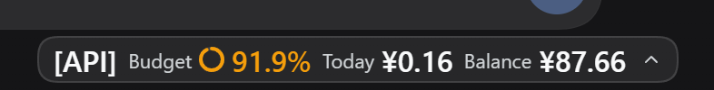
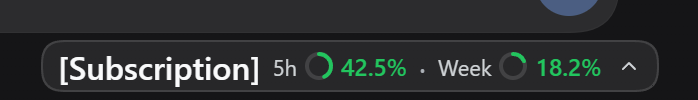
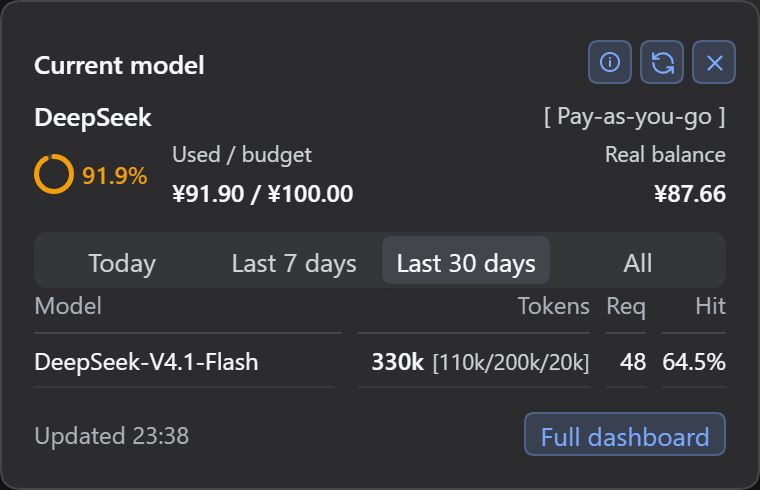
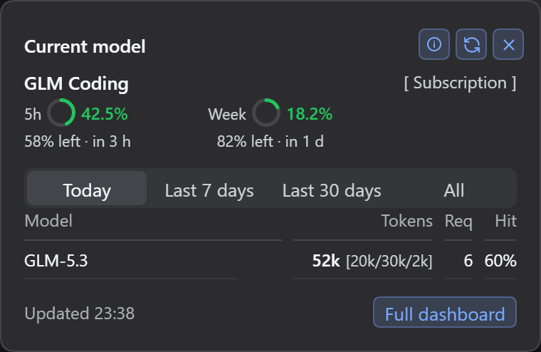
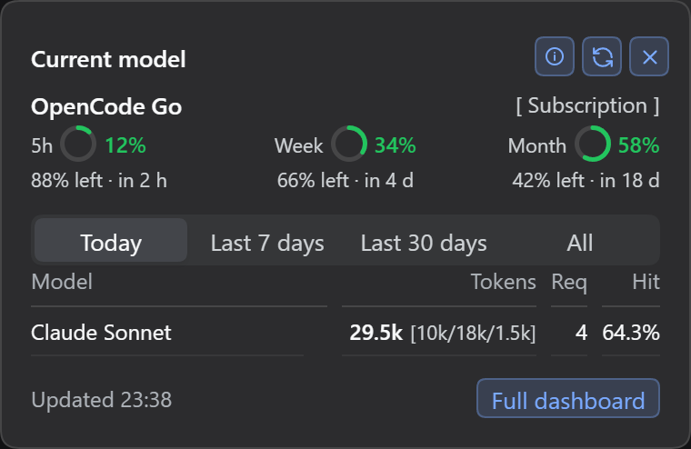
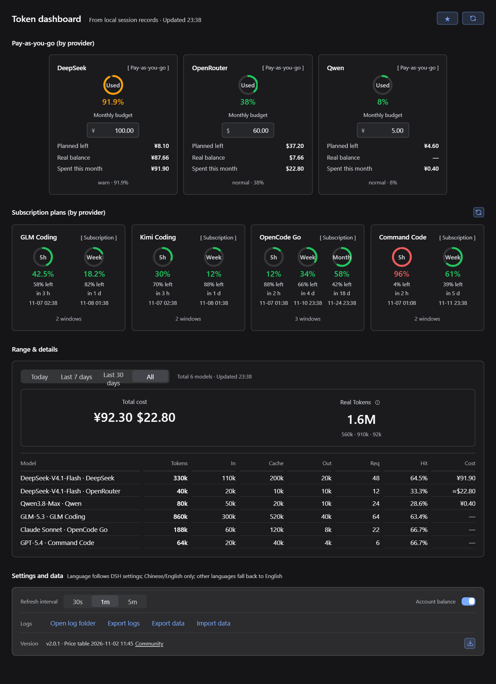

<p align="center">
  
</p>

<h1 align="center">dsh-token-dash</h1>

<p align="center">
  <a href="./README.md">简体中文</a> | English
</p>

<p align="center">
  See today's model spend, monthly budget headroom, and subscription windows for 7 providers right next to the DSH input box.<br />
  Paste a key and the billing mode is detected automatically; cost, Tokens and cache hits are estimated locally;<br />
  export the current month and import it back after switching machines or reinstalling.
</p>

<p align="center">
  <a href="https://github.com/spartawhy117/dsh-token-dash/releases">Latest release</a> ·
  <a href="./CHANGELOG.md">Changelog</a> ·
  <a href="https://github.com/spartawhy117/dsh-token-dash/issues">Feedback</a>
</p>

<p align="center">
  
  
  
  
  <a href="https://awesome-dsh-plugin.com/p/spartawhy117/dsh-token-dash"></a>
</p>

**Three entry points, one local ledger**: the composer-footer-right Pill shows the current model; the floating panel shows budget, balance and the usage table; the full dashboard shows every provider card and model breakdown. No duplicated accounting between pages.

## Provider matrix

| Provider | Billing | Credential | What you get |
|---|---|---|---|
| DeepSeek | Pay-as-you-go | DS account wallet / `DEEPSEEK_API_KEY` | Balance, month-to-date spend, budget |
| Zhipu GLM Coding | Subscription / API | `ZHIPU_API_KEY` / `GLM_API_KEY` / `ZAI_API_KEY` | 5h + weekly windows |
| Kimi Coding | Subscription / API | `KIMI_API_KEY` / `KIMI_CODING_API_KEY`, optional `MOONSHOT_API_KEY` | 5h + weekly/monthly windows; falls back to balance |
| OpenRouter | Pay-as-you-go | `OPENROUTER_API_KEY` | Credits (USD) |
| Qwen | Pay-as-you-go | `DASHSCOPE_API_KEY` (CNY) / `DASHSCOPE_INTL_API_KEY` (USD) | Usage only; balance unsupported |
| OpenCode Go | Subscription | `OPENCODE_GO_API_KEY` | 5h / weekly / monthly windows (USD) |
| Command Code | Subscription | `COMMAND_CODE_API_KEY` + `COMMAND_CODE_ORG_ID` | 5h + weekly windows, credits (CNY) |

- Save keys under the names above in DSH's credential settings; the plugin reads them through the host `credentials` service, not environment variables or local login files.
- Keys are detected automatically; GLM / Kimi / OpenCode Go / Command Code can be re-detected from the dashboard footer.
- Subscription models count toward Tokens but not cost; billing mode is pinned per key instead of following quota flakiness.
- Balance, quota and usage are separate; a balance failure never resets today's Token ledger to zero.

## Interface

Screenshots use mock data so the full layout is visible at once.

**P1 · Composer footer-right Pill**: pay-as-you-go / subscription variants; click to open, click outside, `×` or `Esc` to close.

<p align="center">
  
</p>

<p align="center">
  
</p>

**P2 · Floating panel (current model)**: fixed 380, one row with three groups — used ring / used-budget / real balance — with the balance right-aligned to the panel edge, a full-width range control and the usage table.

<p align="center">
  
</p>

<p align="center">
  
</p>

<p align="center">
  
</p>

- Subscription windows use three slots: first left, second center, third right; two windows occupy the first two slots.
- Model column is capped at 150; Tokens / requests / hit rate are right-aligned.

**P3 · Full dashboard**: cards for 7 providers, summary band, 8-column model breakdown and a settings capsule; the page owns its scrollbar at the window edge.

<p align="center">
  
</p>

- Pay-as-you-go card: budget input, planned balance, real balance, month-to-date spend; subscription card: one ring per window with remaining percentage and countdown.
- Breakdown: model / Tokens / input / cache / output / requests / hit rate / cost; everything except the model column is right-aligned.
- Settings capsule: refresh interval + account-balance toggle; logs, export/import, price table and version below.
- The settings section has an external "Settings and data" title above the capsule; the capsule itself keeps the refresh interval, logs/data controls and version row.
- Spacing uses only 4 / 8 / 12 / 16 / 24 / 32; P2 and P3 share the same tokens.

## Install

Requires DSH `0.2.1` or newer; tested on **DSH 0.2.2-rc.1**. DSH 0.2.2 itself requires Node **24.9+**.

```bash
# Option 1: install from npm (recommended)
dsh plugin --profile desktop add dsh-token-dash

# Option 2: install straight from the GitHub repo (plain JS, no build step)
dsh plugin --profile desktop add github:spartawhy117/dsh-token-dash

# Option 3: download dsh-token-dash-x.y.z.tgz from Releases and install locally (offline)
dsh plugin --profile desktop add /path/to/dsh-token-dash-x.y.z.tgz
```

Update: run `update` with the same name, or use the `⤓` button on the right of “Pricing & version” in settings. Remove: run `remove` with the same name; data stays in `$DSH_HOME/dsh-token-dash/`.

> If the plugin disappears from the profile after a DSH 0.2.2 upgrade, reinstall the same tarball. The ledger and settings are not deleted with the plugin package.

## Compatibility & limitations

- DSH `0.2.1+`; verified on `0.2.2-rc.1`. DSH 0.2.2 is a pre-release and itself requires Node 24.9.
- The UI currently ships Chinese / English only. Other DSH languages (Japanese, German, Russian, etc.) fall back to English.
- After a DSH upgrade the plugin may disappear from the profile; reinstall the same tarball — the ledger is not deleted.
- Qwen tracks usage only; its balance endpoint is unsupported. Other balances/quotas follow what each API returns.
- Upstream APIs are rate-limited; successful results are cached for 60s, failures for 10s, and concurrent requests are coalesced.

## Data & privacy

- Reads only local session `usage` (title-generation overhead excluded); cost and Tokens are local estimates — no billing requests.
- Balances come from official endpoints only; credentials are resolved by the host and are never written to disk or logs.
- Data lives in `$DSH_HOME/dsh-token-dash/`: `daily.json`, `months/`, `prefs.json`.
- Export/import is local: settings + current-month usage, without quotas, balances or logs; the existing files are backed up before an import overwrites them.

## Logs & troubleshooting

Logs live in `$DSH_HOME/logs/dsh-token-dash/` as JSONL; every line carries `prefix: "[TD:<module>]"` and `module`:

```bash
npm run logs -- --tail 50                    # recent 50 lines
npm run logs -- --module adapter.*           # provider detection only
npm run logs -- --module provider,route      # cache / routing issues
```

Common events:

- `[TD:adapter.*]`: `quota.ok` / `quota.fail` / `quota.parse` / `balance.*` / `detect.fail`
- `[TD:provider]`: `probe.miss` (none / hidden / error), `subscriptions.refreshed`, `cache.state`
- `[TD:route]`: `forbidden` (non-loopback), `failed`
- Errors carry `errorKind` (http / timeout / network / parse) and `httpStatus`; 5xx adds `upstream: true`.

## Development

```bash
npm test      # unit tests (80 passing)
npm run e2e   # end-to-end (temp DSH_HOME + web profile + Playwright)
npm run shots       # regenerate the Chinese P1/P2/P3 screenshots in docs/pic
npm run shots -- --en # regenerate the English screenshots in docs/pic/en
npm run pack  # build the release tarball into build/
```

Releases: pushing a `v*` tag triggers the GitHub Release (tarball) and a direct npm publish automatically (Trusted Publishing via OIDC, with provenance); see [docs/release.md](./docs/release.md) for the full checklist.

## Acknowledgements

Attribution and billing semantics learned from these community plugins:

- [dsh-cost-dashboard](https://github.com/mike-lee0120/dsh-cost-dashboard)
- [dsh-token-usage-lao](https://github.com/LaoYueHanNi/dsh-token-usage)
- [dsh-ui-usage-billing](https://github.com/kenz1117/dsh-ui-usage-billing)
- [dsh-spend](https://github.com/nonewind/dsh-spend)
- [dsh-stats-panel](https://github.com/zhang-jiazhi/dsh-stats-panel)
- [DshCockpit](https://github.com/Lxiayu/DshCockpit)
- [shy3130/dsh-quota](https://github.com/shy3130/dsh-quota) (OpenCode Go / cache structure reference)
- [InvisibleSirius/dsh-quota-dashboard](https://github.com/InvisibleSirius/dsh-quota-dashboard) (multi-provider table reference)
