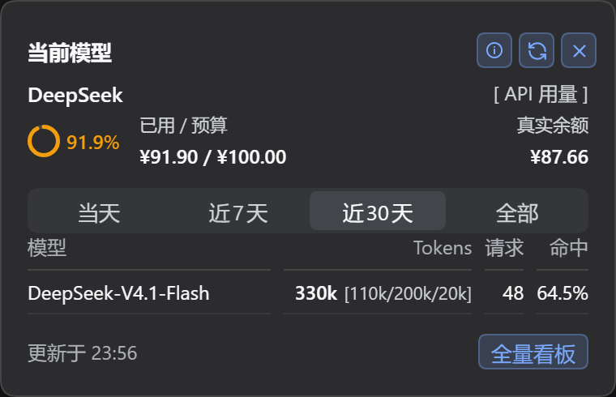
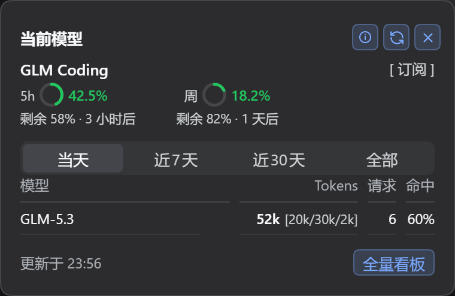
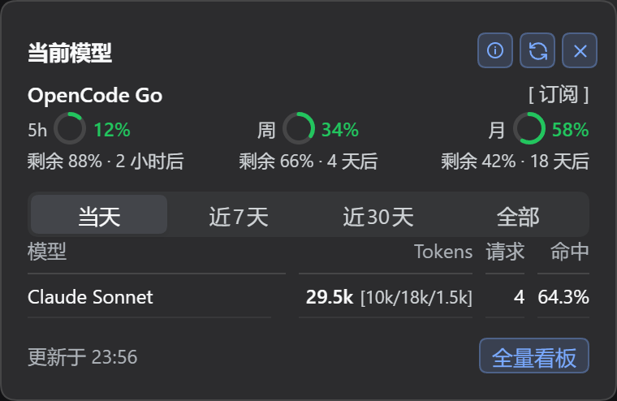
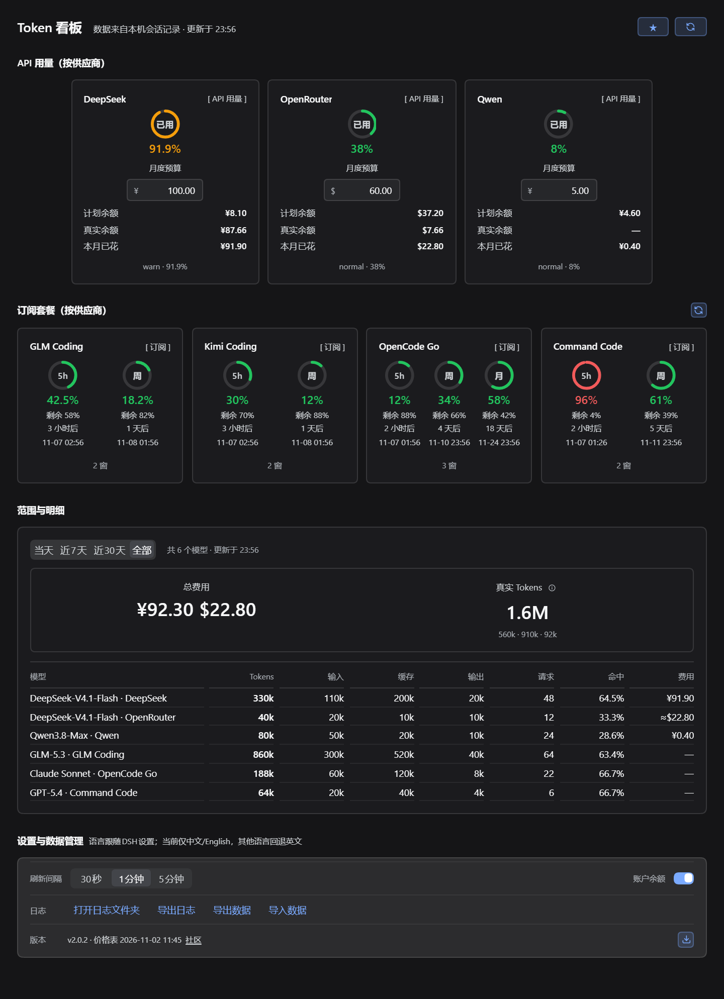

<p align="center">
  
</p>

<h1 align="center">dsh-token-dash</h1>

<p align="center">
  简体中文 | <a href="./README.en.md">English</a>
</p>

<p align="center">
  在 DSH 输入框旁看清今天的模型消耗、本月的预算余量，以及 7 家供应商的订阅窗口。<br />
  填 Key 自动识别订阅或 API 用量；费用、Tokens、缓存命中全部在本地估算；<br />
  当月数据可导出备份，换机或重装后一键导入恢复。
</p>

<p align="center">
  <a href="https://github.com/spartawhy117/dsh-token-dash/releases">最新版本</a> ·
  <a href="./CHANGELOG.md">更新日志</a> ·
  <a href="https://github.com/spartawhy117/dsh-token-dash/issues">问题反馈</a>
</p>

<p align="center">
  
  
  
  
  <a href="https://awesome-dsh-plugin.com/zh/p/spartawhy117/dsh-token-dash"></a>
</p>

**三个入口，一份数据**：输入框底栏右侧 Pill 看当前模型；浮层看预算、余额与用量表；整页看 7 家供应商的全量卡片与模型明细。所有页面共用同一份本地账本，不重复计算。

## 支持矩阵

| 供应商 | 计费形态 | 凭据 | 能看到什么 |
|---|---|---|---|
| DeepSeek | API 用量 | DS 账号钱包 / `DEEPSEEK_API_KEY` | 账户余额、本月已花、预算 |
| Zhipu GLM Coding | 订阅 / API 用量 | `ZHIPU_API_KEY` / `GLM_API_KEY` / `ZAI_API_KEY` | 5h + 周窗口 |
| Kimi Coding | 订阅 / API 用量 | `KIMI_API_KEY` / `KIMI_CODING_API_KEY`，可选 `MOONSHOT_API_KEY` | 5h + 周/月窗口；订阅查询失败可回落余额 |
| OpenRouter | API 用量 | `OPENROUTER_API_KEY` | Credits（USD） |
| Qwen | API 用量 | `DASHSCOPE_API_KEY`（CNY）/ `DASHSCOPE_INTL_API_KEY`（USD） | 仅用量；余额不支持 |
| OpenCode Go | 订阅 | `OPENCODE_GO_API_KEY` | 5h / 周 / 月窗口（USD） |
| Command Code | 订阅 | `COMMAND_CODE_API_KEY` + `COMMAND_CODE_ORG_ID` | 5h + 周窗口、Credits（CNY） |

- 在 DSH 的凭据设置中按上表名称保存 Key；插件只通过宿主 `credentials` 读取，不读环境变量或本机登录文件。
- 填 Key 后自动探测；GLM / Kimi / OpenCode Go / Command Code 可在「全量看板」底部重新检测订阅。
- 订阅模型计入 Tokens，但不计费用；计费形态按 Key 固化，不随配额接口抖动。
- 余额、配额、用量分开展示；余额失败不会把当天的 Token 记账清零。

## 界面

以下截图使用假数据演示，便于一次看到完整效果。

**P1 · 输入框底栏右侧 Pill**：API 用量 / 订阅两种形态，点击展开浮层，点击外部、`×` 或 `Esc` 收起。

<p align="center">
  
</p>

<p align="center">
  
</p>

**P2 · 浮层（当前模型）**：固定 380，单行三组「已用环 / 已用·预算 / 真实余额」，真实余额右对齐到面板右缘；时间范围撑满，下面是用量表。

<p align="center">
  
</p>

<p align="center">
  
</p>

<p align="center">
  
</p>

- 订阅窗口固定三槽位：第 1 窗左、第 2 窗中、第 3 窗右；只有两窗时占前两个槽位。
- 模型列上限 150，Tokens / 请求 / 命中右对齐；长模型名用省略号，悬浮可看全名。

**P3 · 整页看板**：7 家供应商卡片、摘要带、8 列模型明细、底部设置胶囊；页面自己滚动，滚动条贴窗口右缘。

<p align="center">
  
</p>

- API 用量卡：预算输入、计划余额、真实余额、本月已花；订阅卡：每个窗口一个环 + 剩余百分比 + 倒计时。
- 明细表：模型 / Tokens / 输入 / 缓存 / 输出 / 请求 / 命中 / 费用；除模型列外全部右对齐。
- 设置区：胶囊外是「设置与数据管理」区块标题；胶囊内第一行刷新间隔 + 账户余额开关，下面是日志、导出导入、价格表与版本。
- 间距只使用 4 / 8 / 12 / 16 / 24 / 32 六档，P2 / P3 同一套 token。

## 安装

需要 DSH `0.2.1` 或更新版本；已在 **DSH 0.2.2-rc.1** 上验证。DSH 0.2.2 自身要求 Node **24.9+**。

```bash
# 方式一：npm 安装（推荐）
dsh plugin --profile desktop add dsh-token-dash

# 方式二：GitHub 仓库直装（纯 JS 无构建，源码即产物）
dsh plugin --profile desktop add github:spartawhy117/dsh-token-dash

# 方式三：从 Releases 下载 dsh-token-dash-x.y.z.tgz 后本地安装（离线场景）
dsh plugin --profile desktop add /path/to/dsh-token-dash-x.y.z.tgz
```

更新：`update` 同名命令（npm / github: 各自同名），或在插件设置页「价格与版本」右侧的 `⤓` 内完成。卸载：`remove` 同名命令，数据保留在 `$DSH_HOME/dsh-token-dash/`。

> DSH 0.2.2 升级后如果插件从 profile 消失，重装同一个 tarball 即可；账本与设置不随插件包删除。

## 兼容与限制

- DSH `0.2.1+`；已在 `0.2.2-rc.1` 上验证。DSH 0.2.2 是预发布版，且自身要求 Node 24.9。
- 界面语言当前仅中文 / English；选择日语、德语、俄语等其他 DSH 语言时，插件文案显示英文回退。
- 升级 DSH 后插件可能从 profile 消失，重装同一个 tarball 即可，账本不会被删。
- Qwen 只统计用量，余额接口不支持；其余供应商的余额/配额以接口实际返回为准。
- 上游接口有速率限制；成功结果缓存 60s、失败结果缓存 10s，并发请求会合并。

## 数据与隐私

- 只读本地会话 `usage`，不统计标题生成；费用与 Tokens 在本地按价格表估算，不发起计费请求。
- 余额只访问官方接口；凭据经宿主解析，不落盘、不写日志。
- 数据默认在 `$DSH_HOME/dsh-token-dash/`：`daily.json`、`months/`、`prefs.json`。
- 导出 / 导入都在本地完成：导出设置 + 当月使用数据，不含配额、余额与日志；导入覆盖前会备份原文件。

## 日志与排障

日志在 `$DSH_HOME/logs/dsh-token-dash/`，JSONL，每行带 `prefix: "[TD:<module>]"` 与 `module`：

```bash
npm run logs -- --tail 50                    # 最近 50 条
npm run logs -- --module adapter.*           # 只看供应商侦测
npm run logs -- --module provider,route      # 缓存 / 路由异常
```

常见事件：

- `[TD:adapter.*]`：`quota.ok` / `quota.fail` / `quota.parse` / `balance.*` / `detect.fail`
- `[TD:provider]`：`probe.miss`（未配置 / 隐藏 / 失败）、`subscriptions.refreshed`、`cache.state`
- `[TD:route]`：`forbidden`（非回环请求）、`failed`
- 错误带 `errorKind`（http / timeout / network / parse）与 `httpStatus`；5xx 额外 `upstream: true`

## 开发

```bash
npm test      # 单元测试（80 通过）
npm run e2e   # 端到端（临时 DSH_HOME + web profile + Playwright）
npm run shots # 用假数据重新生成 docs/pic 的 P1/P2/P3 截图
npm run pack  # 发布 tarball 生成到 build/
```

发版：推 `v*` tag 自动触发 GitHub Release（tarball）与 npm 直发（Trusted Publishing / OIDC，含 provenance）；完整流程见 [docs/release.md](./docs/release.md)。

## 致谢

归属与计费语义参考了以下社区插件：

- [dsh-cost-dashboard](https://github.com/mike-lee0120/dsh-cost-dashboard)
- [dsh-token-usage-lao](https://github.com/LaoYueHanNi/dsh-token-usage)
- [dsh-ui-usage-billing](https://github.com/kenz1117/dsh-ui-usage-billing)
- [dsh-spend](https://github.com/nonewind/dsh-spend)
- [dsh-stats-panel](https://github.com/zhang-jiazhi/dsh-stats-panel)
- [DshCockpit](https://github.com/Lxiayu/DshCockpit)
- [shy3130/dsh-quota](https://github.com/shy3130/dsh-quota)（OpenCode Go / 缓存结构参考）
- [InvisibleSirius/dsh-quota-dashboard](https://github.com/InvisibleSirius/dsh-quota-dashboard)（多 provider 源表参考）
