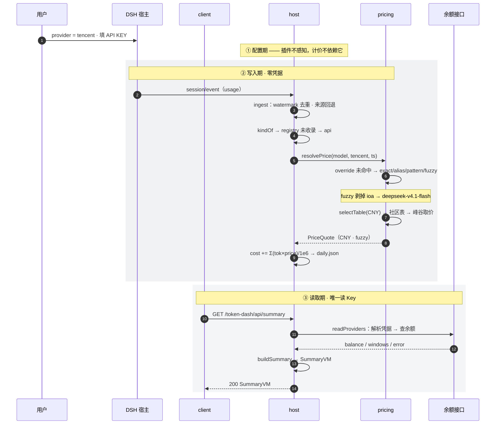
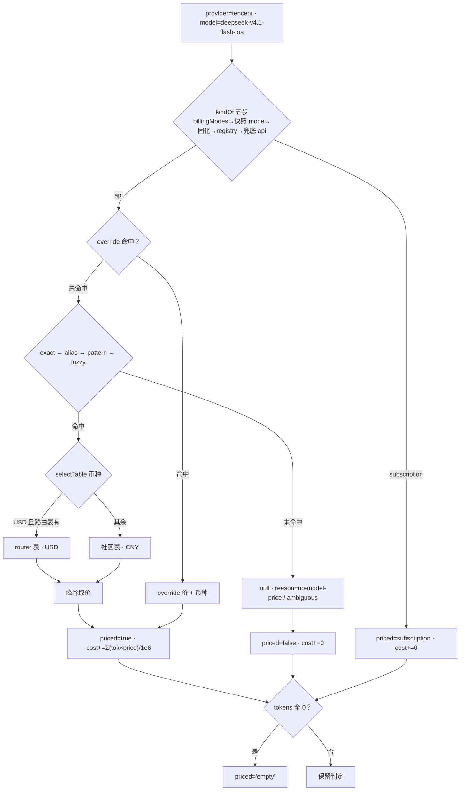
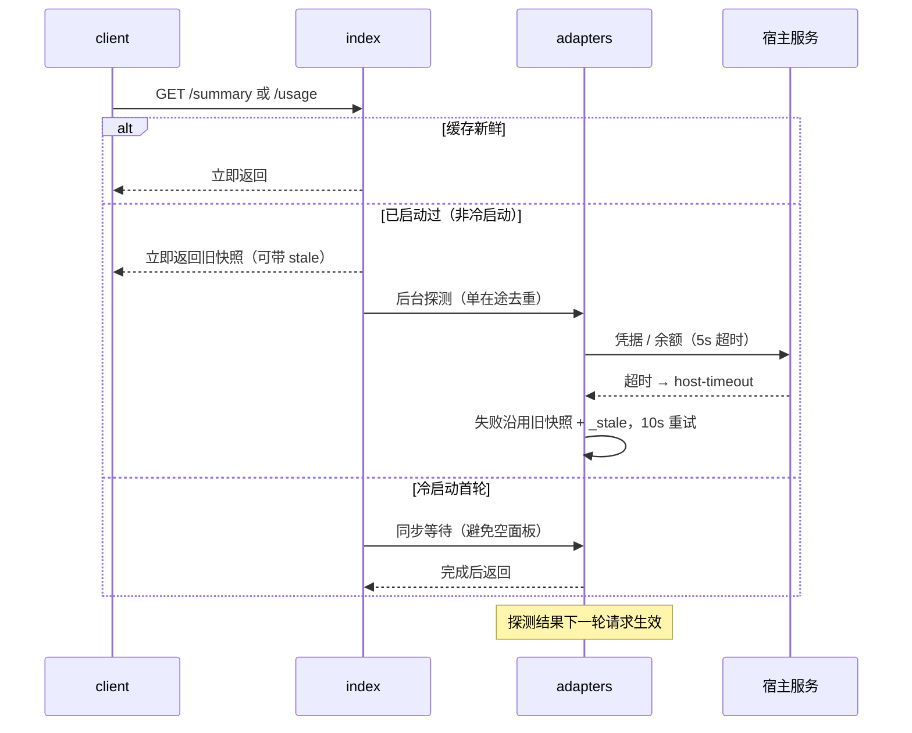
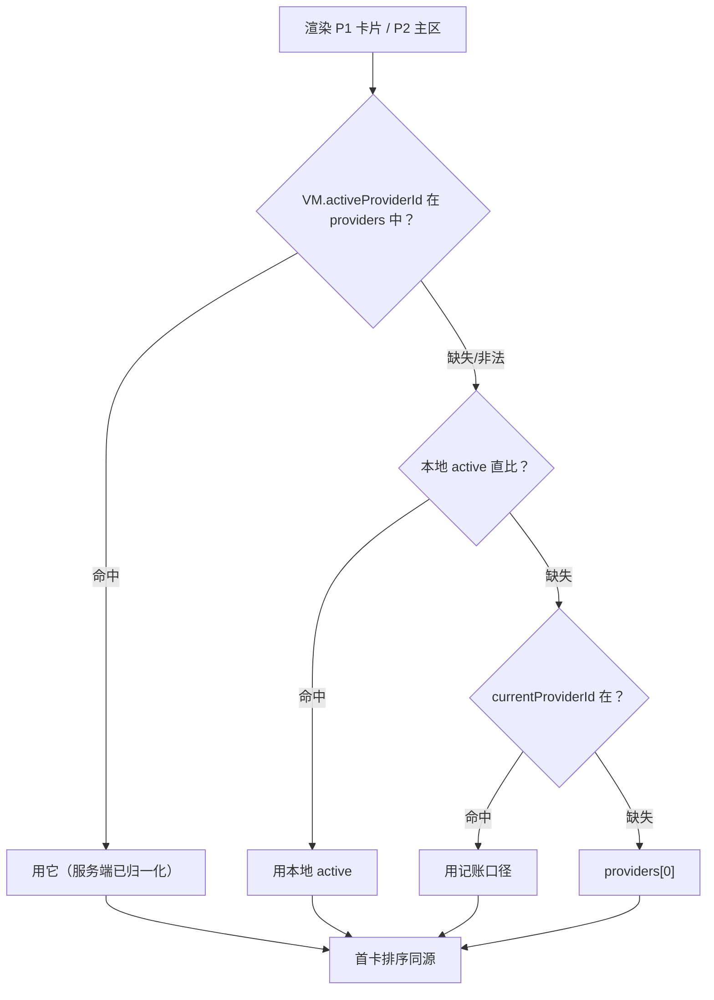

# dsh-token-dash 设计文档

> 面向贡献者的架构说明。全文描述**当前实现**；后续改造在 plan 里写「现状 / 目标」，落地后回填本文。<br>
> UI 视觉以 [UI 设计](ui-design.md) 为唯一真源；需求背景见 [token-dash 计划（已归档）](plan/archived/feature_token_dash.md)。

## 版本历史

| 版本 | 日期 | 主要变更 |
|---|---|---|
| v3.16 | 2026-11-23 | 选卡改为服务端归一化：`SummaryVM` 新增只读 `activeProviderId`，UI 据此选卡而不再自行比对名称；补充别名表归属约束 |
| v3.15 | 2026-11-23 | 新增 §刷新链路与选卡口径：取数与探测解耦（stale-while-revalidate）、宿主调用 5s 超时、失败沿用旧快照标 `stale`、选卡三级回退；`ProviderSnapshot` / `SummaryVM` 新增只读 `stale` |
| v3.14 | 2026-11-20 | 订阅估算 API 价格：`/usage` 的 `models[]` 与 VM 的 `provider.usage` 新增只读估算字段，费用口径不变 |
| v3.13 | 2026-11-16 | P3 四格摘要带与用量趋势柱：`/usage` 新增 `series` / `grain`，摘要带两格 → 四格 |
| v3.9 | 2026-11-10 | 第三方 provider 自适应计价（纯模型名匹配 + 形态/币种声明 + 未定价补算）；确立「只做到 L2」；接入 Ollama |
| v3.6 | 2026-11-10 | 拆出 §两条独立链路：算钱链零凭据、查余额链唯一用 Key，两者只在 `provider` 字符串上交叉 |
| v3.4 | 2026-11-05 | Provider 源表收敛为声明式 `PROVIDER_SOURCES`（7 家 + 每源缓存），新增家只加表行 |
| v3.3 | 2026-11-04 | 补 §client.js 组件分层：几何 / 文本 / 组合 / 页面四层与公共函数 |
| v3.1 | 2026-11-04 | P2/P3 重构：看板整页化、浮层收敛为「当前模型」 |
| v3.0 | 2026-11-02 | 余额语义改为账户真实余额、预算不渲染进度条；P3 走宿主全局面板 |

## 设计目标

**一句话**：在 DSH 本地、零凭据前提下，把「用了多少」记准，把「大概多少钱」估出来——不追账单级精确。

| 层 | 目标 |
|---|---|
| L0 记录 | 任意 provider 的 token 都入账，不要求 provider 已知 |
| L1 估算 | 任意模型名可出价，或明确「未定价」并给出原因 |
| L2 纠偏 | 形态与币种可声明，未定价可见、可补算 |

**非目标**：不做厂商识别（不读 `baseURL` / 域名 / 宿主配置）；不承诺金额等于账单；不做通用 custom 数据源；不做 provider 插件化（不拆 per-provider 文件、不引入 DI）。

**达成的判据**：① 要么出价（带置信度）要么明确未定价，不静默 ¥0；② 币种可一句话改对；③ 订阅不把套餐算成按量；④ 金额处处标为估算。

> 全文描述**当前实现**；后续改造在 plan 里写「现状 / 目标」，落地后回填本文。

## 总体架构

```text
DSH 宿主（Electron / web）
├─ host 端（index.js，Node）     采集 · 归属 · 聚合 · 侦测 · 路由 · 日志
└─ client 端（client.js，浏览器）  P1 Pill · P2 浮层 · P3 整页

两端只通过 /token-dash/api/* 通信：
  client ──GET /summary · /usage──────────→ host
  client ──POST /prefs · /log · /refresh──→ host
```

- **host 只做数据**，无 UI；**client 只做展示**，无业务计算。
- **边界**：adapter 只输出 `ProviderSnapshot`；VM 只输出 `SummaryVM`；UI 只消费 VM，不知道 provider id 与价格页 URL。

## 两条独立链路（先读这一节）

| 链路 | 回答什么 | 输入 | 用 Key | 模块 |
|---|---|---|---|---|
| **A · 算钱** | 今天花了多少？ | 宿主事件的 `provider/model/tokens` | **否** | `collect → core → pricing` |
| **B · 查余额** | 还剩多少？配额用了几成？ | provider 的 API KEY | **是** | `quota-sources → adapters` |

**Key 只决定链路 B 能不能跑，不改变链路 A**。三个时相：

| 时相 | 触发 | 用 Key | 做什么 |
|---|---|---|---|
| ① 配置 | 用户填 provider / Key | — | 宿主存配置，**插件不感知**（无凭据变更钩子） |
| ② 写入 | 宿主 `session/event` | 否 | 记账 + 算钱，落 `daily.json` |
| ③ 读取 | `GET /summary` · `POST /providers/refresh` | **是** | 取快照 → 组装 VM → 返回浏览器 |

### 处理流程（`tencent` 实例）



### 识别分支（输入 → 结果）



读法：先 `kindOf` 定形态（`subscription` 短路），再按 override → 四级匹配 → 选表短路；未命中记未定价并带 `reason`，最后统一做一次 `tokens==0 → 'empty'` 覆盖。

| 约束 | 规则 |
|---|---|
| 形态 | 只认 `billingModes` / 快照 `mode` / 固化值 / registry；**不读 `meta.kind`**，无 `unknown` 态 |
| 计价 | 只比模型名；provider 只用于选表与形态判定 |
| 币种 | `prefs.providerCurrency` → 快照 → registry；只选表 / 声明，**不换算** |
| 币种不匹配 | 报价币种 ≠ provider 币种 → 未定价（`currency-mismatch`），不写 `cost` |
| 未定价 | 留 `reason` 进 VM；启动自动补算，已计价行不动 |

**关键结论**：模型名来自宿主事件，**不从 API KEY 解析**；插件不请求模型、不数 token。这是自建 provider（如 `tencent`）零配置即可计价的原因。

## 刷新链路与选卡口径（v3.16）

链路 B 的读取侧：**用户改一个东西，界面多久能看到**。三个入口共用一条取数链，延迟来自不同层叠加；选卡口径决定「看到的是谁的卡」。

| 入口 | 轮询 | 关键约束 |
|---|---|---|
| P1 收起 | 30s | 用户不看时可放宽 |
| P1 / P2 展开 | 10s + 手动刷新 | 需及时反映余额与配额 |
| P2 范围用量 | 随面板 10s | 只拉当前 range |

### 取数：stale-while-revalidate

**改动前**：缓存过期即同步等探测，任一请求都排这一轮探测之后（实测 6 个请求同毫秒返回，等 9.6s）。

**改动后**：过期先回旧数据，探测转后台。



要点：**接口响应时间与探测耗时解耦**；宿主调用有 5s 上界；失败不清空卡片。

- **去重**：单在途 promise，并发请求共用同一次等待。
- **失败不清快照**：探测 null/异常且有旧值 → 沿用 + `_stale`，10s 重试；无旧值才落 `:none` / `:error`。

### 选卡：服务端归一化后回显

独立于取数的另一个问题：**卡片按哪个 provider 渲染**。

关键约束：宿主上报的是**路由名**（如 `deepseek-account`），而 `providers[].id` 是**内部 id**（`deepseek-official`），两者不一定同字。UI 不认识 provider 别名（设计边界），故由**服务端归一化后经 VM 回显**。



读法：**归一化在服务端完成**（`normalizeProvider`），UI 只做 id 查找；本地直比保留为兜底，不为 UI 引入别名知识。

| 来源 | 何时更新 | 说明 |
|---|---|---|
| `activeProviderId`（VM 回显） | 每次 `/summary` | 服务端把 `?active=` 归一化后的结果，**首选** |
| `active`（投影 `modelSelection`） | 切换即刻 | 本地直比，仅在同字时命中 |
| `state.currentProvider` | **发下一条消息记账时** | 切完不发消息就是旧值，仅兜底 |

- **记账口径不被覆盖**：回退链只影响 VM 输出与排序，**不写回** `state.currentProvider`，不落盘。
- **别名表归属**：`normalizeProvider`（`src/providers.js`）是唯一别名真源；新增 provider 时须同步，否则路由名与内部 id 不同字会回落记账口径。

## 数据流

- **三层归属**：`message.source`（权威）→ `request/header` 会话状态（回退）→ 模型名前缀（视图兜底）；第三层只在 VM 归因，不改 `daily.json`。
- **去重**：`ingest` 按 `event.seq` + `watermarks` 幂等；`backfill` 与实时共用同一 `ingest`。
- **缓存**：`readProviders` 按源缓存（成功 60s / 失败 10s / in-flight 复用），`429` 按 `Retry-After` 退避；读取侧的 5s 判定与后台探测见 §刷新链路与选卡口径。
- **不重算**：`buildSummary` 的 `cost` 全部来自 `daily.json`；快照只提供 `balance` / `windows` / `currency` / `kind`，**不参与金额计算**。
- **冷启动**：`backfill` 与实时 ingest 以 `pricingReady`（≤5s）为计价基线，超时降级并记 `pricing.ready`。

## 数据备份（P3 导出 / 导入）

```text
GET /export → buildExport = { schema, exportedAt, month, prefs, providerKinds, days, usage }
POST /import → validateBundle → 备份 prefs/daily 为 *.import-backup-<ts>
             → prefs 覆盖 · 当月 days 覆盖 · providerKinds 合并 → providerCache 失效
```

只带设置与当月使用；订阅窗口 / 余额 / 日志 / 价目不进包。单 JSON 文件、不打包 zip——当月不足 500KB，压缩收益低于实现与失败成本，且能靠 `schema` / `month` 整包校验。

## Provider / VM / UI 边界

```text
ProviderDescriptor（静态，providers.js）
  id / label / currency / subscription / defaultModel / prefixes / modelLabels / pricingUrl

ProviderSnapshot（adapters → VM 的唯一 DTO）
  id / name / kind / mode / currency / status / balance / windows[] / error / quotaError / fetchedAt / stale?

SummaryVM（core → client 的唯一 DTO）
  providers[] / breakdown.models[] / today / month / cost / apiTotals
  currentProviderId / activeProviderId / pricingLinks[] / version / refreshMs
  providers[].currencySource / providers[].stale
```

- **Adapters**：外部请求、解析、错误分类；出口经 `toSnapshot` 归一，不把 `plans` / `_error` 带进 VM。
- **VM**：纯聚合、不做 IO；`windows` 长度 0–3，缺窗不补占位。
- **UI**：只读 `SummaryVM`；按 `kind` / `status` / `currency` 渲染，不出现 provider id、价格页 URL。
- **响应当前选择**：slot 的 `useProjection(key)` 是宿主提供的**响应式订阅**（`ProjectionValueStore.faceOf`），`modelSelection` 变化会触发重渲染——无需另建订阅通道，但**必须自己消费 `active`**，否则退回记账口径。
- **页面入口**：P3 走宿主全局面板——`slots.inject('main')` 注册整页，`sidebar.panellist` 注册同 `id` 侧栏行。
- **P1 槽位**：只挂 `conversation.composer.dock`；不占 `conversation.hero.agentPreset`。

## Provider 源表（v3.4）

> 当前 8 家：DeepSeek / GLM / Kimi / OpenRouter / Qwen / OpenCode Go / Command Code / Ollama。前 5 家用 `legacy` 保留既有特例；后 3 家由声明式 `credential + quota + usage? + preflight?` 驱动。
> **`deriveKeyRef` 只适用于自定义 route**。内置 route 凭据名由 pi-ai 写死：`opencode` 与 `opencode-go` 都读 `OPENCODE_API_KEY`，故 OpenCode Go 声明 `refs: ['OPENCODE_API_KEY', 'OPENCODE_GO_API_KEY']`（主名跟随生态、旧名兜底）。

```text
readProviders(ctx, prefs, cache)
  → for (源 of PROVIDER_SOURCES)
      旧源: legacy(ctx, prefs)
      新源: resolveCredential → preflight? → fetch(quota.url | fallbackUrl)
  → parse → normalizeWindows（0–3、夹取、缺窗不补）
  → usage 钩子可选：失败只记日志，不影响余额
  → toSnapshot → ProviderSnapshot[]
  → 每源缓存 60s / 10s + in-flight；429 复用旧快照并按 Retry-After 退避
```

| 约束 | 定义 |
|---|---|
| 源表形状 | `{ id, kind, currency, legacy?, credential?, quota?, usage?, preflight? }` |
| 凭据 | 只支持 `bearer` 与 `oauth-reuse`；统一走宿主 `credentials.resolve`，不做 Cookie、不读本机文件 |
| 窗口 | 长度 0–3，`key ∈ 5h/week/month/session`，`usedPercent ∈ [0,100]` |
| 新增一家 | 源表 1 行 + `parse` + 1 份 fixture |
| 错误 | `unconfigured` 不算刷新失败；5xx 带 `upstream`；401→`unconfigured`、429 保留旧值、其余→`error` |

## 第三方接入与扩展边界

| 判据 | 要求 |
|---|---|
| 端点 | 官方 API、Bearer 或宿主 OAuth；Cookie 型仅强需求时接入 |
| 文档 | 响应字段可从官方文档或实机验证，不靠猜 |
| 稳定性 | 有版本或 fallback；失败降级为「查询失败」，不误报 |

**接入顺序**：① 先定形态（纯额度 / 纯按量 / 混合）；② 只做额度→只动 `PROVIDER_SOURCES`，只做计价→只动计价链；③ 两者都要 → 拆两个 feature。

## 路由与鉴权

| 项 | 规则 |
|---|---|
| 挂载 | `webServer.register({ kind:'prefix', path:'/token-dash/api' })` |
| 鉴权 | 回环放行；非回环走 `connection.requestRejection` 或校验 `remoteAddress + host + origin`，失败 403 |
| 脱敏 | 错误响应只返回 `reason`，不含上游 body / Key |
| `/usage` DTO | `{ range, startAt, endAt, totals, total, models, series, grain }`；订阅行额外带 `estimatedCost` / `estimatedPriced` |
| `/update` | `{ current, latest, hasUpdate, published, source }`；`?refresh=1` 跳过 5min 缓存 |
| `/log` 白名单 | 只接受 `CLIENT_LOG_MODULES` 内模块 |
| 更新检测 | 启动 30s 后无条件检测；运行中每 4h；恢复可见且距上次 ≥4h 补检 |

## 文件目录组织

```text
index.js         host 入口：服务注册、路由、更新、日志接线
client.js        client bundle：Pill / Panel / BoardPage / 公共组件
src/
  core.js        纯聚合：buildSummary、addRecord、口径、排序、预算
  collect.js     事件采集：recordFromEvent / ingest / backfill
  adapters.js    供应商侦测 + toSnapshot 边界 + 事件日志映射
  quota-sources.js 声明式源表、端点与解析
  providers.js   provider registry：别名/币种/默认模型/价格页
  catalog.js     价目归一 → CatalogEntry（预编译正则、去重）
  match.js       模型名四级解析（纯函数）
  pricing.js     override + 选表 + 峰谷 + 置信度
  catalog.json   内置价目（随包发布）
  backup.js      导出/导入（纯函数）
  store.js       持久化：daily/prefs 原子写、flusher
  diagnostics.js 日志器（JSONL、脱敏、轮转）
locale/          zh.json / en.json
scripts/e2e.mjs  端到端测试（Playwright）
test/unit/       L1 单元测试
docs/            本目录
```

## client.js 组件分层

| 层 | 组件 | 职责 |
|---|---|---|
| 几何 | `ProgressRing` | 弧长、描边、尺寸 |
| 文本 | `PercentValue` | 数值 → 百分比文本 |
| 组合 | `InlineRing` | 环 + 右侧数字（P1 / P2） |
| 组合 | `QuotaGauge` | 环心标签 + 三行辅助（P3） |
| 页面 | `Pill` / `Panel` / `BoardPage` | 布局、取数、交互 |

公共函数 `stateOf` / `percentText` 三页共用；视觉契约见 [`ui-design.md`](ui-design.md)。

## 模块职责速查

| 模块 | 职责 | 不做 |
|---|---|---|
| core | VM 聚合、口径、排序、预算；入账先判 `kind` | IO / 读时钟 / **凭据** |
| collect | 事件提取与归属、水位去重、回填 | 落盘 / **凭据** |
| adapters | 外部请求与解析、错误分类、`toSnapshot`、**唯一解析凭据** | UI / 计价匹配 |
| providers | descriptor registry、`kind` 兜底 | IO / 请求 / **凭据** |
| catalog | 价目归一 | IO / 匹配 / 认识 provider |
| match | 四级模型名解析 | IO / 认识 provider |
| pricing | override、选表、峰谷、置信度 | **凭据** / 厂商识别 |
| backup | 导出构建、导入校验 | IO / 渲染 |
| store | 文件读写与原子性 | 业务逻辑 |
| client | 渲染与交互 | 业务计算 / 硬编码 provider |
| index | 路由、探测调度（stale-while-revalidate） | VM 计算 / 解析凭据 |

> **凭据边界**：只有 `adapters` 经 `ctx.credentials.resolve` 取 Key，且仅用于链路 B。链路 A 全程零凭据——这是自建 provider 零配置可计价的前提。

## 日志体系

- **文件**：`$DSH_HOME/logs/dsh-token-dash/`，JSONL；每行带 `module` 与 `prefix: "[TD:<module>]"`，分类以 `module` 为准。
- **模块**：`boot / slot / pricing / collect / vm / provider / update / diag / route / data` + `adapter.*`。
- **事件**：`adapter.*` 的 `quota.ok / quota.fail / balance.* / detect.fail`；`provider.slow / cache.state / kind.stamp`；`route.forbidden`。
- **错误分类**：`errorKind`（http / timeout / network / parse / **host-timeout**）+ `httpStatus`；`host-timeout` 指宿主服务调用超 5000ms。
- **归因**：`provider.slow` 带 `slowest`；`vm build/usage` 带 `probe` 模式（`fresh` / `bootstrap` / `background`）。
- **脱敏**：不记 Key / orgId / 对话内容 / 响应体。

## 关键设计决策（摘要）

1. **严格本月口径**：费用/用量/预算按当月；「配置即可见」兜底（无消耗时补默认模型行）。
2. **三层模型归属**：兼容无 source 标注的历史数据，不迁移 `daily.json`。
3. **余额语义**：余额 = 账户真实余额；预算用「已用 / 计划余额」表达，不渲染进度条。
4. **纯 JS 无构建**：源码即产物；npm 发布由 `files` 控制。
5. **只读本地数据**：不统计标题生成、不发起计费请求、凭据不落盘。
6. **Provider 边界收口**：adapter→Snapshot、VM→SummaryVM、UI 只消费 VM；provider 差异不扩散。
7. **不做 provider 插件系统**：单文件源表 + 四个可选钩子，避免过度抽象。
8. **配置面收口**：`prefs` = `budgets` / `billingModes` / `refreshMs` / `showBalance` / `priceOverrides` / `providerCurrency`。
9. **整页入口走宿主管局面板**：`main` + `sidebar.panellist` 同 key 注册，浮层只留当前模型。
10. **仓库入口是静态链接**：不请求 `/repo`、不展示 star。
11. **取数收敛成源表**：新增家只加表行与解析钩子，`adapters.js` 不新增 provider if 分支。
12. **不做 Cookie / 本机登录态**：凭据会过期或越界读用户目录。
13. **升级不迁移数据**：账本与设置独立于 profile；跨机走导出 / 导入。
14. **P3 自持滚动与 4px 间距**：间距只用 4 / 8 / 12 / 16 / 24 / 32。
15. **DSH 0.2.2 兼容基线**：验证过 `slots / layout / webServer / sessionPersistence / credentials`。
16. **两条独立链路**：算钱链零凭据，查余额链唯一用 Key；只在 `provider` 字符串上交叉（见 §两条独立链路）。
17. **只做到 L2**：记录 + 估算 + 纠偏，不承诺账单级精确。
18. **第三方 provider 按 feature 接入**：先定形态，两者都要时拆两个 feature。
19. **取数与探测解耦**（v3.15）：`/summary`、`/usage` 走 stale-while-revalidate，探测转后台；宿主调用 5000ms 超时；失败沿用旧快照并标 `stale`。理由：探测耗时不可控（实测 9~30s），让它阻塞读接口会把「数据慢」放大成「界面卡」。
20. **选卡在服务端归一化**（v3.16）：宿主上报的是路由名，与 `providers[].id` 不一定同字；由 `pick()` 经 `normalizeProvider` 归一化后回显为 VM 的 `activeProviderId`，UI 直接消费、不承担别名知识；回退顺序 activeProviderId → 本地 active → 记账口径 → 首卡，**首卡排序同源**，不写回状态、不落盘。
