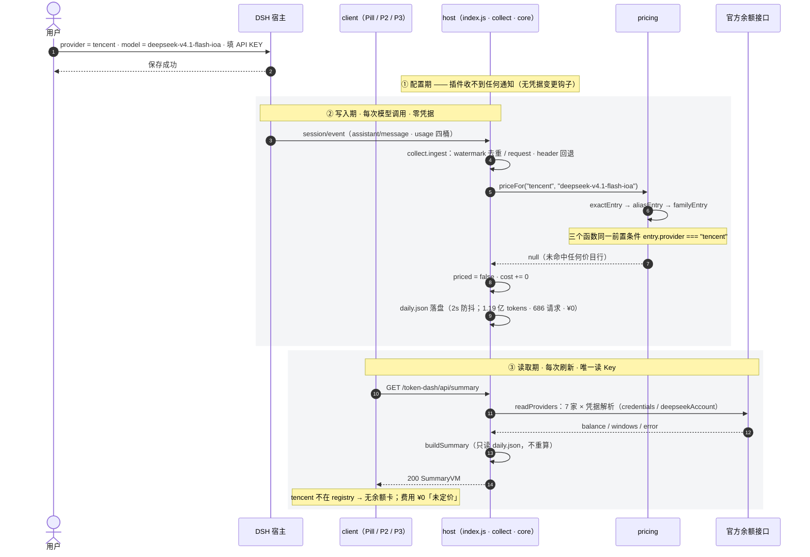
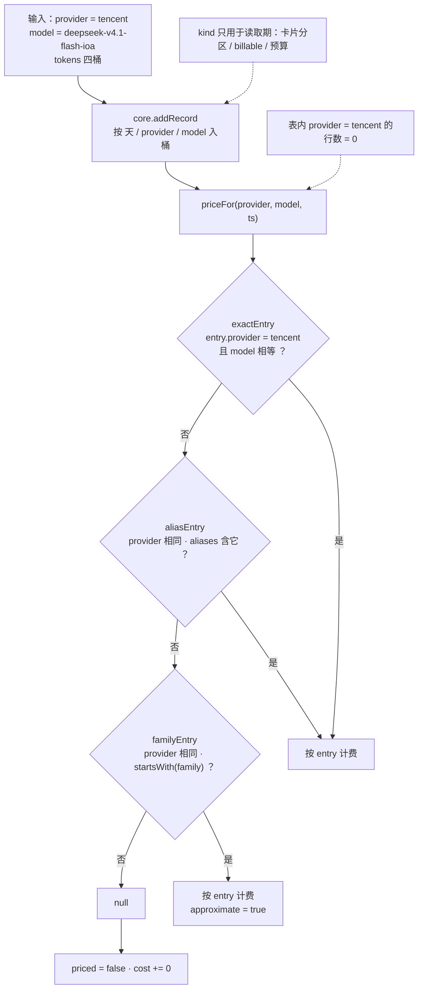
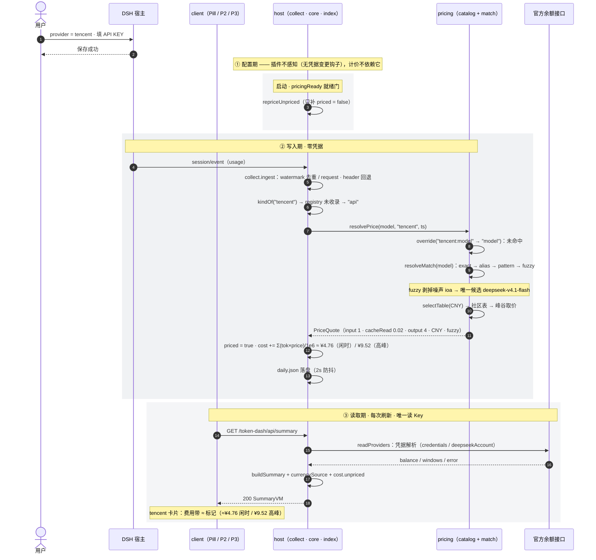
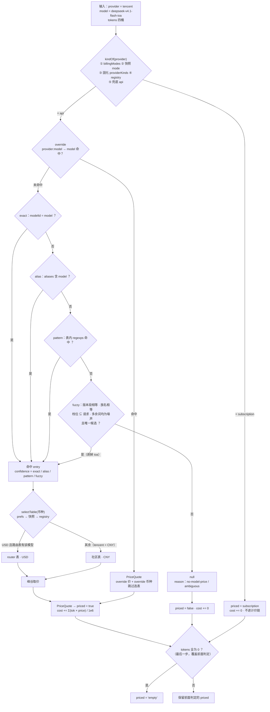

# dsh-token-dash 设计文档

> 更新时间：2026-11-10（v3.9，新增「设计目标」：L0 记录 / L1 估算 / L2 纠偏，明确非目标；接入门槛与顺序收进「第三方接入与扩展边界」）<br>
> 面向贡献者的一页式架构说明。需求背景见 [token-dash 计划（已归档）](plan/archived/feature_token_dash.md)，已归档的 UI 迭代见 [UI 迭代计划](plan/archived/feature_ui_refresh.md)；Provider/VM/UI 边界收口见 [边界计划](plan/archived/feature_provider_boundary.md)；UI 视觉以 [UI 设计](ui-design.md) 为唯一真源。

## 设计目标

**一句话**：在 DSH 本地、零凭据的前提下，把「用了多少」记准，把「大概多少钱」估出来——不追账单级精确。

| 层 | 目标 | 状态 |
|---|---|---|
| L0 记录 | 任意 provider 的 token 都入账，不要求 provider 已知 | 已具备 |
| L1 估算 | 任意模型名可出价，或明确「未定价」并给出原因 | 目标 |
| L2 纠偏 | 形态与币种可声明，未定价可见、可补算 | 目标 |

**非目标**（明确不做，避免反复讨论）：

- **不做厂商识别**：不读 `baseURL`、不做域名指纹、不做网络探测、不读宿主配置与本机登录态；
- **不承诺金额等于渠道账单**：价格来自社区价目表，展示处标注为估算；
- **不做通用 custom 数据源**：新 provider 一家一个 feature 接入（门槛与顺序见 §第三方接入与扩展边界）；
- **不做 provider 插件化**：不拆 per-provider 文件、不引入 DI。

**目标达成的判据**：

1. 任意 provider + 任意模型：要么出价（带置信度），要么明确「未定价」并可补价，不静默 ¥0；
2. 币种可一句话改对，不出现系统性数量级偏差；
3. 订阅类 provider 不把套餐算成按量费用；
4. 金额处处标为估算，用户不会误当账单。

> **阅读约定**：未标注的段落描述**当前实现**（总体架构 / 数据流 / 源表 / 目录 / 日志）；标「现状」「目标」的小节分别对应当前实现与改造后形态。

## 总体架构

插件分为两端，随 DSH 宿主进程加载：

```text
┌──────────────────────────── DSH 宿主（Electron / web）────────────────────────────┐
│                                                                                    │
│  host 端（index.js，Node 环境）                client 端（client.js，浏览器环境）   │
│  ┌──────────────────────────────┐             ┌────────────────────────────────┐  │
│  │ 会话事件监听 session/event     │             │ P1 底栏 Pill（两槽位）          │  │
│  │ → collect.ingest 来源归属       │   /summary   │ P2 浮层 / P3 整页              │  │
│  │ → daily.json（本地存储）        │ ──────────→ │ fetch 轮询（refreshMs 可配）    │  │
│  │ readProviders → Snapshot      │ ←────────── │ POST /prefs /log /refresh …    │  │
│  │ buildSummary(state, prefs,    │             └────────────────────────────────┘  │
│  │   now, snapshots) → VM        │                                             │
│  │ providerRegistry（元数据）     │                                             │
│  │ web 路由 /token-dash/api/*    │                                             │
│  └──────────────────────────────┘                                             │
└────────────────────────────────────────────────────────────────────────────────────┘
```

- **host 端**只做数据：采集、归属、聚合、侦测、路由、日志；无 UI。
- **client 端**只做展示：Pill 常驻 + P2 浮层（当前模型）+ P3 整页（全量），无业务计算。
- **provider 边界**：adapter 只输出 `ProviderSnapshot`；VM 只输出 `SummaryVM`；UI 只消费 VM，不知道 provider id / 价格页 URL。
- 两端只通过 `/token-dash/api/*` HTTP 前缀路由通信。

## 两条独立链路（先读这一节）

插件里有两件互不相关的事，**不要把它们当成同一条链**：

| 链路 | 回答什么 | 输入 | 是否用 API KEY | 模块 |
|---|---|---|---|---|
| **A · 算钱** | 今天花了多少？ | 宿主事件里的 `provider` / `model` / `tokens` | **否** | `collect` → `core` → `pricing` |
| **B · 查余额** | 账户还剩多少？订阅配额用了几成？ | provider 的 API KEY | **是** | `quota-sources` → `adapters` |

把「用户填了一个 API KEY」当起点最容易看懂：**Key 只决定链路 B 能不能跑，不改变链路 A**。整件事发生在三个时相：

| 时相 | 触发源 | 频率 | 用 Key | 一句话 |
|---|---|---|---|---|
| ① 配置 | 用户填 provider / Key | 一次性、随时 | — | 宿主存配置；**插件不感知**（没有凭据变更钩子） |
| ② 写入 | 宿主 `session/event` | 每次模型调用 | 否 | 记账 + 算钱，落 `daily.json` |
| ③ 读取 | `GET /summary`、`POST /providers/refresh` | 每次刷新（≥5s；源级 60s / 10s） | **是** | 取快照 → 组装 VM → 返回浏览器 |

> 下面每组图分两层：**时序图**（arc42 §6 Runtime view 的推荐形式；实线 `->>` 调用、虚线 `-->>` 返回，`rect` 底色区分时相）回答「谁在什么时候调谁、返回什么」；**识别分支树**回答「一条输入走哪条分支」。现状一组、目标一组。

### 现状 · 处理流程（`tencent` 实例）



读法：实线是调用、虚线是返回。写入期的三次匹配共用同一前置条件 `entry.provider === "tencent"`，表内没有该 provider 的行，返回 `null`，该行记为未定价；读取期只覆盖 registry 的 7 家，`tencent` 不在其中，余额与配额为空。

**识别分支树**



读法：先按 `entry.provider` 过滤，再比模型名；三处条件的 provider 部分相同，表内没有该 provider 的行，结果落到 `null`，该行记为未定价。

### 目标 · 处理流程（`tencent` 实例）



读法：`kind` 由五步优先级判定，`tencent` 不在 registry，落在兜底 `api`，首次调用即可计价；`resolvePrice` 先查 override、再只拿模型名匹配，`deepseek-v4.1-flash-ioa` 经 fuzzy 剥掉 `ioa` 命中 `deepseek-v4.1-flash`，币种非 USD 走社区表。读取期照旧只读 `daily.json` 组装 VM，并在 VM 里带上 `currencySource` 与未定价清单。

**识别分支树**



读法：先由 `kindOf` 五步定形态（`subscription` 短路），再按 override → 四级模型名匹配 → 选表的顺序短路；未命中记未定价并带 `reason`。三个出口最后统一做一次 `tokens == 0 ? 'empty' : 保留` 的覆盖。

**目标新增的约束**：

| 项 | 规则 |
|---|---|
| 形态 | `kind` 只认 `billingModes` / 快照 `mode` / 固化值 / registry；**不读 `meta.kind`**，不引入 `unknown` 态 |
| 计价 | 只比模型名；provider 只用于选表与形态判定（`BND-01`） |
| 币种 | `prefs.providerCurrency` → 快照 → registry；只选表 / 声明，不换算（`BND-10`） |
| 未定价 | 留 `reason` 进 VM；启动自动补算，已计价行不动（`REQ-09`） |

**两条链路只在 `provider` 这个字符串上交叉**：链路 A 用它选币种与判形态，链路 B 用它查余额接口。职责完全不同。

**关键结论**：模型名来自宿主事件，**不是从 API KEY 解析出来的**；插件不请求模型、不数 token。这就是自建 provider（如 `tencent`）无需任何配置即可被记录的原因——宿主已经知道是谁、用了多少，插件只需要回答"这个模型名值多少钱"。

## 数据流

### 图上放不下的约束

- **三层归属**（链路 A）：`message.source`（权威）→ `request/header` 会话状态（回退）→ 模型名前缀（视图层兜底）；第三层只在 VM 归因，不改 `daily.json`。
- **去重**：`ingest` 按 `event.seq` + `watermarks` 幂等；`backfill` 与实时共用同一 `ingest`，`seedLength` 之前的事件跳过。
- **缓存**：`readProviders` 按源缓存（成功 60s / 失败 10s / in-flight 复用）；`/summary` 另有 5s 最小刷新间隔。
- **不重算**：`buildSummary` 的 `cost` 全部来自 `daily.json`；快照只提供 `balance` / `windows` / `currency` / `kind`，**不参与任何金额计算**。
- **重新检测**：`readSubscriptions` 走同一 snapshot 出口，只查配额不查余额。
- **冷启动**：`backfill` 等待 `pricingReady`（≤5s）后计价；实时 ingest 的同一等待门属目标态（见 §目标 · 处理流程）。
- **P3 页头 ★**：静态 `REPO_URL` 链接；不请求 `/repo`，不展示 star 计数。

## 数据备份（P3 导出 / 导入）

```text
GET /export
  → buildExport(state, prefs, now, snapshots)（src/backup.js）
      = { schema, exportedAt, month, prefs, providerKinds, days(当月), usage(四范围派生) }
  → 浏览器下载 dsh-token-dash-YYYY-MM.json

POST /import
  → validateBundle（schema / month / days 形状，整包校验）
  → 备份 prefs.json / daily.json 为 *.import-backup-<ts>
  → prefs 覆盖（经 normalizePrefs）、当月 days 覆盖、providerKinds 合并
  → providerCache 失效，下次请求重新侦测
```

导出只带设置与当月使用数据；订阅窗口 / 余额 / 日志 / 社区价目不进包（可由 API 或启动流程复得）。派生 `usage` 与 P2 时间选择同口径，仅用于阅读，导入时忽略。

包形态固定为单个 JSON 文件，不打包 zip、不拆多个文件：当月体量不足 500KB，压缩收益低于 zip 写入/解压的实现与失败成本，单文件还能靠 `schema` / `month` 做整包校验。

## Provider / VM / UI 边界

```text
ProviderDescriptor（静态，providers.js）
  id / label / currency / subscription / defaultModel
  prefixes / modelLabels / pricingUrl

ProviderSnapshot（adapters.js → VM 的唯一 DTO）
  id / name / kind / mode(api|subscription|unknown) / currency
  status(ok|error|unconfigured) / balance / windows[] / error / quotaError / fetchedAt

SummaryVM（core.js → client 的唯一 DTO）
  providers[] / breakdown.models[] / today / month
  cost / apiTotals / currentProviderId / pricingLinks[] / version / refreshMs
  （目标态增量：cost.unpriced[] / currencySource）
```

- **Adapters**：只负责外部请求、解析、错误分类；出口用 `toSnapshot` 归一化，不把 `plans` / `_error` 等内部字段带进 VM。
- **VM**：纯聚合，不做 IO；通过 `providerRegistry` 查元数据，不直接 import provider 数据表；输出 `windows` 和 `pricingLinks`。`windows` 长度 0–3，缺窗不补占位对象。
- **UI**：只读 `SummaryVM`；按 `kind` / `status` / `currency` 渲染，不出现 provider id、价格页 URL、默认模型等 provider 知识。
- **页面入口**：P3 走宿主「全局面板」机制——`slots.inject('main')` 注册整页（`key = token-dash`），`sidebar.panellist` 注册同 `id` 的左侧常驻行；`layout` 通过 `inject` 注入，浮层底部「全量看板」与侧栏入口调用 `selectPanel('token-dash')`（点击时再校验 `hasMainPanel`）。
- **P1 槽位**：只挂 `conversation.composer.dock`（输入框底栏右侧，Pill 根节点 `order:10`）；不占用 `conversation.hero.agentPreset`，官方 Agent 模式按钮不被替换。
- **兼容**：VM 可读取旧 `plans` 输入，但输出只保留 `windows`；`DEFAULT_MODELS` 保留为派生导出，供旧调用方过渡。

## Provider 源表（v3.4）

> 当前 7 家：DeepSeek / GLM / Kimi / OpenRouter / Qwen / OpenCode Go / Command Code。前 5 家用 `legacy` 函数保留既有账号钱包、双路径等特例（DeepSeek 账号钱包 / API Key；Kimi Coding / 开放平台）；后 2 家由声明式 `credential + quota + preflight` 驱动。详细能力见 [后端能力清单](checklist/archived/backend-capability-checklist.md) §4。

```text
quota-sources.js
  PROVIDER_SOURCES = [
    { id, kind, currency, legacy? }                       // 既有 5 家
    { id, kind, currency, credential, quota, preflight? } // OpenCode / Command Code
  ]

adapters.readProviders(ctx, prefs, cache)
  → for (源 of 表)
      旧源: legacy(ctx, prefs)
      新源: resolveCredential → preflight?.(query) → fetch(quota.url | fallbackUrl)
  → parse → normalizeWindows（0–3、夹取、缺窗不补）
  → toSnapshot → ProviderSnapshot[]
  → 每源缓存 60s / 10s + in-flight
```

| 约束 | 定义 |
|---|---|
| 源表形状 | `{ id, kind, currency, legacy?, credential?, quota?, preflight? }`；`quota = { url, fallbackUrl?, parse }` |
| 凭据 | 只支持 `bearer` 与 `oauth-reuse`；统一走宿主 `credentials.resolve`，不做 Cookie、不读本机文件 |
| preflight | 取数前可选，返回 query 片段；异常返回空串，主请求继续 |
| 窗口 | 长度 0–3，`key ∈ 5h/week/month`，`usedPercent ∈ [0,100]`，缺窗不补占位 |
| 新增一家 | 源表 1 行 + `parse`（或 legacy reader）+ 1 份 fixture |
| 错误 | `unconfigured` 不算刷新失败；5xx 带 `upstream: true`；`probe.misses` 记录 `none/error/hidden` |

## 第三方接入与扩展边界

分层目标与不承诺项见 §设计目标；这里只定「怎么接一家新的」。

### 接入一家新 provider 的门槛

| 判据 | 要求 |
|---|---|
| 端点 | 官方 API、Bearer 或宿主 OAuth；Cookie 型仅在强需求时接入 |
| 文档 | 响应字段能从官方文档或实机验证，不靠猜 |
| 稳定性 | 端点有版本或 fallback；失败降级为「查询失败」，不误报 |
| 收益 | 覆盖真实使用场景，否则只增加维护成本 |

满足后按「源表 1 行 + 1 个 `parse` + 1 份 fixture」接入，不新增抽象层、不拆 per-provider 文件。

### 接入顺序

1. **先定形态**：纯订阅额度 / 纯按量余额 / 额度 + 按量混合。例：Ollama 是 `included.allowance_usd` + 逐笔 `usage_usd`，应按 `api` 计价、币种 USD，不做订阅隔离。
2. **只做额度/余额** → 只动 `PROVIDER_SOURCES`，不碰计价链；**只做计价** → 只动计价链，不碰 `PROVIDER_SOURCES`。
3. **两者都要** → 拆成两个 feature，避免一次改动跨两条链。

## 路由与鉴权

| 项 | 现状 | 目标 |
|---|---|---|
| 挂载 | 宿主 `webServer.register({ kind:'prefix', path:'/token-dash/api' })` | 不变 |
| 鉴权 | 回环放行；非回环优先 `connection.requestRejection`，无则校验 `remoteAddress + host + origin`，失败 403 | 同现状 |
| 脱敏 | 日志已过滤；错误响应只返回 `reason`，不含上游 body / Key | 保持 |
| 附加路由 | 无 `/repo` | 不新增；仓库入口为静态 `REPO_URL` 链接 |

## 文件目录组织

```text
dsh-token-dash/
├── index.js               host 端入口：服务注册、web 路由、spawn 更新、日志接线
├── client.js              client 端 bundle：Pill / Panel（P2）/ BoardPage（P3）/ 公共组件（ProgressRing / PercentValue / InlineRing / QuotaGauge）
├── src/
│   ├── core.js            纯聚合：buildSummary（VM）、addRecord、月/日键、排序、预算
│   ├── collect.js         会话事件采集：recordFromEvent / headerFromEvent / ingest / backfill
│   ├── adapters.js        供应商侦测（7 家 API/订阅）+ toSnapshot 边界 + 事件日志映射
│   ├── quota-sources.js   声明式 provider 源表、端点与解析（OpenCode / Command Code）
│   ├── providers.js       provider registry：别名/展示名/币种/默认模型/前缀/展示名/价格页
│   ├── pricing.js         价格：内置 catalog + 社区价格表 + OpenRouter 路由价
│   ├── catalog.json       内置模型价格目录（官方价，随包发布，pricing.js 消费）
│   ├── backup.js          导出包构建与导入校验（纯函数，无 IO）
│   ├── store.js           持久化：DSH_HOME 解析、daily/prefs 读写（原子写）、flusher
│   └── diagnostics.js     日志器（JSONL、脱敏、轮转）与日志导出
├── locale/                zh.json / en.json（词条副本，随包发布；运行时词典内联在 client.js 并经 ctx.locale.register 注册）
├── tools/logs.mjs         常驻日志查看工具（npm run logs）
├── scripts/e2e.mjs        端到端测试（临时 DSH_HOME + web profile + Playwright）
├── test/unit/             L1 单元测试（node --test）
├── docs/                  文档与截图（本目录，纳入 git）
│   ├── design.md          本设计文档
│   ├── release.md         发版流程
│   ├── pic/               README 展示用截图
│   ├── plan/              计划（active / archived）
│   └── checklist/         施工 / 走查 checklist
├── build/                 生成物（npm pack tarball 等），.gitignore 忽略不入库
└── reference/third-party/ 本地调研用的第三方插件源码（.gitignore 忽略）
```

## client.js 组件分层（v3.3）

| 层 | 组件 | 职责 | 不负责 |
|---|---|---|---|
| 几何 | `ProgressRing` | 弧长、描边、尺寸 `{ percent, state, size, stroke }` | 任何文字 |
| 文本 | `PercentValue` | `0.425 → 42.5%`、`null → —`、按状态上色 | 位置与间距 |
| 组合 | `InlineRing` | 环 + 右侧数字（P1 / P2 内联） | 拼词条（`text` 由调用方给） |
| 组合 | `QuotaGauge` | 环心标签 + 环下数字 + 三行辅助（P3 卡片） | 解析数值 |
| 页面 | `Pill` / `Panel` / `BoardPage` | 布局、取数、交互 | 重画弧或格式化百分比 |

- 公共函数：`stateOf(percent, critical)` 判状态、`percentText(percent)` 格式化；三页共用。
- 设计契约与状态矩阵见 [`ui-design.md`](ui-design.md) §2.5 与 [`ring.html`](../tools/preview/templates/ring.html)；实现方案见 [`feature_board_cards_redesign.md`](plan/archived/feature_board_cards_redesign.md)。

## 模块职责速查

| 模块 | 职责 | 不做什么 |
|---|---|---|
| core | VM 聚合、月/日口径、排序、预算计算；入账按 token 累加（`kind` 分流计价属目标态） | 不做 IO、不读时钟（now 注入）、不直接读 provider 数据表、**不接触凭据** |
| collect | 事件提取与归属、水位去重、历史回填 | 不落盘（交 store）、**不接触凭据** |
| adapters | 外部接口请求与解析、错误分类、`toSnapshot`、**唯一解析凭据的地方** | 不做 UI、不做价格匹配、不定义 provider 元数据 |
| providers | descriptor registry、别名/币种/默认模型/前缀/价格页 | 不做 IO、不请求接口、**不接触凭据** |
| pricing | 价目表加载与模型名匹配、峰谷与币种报价 | **不接触凭据**、不请求 provider 业务接口（只拉公开价目表）、**不识别厂商**（不看 `baseURL` / 域名） |
| backup | 导出包构建（设置 + 当月使用）、导入包校验与覆盖策略 | 不做 IO、不写盘、不渲染 |
| store | 文件读写与原子性 | 不做业务逻辑 |
| client | 渲染与交互 | 不做业务计算（数字全部来自 VM）、不硬编码 provider |

> **凭据边界**：只有 `adapters` 经 `ctx.credentials.resolve` 取 Key，且仅用于链路 B（余额 / 配额）。链路 A（算钱）全程零凭据，这是"自建 provider 无需配置即可计价"的前提。

## 日志体系

- 文件：`$DSH_HOME/logs/dsh-token-dash/`，JSONL 格式；每行同时带 `module` 与 `prefix: "[TD:<module>]"`，前缀仅作阅读 / 导出标记，分类以 `module` 为准；header 的 `dshVersion` 从宿主动态读取（`DSH_VERSION` → asar `package.json` → `unknown`）
- 模块：`boot / slot / pricing / collect / vm / provider / update / diag / route / data`；适配器 `adapter.deepseek / adapter.glm / adapter.kimi / adapter.openrouter / adapter.qwen / adapter.opencode / adapter.commandcode`
- 事件：`adapter.*` 的 `quota.ok / quota.fail / quota.parse / balance.* / credits.ok / detect.fail`；`provider.probe.miss / kind.stamp / subscriptions.refreshed / cache.state`；`route.forbidden / route.failed`
- 错误带分类：`errorKind`（http/timeout/network/parse）+ `httpStatus`；5xx 额外 `upstream: true`
- 脱敏：不记 API Key / orgId / 对话内容 / 响应体；字符串字段与导出内容统一 `redact`

## 关键设计决策（摘要）

1. **严格本月口径**：费用/用量明细与预算均按当月；"配置即可见"兜底（已配置 provider 无消耗时补默认模型行）
2. **三层模型归属**：兼容老数据（无 source 标注的历史记录靠前缀兜底），不迁移 `daily.json`
3. **余额语义**：余额 = 账户真实余额（adapter 查询）；预算维度用「已用 / 计划余额」表达，**不渲染进度条**（v3.0 起）
4. **纯 JS 无构建**：源码即产物——GitHub 安装长期可用；npm 发布时 `files` 字段控制包内容
5. **只读本地数据**：不统计标题生成、不发起计费请求、凭据经宿主解析不落盘
6. **Provider 边界收口**：现有七家（含 OpenCode Go / Command Code）；adapter 输出 `ProviderSnapshot`，VM 输出 `SummaryVM`，UI 只消费 VM；provider 差异留在 descriptor/adapter，不扩散到 VM/UI
7. **不做 provider 插件系统**：不拆 per-provider 文件、不引入 DI；七家规模用单文件源表 + 三个可选钩子，避免过度抽象
8. **配置面收口**：`prefs` 只保留 `budgets` / `billingModes` / `refreshMs` / `showBalance`（+ `version`）；legacy `budget`、`showMonthTokens`、`logLevel` 只做读取兼容，不参与计算，保存时自然消失；预算未配置时默认 100（provider 币种，不写盘）。计价改造将新增 `priceOverrides` / `providerCurrency`（仅认文件、无 UI，见 [active plan](plan/active/feature_third_party_provider_pricing.md)），落地前不写入
9. **整页入口走宿主全局面板**：P3 不再塞进浮层，改用 `main` + `sidebar.panellist` 同 key 注册；浮层只保留当前模型，避免同一套用量组件两处维护（v3.0）
10. **仓库入口是静态链接**：`REPO_URL` 直接新窗口打开，不请求 `/repo`、不展示 star 计数；与用量/预算无关
11. **取数收敛成源表**：provider 元数据、凭据形态与归一化集中到 `quota-sources.js`，`readProviders` 按表迭代；新增家只加表行与解析钩子，`adapters.js` 不再新增 provider if 分支
12. **不做 Cookie / 本机登录态**：百炼 Token Plan、小米 MiMo、Codex `~/.codex/auth.json` 均不接入——凭据会过期或越界读用户目录
13. **升级不迁移数据**：账本与设置在 `$DSH_HOME/dsh-token-dash/`，与 profile 的 `node_modules` 分离，`dsh plugin add` 不触碰；跨机迁移走 P3「导出 / 导入」，导出只含设置与当月使用，不含配额、余额与日志
14. **P3 自持滚动与 4px 间距**：`BoardPage` 外层 `board-scroll` 负责纵向滚动，不改宿主 `main`；间距只用 4 / 8 / 12 / 16 / 24 / 32 六档
15. **DSH 0.2.2 兼容基线**：已在 `0.2.2-rc.1` 验证 `slots / layout / webServer / sessionPersistence / credentials`；不依赖 PTC、tools、agent 路由等 0.2.2 迁移项；DSH 自身要求 Node 24.9，插件元数据仍声明 `>=20`
16. **两条独立链路**（v3.6）：算钱链（`collect → core → pricing`）全程零凭据，价格来自公开价目表、token 来自宿主事件；查余额链（`quota-sources → adapters`）是唯一使用 API KEY 的地方。两者只在 `provider` 字符串上交叉，模型名**不从 Key 解析**——这是自建 provider 可零配置计价的前提。三时相（配置 / 写入 / 读取）与现状-目标双流程图见 §两条独立链路
17. **只做到 L2**（v3.9）：记录 + 估算 + 纠偏。不做厂商识别（`baseURL` / 域名指纹 / 网络探测 / 宿主配置），不承诺金额等于渠道账单，金额一律标为估算。理由与判据见 §设计目标
18. **第三方 provider 按 feature 接入**（v3.9）：新 provider = 源表 1 行 + 1 个 `parse` + 1 份 fixture；计价改造只提供通用估算能力，自身不扩表。先定形态（额度 / 按量 / 混合）再动手，两者都要时拆两个 feature

