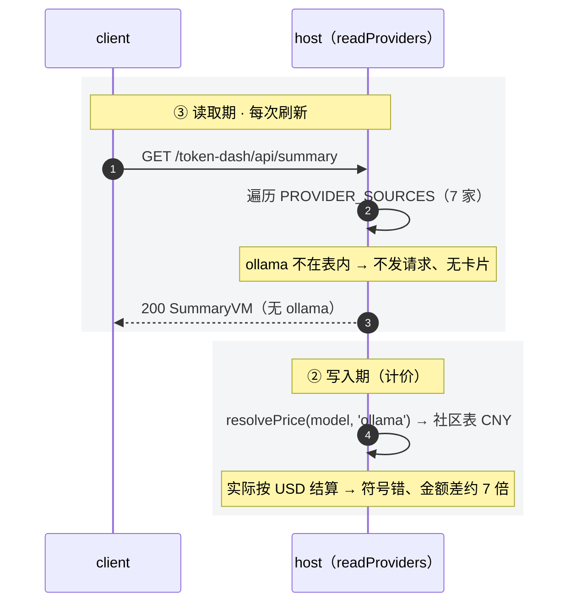
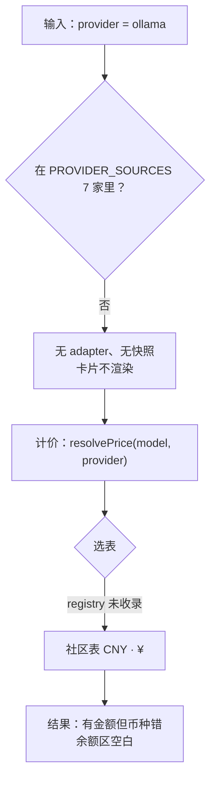
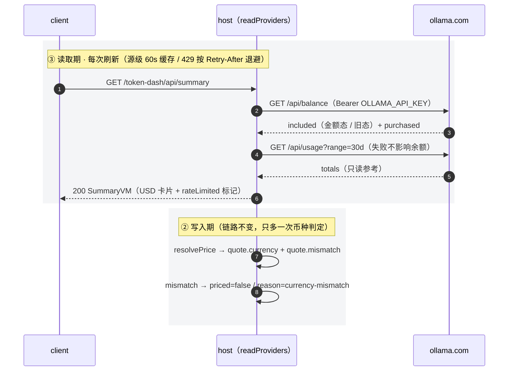
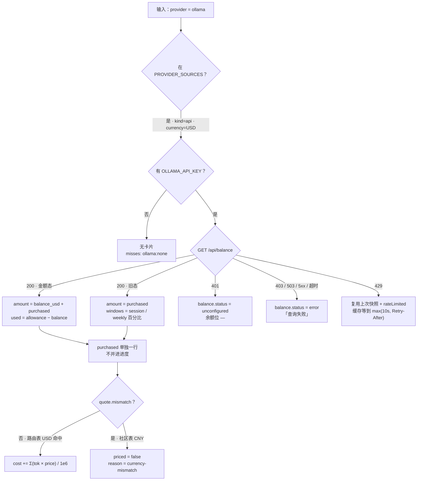

# Ollama Cloud 余额与用量接入

> 状态：待验收（CHG-01~11 已实施，L1 / L2 通过；真实 Key 手测未做）<br>
> 创建时间：2026-11-10<br>
> 更新时间：2026-11-10（第三轮：实施完成并回写验收；第二轮为代码复核 + 官方文档核对，纠正 `kind` / `credential` / 429 保旧值 / 历史重算四处缺口；D-5 / D-6 拍板为 A）<br>
> 关联逻辑根：`dsh-token-dash`（`src/quota-sources.js` / `src/adapters.js` / `src/providers.js` / `src/pricing.js` / `src/core.js` / `src/store.js` / `client.js`）<br>
> 关联资料：[`design.md`](../../design.md) §第三方接入与扩展边界、[`feature_third_party_provider_pricing.md`](../archived/feature_third_party_provider_pricing.md)（D-17：第三方订阅按独立 feature 接入）

## 〇、前置依赖 / 代码探查事实

### 官方接口（2026-11-10 核对 `docs.ollama.com/api/balance`、`/api/cloud-usage`）

| 端点 | 鉴权 / 参数 | 关键字段与语义 |
|---|---|---|
| `GET https://ollama.com/api/balance` | `Authorization: Bearer $OLLAMA_API_KEY`；**无** query | `included` 为 **`oneOf` 二态**：金额态 `{balance_usd, allowance_usd, period{from,until}}`；旧套餐 `{session{remaining_percent,resets_at}, weekly{...}}`。另恒有 `purchased{balance_usd}`（仅未过期）。`period.from` 含、`until` 不含；年付也按月重置 |
| `GET https://ollama.com/api/usage?range=24h\|7d\|30d&group_by=model` | 同上；`range` 默认 `7d`；`scope` 默认 `self`（`team` 需管理员）；`group_by` 仅支持 `model` | `totals{request_count, usage_usd, input_tokens, cached_input_tokens, output_tokens, groups[], remainder}`、`buckets[]`。`groups` 最多 10 组；旧套餐区间**只有请求数** |

### 关键约束（官方）

| 事实 | 结论 |
|---|---|
| Ollama 是「月度额度 + 逐笔按量（USD）」 | 不能按 `subscription` 隔离计价；应按 `api` + USD |
| 两个端点都是 **10 请求/分钟/用户，跨 key 与设备共享** | 必须复用源级 60s 缓存；`429` 带 `Retry-After`（整数秒，≥1） |
| `/api/balance` 错误码：`401` 凭证无效、`403` 账户暂停、`429` 限流、`503` 余额服务暂不可用 | 四个分支都要有明确出口，不能一律 `查询失败` |
| `/api/usage` 非法 / 重复参数返回 `400`；新用量入库有延迟 | 只读参考值，不得回写账本 |
| `included` 是 `oneOf` | 解析必须按字段存在分支，两态都缺 → `error` |
| `purchased` 优先于 `included` 消耗、仅未过期 | 卡片单独一行，不合并进度 |
| 社区表是 CNY，Ollama 按 USD 结算 | 直接套表会把人民币数值渲染成 `$`（约 7 倍偏差） |

### 当前代码事实（2026-11-10 复核，本 plan 的落点依据）

| 事实 | 影响 |
|---|---|
| `PROVIDER_SOURCES` 现有 7 家；声明式源形状 `{ id, kind, currency, credential, quota, preflight? }` | 新增一家 = 源表 1 条 + 1 个 `parse` |
| `resolveCredential` 只认 `type === 'bearer'`（或 `oauth-reuse'`），**缺 `type` 直接当作无凭据** | 源表条目必须写 `credential.type`，否则静默跳过 |
| `toSnapshot` 把 `kind` 归一为 `api` / `subscription` 两值 | 源表不存在 `balance` 之类第三态 |
| `readDeclarativeSource` 把 `mode` **硬编码为 `'subscription'`**；`stampProviderKinds` 会写进 `state.providerKinds` | 若照抄，ollama 被固化订阅 → 其 token 全部 `priced='subscription'`、`cost=0`（与 BND-01 直接冲突） |
| 缓存按源：成功 60s / 失败 10s；声明式源失败时返回**空条目**而不是抛错 | 429 时上一次的值会被覆盖，无法「保留上次值」 |
| `addRecord(state, record, kindOf)` / `repriceUnpriced(state, scope, kindOf)` / `repriceState(state)` 均无币种入参 | 币种判定若放进 core，需新增回调并改 5 处调用 |
| `index.js` 已有 `currencyOf(id) = prefs.providerCurrency > 快照 currency > registry`，并注入 `configurePricing` | `resolvePrice` 内部已能拿到 provider 币种 |
| `resolvePrice` 选表：`USD` 先查 OpenRouter 路由表（`modelId` 精确匹配，已去 `vendor/` 前缀），未命中回退社区表（CNY） | USD provider 命中路由表即正常计价；只有回退社区表时才币种不符 |
| `costVersion` 在 `emptyState` / `repriceState` / `store.COST_MODEL_VERSION` 三处硬编码 `3`；`repriceState` 用 `costOf` 重算且无币种判定 | 计价语义变化若不升版本，历史 CNY 金额会继续挂在 USD 桶下 |
| P2 / P3 余额位是单值 `balanceText()`；P3 API 卡为「环 + 预算输入 + 计划余额 + 真实余额 + 本月已花 + caption」 | 「已用 / 总额」「购买余额」只能新增 P3 行，不能塞进 P2 四格（真实余额已跨 3–5 列） |
| 测试硬编码 7 家：`providers.test.mjs` / `providers-vm.test.mjs`（`pricingLinks` 顺序与长度）、`adapters.test.mjs`（`misses` 全列表） | 加一家必然打破，需同批更新 |
| e2e 用 `page.route` 注入 SummaryVM（`apiProviders`），不依赖真实 Key | 卡片渲染可 e2e 断言；429 / 401 只能在单测覆盖 |

### 待对齐

- DSH 事件里 Ollama 的 `provider` 字符串（`ollama` / `ollama-cloud`）需一条真实事件确认；未确认时按 `ollama` 建 id 并加别名。
- 旧套餐 `included.session` 的真实窗口时长官方未写（只给 `resets_at`），不得换算成 `5h`。

## 一、需求

| ID | 优先级 | 需求 / 边界 / 风险 | 成功信号 |
|---|---|---|---|
| REQ-01 | P0 | Ollama 余额：解析 `included` 二态 + `purchased` + `period`，映射「真实余额 / 套餐已用 / 购买余额」 | `真实余额 $97.50`、`套餐已用 $27.50 / $100.00`、`购买余额 $25.00` |
| REQ-02 | P0 | 形态按 `api`、币种 USD；声明式源的 `mode` 由 `kind` 派生，禁止被固化成订阅 | `kind=api`；`stampProviderKinds` 后 `state.providerKinds.ollama` 仍为空或 `api` |
| REQ-03 | P0 | **币种不匹配即未定价**：`quote` 币种 ≠ provider 币种 → 不写 `cost`，`reason='currency-mismatch'`；`addRecord` / `repriceUnpriced` / `repriceState` 三处一致（含 override 未声明 `currency` 的 USD provider） | 不出现「CNY 数值配 `$`」；`openrouter` / `qwen` 国际站同类旧行为一并修正 |
| REQ-04 | P1 | 用量只读：`/api/usage?range=30d` 的 `usage_usd` 与 token 作「渠道侧参考」，只进 P3 卡片 caption，**不回写账本** | 卡片可见渠道用量；本地 `cost` 不被覆盖 |
| REQ-05 | P0 | 失败降级：`401` → `unconfigured`；`403` / `503` / `5xx` → `error`；`429` → 复用上次快照 + `rateLimited`，缓存等到 `max(10s, Retry-After)` | 不污染其余 provider；限流不闪成「查询失败」 |
| REQ-06 | P0 | 计价语义变化后历史一致：`costVersion` 3 → 4，重算走同一币种判定；重算入口补 `kindOf`，订阅行不计价、零 token 行保持 `'empty'` | 历史行不再保留「CNY 金额 / USD 桶」；单测断言 `costVersion === 4`，订阅行仍 `cost=0` |
| BND-01 | 边界 | Ollama 不做订阅隔离（`kind` 保持 `api`） | 本地计价仍按 token × 单价 |
| BND-02 | 边界 | 不读 Cookie、不抓控制台页面；无 Key 即未配置 | 无新增入站数据面 |
| BND-03 | 边界 | 计价链只开一个例外：新增「币种不匹配 → 未定价」。`catalog` / `match` / `selectTable` 的匹配与选表逻辑不动 | `resolvePrice` 仍只答「多少钱、什么币种」+ 只读 `mismatch` |
| BND-04 | 边界 | 不新增设置项；不为 Ollama 增加新 prefs 键 | 设置区仍三行 |
| BND-05 | 边界 | 现有 7 家 adapter 的声明、解析与 UI 形态零改动 | 7 家快照字段与文案不变 |
| RSK-01 | 风险 | 10 rpm 跨 key / 设备共享，本机再叠加 `/api/usage` 或其它工具会触发 429 | 源级缓存 + `Retry-After` 退避 + 保旧值；日志可还原 `retryAfter` |
| RSK-02 | 风险 | 币种不匹配判定把「有数」变「未定价」，看起来像能力倒退 | 未定价 `title` 写明「价目表为 CNY，该 provider 按 USD 结算」，并提示用 `priceOverrides` 补 USD 单价 |
| RSK-03 | 风险 | 误以为 Ollama 全部模型未定价 | 路由表命中即 USD 计价；只有回退社区表才未定价——验收按这两种命中分别断言 |
| RSK-04 | 风险 | 升 `costVersion` 会重算历史估算值，用户看到金额变化 | CHANGELOG 写明「历史成本按新币种规则重算」；回滚只能是代码回退 |

## 二、设计方案

### 2.0 结构总览

```text
src/quota-sources.js  ollama 源：kind:'api' / currency:'USD' /
                      credential:{ type:'bearer', refs:['OLLAMA_API_KEY'] } /
                      quota:{ url:'https://ollama.com/api/balance', parse: parseOllamaBalance } /
                      usage:{ url:'https://ollama.com/api/usage', range:'30d', parse: parseOllamaUsage }
                      quota.parse：金额态 / 旧态 / purchased / period；两态都缺返回 error 语义
src/adapters.js       requestJson 读 Retry-After；readDeclarativeSource：mode 由 kind 派生、
                      429 复用上一份快照、quota / usage 分开取（usage 失败不改变条目）；
                      toSnapshot 透出 rateLimited；logAdapterEvents 增 adapter.ollama 分支
src/providers.js      ollama descriptor（label 'Ollama'、currency 'USD'、subscription false、
                      pricingUrl、无 defaultModel/prefixes）+ PROVIDER_ORDER 追加
src/pricing.js        PriceQuote 增只读 mismatch（复用已注入的 currencyOf，不改选表）
src/core.js           addRecord / repriceUnpriced / repriceState 按 mismatch 判未定价；
                      repriceState 增 kindOf（订阅行跳过、保留 empty）；costVersion 3 → 4
src/store.js          COST_MODEL_VERSION 3 → 4
client.js             真实余额沿用单值；P3 卡新增「套餐已用」「购买余额」两行 + 周期 / 限流 caption；
                      mismatch 文案进 REASON_TEXT
locale/*.json         client 内联词典的随包副本同步（词条键一致）
```

职责不变：源表只声明，adapter 只发请求与解析，计价链只回 quote，UI 只消费 VM。

### 2.1 现状 vs 目标

**现状 · 处理流程**



**现状 · 分支树**



**目标 · 处理流程**



**目标 · 分支树**



读法：读取期只加一个源；写入期链路不动，唯一新增是「quote 币种与 provider 币种一致才计价」，判定与「未定价」复用现有 `reason` 通道。

### 2.2 数据映射

| 源字段 | 映射 | 消费方 / 说明 |
|---|---|---|
| `included.balance_usd` | `balance.packageLeft` | 套餐剩余，仅用于 P3「套餐已用」分子推导 |
| `included.allowance_usd` | `balance.allowance`、`balance.used = allowance − balance_usd` | P3「套餐已用 $27.50 / $100.00」 |
| `purchased.balance_usd` | `balance.purchased` | P3「购买余额」独立行 |
| 金额态合计 | `balance.amount = balance_usd + purchased` | 单值「真实余额」（P1 / P2 / P3 共用 `balanceText`） |
| `included.period.until` | `balance.periodEnd = Date.parse(until)` | P3 caption「周期至 MM-DD HH:mm」（复用 `resetParts`） |
| `included.session/weekly` | `windows[]`（`key: 'session' / 'week'`、`usedPercent = 100 − remaining_percent`、`resetAt`） | 旧套餐分支；`amount` 取 `purchased` |
| `/api/usage` `totals` | `channel = { range:'30d', usageUsd, requests, inputTokens, cachedInputTokens, outputTokens }` | 只读，进 P3 caption；**不写** `daily.json` |
| `401` | `balance.status='unconfigured'` | 与 DeepSeek 401 行为一致（余额位 `—`） |
| `403` / `503` / `5xx` | `balance.status='error'` | 文案统一「查询失败」，原因只进日志 `httpStatus` |
| `429` | 复用上一份快照 + `rateLimited=true` + `_quotaError.retryAfter` | 缓存 TTL 取 `max(10s, Retry-After)` |

- `toSnapshot` 需显式新增 `rateLimited` 字段，`buildSummary` 的 `...info` 会带进 VM，client 只读该标记。
- 两态都缺（无 `balance_usd` / 无 `session`）→ `balance.status='error'` + `_error.kind='parse'`，不伪造 0。

### 2.3 计价：币种不匹配（REQ-03）

```text
resolvePrice(model, provider, ts)
  quote = override ?? (router 命中 ? router : community)      // 选表逻辑不变
  quote.mismatch = quote.currency !== currencyOf(provider)      // 只读判定，不拒绝出价
  return quote

addRecord / repriceState / repriceUnpriced
  if kindOf(provider) === 'subscription' → priced = 'subscription'，cost 不动   // 形态先于计价
  quote = resolvePrice(...)
  if quote == null            → priced = false, reason = explainPriceMiss(model)
  else if quote.mismatch      → priced = false, reason = 'currency-mismatch'
  else                        → cost = Σ(tok × price) / 1e6, priced = true
  若四桶 token 全为 0          → priced = 'empty'（重算同样保留）
```

- `currencyOf` 复用 `pricing.js` 内已注入的解析（`prefs.providerCurrency > 快照 > registry`），与 VM 展示同源。
- **不采用**「给 `addRecord` / `repriceUnpriced` / `repriceState` 加 `currencyOf` 参数」：那要改 `collect.ingest` / `backfill` / `index` 五处签名与全部单测，收益仅为少一个只读字段。
- 但 `repriceState` 需要补 `kindOf`（`index.js` 已有该闭包）：现版本重算不判形态，会把订阅 provider 的行按模型价算出金额并把 `priced` 压成布尔值；目前仅靠 `billable` 过滤没进总额，属隐患。
- override 同样参与判定：`normalizeOverride` 未写 `currency` 时默认 CNY，因此 USD provider 的 override 必须显式 `currency:'USD'`——写进 `docs/design.md` 的示例，否则会静默变未定价。

### 2.4 关键陷阱

| 项 | 约束 |
|---|---|
| `mode` 硬编码 | 声明式源的 `mode` 必须由 `kind` 派生；否则 `stampProviderKinds` 把 ollama 固化为订阅，`cost=0` |
| `credential.type` | 必须写 `type:'bearer'`，缺失等于无凭据（静默 `:none`） |
| `included` 二态 | 先判 `session !== undefined`，否则按金额态；两态都缺 → `error` |
| `purchased` 语义 | 用户会以为「还有 25 美元」；必须标「购买余额（未过期）」，且不计入套餐进度 |
| `amount` 语义 | `amount` 是「真实余额合计」，不是套餐剩余；进度只能用 `allowance` / `used` |
| 429 不覆盖旧值 | 否则卡片在限流时闪成「查询失败」；复用快照时不复制 `fetchedAt`，用当前时间 |
| 币种不匹配优先 | 即使命中社区表也不能按 USD 渲染；override 缺 `currency` 同样判未定价 |
| 与 `usage_usd` 的关系 | 渠道用量只读，不得覆盖本地 `cost`（否则双算）；它含 web search / fetch，与本地统计口径不同 |
| `providerKinds` | 不得给 ollama 写 `subscription`（与 BND-01 冲突） |
| 旧套餐窗口 | `session` 时长官方未声明，不得映射成 `5h`；且 API 形态卡不渲染 `windows`，旧套餐只保证解析与日志 |
| 历史成本 | 不升 `costVersion` 则旧行继续带着 CNY 金额进 USD 桶（D-5 已定升 4） |
| 重算边界 | `repriceState` 必须先按 `kindOf` 跳过订阅 provider，否则给订阅行写入金额并压掉 `'subscription'` / `'empty'` 两态；当前只靠 `billable` 过滤兜底 |
| 余额口径 | `amount` 取「套餐剩余 + 购买余额」（D-6）；单值位不得只放套餐剩余，否则低报可用额度 |

### 2.5 日志

`adapter.ollama.quota.ok`（`amount` / `purchased` / `legacy`）、`quota.fail`（`errorKind` / `httpStatus` / `retryAfter`）、`adapter.ollama.usage`（`range` / `usageUsd`，只读）、`probe.miss` 的 `ollama:none`。日志只记状态与计数，不记 Key 与响应体。

## 三、实现要点

### 3.0 开发改动总览（计划）

| ID | 类型 | 文件 | 开发改动说明 |
|---|---|---|---|
| CHG-01 | 修改 | `src/quota-sources.js` | 增 `parseOllamaBalance`（二态 + purchased + period）与 `parseOllamaUsage`（只取 `totals`）；源表增可选 `usage` 字段；`PROVIDER_SOURCES` 增 `ollama`：`kind:'api'`、`currency:'USD'`、`credential:{type:'bearer',refs:['OLLAMA_API_KEY']}`、`quota.url='/api/balance'`、`usage={url:'/api/usage', range:'30d'}` |
| CHG-02 | 修改 | `src/adapters.js` | `requestJson` 读 `Retry-After`；`readDeclarativeSource` 的 `mode` 由 `kind` 派生、429 复用上一份快照、`quota` 与 `usage` 分开取（`usage` 失败只记日志）；`toSnapshot` 增 `rateLimited`；`logAdapterEvents` 增 `adapter.ollama` 分支（`FAILURE_MODULES` 有 `adapter.<id>` 兜底，无需改） |
| CHG-03 | 修改 | `src/providers.js` | 增 `ollama` descriptor（`label:'Ollama'`、`currency:'USD'`、`subscription:false`、`pricingUrl:'https://ollama.com/pricing'`、无 `defaultModel` / `prefixes`）；`PROVIDER_ORDER` 追加到末位；`ALIASES` 按实测补 `ollama-cloud` 等 |
| CHG-04 | 修改 | `src/pricing.js` | `PriceQuote` 增只读 `mismatch`（override 与选表两条出口都写）；不改匹配与选表 |
| CHG-05 | 修改 | `src/core.js` | `addRecord` / `repriceState` / `repriceUnpriced` 用 `quote.mismatch` 判未定价；`repriceState(state, kindOf)` 增形态跳过（订阅行不计价）并保留 `'empty'`；`costVersion` 3 → 4（`emptyState` + `repriceState` 两处） |
| CHG-06 | 修改 | `src/store.js` | `COST_MODEL_VERSION` 3 → 4，触发一次历史重算 |
| CHG-07 | 修改 | `client.js` + `locale/en.json` + `locale/zh.json` | P3 API 卡新增「套餐已用」「购买余额」行与周期 / 限流 caption；`REASON_TEXT` 增 `currency-mismatch`；词条三处同步 |
| CHG-08 | 修改 | `tools/preview/templates/cards-api.html` | 原型补余额明细行与 caption；尺寸仍取 `spec.mjs`，不新增字号 |
| CHG-09 | 测试 | `test/unit/{quota-sources,adapters,pricing,core,providers,providers-vm}.test.mjs` | 二态 / purchased / 429 保旧值 / 401 / mismatch（含 override）/ `costVersion=4` / 重算后订阅行仍 `cost=0` 且零 token 行仍 `'empty'` / 8 家契约 / `misses` 列表 |
| CHG-10 | 测试 | `scripts/e2e.mjs` | `apiProviders` 注入 ollama（USD + allowance + purchased）与 `rateLimited` 变体；断言 P3 行与 caption |
| CHG-11 | 文档 | `docs/design.md` / `docs/ui-design.md` / `CHANGELOG.md` | 源表 7 → 8 家、源表形状增可选 `usage`；窗口 key 契约增 `session`；余额明细口径；`priceOverrides` 的 USD 示例（必须带 `currency`）；历史重算说明 |

> 2026-11-10 实施结果：CHG-01~11 全部落地（`2.1.0-local.5`）。L1 `npm test` 116 项（115 pass / 1 skip / 0 fail），L2 `npm run e2e` 通过（含 Ollama 卡的额度行、周期、限流与渠道用量断言）。L3 真实 Key 手测未做，`included` 旧套餐态只保证解析、UI 不渲染。

### 3.1 改动清单（待实施）

#### CHG-01 · `src/quota-sources.js`

- `parseOllamaBalance(body)`：返回 `{ windows, balance }`；金额态写 `amount/allowance/used/purchased/periodEnd/packageLeft`，旧态写 `windows` + `amount = purchased`，两态都缺返回 `{ balance: { status:'error', _error:{kind:'parse'} } }`。
- `parseOllamaUsage(body)`：只读 `totals`，返回 `{ channel: { range:'30d', usageUsd, requests, inputTokens, cachedInputTokens, outputTokens } }`；`totals` 不可解析时返回 `{}`。
- `PROVIDER_SOURCES`：追加 ollama 条目（字段见 3.0）；`usage` 与 `preflight` 同属可选钩子，缺省不请求。

#### CHG-02 · `src/adapters.js`

- `requestJson`：非 2xx 时把 `Retry-After` 读成 `error.retryAfter`（用 `response.headers?.get?.('retry-after')`，兼容单测里的裸 mock）。
- `readCachedSource`：把 `cached?.data` 作为第三个入参传给 `readSource`；429 复用旧条目时按失败语义写缓存——`ok:false` + `until = now + max(10s, retryAfter × 1000)`，新鲜度判定改成 `now < (cached.until ?? cached.at + ttl)`，避免提前重试继续撞限流。
- `readDeclarativeSource`：`mode` 由 `kind` 派生；429 有旧快照时复用旧快照并标 `_rateLimited`。

```diff
-  const base = { id: source.id, name: providerLabel(source.id), kind: source.kind, mode: 'subscription', currency: source.currency }
+  const base = { id: source.id, name: providerLabel(source.id), kind: source.kind, mode: source.kind === 'subscription' ? 'subscription' : 'api', currency: source.currency }
```

```diff
-  } catch (error) {
-    return { ...base, windows: [], _quotaError: errorDetail(error) }
-  }
+  } catch (error) {
+    const detail = errorDetail(error)
+    if (error.status === 429 && previous !== null && previous !== undefined) {
+      return { ...previous, _quotaError: { ...detail, retryAfter: error.retryAfter ?? null }, _rateLimited: true, fetchedAt: Date.now() }
+    }
+    return { ...base, windows: [], _quotaError: detail }
+  }
```

- `toSnapshot`：`rateLimited: entry._rateLimited === true`。
- `logAdapterEvents`：`item.id === 'ollama'` 分支，`balance.status === 'ok'` 记 `quota.ok`（含 `amount` / `purchased` / `legacy`），否则记 `quota.fail`。

#### CHG-04 · `src/pricing.js`

- `override` 出口与选表出口各补一行 `mismatch: <currency> !== currencyOf(providerId)`。

#### CHG-05 · `src/core.js`

```diff
-      const price = resolvePrice(model, provider, record.ts)
-      if (price === null) {
+      const price = resolvePrice(model, provider, record.ts)
+      if (price === null || price.mismatch === true) {
         row.priced = false
-        row.reason = explainPriceMiss(model)
+        row.reason = price === null ? explainPriceMiss(model) : 'currency-mismatch'
```

- `repriceState(state, kindOf)`：新增第二参数（缺省走 registry，`index.js` 传已有 `kindOf`）；循环内先跳过非 `api` provider，保持订阅行 `cost` 与 `priced` 原值；`mismatch` 归入未定价；四桶 token 全 0 的行写回 `'empty'`；结尾 `state.costVersion = 4`。
- `repriceUnpriced`：同样把 `mismatch` 归入未定价，`skipped` 增 `'currency'` 计数（保持 `priced=false`，等用户补价后再补算）。
- `emptyState().costVersion = 4`。

```diff
-export function repriceState(state) {
-  if (state.costVersion === 3) return { repriced: false, rows: 0 }
+export function repriceState(state, kindOf = (id) => providerKind(id)) {
+  if (state.costVersion === 4) return { repriced: false, rows: 0 }
```

```diff
+        if (kindOf(owner) !== 'api') continue        // 订阅行不计价，保留 priced='subscription'
         const price = owner === null ? null : resolvePrice(model, owner, ts)
```

#### CHG-07 · `client.js`

- `ProviderCard` 的 `kvRow` 组尾部：`balance.allowance !== undefined` 时渲染「套餐已用 `${used} / ${allowance}``，`balance.purchased !== undefined` 时渲染「购买余额」。
- `cardCaption` 追加 `周期至 {time}`（`resetParts(periodEnd).absolute`）与 `限流中`。
- `REASON_TEXT['currency-mismatch'] = '价目币种不匹配'`，未知 reason 仍回退「未定价」。

#### CHG-09 · 测试（先失败后通过，按此顺序）

1. 解析：新建 `test/unit/quota-sources.test.mjs`——金额态、旧态、`purchased`、`periodEnd`、两态都缺、`usage.totals` 缺失返回 `{}`。
2. 管道：`test/unit/adapters.test.mjs`——`mode` 由 `kind` 派生、429 复用旧快照并写 `retryAfter` / `until`、`401` → `unconfigured`、`403` / `503` → `error`、`usage` 失败不影响条目、`misses` 变为 8 家顺序。
3. 计价：`test/unit/pricing.test.mjs`——override 缺 `currency` 时 `mismatch=true`、写 `'USD'` 时 `false`、路由表命中时 `false`。
4. 聚合与重算：`test/unit/core.test.mjs`——`addRecord` 的 mismatch 未定价、`costVersion` 断言 3 → 4、`costVersion=1` 混合账本重算后订阅行仍 `cost=0` 且零 token 行仍 `'empty'`、`repriceUnpriced` 的 `skipped.currency`。
5. 契约：`test/unit/providers.test.mjs` / `providers-vm.test.mjs`——8 家 `pricingLinks` 顺序与长度。
6. 渲染：`scripts/e2e.mjs`——`apiProviders` 注入 ollama（USD + allowance + purchased）与 `rateLimited` 变体，断言 P3 两行、caption、真实余额。
7. 词条：`test/unit/locale.test.mjs` 自动覆盖 zh / en 键与占位符一致。

## 四、不改动 / 边界

- `BND-01`：Ollama 不做订阅隔离（`kind=api`）。
- `BND-02`：不读 Cookie、不抓控制台页面。
- `BND-03`：`catalog` / `match` / `selectTable` 不动，`resolvePrice` 只多一个只读 `mismatch`。
- `BND-04`：不新增 prefs 键、不改设置区。
- `BND-05`：现有 7 家 adapter 声明与解析零改动。
- 与 `design.md` §接入顺序第 3 条（额度与计价要拆两个 feature）的偏差：本次计价侧只是**通用币种规则**（对 `openrouter` / `qwen` 国际站同样生效），不新增 provider 计价能力，故不拆。
- 已否决：给三个 core 函数加 `currencyOf` 参数（见 §2.3）。

### 已否决：Mistral

| 项 | 结论 |
|---|---|
| API 用量查询 | Admin API **仅 Enterprise**、非自助；普通 API key 调 admin 端点稳定 401 |
| 消费级订阅（Le Chat / Vibe） | **无公开 API**；控制台 `Limits` 页与 CLI 都要登录态，抓取违反 BND-02 |
| 原计划的替代方案 | 手动额度声明（`prefs.manualQuota`）也被否决：用户仍需先开网页抄数字，收益不足以新增键与分支 |
| 后续触发条件 | Mistral 若开放个人 usage API，按 `design.md` 门槛（官方端点 + 字段可验证）单独开 feature |

## 五、最终验收

| 项 | 来源 | 方式 | 结果 |
|---|---|---|---|
| 金额态：`balance_usd=72.5` / `allowance_usd=100` / `purchased=25` → 真实余额 `$97.50`、套餐已用 `$27.50 / $100.00`、购买余额 `$25.00` | REQ-01 | 单测解析 + e2e 断言 | 已验证（L1 + L2） |
| 旧态：`session/weekly` → 两个 `usedPercent`，`amount` 取 `purchased` | REQ-01 | 单测（UI 不渲染，理由见 §2.4） | 已验证（L1） |
| `period.until` → caption「周期至 …」 | REQ-01 | e2e 文案 | 已验证（L2） |
| `kind=api`、币种 USD、`state.providerKinds.ollama` 未被固化为订阅 | REQ-02 / BND-01 | 单测 `stampProviderKinds` | 已验证（L1） |
| CNY 报价 + USD provider → `priced=false`、`reason=currency-mismatch` | REQ-03 | 单测（路由表未命中场景） | 已验证（L1） |
| 路由表命中时仍按 USD 正常计价（不误判未定价） | RSK-03 | 单测 | 已验证（L1） |
| `openrouter` / `qwen` 国际站同类旧行为同步转未定价 | REQ-03 / BND-05 | 单测（回归） | 已验证（L1） |
| USD provider 的 override 未写 `currency` → 判未定价；写 `'USD'` → 正常计价 | REQ-03 | 单测 | 已验证（L1） |
| `costVersion` 升 4 且历史行按新规则重算 | REQ-06 | 单测（`core.test` 断言由 3 改 4） | 已验证（L1） |
| 重算后订阅 provider 行仍 `cost=0` / `priced='subscription'`，零 token 行仍 `'empty'` | REQ-06 | 单测（含 `costVersion=1` 的混合账本） | 已验证（L1） |
| `/api/usage` 只读，失败不影响余额与 `cost` | REQ-04 | 单测：`usage_usd` 变化不改 `daily.json` | 已验证（L1） |
| `429` 保留旧值 + `rateLimited`，缓存等到 `Retry-After` | REQ-05 / RSK-01 | 单测 mock（含 `Retry-After` 头） | 已验证（L1） |
| `401` → `unconfigured`；`403` / `503` → `error` | REQ-05 | 单测 | 已验证（L1） |
| 8 家契约：`pricingLinks` 顺序 / 长度、`misses` 顺序 | 质量门槛 | 单测 | 已验证（L1） |
| 现有 7 家零回归 | 质量门槛 | `npm test` + `npm run e2e` | 已验证（L1 + L2） |

### 5.1 分层验收与自主执行守则

| 层 | 内容 | 方式 | 资源消耗 | 无人值守 |
|---|---|---|---|---|
| L0 静态 | plan 结构、语法与 lint | `validate_plan.py`、IDE 诊断 | 无 | 是 |
| L1 单测 | 解析 / 缓存 429 / 计价 mismatch / 成本重算 / 8 家契约 | `npm test` | 无 | 是 |
| L2 E2E | client 渲染（注入 SummaryVM，不连真实接口） | `npm run e2e` | 无（本机 DSH 进程） | 是 |
| L3 真实接口 | 真实 Key 下的余额 / 用量字段与套餐形态 | 手动配置 Key 后看卡片与 `adapter.ollama.*` 日志 | 无 token 计费 | 否（需用户在场提供 Key） |

**守则五要素**

1. 执行范围：L0 → L1 → L2 递进，低层不通过不进高层；L3 只在用户在场时执行。
2. 修复边界：只修适配层（断言、fixture、E2E mock、词条同步）；不得改动 §四 的 `BND-01` / `BND-03` / `BND-05` 语义。
3. 停机条件：同层同类失败连续 2 轮、或需改 BND、或单轮改动文件超过 8 个 → 停止并留报告。
4. 记录去向：每轮结论记 §九；未解决项转「待用户验证」并回写 §五 结果列。
5. commit / 打包授权：本轮已获用户「改代码 + 提交推送 + 本地打包安装」授权；`pack` 只在 L1 / L2 全绿后执行，不 tag、不发布。

## 七、日志速查

- `adapter.ollama.quota.ok`：`amount` / `purchased` / `legacy`
- `adapter.ollama.quota.fail`：`errorKind` / `httpStatus` / `retryAfter`
- `adapter.ollama.usage`：`range` / `usageUsd`（只读）
- `probe.miss`：`ollama:none`（未配置）/ `ollama:error`

## 八、决策记录

| # | 决策点 | 可选项 | 拍板 | 状态 |
|---|---|---|---|---|
| D-1 | Ollama 形态 | A 订阅隔离（`cost=0`）/ B 按量 `api` + USD | **B** | 已定（2026-11-10） |
| D-2 | 用量是否展示 | A 只读展示 / B 不接 | **A** | 已定（2026-11-10）；落点收敛为 P3 caption（REQ-04） |
| D-3 | 币种不匹配如何处理 | A 沿用旧行为（CNY 数值 + `$`）/ B 判未定价并给 `reason` | **B** | 已定（2026-11-10）；实现改为 `quote.mismatch`（§2.3） |
| D-4 | Mistral 是否接入 | A 计价 + Admin 用量 / B 放弃 | **B** | 已定（2026-11-10） |
| D-5 | 历史成本是否重算 | A 升 `costVersion` 4 重算 / B 只修正新数据 | **A** | 已定（2026-11-10）：不重算则 USD 桶长期留着 CNY 金额（约 7 倍偏差），且新旧日不可比；前置条件是 `repriceState` 补 `kindOf`，订阅行不计价 |
| D-6 | 余额展示口径 | A 真实余额 = 套餐剩余 + 购买余额，P3 再拆两行 / B 只显示套餐剩余 | **A** | 已定（2026-11-10）：单值位回答「还能用多少钱」，只放套餐剩余会低报；进度仍只用 `allowance` / `used` |

## 九、自测反馈台

- 2026-11-10：核对官方文档——`included` 为 `oneOf` 二态、限流 10 rpm 跨 key 与设备共享、`purchased` 仅未过期。
- 2026-11-10：判断 Ollama 按量 USD 必须前置「币种不匹配 → 未定价」，否则 CNY 数值会配 `$` 符号。
- 2026-11-10：Mistral 查证结论——Admin API 仅 Enterprise、普通 key 无效、消费级无公开接口；用户拍板放弃（D-4）。
- 2026-11-10（第二轮）：对照代码发现四处会直接卡住实施的缺口——① 源表 `kind:'balance'` 不存在，且 `credential` 缺 `type` 会被静默跳过；② `readDeclarativeSource` 硬编码 `mode:'subscription'`，会把 ollama 固化成订阅（`cost=0`）；③ 429「保留上次值」在现有缓存结构下无法成立；④ 计价语义变化漏了 `costVersion` 与 `repriceState`。已在 §〇 / §2.4 / §3.0 修正。
- 2026-11-10（第二轮）：官方文档补充 `403` / `503` / `400` 与 `scope` 参数、`period` 语义、旧套餐区间只有请求数；`/api/usage` 与 `/api/balance` 共用 10 rpm 配额，故用量按 30d 低频随刷新取一次。
- 2026-11-10（拍板）：D-5 取 A——升 `costVersion` 4 并重算历史，前置补 `repriceState(state, kindOf)`，否则订阅行会被写入金额；D-6 取 A——`amount` = 套餐剩余 + 购买余额，P3 拆「套餐已用」「购买余额」两行。§2.3 / §2.4 / CHG-05 / §五 已同步。
- 2026-11-10（实施）：CHG-01~11 落地，L1 116 项（115 pass / 1 skip）与 L2 e2e 通过；`2.1.0-local.5` 已打包安装。遗留：L3 真实 Key 手测、DSH 事件里 Ollama 的 `provider` 字符串待一条真实数据确认。
