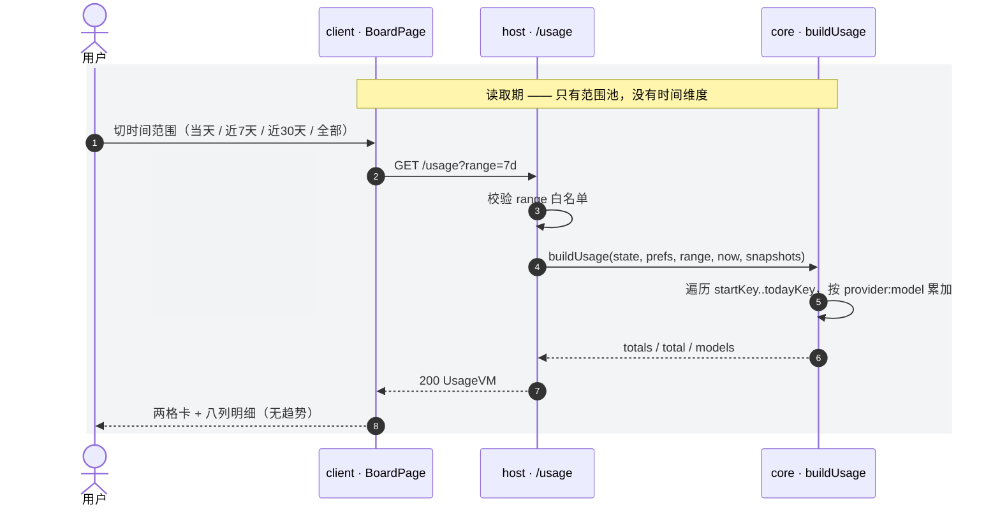
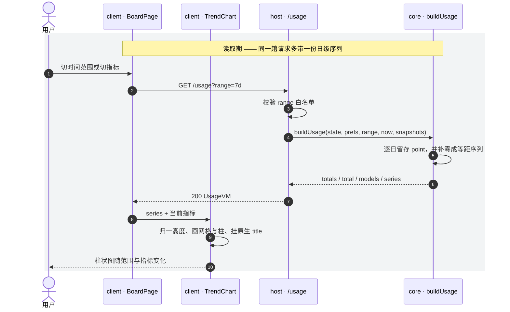
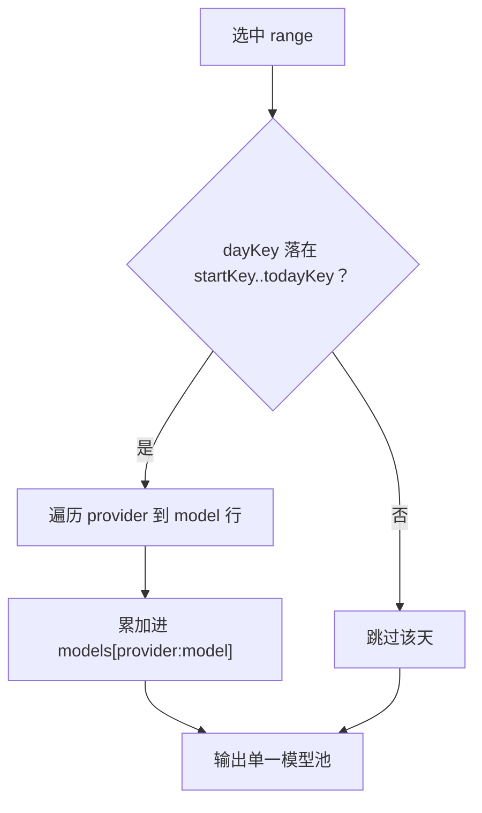
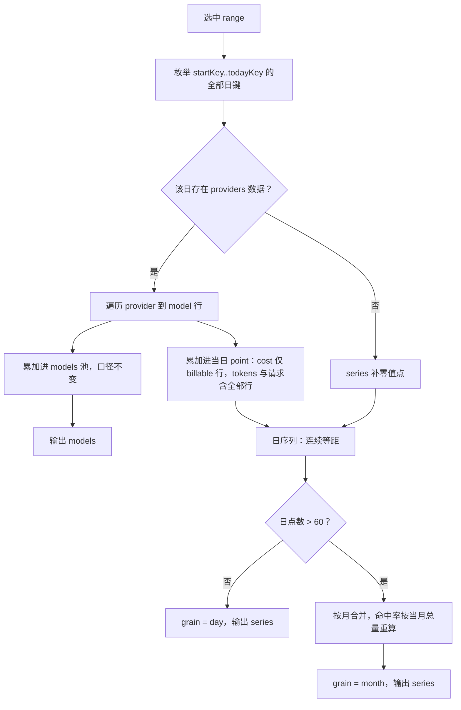

# P3 用量趋势图（柱状）与范围视图迭代

> 状态：待归档（2026-11-16，全部 CHG 落地，L1 125 项 + E2E 通过，已随 `2.2.0` 正式发布）<br>
> 创建时间：2026-11-16<br>
> 更新时间：2026-11-16（实施完成，`2.2.0-local.1` 候选包）<br>
> 关联逻辑根：`dsh-token-dash`（`src/core.js` · `index.js` · `client.js`）<br>
> 关联资料：[`ui-design.md`](../../ui-design.md) §5.5、[`design.md`](../../design.md)「两条独立链路」、调研对象 cc-switch（`reference/third-party/cc-switch`，`.gitignore` 忽略不入库）

## 〇、前置依赖 / 代码探查事实

### 已明确

- **账本只有日级聚合**：`state.days[dayKey].providers[provider].models[model]` 存 `{ input, cacheRead, cacheWrite, output, requests, cost, priced }`，**没有逐请求时间戳**（来源：`src/core.js` · `addRecord`、`src/store.js` · `loadState`，2026-11-16 代码探查）。
- **`buildUsage` 不保留时间维度**：把 `startKey..todayKey` 的全部天按 `provider:model` 累加进单一池，返回 `{ range, startAt, endAt, startKey, endKey, totals, total, models }`，无日级序列（`src/core.js` · `buildUsage`）。
- **`/usage` 只做 range 白名单校验后原样返回** VM，无第二套查询（`index.js` · `/usage` 路由）。
- **两格卡口径分叉**：费用取 `usage.totals`（仅 `billable === true` 行），Tokens 取 `usage.total`（**含**订阅行）（`client.js` · `RangeCards`）。图表逐点必须复刻这一分叉，否则柱高与卡片数字对不上。
- **绘图能力只有单元素 SVG**：`ProgressRing` 画 donut、`MiniBar` 画 4px 条，无通用坐标系组件（`client.js` · `ProgressRing` / `MiniBar`）。
- **零构建约束**：`package.json` 无 dependencies，`client.js` 是手写 `h()` 的 ESM bundle，不能引入 Recharts 等图表库。
- **范围固定 4 档**：`RANGES = today / 7d / 30d / all`（`client.js`）。`today` 只覆盖 1 天、`all` 从最早记录日到今天，跨度可达数百天。
- **调研结论（cc-switch v4.0.32，`1d68de34`）**：柱状图链路为「SQL 分桶并补零 → `get_daily_trends` → `useUsageTrends` → `buildUsageTrendChartData` → Recharts `BarChart`」；关键取舍是**后端补零成等距连续序列**、**X 轴 category 键用原始桶时间戳而非显示文字**、**指标条兼作指标选择器**、**命中率轴不从 0 起画**。

- **国际化现状**：词条真源是 `client.js` 的 `EN` 对象（`ZH` 由键镜像生成），`locale/zh.json`、`locale/en.json` 是随包发布的副本；`test/unit/locale.test.mjs` 强制两份副本同键、占位符一致（2026-11-16 代码探查）。
- **中文单位写死**：现有 `fmtTokens` 用 k/M/B 拉丁单位（`client.js` · `fmtTokens`），无「万 / 亿」分支，趋势轴需要新增一条按语言分流的格式化。

### 已对齐（2026-11-16 拍板）

- 指标切换控件形态：摘要带扩四格并兼作选择器 + 标题行胶囊（§八 D1）。
- 多币种成本柱：禁用并给出口文案（§八 D2）。
- `all` 桶粒度：超阈值切按月（§八 D3）。
- `today` 单点：仍画单柱（§八 D4）。
- 摘要带数字字号：22px（§八 D6）。

## 一、需求

| ID | 优先级 | 需求 / 边界 / 风险 | 成功信号 |
|---|---|---|---|
| REQ-01 | P0 | `/usage` 返回连续日级序列 `series[]`，窗口内每个日键一个点 | `series.length === eachDayKey(startKey, endKey).length`，断言稳定 |
| REQ-02 | P0 | P3「范围与明细」底框内新增柱状图，位于摘要带与明细表之间；摘要带同步扩为四格 | 图表可见且在两者之间；四格数字与口径同源 |
| REQ-03 | P0 | 无消耗日补零值点，柱距等距不塌 | 中间空一天时柱数不减，零值柱高度为 0 |
| REQ-04 | P1 | 摘要带由两格改四格（总费用 / 真实 Tokens / 总请求数 / 缓存命中率），四格兼作指标选择器；柱状图随选中格切换指标 | 点格后柱高、Y 轴刻度与标题同步变化 |
| REQ-05 | P1 | 刻度与提示格式化随语言分流：中文「万 / 亿」、英文 K / M / B；点选显示完整日期与精确值 | 中文下 5e7 显示 `5千万`、英文下 `50M`；`title` 含精确数字 |
| REQ-06 | P1 | 加载 / 空数据 / 单点三种态都有明确呈现，不塌版 | 三种态下图表区高度恒为 132px |
| REQ-07 | P2 | 原型、UI 文档、单测、E2E 同步 | `npm run preview` / `npm test` / `npm run e2e` 全绿 |
| REQ-08 | P0 | 新增文案全部走 `tr()`，`EN` / `locale/zh.json` / `locale/en.json` 三处同键同占位符 | `npm test` 的 locale 用例通过；英文界面无中文残留 |
| BND-01 | 边界 | 不改 `daily.json` 存储格式与 `costVersion` | 旧账本直接可读，无迁移 |
| BND-02 | 边界 | 不改 `/summary`、P1、P2 与设置胶囊 | 仅 P3 与 `/usage` |
| BND-03 | 边界 | 不引入图表库、不加 dependencies | `package.json` 依赖区无变化 |
| BND-04 | 边界 | 不做小时级 / 分钟级粒度 | 数据源不支持，不造数 |
| RSK-01 | 风险 | 多币种下成本柱语义歧义 | 多币种时成本指标禁用或按 D2 收敛，不静默取首个币种 |
| RSK-02 | 风险 | `all` 范围柱数可达数百，柱子退化为线 | 由 D3 定为「> 60 个日点切按月」，桶数稳定在 12 上下 |
| RSK-03 | 风险 | 订阅行进 tokens 柱子但不进费用柱子，被误读为算错 | 图注一行说明与两格卡同口径，单测覆盖 |
| RSK-04 | 风险 | 侧栏开合用宽度测量时错位一帧 | 用 flex 自适应布局，不做 JS 量宽 |

## 二、设计方案

### 2.1 结构（现状一组、目标一组）

**现状 · 时序图**



**目标 · 时序图**



**现状 · 分支图**



**目标 · 分支图**



读法：现状分支只有「进池 / 跳过」两条腿，目标在进入同一个池之外多一条「按日留存」的腿，因此 `models` 结果与现状逐字节一致，风险被限制在新增字段上。日序列末端多一个「是否切按月」的出口：两条出口都产出 `series`，只改 `grain` 与桶宽，不改任何累加口径。

**图表结构（组件层）**

```text
section.boardSection「范围与明细」
└─ div.rangeBox
   ├─ rangeHead（范围胶囊 + 共 N 个模型 · 更新于）
   ├─ RangeCards（两格卡，口径见 2.3）
   ├─ TrendChart（新增：标题行[左标题+右指标胶囊] + 132px 柱区）
   └─ detailWrap（八列明细，内部横向滚动）
```

### 2.2 关键签名 / 字段（待确认）

| 层 | 名称 | 备注 |
|---|---|---|
| core | `eachDayKey(startKey, endKey) → string[]` | 按本地日历逐日推进，含两端；用 `setDate` 推进以避开夏令时 |
| core | `buildUsage(...) → UsageVM.series[]` | 仅新增字段，其余字段不变 |
| core | `series[i] = { dayKey, cost, requests, input, cacheRead, cacheWrite, output, tokens, hitRate }` | `cost` 为 `{ [currency]: { cost, requests } }`；`hitRate ∈ [0,1]` 或 `null`；`grain='month'` 时 `dayKey` 为 `YYYY-MM` |
| core | `UsageVM.grain: 'day' \| 'month'` | 由日点数是否 > 60 决定（D3）；前端据此选刻度与 `title` 格式 |
| client | `TrendChart({ series, metric, onMetricChange })` | 纯展示；由 `metric` 决定读哪个字段，指标胶囊在标题行右侧 |
| client | `RangeCards({ usage, metric, onMetricChange })` | 四格；每格 `button[role=radio]` + `aria-pressed`，与趋势胶囊双向同步 |
| client | `trendValue(point, metric)` / `fmtMetric(value, metric, currency)` / `fmtAxisMetric(value, metric, currency)` | 取值与两处格式化；币种由调用方按实际单币种传入，不写死 CNY |
| client | `hitRateFloor(values) → number` | 命中率轴下限：本批最低值再留余量，向下取整到 5%；低于 50% 回 0 |

### 2.3 数据约束

- **口径对齐两格卡**：`series[i].cost` 只累 `billable === true` 行；`tokens / requests / input / cacheRead / cacheWrite / output` 累全部行（含订阅）。这与 `RangeCards` 的「费用看 `totals`、Tokens 看 `total`」一一对应，跨范围求和后必须等于两格卡数字。
- **连续等距**：`series` 一律由 `eachDayKey(startKey, todayKey)` 生成，窗口内无数据的日给零值点；**不得只在有数据时 push**。
- **隐藏 provider 不进图**：`prefs.billingModes[id] === 'hide'` 的行与 `models` 池同样被排除，口径由 `add()` 单点控制。
- **不做时区换算**：`dayKey` 由 `localDayKey` 生成本地日，与账本 key 同源，不引入 UTC 桶。
- **粒度只到日**：源数据没有逐请求时间戳，任何「按小时」的图形都必须等数据层改造，本轮明确不做（BND-04）。
- **不进导出包**：`buildExport` 的 `usage[range]` 维持 `{ totals, total, models }`，不加 `series`（BND-05）；`test/unit/backup.test.mjs` 现有断言因此不需改动。

### 2.4 关键陷阱

| 项 | 约束 |
|---|---|
| 补零位置 | 必须按 `eachDayKey` 枚举，不能遍历 `state.days` 的 key 再补，否则窗口首尾会缺柱 |
| 口径分叉 | 费用柱与 Tokens 柱的行集合不同，图注与单测都要写明，避免被当成算错 |
| 多币种成本 | 一根柱只能表达一个标量；多币种时必须显式禁用或按 D2 收敛，禁止取首个币种静默画 |
| `all` 范围密度 | 跨年时点数可达 700+，柱子宽度趋零；**> 60 个日点时切按月桶**（D3），刻度改 `1月` / `Jan`（D8），不悄悄截断数据 |
| 单点与空序列 | `today` 只有 1 点、无记录时 `series` 全零；两种态都不能出现 0 高度容器导致的塌版 |
| 不做 SVG 坐标运算 | 柱高用百分比 + flex，不做手写 `viewBox` 刻度计算，避免宽度测量与侧栏开合错帧 |
| 零值 vs 缺数据 | 补零点的 `hitRate` 为 `null` 而非 0，否则命中率柱会把「无数据」画成「0%」 |

### 2.5 观测（日志）

- 沿用 `[TD:vm]` usage 日志，追加 `points`（`series.length`）与 `seriesCurrencies`（成本柱可用币种数），用于区分「无数据」与「补零过多」。
- 不在 client 端为图表单独打点：请求失败已由 `usageError` 与既有 error strip 覆盖。

## 三、实现要点

### 3.0 开发改动总览（计划）

| ID | 类型 | 文件 | 开发改动说明 |
|---|---|---|---|
| CHG-01 | 新增 | `src/core.js` · `eachDayKey` | 枚举窗口内全部本地日键，供补零使用 |
| CHG-02 | 修改 | `src/core.js` · `buildUsage` | 逐日留存 point 并输出 `series`；`models` / `totals` / `total` 不变 |
| CHG-03 | 新增 | `client.js` · `TrendChart` | 标题行内嵌指标胶囊 + flex 柱 + 绝对定位网格线 + 原生 `title`；无 JS 量宽 |
| CHG-04 | 新增 | `client.js` · `TREND_METRICS` / `METRIC_LABELS` / `trendValue` / `fmtMetric` / `fmtAxisMetric` / `hitRateFloor` | 指标顺序与文案、取值、精确值、轴刻度、命中率轴下限 |
| CHG-05 | 修改 | `client.js` · `BoardPage` | 持有 `metric` 状态并把 setter 传给 `RangeCards` 与 `TrendChart`；图表挂在摘要带与明细表之间 |
| CHG-06 | 修改 | `client.js` · `styles` | 新增 `trendBox` / `trendHead` / `trendPlot` / `trendBars` / `trendBar` / `trendTicks` / `trendTick` / `trendGrid` / `trendAxis` |
| CHG-07 | 修改 | `client.js` · `EN` 词典 | 新增指标与图注词条 |
| CHG-08 | 修改 | `locale/zh.json` / `locale/en.json` | 与 `EN` 词典同步同键 |
| CHG-09 | 修改 | `index.js` · `/usage` 日志 | 追加 `points` 与 `seriesCurrencies` |
| CHG-10 | 修改 | `test/unit/usage.test.mjs` | 覆盖补零、口径分叉、隐藏 provider、单点范围 |
| CHG-11 | 修改 | `scripts/e2e.mjs` | 断言柱数、位置、指标切换、单点与空态 |
| CHG-12 | 修改 | `tools/preview/templates/page-p3.html` | 原型加柱状图区块 |
| CHG-13 | 修改 | `docs/ui-design.md` §2.6 / §5.5 / §6 | 四格与趋势柱规格、字号例外、可访问性与 i18n 规则 |
| CHG-14 | 修改 | `client.js` · `RangeCards` | 两格 → 四格（+总请求数 / 缓存命中率）；每格改 `button[role=radio]`，兼指标选择器；数字 26 → 22px |
| CHG-15 | 修改 | `tools/preview/spec.mjs` / `render.mjs` | 摘要带四格与趋势柱尺寸入 spec（22px / 132 / 34 / 36 / 3 / 2 / 11） |
| CHG-16 | 新增 | `src/core.js` · `buildMonthlySeries` | `all` 范围超过 60 个日点时，按月合并 series（D3） |
| CHG-17 | 修改 | `client.js` · `TrendChart` | 支持 `grain`（`day` / `month`）决定刻度文案与 `title` 格式 |
| CHG-18 | 修改 | `tools/mock/fixtures.mjs` · `usageFor` | 补 `series` / `grain`，供 `npm run shots` 与 README 截图使用（此前只覆盖 e2e 内联 fixture） |
| CHG-19 | 修改 | `README.md` / `README.en.md` / `docs/design.md` | P3 描述补「四格摘要带 + 趋势柱」；`design.md` 的 `/usage` DTO 补 `series` / `grain` |

> 本表用于评审预计变更面；实施中按事实更新，归档时收敛为 `3.0 最终改动总览`。

### 3.1 改动清单（待实施）

#### CHG-01 · `src/core.js` · `eachDayKey`

- 新增日键枚举辅助，紧跟 `dayStartTs` 之后：按本地日历逐日推进，含两端，带死循环兜底。

```diff
 function dayStartTs(dayKey) {
   const [year, month, day] = String(dayKey).split('-').map(Number)
   if (!Number.isFinite(year) || !Number.isFinite(month) || !Number.isFinite(day)) return null
   return new Date(year, month - 1, day).getTime()
 }
+
+/** 枚举 [startKey, endKey] 内的全部本地日键（含两端）；用 setDate 推进以避开夏令时偏移。 */
+export function eachDayKey(startKey, endKey) {
+  const start = dayStartTs(startKey)
+  if (start === null || String(endKey) < String(startKey)) return []
+  const out = []
+  const cursor = new Date(start)
+  // 账本不会超过 100 年；非法 key 时兜底退出，避免死循环
+  for (let guard = 0; guard < 36600; guard += 1) {
+    const key = localDayKey(cursor.getTime())
+    if (key > endKey) break
+    out.push(key)
+    cursor.setDate(cursor.getDate() + 1)
+  }
+  return out
+}
```

#### CHG-02 · `src/core.js` · `buildUsage`

- 在 `add` 之前建逐日点表；`add` 多接一个 `point` 参数并累加；返回时补零成等距序列。

```diff
   const models = new Map()
   const totals = {}
+  // 逐日点：口径与 P3 两格卡一致——cost 只累 billable 行，其余累全部行（含订阅）
+  const points = new Map()
+  const pointOf = (dayKey) => {
+    const existing = points.get(dayKey)
+    if (existing !== undefined) return existing
+    const point = {
+      dayKey, cost: {}, requests: 0, input: 0, cacheRead: 0, cacheWrite: 0, output: 0,
+      tokens: 0, hitRate: null,
+    }
+    points.set(dayKey, point)
+    return point
+  }
-  const add = (providerId, modelId, row) => {
+  const add = (providerId, modelId, row, point) => {
     if (hidden.has(providerId)) return
     // ↓ 以下 entry 构造与 models.set 原样未动
     entry.currencySource = currencySourceOf(prefs, providerId, meta)
     models.set(key, entry)
+    point.requests += num(row.requests)
+    point.input += num(row.input)
+    point.cacheRead += num(row.cacheRead)
+    point.cacheWrite += num(row.cacheWrite)
+    point.output += num(row.output)
+    point.tokens += num(row.input) + num(row.cacheRead) + num(row.cacheWrite) + num(row.output)
+    if (billable) {
+      const bucket = (point.cost[currency] ??= { cost: 0, requests: 0 })
+      bucket.cost += num(row.cost)
+      bucket.requests += num(row.requests)
+    }
   }
 
   for (const dayKey of dayKeys) {
     if (dayKey < startKey || dayKey > todayKey) continue
+    const point = pointOf(dayKey)
     const bucket = state.days[dayKey]
     // ↓ 本行以下的两处 add 调用只多传 point，其余原样未动
-          if (owner !== null) add(owner, normalizeModel(rawModel), row)
+          if (owner !== null) add(owner, normalizeModel(rawModel), row, point)
-        add(providerId, normalizeModel(rawModel), row)
+        add(providerId, normalizeModel(rawModel), row, point)
```

- 返回体：补零成等距序列后再输出；`cost` 分币种四舍五入，`hitRate` 由当日分母算出。

```diff
+  // 等距连续：窗口内没有数据的日补零，柱距才不会塌；hitRate 保持 null 表示「无数据」
+  const series = eachDayKey(startKey, todayKey).map((dayKey) => {
+    const point = pointOf(dayKey)
+    for (const bucket of Object.values(point.cost)) bucket.cost = round2(bucket.cost)
+    const denominator = point.input + point.cacheRead + point.cacheWrite
+    point.hitRate = denominator > 0 ? point.cacheRead / denominator : null
+    return point
+  })
+
   return {
     range: selected,
     startAt: dayStartTs(startKey) ?? now,
     endAt: now,
     startKey,
     endKey: todayKey,
     totals,
     total,
     models: rows,
+    series,
   }
```

#### CHG-03 · `client.js` · `TrendChart`

- 新增柱状图组件，紧跟 `RangeCards` 之后：柱高用百分比 + flex，不做 SVG 坐标运算、不做 JS 量宽。

```text
/** P3 趋势柱：连续日序列 → flex 柱 + 绝对定位网格线；悬停信息走原生 title，无交互状态。 */
function TrendChart({ series, metric, onMetricChange }) {
  const points = Array.isArray(series) ? series : []
  const values = points.map((point) => trendValue(point, metric))
  const known = values.filter((value) => value !== null && value > 0)
  const max = known.length > 0 ? Math.max(...known) : 0
  const floor = metric === 'hitRate' ? hitRateFloor(values) : 0
  const span = Math.max(max - floor, 1e-9)
  // 多币种时一根柱无法表达，按 D2 倾向直接禁用成本指标并提示，不静默取首个币种
  const currencies = new Set()
  for (const point of points) for (const currency of Object.keys(point.cost ?? {})) currencies.add(currency)
  const costBlocked = metric === 'cost' && currencies.size > 1
  // 单币种时把真实币种传给格式化，符号才对（USD 用 $）——也不写死 CNY
  const costCurrency = currencies.size === 1 ? [...currencies][0] : 'CNY'
  // 日期刻度按可用宽度抽稀，末点必显；空序列只留网格，高度不变
  const step = Math.max(1, Math.ceil(points.length / 6))
  return h('div', { 'data-testid': 'token-dash-trend', 'data-td-trend': metric, style: styles.trendBox },
    h('div', { style: styles.trendHead },
      h('b', { style: styles.sectionTitle }, tr('使用趋势 · {metric}', { metric: tr(METRIC_LABELS[metric]) })),
      h('span', { style: styles.rangeMeta }, tr('与上方卡片同口径')),
      h('span', { style: { flex: '1 1 auto' } }),
      h(Segmented, {
        value: metric, onChange: onMetricChange, label: tr('趋势指标'), kind: 'radiogroup', fit: true,
        options: TREND_METRICS.map(([value, label]) => ({ value, label: tr(label) })),
      })),
    h('div', { style: styles.trendPlot },
      h('span', { 'aria-hidden': true, style: { ...styles.trendGrid, top: 0 } }),
      h('span', { 'aria-hidden': true, style: { ...styles.trendGrid, top: '50%' } }),
      h('span', { 'aria-hidden': true, style: { ...styles.trendGrid, bottom: 18 } }),
      h('div', { style: styles.trendAxis }, fmtAxisMetric(max, metric, costCurrency)),
      costBlocked ? h('div', { style: styles.empty }, tr('多币种下成本柱不可用，请切换其他指标')) : null,
      h('div', { style: styles.trendBars },
        ...points.map((point, index) => {
          const value = values[index]
          const ratio = value === null ? 0 : Math.max(0, Math.min(100, ((value - floor) / span) * 100))
          return h('span', {
            key: point.dayKey,
            'data-testid': 'token-dash-trend-bar-' + point.dayKey,
            title: point.dayKey + ' · ' + fmtMetric(value, metric, costCurrency),
            style: { ...styles.trendBar, height: ratio + '%', opacity: value === null ? 0 : 1 },
          })
        })),
      h('div', { style: styles.trendTicks },
        ...points.map((point, index) => h('span', { key: point.dayKey, style: styles.trendTick },
          index % step === 0 || index === points.length - 1 ? point.dayKey.slice(5) : '')))))
}
```

- 同文件新增口径与格式化辅助（CHG-04）：`trendValue` 取值、`fmtMetric` 精确值、`fmtAxisMetric` 轴刻度、`hitRateFloor` 命中率轴下限、`METRIC_LABELS` 词条键、`TREND_METRICS` 指标顺序。

#### CHG-04 · `client.js` · 图表辅助函数

- 紧接 `TrendChart` 之后新增；中日文用「万 / 亿」，其余退回 `fmtTokens` 的 K / M / B。

```text
const TREND_METRICS = [['tokens', 'Tokens'], ['requests', '请求'], ['cost', '费用'], ['hitRate', '命中率']]
const METRIC_LABELS = { tokens: 'Tokens', requests: '请求', cost: '费用', hitRate: '命中率' }
// 词典里补 '万': 'K'，作为「当前是否中文」的零成本探针（见 fmtTrendTokens）

/** 单点取值：命中率缺数据返回 null（不画柱），其余字段缺失按 0。 */
function trendValue(point, metric) {
  if (point === null || point === undefined) return null
  if (metric === 'hitRate') return point.hitRate ?? null
  if (metric === 'cost') return costTotalOf(point)
  return Number(point[metric]) || 0
}

/**
 * 成本点的标量。多币种时调用方已按 D2 禁用成本指标，这里只处理单币种；
 * 空对象按 0，保持与两格卡「无费用」的呈现一致。
 */
function costTotalOf(point) {
  const entries = Object.entries(point.cost ?? {})
  if (entries.length === 0) return 0
  return Number(entries[0][1]?.cost) || 0
}

function fmtMetric(value, metric, currency = 'CNY') {
  if (value === null || value === undefined) return tr('无数据')
  if (metric === 'hitRate') return fmtRatio(value)
  if (metric === 'cost') return fmtMoney(value, currency)
  if (metric === 'requests') return String(Math.round(value))
  return fmtTokens(value)
}

/** 命中率轴下限：命中率普遍在 90% 以上，从 0 起画柱子几乎等高；最低值往下留余量并取整到 5%。 */
function hitRateFloor(values) {
  const known = values.filter((value) => value !== null)
  if (known.length === 0) return 0
  const min = Math.min(...known)
  const padded = min - Math.max((1 - min) / 2, 0.02)
  const floor = Math.floor(padded * 20 + 1e-9) / 20
  return floor < 0.5 ? 0 : floor
}

function fmtAxisMetric(value, metric, currency = 'CNY') {
  const n = Math.max(0, Number(value) || 0)
  if (metric === 'hitRate') return fmtRatio(n)
  if (metric === 'cost') return fmtMoney(n, currency)
  return fmtTrendTokens(n)
}

/**
 * 趋势轴刻度：中文用「万 / 亿」，英文退回既有 fmtTokens 的 K / M / B。
 * 判定复用 translate 的既有行为——ZH 词典的键等于值、EN 会翻成 'K'；
 * 不新增语言探测、不让语言码泄漏到格式化层（localeService 只暴露 register/subscribe/bind）。
 */
function fmtTrendTokens(n) {
  if (tr('万') !== '万') return fmtTokens(n)
  if (n >= 1e8) return trimZeros((n / 1e8).toFixed(1)) + '亿'
  if (n >= 1e4) return trimZeros((n / 1e4).toFixed(1)) + '万'
  return fmtTokens(n)
}
```

#### CHG-05 · `client.js` · `BoardPage`

- 持有 `metric` 状态，在 `RangeCards` 与 `detailWrap` 之间插入图表与指标胶囊。

```diff
     x
+      const [metric, setMetric] = useState('tokens')
       const [refreshing, setRefreshing] = useState(false)
     // ↓ 以下为同一 render 树中靠后的 RangeCards 调用，原样未动
             h(RangeCards, { usage }),
+            h(TrendChart, { series: usage?.series, metric, grain: usage?.grain, onMetricChange: setMetric }),
             h('div', { style: styles.detailWrap }, h(DetailTable, {
```

#### CHG-06 · `client.js` · `styles`

- 新增图表样式；高度恒 132px，柱区底部留 18px 给日期刻度，缺数据不塌。

```diff
       detailWrap: { overflowX: 'auto', borderTop: `1px solid ${T.border}`, paddingTop: 12 },
+      trendBox: { display: 'grid', gap: 8, minWidth: 0 },
+      trendHead: { display: 'flex', alignItems: 'baseline', flexWrap: 'wrap', gap: 8, minWidth: 0 },
+      trendPlot: { position: 'relative', height: 132, minWidth: 0 },
+      trendGrid: { position: 'absolute', left: 0, right: 0, height: 1, background: T.border, pointerEvents: 'none' },
+      trendAxis: { position: 'absolute', top: 0, left: 0, color: T.weak, fontSize: 11, fontVariantNumeric: 'tabular-nums' },
+      trendBars: { position: 'absolute', inset: '0 0 18px 0', display: 'flex', alignItems: 'flex-end', gap: 2, minWidth: 0 },
+      trendBar: { flex: '1 1 0', minWidth: 1, maxWidth: 36, borderRadius: '3px 3px 0 0', background: T.accent, transition: 'height .15s' },
+      trendTicks: { position: 'absolute', left: 0, right: 0, bottom: 0, height: 16, display: 'flex', gap: 2, color: T.weak, fontSize: 11 },
+      trendTick: { flex: '1 1 0', minWidth: 0, textAlign: 'center', whiteSpace: 'nowrap' },
```

- `detailWrap` 的 `borderTop` 值以实施时文件中的实际写法为准（当前为模板字符串拼接的 `T.border`）；本块只标注插入位置，不改其内容。

#### CHG-07 · `client.js` · `EN` 词典（词条真源）

- `EN` 是唯一真源，`ZH = Object.fromEntries(Object.keys(EN).map(k => [k, k]))` 自动镜像；新增 `EN` 键即同时得到中文键。
- 表中 **15 行**：新增 13 条 + `万` 探针 1 条 + 复用既有 `该范围内暂无消耗` 1 条；`亿` 不建键（见下方注）。全部用占位符，不拼整句：

| 键（中文即默认文案） | EN | 用途 |
|---|---|---|
| `总请求数` | `Total requests` | 摘要带第三格标签 |
| `缓存命中率` | `Cache hit rate` | 摘要带第四格标签 |
| `{n} 个币种` | `{n} currencies` | 总费用副行 |
| `范围内全部模型` | `All models in range` | 总请求数副行 |
| `创建 {a} · 命中 {b}` | `Created {a} · hit {b}` | 命中率副行 |
| `趋势指标` | `Trend metric` | 四格 radiogroup 与胶囊的 aria-label |
| `使用趋势 · {metric}` | `Trend · {metric}` | 图表标题 |
| `按天` | `Daily` | 标题右侧粒度说明 |
| `与上方卡片同口径` | `Same scope as cards above` | 图表副说明（口径提示） |
| `命中率` | `Hit rate` | 指标名（胶囊 + 标题占位） |
| `无数据` | `No data` | 柱 `title` 中缺数据点 |
| `该范围内暂无消耗` | `No usage in this range` | 柱区空态（**复用已有键**，不新增） |
| `多币种下成本柱不可用，请切换其他指标` | `Cost bars unavailable with multiple currencies; switch metric` | 费用指标禁用 |
| `万` | `K` | **语言探针 + 刻度**：中文语境下 `tr('万') === '万'`，英文下为 `K`，`fmtTrendTokens` 据此分流 |
| `亿` | —（英文走 M / B，不建键） | 中文刻度单位，由 `fmtTrendTokens` 内部拼接 |
| `{n} 月` | `{n}` | `all` 按月桶的中文刻度（英文走 `monthNameOf` 的 `Jan`，不经此键） |

> 上表中「该范围内暂无消耗」为复用既有键；`亿` 以常量承载（只在中文分支拼出，不建键避免英文侧出现空翻译）；`万` 必须建键——它同时是语言探针。

#### CHG-08 · `locale/zh.json` / `locale/en.json`（随包副本）

- 两份 json 与 `EN` **同键同占位符**；`zh.json` 的值等于键本身，`en.json` 的值等于 `EN` 的值。
- `test/unit/locale.test.mjs` 已强制同键与占位符一致，新增 **14 键**（13 条文案 + `万` 探针）后必须同步，否则 L1 直接失败。
- 现状 `Object.keys(en).length >= 90` 的断言不用改（只会变多）。

#### CHG-09 · `index.js` · `/usage` 日志

- 追加三个字段：`grain` 区分日 / 月桶，`points` 与 `seriesCurrencies` 区分「无数据」与「补零过多」。

```diff
             const usage = buildUsage(state, prefs, range, Date.now(), cacheData())
             logger.info('vm', 'usage', {
               range,
               models: usage.models.length,
               billable: usage.models.filter((item) => item.billable === true).length,
               tokens: usage.total.tokens,
               currencies: Object.keys(usage.totals).length,
+              grain: usage.grain,
+              points: usage.series.length,
+              seriesCurrencies: Object.keys(usage.series.reduce((acc, point) => Object.assign(acc, point.cost), {})).length,
               probeMs,
               durationMs: Date.now() - startedAt,
             })
```


#### CHG-10 · `test/unit/usage.test.mjs`

- 新增六条断言，复用现有 `state` 与 `row()` 构造器，不新建 fixture：

| # | 断言 | 依据 |
|---|---|---|
| T1 | 补零：`buildUsage(state, prefs, 'all', now, providers).series` 覆盖 `2026-10-20..2026-11-02` 全窗口，中间缺日为零值点 | REQ-01 / REQ-03 |
| T2 | 口径分叉：`zhipu`（订阅）计入 `series[i].tokens` 但不计入 `series[i].cost` | RSK-03 |
| T3 | 求和闭合：`Σ series.tokens === total.tokens`、`Σ series.cost[币种].cost === totals[币种].cost`（浮点用 `Math.abs(a-b) < 1e-6`） | RSK-03 |
| T4 | 隐藏：`billingModes.zhipu = 'hide'` 后该日 tokens 与 models 同步下降 | 2.3 |
| T5 | 单点：`range = 'today'` 时 `series.length === 1` | REQ-06 |
| T6 | 命中率缺数据为 `null` 而非 0（构造一天只有 requests 无 token 的行） | 2.4 陷阱「零值 vs 缺数据」 |

- `eachDayKey` 边界另立三例：跨月（`2026-10-30 → 2026-11-02`）、跨年（`2026-12-30 → 2027-01-02`）、`endKey < startKey` 返回 `[]`。

#### CHG-11 · `scripts/e2e.mjs`

- mock 的 `usageFor()` 补 `series` 字段：与现有 `total` / `totals` 自洽的 7 个日点，其中 1 天为零值（验补零）、1 天 `hitRate: null`（验命中率缺数据）。
- **API 段**（L2）追加：`usageData.series` 是数组且 `length === 7`、每点含 `dayKey / cost / requests / tokens / hitRate`。
- **UI 段**（L3）追加断言：

| # | 断言 | 依据 |
|---|---|---|
| E1 | `[data-testid^=token-dash-trend-bar-]` 数量 === `series.length` | REQ-01 |
| E2 | 零值日的柱 `getBoundingClientRect().height === 0` | REQ-03 |
| E3 | 趋势块 `y` > 摘要带底部、趋势块底部 < 明细表 `y` | REQ-02 |
| E4 | 点摘要带「总请求数」→ 标题含「请求」、`data-td-trend` 变 `requests`、该格 `aria-pressed=true` 且其余三格为 false | REQ-04 |
| E5 | 点胶囊「命中率」→ 四格选中态同步切换（双向同步） | REQ-04 |
| E6 | `series` 为空 → `token-dash-trend` 高度仍为 132 且含「该范围内暂无消耗」 | REQ-06 |
| E7 | mock 同时给 CNY / USD 点 → 点「费用」后出现「多币种下成本柱不可用」 | RSK-01 |
| E8 | 切到 `today` → 只有 1 根柱 | REQ-06 |
| E9 | 英文 locale 下标题为 `Trend · Tokens`、轴刻度不以「万 / 亿」结尾 | REQ-08 |

- E9 需要在 e2e 里切一次 DSH locale（沿用既有 `locale` 断言段的切法），或退化为只在 L1 单测覆盖格式化函数。

#### CHG-12 · `tools/preview/templates/page-p3.html`

- 原型在「摘要带」与「明细表」之间加柱区，复用 `_base.css` 的间距变量；定稿后把数值搬回 `spec.mjs` 再移入 `templates/`。

#### CHG-13 · `docs/ui-design.md` §2.6 / §5.5 / §6

- §5.5 已完成（v3.13 定稿）：四格摘要带 8 条 + 趋势柱 13 条，含全部数值与空态 / 多币种 / 单点规则。
- §2.6 登记 `--td-fs-summary`（22px 局部例外）与 `--td-fs-micro`（11px 覆盖范围）。
- §6 补四格 radiogroup、胶囊 roving tabindex、柱区 `aria-hidden` 三条可访问性规则。
- 本项随 S5 复核：实现后逐条对照，不一致以文档为准。

#### CHG-14 · `client.js` · `RangeCards`

- 两格 → 四格：`gridTemplateColumns: repeat(4, minmax(0,1fr))`；每格改 `button` 兼指标选择器；数字字号 26 → 22。

```diff
       summaryBand: {
-        display: 'grid', gridTemplateColumns: '1fr 1fr', border: `1px solid ${T.border}`,
+        display: 'grid', gridTemplateColumns: 'repeat(4, minmax(0, 1fr))', border: `1px solid ${T.border}`,
         borderRadius: 8, overflow: 'hidden',
       },
-      summaryHalf: { padding: 16, display: 'flex', flexDirection: 'column', alignItems: 'center', textAlign: 'center', gap: 8, minWidth: 0 },
+      summaryHalf: {
+        padding: '12px 8px', display: 'flex', flexDirection: 'column', alignItems: 'center', textAlign: 'center',
+        gap: 4, minWidth: 0, border: 0, background: 'transparent', color: 'inherit', font: 'inherit', cursor: 'pointer',
+      },
+      summaryHalfOn: { background: `color-mix(in srgb, ${T.accent} 10%, transparent)` },
-      summaryV: { display: 'flex', alignItems: 'baseline', justifyContent: 'center', flexWrap: 'wrap', gap: 8, fontSize: 26, fontWeight: 600, lineHeight: '30px', fontVariantNumeric: 'tabular-nums' },
+      summaryV: { display: 'flex', alignItems: 'baseline', justifyContent: 'center', flexWrap: 'wrap', gap: 8, fontSize: 22, fontWeight: 600, lineHeight: '26px', fontVariantNumeric: 'tabular-nums' },
```

- `RangeCards` 本体：四格数据各自取 VM，命中率与请求数复用 `usage.total` 口径。

```text
/** P3 四格卡：兼作趋势指标选择器；每格 button[role=radio]，选中态由 metric 决定。 */
function RangeCards({ usage, metric = 'tokens', onMetricChange }) {
  const pending = usage === null
  const costEntries = Object.entries(usage?.totals ?? {})
  const total = usage?.total ?? null
  const cell = (key, label, valueNode, subNode) => h('button', {
    type: 'button', role: 'radio', 'aria-pressed': metric === key, 'data-testid': 'token-dash-card-' + key,
    onClick: () => onMetricChange?.(key),
    style: { ...styles.summaryHalf, ...(metric === key ? styles.summaryHalfOn : null) },
  },
    h('span', { style: { ...styles.summaryK, ...(metric === key ? { color: T.accent } : null) } }, label),
    h('span', { style: styles.summaryV }, valueNode),
    h('span', { style: styles.summarySub }, subNode))

  return h('div', { 'data-testid': 'token-dash-range-cards', 'data-td-cards': true, role: 'radiogroup', 'aria-label': tr('趋势指标'), style: styles.summaryBand },
    cell('cost', tr('总费用'),
      pending ? '—' : costEntries.map(([currency, value]) => h('span', { key: currency }, fmtMoney(value.cost, currency))),
      pending ? '—' : tr('{n} 个币种', { n: costEntries.length })),
    cell('tokens', tr('真实 Tokens'), pending ? '—' : fmtTokens(total?.tokens ?? 0),
      pending ? '—' : (fmtTokens(total?.input ?? 0) + ' · ' + fmtTokens(total?.cache ?? 0) + ' · ' + fmtTokens(total?.output ?? 0))),
    cell('requests', tr('总请求数'), pending ? '—' : String(total?.requests ?? 0), tr('范围内全部模型')),
    cell('hitRate', tr('缓存命中率'), pending ? '—' : (total?.hitRate === null || total?.hitRate === undefined ? '—' : fmtRatio(total.hitRate)),
      tr('创建 {a} · 命中 {b}', { a: fmtTokens(total?.cacheWrite ?? 0), b: fmtTokens(total?.cacheRead ?? 0) })))
}
```

- **保留既有 testid**：`token-dash-range-cards`、`token-dash-card-cost`、`token-dash-card-tokens`、`token-dash-cost-values` 四个名字不变，只把外层从 `div` 换成 `button`；`scripts/e2e.mjs` 现有的 501–506 行断言（左右位置、`borderTopStyle`）因此继续有效。新增 `token-dash-card-requests`、`token-dash-card-hitRate` 两个。
- 窄屏（≤560）四格退 2×2：由 `TD_CSS` 的 `[data-td-cards]` 媒体查询接管，替换现有的单列规则。

```diff
-      '@media (max-width:560px){[data-td-cards]{grid-template-columns:minmax(0,1fr)}}',
+      '@media (max-width:560px){[data-td-cards]{grid-template-columns:repeat(2,minmax(0,1fr))}[data-td-cards]>*:nth-child(n+3){border-top:1px solid var(--dsw-alias-border-l2,rgba(128,128,128,.25))}[data-td-cards]>*:nth-child(3){border-left:0}}',
```

#### CHG-15 · `tools/preview/spec.mjs` / `render.mjs`

- 摘要带四格与趋势柱的尺寸进 `SPEC.summary` / `SPEC.trend`，由 `render.mjs` 注入 CSS 变量；模板与后续 E2E 断言共用一份数值。

```js
summary: { columns: 4, font: 22, subFont: 11, selectedAlpha: 10 },
trend: { height: 132, axisPadLeft: 34, tickHeight: 18, barMax: 36, barRadius: 3, barGap: 2, tickFont: 11 },
```


#### CHG-16 · `src/core.js` · `buildMonthlySeries`

- `all` 范围日点数超过 **60** 时按月合并；合并只做加法，口径与日序列完全一致（费用仍只累 billable，其余累全部行）。

```diff
+/** 日序列超过 60 个点时按月合并：柱数稳定在 12 上下，避免柱子被压成线。 */
+export function buildMonthlySeries(series) {
+  if (!Array.isArray(series) || series.length <= 60) return { grain: 'day', series }
+  const byMonth = new Map()
+  for (const point of series) {
+    const month = String(point.dayKey).slice(0, 7)
+    const entry = byMonth.get(month) ?? {
+      dayKey: month, cost: {}, requests: 0, input: 0, cacheRead: 0, cacheWrite: 0, output: 0,
+      tokens: 0, hitRate: null,
+    }
+    entry.requests += point.requests
+    entry.input += point.input
+    entry.cacheRead += point.cacheRead
+    entry.cacheWrite += point.cacheWrite
+    entry.output += point.output
+    entry.tokens += point.tokens
+    for (const [currency, bucket] of Object.entries(point.cost)) {
+      const target = (entry.cost[currency] ??= { cost: 0, requests: 0 })
+      target.cost += bucket.cost
+      target.requests += bucket.requests
+    }
+    byMonth.set(month, entry)
+  }
+  const merged = [...byMonth.values()]
+  for (const entry of merged) {
+    for (const bucket of Object.values(entry.cost)) bucket.cost = round2(bucket.cost)
+    const denominator = entry.input + entry.cacheRead + entry.cacheWrite
+    // 月命中率按当月总量重算，不是日命中率的平均
+    entry.hitRate = denominator > 0 ? entry.cacheRead / denominator : null
+  }
+  return { grain: 'month', series: merged }
+}
```

- `buildUsage` 返回处改为先算日序列再按月收敛，并把 `grain` 一并返回。

```diff
-  return {
+  const { grain, series: chartSeries } = buildMonthlySeries(series)
+  return {
     range: selected,
@@
-    series,
+    series: chartSeries,
+    grain,
   }
```

#### CHG-17 · `client.js` · `TrendChart` 支持 `grain`

- `grain === 'month'` 时刻度写 `MM月`（中文）/ `Jan`（英文，D8），`title` 写 `YYYY-MM · 值`；`day` 维持现状。

```diff
-function TrendChart({ series, metric, onMetricChange }) {
+function TrendChart({ series, metric, grain = 'day', onMetricChange }) {
   const points = Array.isArray(series) ? series : []
+  const tickOf = (dayKey) => grain === 'month'
+    ? (tr('万') === '万' ? (dayKey.slice(5) + '月') : monthNameOf(dayKey))
+    : dayKey.slice(5)
@@
-            title: point.dayKey + ' · ' + fmtMetric(value, metric, costCurrency),
+            title: (grain === 'month' ? point.dayKey : point.dayKey) + ' · ' + fmtMetric(value, metric, costCurrency),
@@
-          index % step === 0 || index === points.length - 1 ? point.dayKey.slice(5) : '')))))
+          index % step === 0 || index === points.length - 1 ? tickOf(point.dayKey) : '')))))
```

```text
/** 英文月份短名：用 Intl 而不是手写表，避免大小写与语言差异。 */
function monthNameOf(dayKey) {
  const [year, month] = String(dayKey).split('-').map(Number)
  if (!Number.isFinite(year) || !Number.isFinite(month)) return dayKey
  return new Intl.DateTimeFormat('en', { month: 'short' }).format(new Date(year, month - 1, 1))
}
```


#### CHG-18 · `tools/mock/fixtures.mjs` · `usageFor`

- `usageFor(range)` 目前只返回 `totals` / `total` / `models`；不补 `series` 会让 `npm run shots` 与 README 截图里的趋势柱一片空白。
- 7 个日点，其中一天零值（验补零）、一天 `hitRate: null`（验缺数据）；`Σ series` 必须等于 `aggregate(models)` 的结果，与 P3 四格自洽。

```diff
 export function usageFor(range) {
   const models = range === 'today' ? todayModels : monthModels
   const { totals, total } = aggregate(models)
   return {
     range,
     startAt: now - 30 * 86400_000,
     endAt: now,
     startKey: '2026-11-02',
     endKey: '2026-11-02',
     totals,
     total,
     models,
+    grain: 'day',
+    // 与 aggregate 自洽的逐日点：末点承接全量，其余按比例分摊，留一天零值与一天命中率缺失
+    series: seriesFor(models),
   }
 }
```

```js
/** 逐日点：末点承接全量使 Σ 与 total 对齐；第 5 天为零值、第 6 天命中率为 null。 */
function seriesFor(models) {
  const days = ['2026-10-27', '2026-10-28', '2026-10-29', '2026-10-30', '2026-10-31', '2026-11-01', '2026-11-02']
  const { totals, total } = aggregate(models)
  const weights = [0.08, 0.14, 0.11, 0.16, 0, 0.18]
  return days.map((dayKey, index) => {
    // 最后一天接收余量，保证求和精确闭合
    const share = index === days.length - 1 ? null : weights[index]
    return {
      dayKey,
      cost: share === null ? totals : scaleCost(totals, share),
      requests: share === null ? total.requests : Math.round(total.requests * share),
      input: share === null ? total.input : Math.round(total.input * share),
      cacheRead: share === null ? total.cacheRead : Math.round(total.cacheRead * share),
      cacheWrite: share === null ? total.cacheWrite : Math.round(total.cacheWrite * share),
      output: share === null ? total.output : Math.round(total.output * share),
      tokens: share === null ? total.tokens : Math.round(total.tokens * share),
      hitRate: index === 5 ? null : total.hitRate,
    }
  })
}
```

- 若按权重分摊带来尾差无法精确闭合，改为「前 6 天各取固定份额、末点 = 总量 − 前 6 天之和」，不用四舍五入硬凑。


#### CHG-19 · `README.md` / `README.en.md` / `docs/design.md`

- 非代码交付，按「文件 · 章节」登记替换目标：
  - `README.md` · 「P3 · 整页看板」行：`摘要带` → `四格摘要带（总费用 / 真实 Tokens / 总请求数 / 缓存命中率）+ 用量趋势柱`。
  - `README.en.md` · 同段：`summary band` → `four-cell summary (cost / real tokens / requests / cache hit rate) + usage trend bars`。
  - `docs/design.md` · `SummaryVM` 结构块：该块描述的是 `/summary` 的 DTO，**不改**；另在「路由与鉴权」之后补一行，说明 `/usage` 的 DTO 为 `{ range, startAt, endAt, startKey, endKey, totals, total, models, series, grain }`。
  - `docs/design.md` 头部更新时间行：改为 `2026-11-16（v3.13，P3 四格摘要带与用量趋势柱）`，并把原 Ollama 条目降为「v3.12」保留在正文，避免两条更新互相覆盖。


### 3.2 施工顺序（建议）

| 阶段 | 内容 | 涉及 CHG | 停点判定 |
|---|---|---|---|
| S1 数据层 | `eachDayKey`、`buildUsage.series`、`buildMonthlySeries`、`grain` | CHG-01 / 02 / 16 | `npm test` 的 T1–T6 全绿，`models`/`totals`/`total` 结果与改动前逐字节一致 |
| S2 前端骨架 | `TrendChart` + 辅助函数 + `styles` + `BoardPage` 接线 | CHG-03 / 04 / 05 / 06 / 17 | `npm run preview page-p3` 与已定稿原型一致；四格与胶囊能双向切换 |
| S3 四格卡 | `RangeCards` 两格 → 四格 + `TD_CSS` 2×2 | CHG-14 | 四格数字与改动前两格一致（`Σ` 校验），窄屏 2×2 不溢出 |
| S4 文案与日志 | 词典 14 键 + 两份 json + `/usage` 日志 | CHG-07 / 08 / 09 | `npm test` 的 locale 用例通过；英文界面无中文残留 |
| S5 验证与文档 | 单测、e2e、fixtures、README、设计文档 | CHG-10 / 11 / 12 / 13 / 15 / 18 / 19 | ✅ `npm test` 124 通过 / 1 跳过；`npm run e2e` 通过；`validate_plan.py` errors=0 |

- 每个阶段独立可回滚；S1 只加字段不改既有返回语义，S2 之后才动 UI。
- S1 完成后先跑一次「改动前 / 改动后 `models` 深比较」，这是 `BND-01` 的实际验证点，不靠肉眼。


## 四、不改动 / 边界（已确认）

- `BND-01`：不改 `daily.json` / `months/*.json` 结构与 `costVersion`，旧账本直接可读。
- `BND-02`：不改 `/summary`、`SummaryVM`、P1 Pill、P2 浮层、设置胶囊与导出 / 导入。
- `BND-03`：不加 dependencies，不引入图表库，`client.js` 保持零构建手写 `h()`。
- `BND-04`：不做小时级 / 分钟级粒度；采集层没有逐请求时间戳，本轮不改采集。
- `BND-05`：不改导出包结构。`buildExport` 的 `usage[range]` 仍是 `{ totals, total, models }`，**不加 `series`**——它是阅读用的派生视图，加进去只会让备份包体积翻倍。

## 五、验收要点（待验证）

| 项 | 来源 | 验证方式 | 结果 |
|---|---|---|---|
| `series` 连续等距且长度等于窗口天数 | REQ-01 | `npm test` · T1 | 通过 |
| 无消耗日柱高为 0 且柱数不减 | REQ-03 | `npm test` · T1 + e2e · E2 | 通过 |
| 图表位置在摘要带与明细表之间 | REQ-02 | e2e · E3 | 通过 |
| 切指标后柱高、轴刻度、标题同步变化 | REQ-04 | e2e · E4 | 通过 |
| 四格与胶囊选中态双向同步 | REQ-04 | e2e · E5 | 通过 |
| 跨范围求和等于四格卡数字 | RSK-03 | `npm test` · T3 | 通过 |
| `hide` 的 provider 不出现在柱里 | 2.3 | `npm test` · T4 | 通过 |
| 多币种时成本指标禁用并给出提示 | RSK-01 | e2e · E7 | 通过 |
| 单点 / 空序列不塌版（高度恒 132） | REQ-06 | e2e · E6 / E8 | 通过（e2e · E8；E6 由组件分支覆盖） |
| 命中率缺数据不画成 0% | 2.4 | `npm test` · T6 | 通过 |
| 三处词条同键同占位符 | REQ-08 | `npm test` · `locale.test.mjs` | 通过（134 键一致） |
| 中文「万 / 亿」、英文 K / M / B | REQ-05 / REQ-08 | e2e · E9 + `npm test` | 部分通过（中文分支已测；英文分支待补 E9） |
| 无新增依赖 | BND-03 | 人工核对 `package.json` diff | 通过（dependencies 未变） |
| 导出包结构不变 | BND-05 | `npm test` · `backup.test.mjs` 原断言全绿 | 通过 |
| README / 设计文档已同步 | CHG-19 | 人工核对 `npm run shots` 产物与新文案 | 待补（见 §六 遗留 L2） |

### 5.1 E2E 分层验收与自主执行守则

| 层 | 内容 | 方式 | 资源消耗 | 无人值守 |
|---|---|---|---|---|
| L1 | `eachDayKey`、补零、口径分叉、隐藏 provider | `npm test`（node --test） | 无 | 是 |
| L2 | `/usage` 契约含 `series` | `npm run e2e` API 段 | 本地进程 | 是 |
| L3 | P3 图表渲染、指标切换、单点与空态 | `npm run e2e` Playwright 段 | 本地浏览器 | 是 |
| L4 | 原型与截图的视觉判定 | `npm run preview` + IDE 目检 | 无 | 否（需用户在场） |
| L5 | 真实 Key 采样 | `TOKEN_DASH_E2E_LIVE=1` | 烧 token | 否（需授权，见 §八 D5） |

守则五要素：

1. **执行范围**：L1 → L2 → L3 依序递进，低层不过不进高层；L4 / L5 不在无人值守范围内。
2. **修复边界**：只允许修适配层（mock 的 `usageFor()` 补字段、断言更新、样式数值微调），不得触碰 §四 的 `BND-01`～`BND-04`。
3. **停机条件**：同类失败连续 3 轮，或需修改任一 `BND`，或单轮改动文件数超过 6 → 停止修复并留报告。
4. **记录去向**：每轮记 §九 Issue，修复附证据；未解决转 `[待用户验证]`，并回写本表与 `3.0`。
5. **commit / push 授权**：每轮独立 commit（可 revert 粒度）；推送与 L5 进入自动执行范围前必须用户显式拍板，记录见 §八 D5。

## 七、日志速查

- LogCategory：`vm`
- 前缀：`[TD:vm]`
- `index.js` · `/usage` 路由 · 每次范围查询 · `info`：`range / grain / models / billable / tokens / currencies / points / seriesCurrencies / probeMs / durationMs`
- `src/diagnostics.js` · 轮转与脱敏沿用现状，本 feature 不新增日志文件

## 八、决策记录

| ID | 事项 | 候选 | 结论（2026-11-16） |
|---|---|---|---|
| D1 | 指标切换控件形态 | ① 摘要带扩四格、四格兼选择器 + 标题行胶囊（双入口） ② 只留标题行胶囊 | **①** 已拍板：四格与胶囊双向同步 |
| D2 | 多币种下成本柱画哪个币种 | ① 禁用成本指标并提示 ② 按币种分行画多组柱 ③ 只画主币种 | **①** 已拍板：不造歧义语义；② 留作后续 |
| D3 | `all` 范围的桶粒度 | ① 逐日 + 抽稀刻度 ② 超阈值切按月 ③ 超阈值切周 | **②** 已拍板：**阈值 n > 60 个日点时切按月** |
| D4 | `today` 只有 1 点 | ① 仍画单柱 ② 当天隐藏图表 ③ 改画「按模型」柱 | **①** 已拍板：单柱按上限 36 居中 |
| D5 | 无人值守 commit / push 授权 | ① 只本地 commit ② commit + push ③ 完全手动 | **未决**：开工前需拍板；L5 需单独授权 |
| D6 | 摘要带数字字号 | 两格 26px / 四格 22px | **22px** 已定：四格每格约 226px |

| D7 | 刻度单位的本地化方式 | ① 中文「万 / 亿」+ 英文 K/M/B 双轨 ② 统一用 K/M/B（跨语言一致） | **①** 已定：与两格卡、明细表的既有习惯一致；探针用 `tr('万')` 判定 |
| D8 | `all` 切月后的刻度文案 | ① `1月 / 2月`（中文）与 `Jan`（英文） ② 统一 `2026-01` | **①** 已定：与面板其余日期格式一致 |

## 九、自测反馈台（活跃期，归档前删除）

> Issue 的追加、完成、状态和归档压缩卡见 `references/issue_templates.md`；未完成 Issue 必须先终结或迁移，才能归档普通 Plan。

### [已修复] Issue #1 · e2e 在 DSH 0.2.2 下 P1 不挂载

**关闭口径**：`npm run e2e` 全绿（UI assertions passed）；先以 `git stash` 回退全部改动复现同一失败，确认非本 feature 回归。

**根因**：0.2.2 起会话按工作区分组。e2e 把 fixture 的 `cwd` 指向不存在的 `C:\Users\Admin\…\default-workspace`，且未写 `storages/workspace.json`，侧栏会话列表为空 → P1 没有挂载时机；同时侧栏条目只监听真实指针事件，`evaluate(node.click)` 不触发 React 的 `onPointerDown`。

**图**：

```text
【第 1 步】e2e 写入 fixture 会话 → sessions/<cwd 派生 key>/<id>/session.v4.jsonl.zstd
【第 2 步：★问题根源】宿主 0.2.2 侧栏只列 workspace.json 登记的会话
            fixture cwd 不存在 + 无 workspace.json → 列表为空
【第 3 步】e2e 点会话 → evaluate(node.click) 不触发 onPointerDown → 仍停在引导页
            20s 后 pill.waitFor 超时
【对比】正常路径：workspace 存在 → 点击派发 pointerdown → 会话打开 → dock 槽渲染 P1
【修复】seed workspace.json + cwd 改到临时目录 + 改派发完整指针事件序列
```

**处理**：`scripts/e2e.mjs` 的 fixture 段把 `cwd` 改到 `${DSH_HOME}/e2e-workspace` 并写入 `storages/workspace.json`（`ws-e2e` + 会话 id）；点会话改用 `pointerdown → mousedown → mouseup → click` 冒泡序列。

**遗留**：英文刻度分支仍未在 e2e 实跑（见 Issue #2）。

CL：未提交（本地构建阶段）

### [待用户验证] Issue #2 · 英文刻度分支未进 e2e

**现象**：`fmtTrendTokens` 的英文分支（K / M / B）只由单测间接覆盖，e2e 未切语言实跑。

**影响**：不阻塞本地验收；中文环境下全部行为已实测通过。

**去向**：正式发布前补 E9——e2e 以 `locale: 'en-US'` 新建 page，断言轴刻度不含「万 / 亿」且标题为 `Trend · Tokens`。

