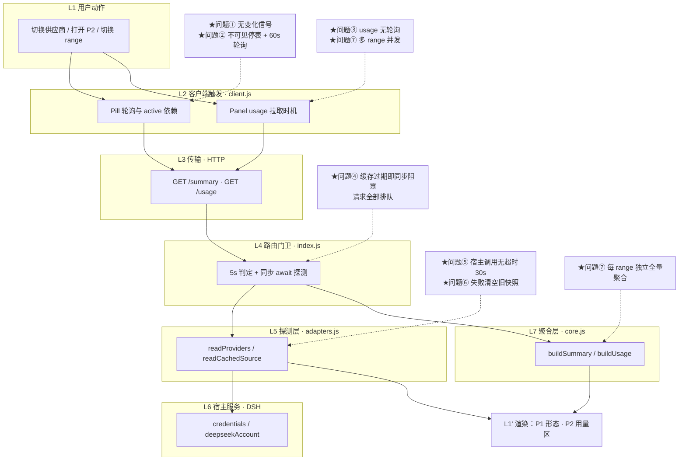
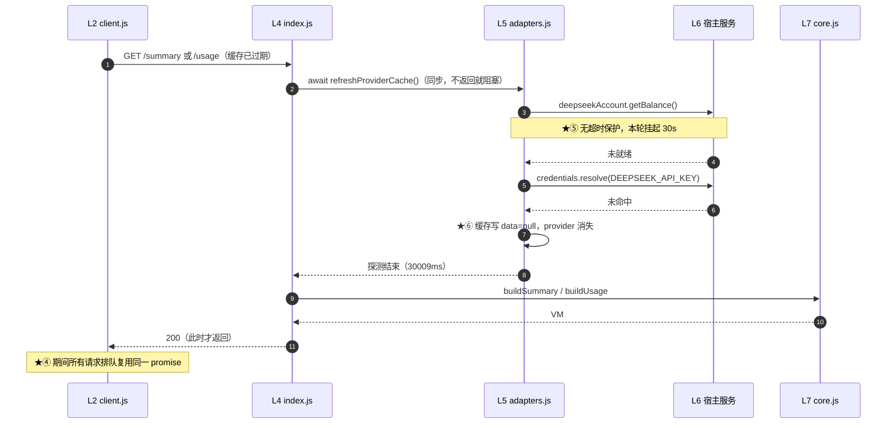
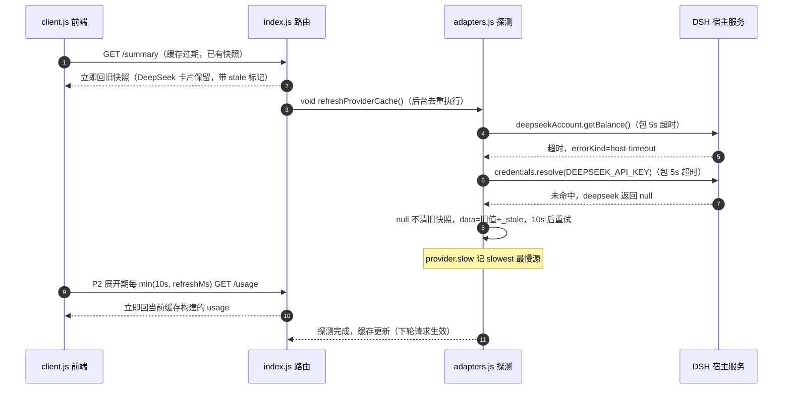
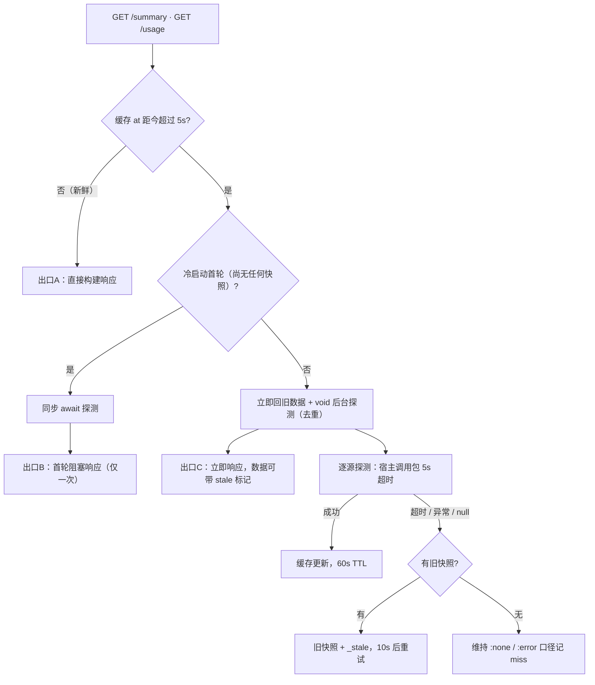
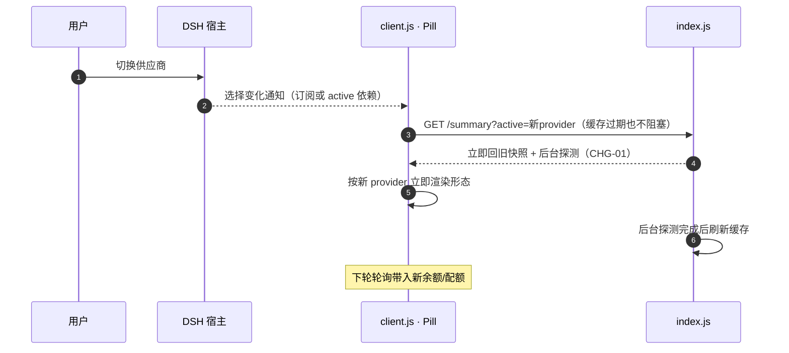
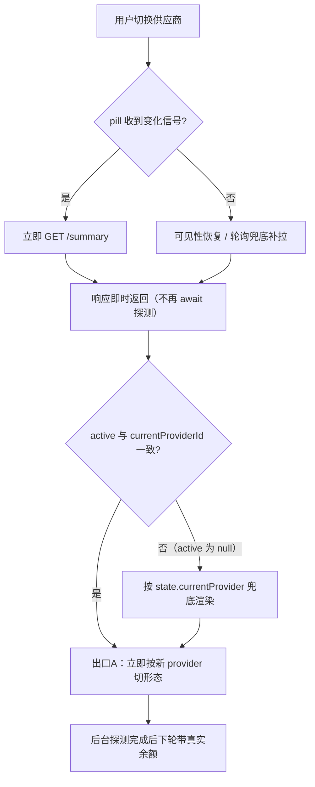
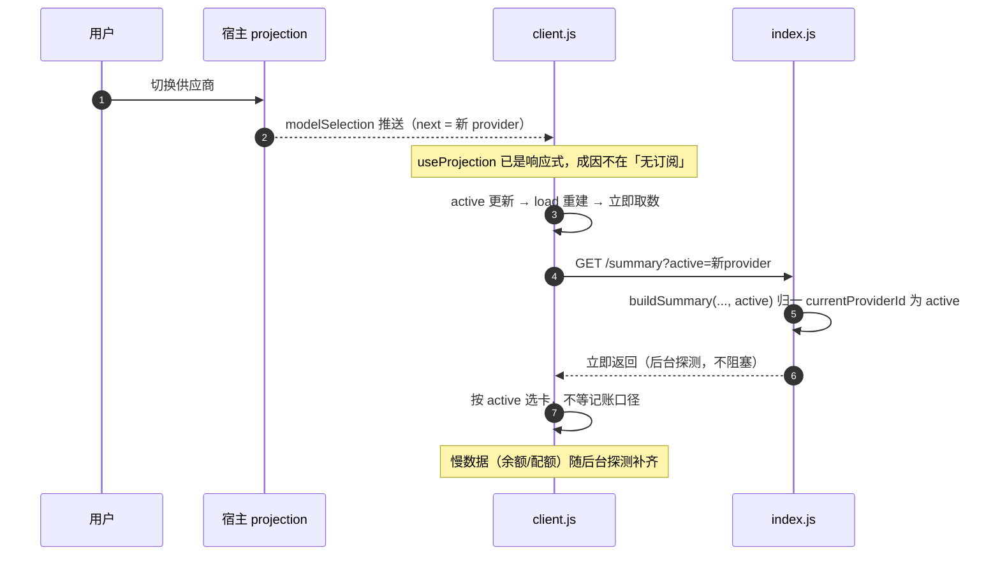

# Provider 探测链路优化：请求去阻塞、失败降级、P1 切换即时化与 P2 用量自动刷新

> 状态：待归档<br>
> 创建时间：2026-11-23<br>
> 更新时间：2026-11-23（CHG-01 ~ CHG-13 全部落地；两条 Issue 已修复并真机验证通过，压缩为归档卡；L1 184 项 + L4 e2e 通过）<br>
> 关联逻辑根：`dsh-token-dash`（`index.js`、`src/adapters.js`、`src/core.js`、`client.js`）<br>
> 排查日志前缀：`[TD:provider]`（全量前缀见 §七）<br>
> 关联资料：[`design.md`](../../design.md)（链路 B · 查余额 / 缓存口径）、现场日志 `.dsh/logs/dsh-token-dash/dsh-token-dash-20261123.log`（宿主用户目录，2026-11-23 18:24 事故）

## 〇、前置依赖 / 代码探查事实

### 已明确

- `/summary` 与 `/usage` 处理中，`providerCacheMeta.at` 距今超过 5s 就**同步 `await` 全量探测**，期间所有请求排队复用同一个在途 promise。（来源：代码探查 `index.js` 路由两处 `> 5000` 判定）
- DeepSeek 源探测优先走 DSH 宿主账户服务 `deepseekAccount.getBalance()`，该调用**无超时保护**；插件直连 HTTP 才有 6s `AbortSignal.timeout`。（来源：代码探查 `src/adapters.js` `deepseek()` / `requestJson()`）
- 凭据解析 `resolveKey()` 直接 `await credentials.resolve(name)`，同为宿主服务调用、无超时。（来源：代码探查 `src/adapters.js` `resolveKey()`）
- 探测失败/未命中时缓存条目被写成 `data: null`，该 provider 立即从 `cacheData()` 消失，卡片缺失余额甚至整卡不显示。（来源：代码探查 `src/adapters.js` `readCachedSource()` 的 then/catch）
- 既有降级先例：声明式源 429 时**复用上一份快照**并按 `Retry-After` 退避（`{ ...previous, _quotaError, _rateLimited }`），`previous` 已作为参数传入 `readSource`。（来源：代码探查 `src/adapters.js` `readDeclarativeSource()`）
- 源级缓存口径：成功 60s / 失败 10s / in-flight 复用；`/summary` 另有 5s 最小刷新间隔。（来源：`design.md` 缓存口径 + 代码探查）
- P2 弹层「范围用量 + 模型明细」只在**挂载、切换时间范围、手动点刷新**三个时机拉取 `/usage`，没有轮询；P1 pill 展开期 `/summary` 轮询为 min(10s, refreshMs)；P3 看板对 summary + usage 均有 10s 轮询先例。（来源：代码探查 `client.js` `Panel` / `Pill` / 看板组件）
- 客户端轮询统一经 `usePolling`，`document.hidden` 时跳过。（来源：代码探查 `client.js` `usePolling`）
- 2026-11-23 18:24 事故（现场日志，本地时间）：18:24:19 一条 `/summary` 触发探测，`provider.slow probeMs=30009`；DeepSeek 源以 `:none` 收场、缓存被清空；用户两次点开 P2 的请求排队 12.6s / 1.9s 后于 18:24:49 一并返回；18:25:58 下一轮探测 3.2s 恢复正常。
- 事故期间用量数据本身已实时入库（`vm usage` tokens 29074079 → 32349908），“数据不新鲜”是取数链路阻塞，不是采集丢失。（来源：现场日志）
- `buildSummary` 已有快照内部字段剥离先例（`plans` / `mode` 剥离后不进 VM），`_stale` 可照此透出。（来源：代码探查 `src/core.js` `buildSummary`）
- `provider.slow` 目前只记 `probeMs` 与失败清单，**无法归因是哪个源拖慢**。（来源：代码探查 `index.js` `refreshProviderCache`）

**P1 形态切换延迟（2026-11-23 用户报告「切换供应商后等了起码 20 多秒 P1 才切换形态」）**

- 日志实证：18:19:40 最后一轮常规探测后，**18:19:40 → 18:24:19 整整 4 分 39 秒无任何请求**；18:24:19 才有一条 `/summary` 进来触发探测（`probeMs=30009`），18:24:49 返回时 P1 数据才更新。（来源：现场日志）
- 客户端 `Pill` 的 `load` 依赖数组为 `[refreshMs, active]`，`active` 变化会重建 `load`，进而触发 `useEffect(() => { load() }, [load])` 立即重新拉取——**形态切换本身有即时重取通道**。（来源：代码探查 `client.js` `Pill`）
- ``active`` 经 `rawActiveProvider` 三级取值：投影 `modelSelection` 的 `next/lastUsed` → `agentDefaultModel.currentSelection()` → `null`。三者都是**读取式调用、无订阅**，切换供应商后如果宿主投影未及时更新或不产生重渲染，pill 收不到任何信号。（来源：代码探查 `client.js` `rawActiveProvider`）
- `usePolling` 在 `document.hidden` 时**停表**，且 `setInterval` 回调内二次判 `document.hidden`；可见性恢复时才立即补拉一次。（来源：代码探查 `client.js` `usePolling`）
- `currentProviderId` 由 `state.currentProvider` 决定，后者在 **ingest 记账时**由最后一条会话事件的 provider 覆盖写入（`state.currentProvider = provider`），不是「用户当前选中」。（来源：代码探查 `src/core.js` 记账段 + `buildSummary`）
- 结论：P1 切换延迟 = **切换动作无网络请求**（客户端无信号 + 后台无变化）**叠加** 首个请求撞上慢探测。20+ 秒 ≈ 等轮询/等可见性恢复的空窗 + 9~30s 探测阻塞。与 P2 的「加载中」是**同一条阻塞链路的不同表现**，但 P1 多一层「客户端无感知」因素。归因汇总见 §2.0.4（①~⑦）。

**宿主 API 探查结论（2026-11-23，`app.asar` 内 `@deepseek-ai/*` 包实证）**

- `useProjection` 是宿主注入给 slot 组件的**响应式订阅钩子**，形如 `useProjection(key)` 返回当前投影值并在变化时触发重渲染。官方 `ActionCardTail` / `QueueDock` / `GoalBar` / `TeamModeToggle` 均以 `useProjectioninjection` 形式使用。（来源：`dsh-client-ui-action-cards` / `dsh-client-ui-conversation` / `dsh-client-ui-agent-team` 的 `lib/client.js`）
- `ProjectionValueStore` 每个 key 有 identity-stable 的 face，`faceOf(key)` 是 `useProjection` 的解析路径，「组件可在 key 有值之前先订阅」。（来源：`dsh-api-session-controller` `lib/types/client/sessions/projection-store.js`）
- `modelSelection` 投影结构含 `next` / `lastUsed`；官方模型选择器 `ModelDirectory.syncInputs()` 读取 `projected.next ?? catalog.value.default` 计算当前选择，并 `projected.subscribe(...)` 跟随变化。（来源：`dsh-client-ui-model-selection` `lib/client.js`）
- 官方模型选择器在 `llm/adapters-updated`、`llm/models-updated`、`settings/document-updated`、`credentials/*-updated` 上均触发 `catalog.refresh()`——**切换供应商属于这些事件之一，投影与目录都会随之更新**。（来源：同上）
- `AgentDefaultModelConfig` 的 `currentSelection()` 返回 `{ provider, model, reasoningEffort? }`，直接读 Config 引用、**无订阅**；切换后的落盘经 `saveSelection()` → `configEditor.edit()`，是异步写。（来源：`dsh-agent-default-model` `lib/index.js`）
- 结论：**P1 拿数据的通道（`useProjection`）本身是响应式的**，切换供应商确实会推送变化；延迟不在「没有订阅」，而在下面两点——

### P1 切换延迟的两个真实成因（探查后修正）

- **成因 A · 渲染依据错了**：`Pill`/`Panel` 取卡用的是 `providers.find(p => p.id === summary.currentProviderId) ?? providers[0]`（`client.js` 两处），而 `currentProviderId` 来自 `state.currentProvider`，后者**只在 `addRecord()` 记账时被覆盖写入**（`state.currentProvider = provider`），即**用户发下一条消息后才变**。切换供应商本身不会改它 → 即使 `active` 变了、请求也回来了，卡片仍然按旧 provider 选。（来源：`client.js` 两处 + `src/core.js` `addRecord`）
- **成因 B · 宿主侧丢弃了 `active`**：`/summary?active=<id>` 的查询串在 `index.js` 路由中**完全未被读取**（全文件无 `active` 使用点），`buildSummary` 也无该入参 → 服务端无法以「用户当前选中」为准回数据。（来源：代码探查 `index.js` 路由 + `src/core.js` `buildSummary`）
- 叠加既有成因（§2.0.4 ②④⑤⑥）：切设置页期间轮询停表造成的空窗 + 收起态 60s 轮询 + 首个请求撞慢探测。但即使这些都修掉，**A（选卡依据）不修，P1 仍会显示旧 provider 的卡片**——这是「等了 20 多秒才切形态」的必要条件。

**2026-11-23 18:42 P2「范围数据加载中」事故（现场日志）**

- 18:41:54 一轮探测 `probeMs=9919`，DeepSeek 掉成 `:none`；此后 27 秒无请求。
- 18:42:31 一轮探测 `probeMs=9629`；**同一毫秒内返回 6 条 `vm usage`**：today / 7d / today / 7d / 30d / all，`probeMs` 分别为 9629 / 5835 / 5265 / 4754 / 3903 / 3223——全部排队等同一轮探测。
- 面板一次打开并发 6 个 range 请求，每个都要独立执行一次 `buildUsage` 全量聚合（30d/all 遍历整月/全部数据）。
- 18:32 之后 `provider.slow` 出现 6 次（7.2s / 10.3s / 7.4s / 9.9s / 9.6s 等），而 18:25 之前探测普遍 280~500ms——**慢探测已从偶发转为常态**，撞上过期缓存的概率随之升高。

### 待对齐

无。以下参数已按建议值定稿（可实施中按日志微调，不阻塞开工）：

| 参数 | 定稿值 | 依据 |
|---|---|---|
| `HOST_TIMEOUT` | 5000 | 与直连 `TIMEOUT=6000` 对齐、留 1s 余量；事故实测 30s 为主要拖累 |
| 降级重试 TTL | 沿用 `TTL_FAIL = 10000` | 不新引入配置项，复用既有失败档 |
| P2 usage 轮询 | `min(10_000, refreshMs)` | 与 P3 看板口径一致 |
| P1 收起态轮询 | `min(30_000, refreshMs)` | 收起时用户不看数据；30s 足够兜底且不放大探测压力 |
| 冷启动首轮 | 保留同步等待 | 避免空面板；代价约 5s+6s，仅首轮一次 |
| `USAGE_TTL_MS` | 5000 | 与探测最小间隔同量级，按 `range` 分键 |
| 问题编号 ①~⑦ | 沿用 | 为本 feature 分析编号，与 Issue 编号（§九）互不冲突 |

> P1 切换感知：已探查确认 `useProjection('modelSelection')` 是响应式通道，**无需宿主 `subscribe`**；采用方案 A + B + C，见 §2.6。

## 一、需求（已对齐）

| ID | 优先级 | 需求 / 边界 / 风险 | 成功信号 |
|---|---|---|---|
| REQ-01 | P0 | `/summary`、`/usage` 不再同步等待探测：缓存过期先回旧数据、探测后台去重执行；仅冷启动首轮同步等待 | 探测进行中接口仍立即返回旧快照；background 态日志 `probeMs` 恒 0 |
| REQ-02 | P0 | 宿主服务调用（`deepseekAccount.getBalance`、`credentials.resolve`）加超时保护，超时归类 `host-timeout` | 单源探测耗时封顶约 HOST_TIMEOUT；日志出现 `errorKind=host-timeout`，不再 30s 挂起 |
| REQ-03 | P1 | 探测 null/异常不清空旧快照：沿用 previous + `_stale` 标记，10s 后重试；无旧快照维持 `:none` 口径 | 宿主服务抖动时 DeepSeek 卡片保留旧余额并带陈旧标记，TTL 过期即消失或恢复 |
| REQ-04 | P1 | P2 弹层展开期「范围用量 + 模型明细」随轮询自动更新 | 聊天中不点刷新，P2 数值在一个轮询周期内自动变化 |
| REQ-05 | P2 | `provider.slow` 携带最慢源归因 `slowest: { id, ms }` | 再现慢探测时日志可直接读出拖慢的源 |
| REQ-06 | P2 | 快照降级状态透出到 UI：卡片标题区显示「数据待更新」角标 | 降级期间角标可见，恢复后消失 |
| REQ-07 | P0 | P1 形态切换即时生效：切换供应商后 pill 立即按新 provider 选卡并切形态，不等轮询、不等慢探测、不等记账 | 未发消息情况下切换后 1s 内 pill 前缀与内容按新 provider 变化 |
| REQ-10 | P1 | 选卡口径三级回退（方案 A+B+C）：active → 最近观测 → 记账，且首卡排序同源 | 三者任一路径下 `currentProviderId` 与 UI 选卡一致；非法值安全回落 |
| REQ-08 | P1 | 面板多 range 取数收敛：一次打开不再并发 6 个 `/usage` 全量聚合；同 range 结果短 TTL 复用 | 打开面板的 `/usage` 请求数下降；同 range 重复请求命中缓存 |
| REQ-09 | P0 | 七处问题（§2.0.4 ①~⑦）与方案 A/B/C 同批交付；任一处缺失不得宣称 P1/P2 延迟已解决 | 逐条对照 §2.0.4 的 CHG 列与 §2.6 三个方案全部落地，验收表对应项全绿 |
| BND-01 | 边界 | Provider/VM/UI 边界不变：adapter 只输出 ProviderSnapshot、VM 只输出 SummaryVM、UI 只消费 VM；仅允许新增只读字段 | 既有字段读法不变 |
| BND-02 | 边界 | 不改 429 复用快照与 `Retry-After` 退避的既有行为 | 限流路径行为与日志不变 |
| BND-03 | 边界 | 凭据安全边界不变：只经 `ctx.credentials.resolve`，不读凭据文件；日志不记 Key 与响应体 | 代码与日志均无新增敏感面 |
| BND-04 | 边界 | P3 看板取数链路、`document.hidden` 跳过轮询、`?active=` 参数现状均不动 | P3 行为不变 |
| BND-05 | 边界 | 不新增 provider、不做 per-provider 拆分；探测并发模型（单在途 promise 去重）不变 | 源表结构与探测并发语义不变 |
| RSK-01 | 风险 | 降级快照会让“已删除 Key 的 provider”多显示约 10s 旧数据 | TTL 过期后卡片消失；角标提示陈旧 |
| RSK-02 | 风险 | HOST_TIMEOUT 过短误伤慢网络下的正常宿主调用 | 5s 初始值 + `host-timeout` 可观测，按日志调整 |
| RSK-03 | 风险 | P2 usage 10s 轮询推高 `buildUsage` 频率 | 探测不再阻塞后构建为本地聚合；验收观测 `vm usage` 的 `durationMs` 无劣化 |
| RSK-04 | 风险 | 冷启动首轮仍同步阻塞（最长约 HOST_TIMEOUT + TIMEOUT） | 仅首轮发生；日志 `probe=bootstrap` 可核对 |

## 二、设计方案（待设计）

### 2.0 结构总览与分层归因

#### 2.0.1 文件职责

| 文件 | 职责 | 本 feature 改动归属 |
|---|---|---|
| `index.js` | 路由、providerCache 元数据、探测调度 | CHG-01（去阻塞）、CHG-05（slow 归因）、CHG-08（usage 缓存） |
| `src/adapters.js` | 源表探测、缓存、宿主/HTTP 调用 | CHG-02（超时）、CHG-03（降级）、CHG-05（逐源计时） |
| `src/core.js` | SummaryVM / UsageVM 构建 | CHG-04（`_stale` 剥离透出） |
| `client.js` | P1 pill / P2 弹层 / P3 看板 | CHG-06（usage 轮询 + 角标）、CHG-07（P1 即时化）、CHG-09（range 收敛） |

分层不变：`client.js ─HTTP→ index.js ─cacheData()→ core.js`，探测全部收敛在 `adapters.js`。

#### 2.0.2 UI → 数据层刷新流程（伪代码）

一个「用户看到新数字」的完整链路分七层，任一层的阻塞都会表现为界面不刷新；P1 与 P2 的延迟是**同一链路上不同层**的问题叠加。

```text
[L1 用户动作]    切换供应商 / 打开 P2 / 切换 range / 长时间对话
        │
        ▼
[L2 客户端触发]  client.js
        ├─ Pill:  active 变了? ──否──► 等 interval（展开 10s / 收起 30s，本次收紧）
        │          document.hidden? ──是──► 停表，空窗累积        ◄── ★问题①
        ├─ Panel: 只在 mount / range 变化 / 手动刷新发请求
        │          无轮询                                          ◄── ★问题③
        └─ 一次打开并发 6 个 range（today×2 / 7d×2 / 30d / all）   ◄── ★问题⑦
        │
        ▼
[L3 传输]        GET /summary?active=… · GET /usage?range=…
        │        （?active= 宿主侧未消费，仅前端自用）
        ▼
[L4 路由门卫]    index.js
        ├─ providerCacheMeta.at 距今 > 5s?
        │     └─ 是 ──► await refreshProviderCache() 同步阻塞
        │                所有请求排队复用同一在途 promise          ◄── ★问题④
        └─ 否 ──► 直接构建 VM 返回
        │
        ▼
[L5 探测层]      adapters.js · readProviders / readCachedSource
        ├─ deepseek 源 → 宿主账户服务 + 凭据解析，均无超时        ◄── ★问题⑤
        ├─ 本轮 null / 抛错 ──► 缓存写 data=null ──► provider 消失 ◄── ★问题⑥
        └─ 成功 ──► 缓存 60s / 失败 10s
        │
        ▼
[L6 宿主服务]    DSH · credentials.resolve / deepseekAccount.getBalance
        └─ 未就绪时无界挂起（实测 30009ms）                        ◄── ★问题⑤
        │
        ▼
[L7 聚合层]      core.js · buildSummary / buildUsage
        └─ 每个 range 独立全量聚合（30d/all 遍历整月 / 全部数据）  ◄── ★问题⑦
        │
        ▼
[L1' 渲染]       VM → P1 pill 形态 / P2 范围用量区 / P3 看板
        └─ 数据到达前：P1 保持旧形态，P2 停在「范围数据加载中…」
```

读法：★ 标记处即本次要修的七处；①②③⑦ 在客户端侧（即使服务端秒回也照样慢），④⑤⑥ 在宿主侧（客户端再怎么轮询也会被堵住）。

#### 2.0.3 问题定位示意（哪一层出的问题）



读法：四个 ★ 旁注分别挂在 L2 / L2+L4 / L4 / L5 上——**P1 与 P2 共用 L4~L6 的阻塞**，客户端侧各自再叠一层自己的触发缺陷。

#### 2.0.4 七处问题与对策总览

| # | 层 | 问题（现状） | 证据 | 对策 | CHG | 主要影响 |
|---|---|---|---|---|---|---|
| ① | L2 client | **选卡依据错**：用 `currentProviderId`（要等下条消息记账才变）而非 `active` | 切换后未发消息，卡片仍是旧 provider | 方案 A：`active` 优先选卡 | CHG-07 | P1 |
| ② | L2 client | 不可见期间轮询停表；收起态轮询 `refreshMs`（默认 60s），空窗累积 | 同上 4 分 39 秒空窗 | 收起态上限收紧到 30s（展开态原已 10s）；恢复可见立即补拉（已有） | CHG-07 | P1 |
| ①′ | L4 index | 宿主**丢弃** `/summary?active=` 参数，服务端无法以用户选中为准 | `index.js` 全文件无 `active` 使用点 | 方案 B：解析并透传，`buildSummary` 归一 | CHG-10/11/12 | P1 |
| ③ | L2 client | P2 的 usage 只在挂载 / 切 range / 手动刷新拉取，无轮询 | 面板常开时数据不动 | `usePolling(loadUsage, min(10s, refreshMs))` | CHG-06 | P2 |
| ④ | L4 index | 缓存过期即**同步 await** 全量探测，所有请求排队 | 6 条 usage 同毫秒返回，probeMs 3223~9629 | stale-while-revalidate，后台去重探测；仅冷启动同步 | CHG-01 | P1 + P2 |
| ⑤ | L5→L6 adapters | 宿主 `getBalance` / `credentials.resolve` 无超时 | `probeMs=30009` | `withHostTimeout` 5s + `host-timeout` 归类 | CHG-02 | P1 + P2 |
| ⑥ | L5 adapters | 探测 null / 失败即写 `data=null`，provider 从 VM 消失 | DeepSeek 反复掉成 `:none` | 沿用旧快照 + `_stale`，10s 后重试 | CHG-03 / CHG-04 | P1 + P2 |
| ⑦ | L2+L7 | 一次开面板并发 6 个 range，各做一次全量聚合 | 18:42:31 同毫秒 6 条 usage | 只拉当前 range + `/usage` 按 range 5s 复用 | CHG-08 / CHG-09 | P2 |

补充（探查后修正，见 §2.6）：① 的表述需拆成两层——表层是「无变化信号」，深层是 **选卡依据错用 `currentProviderId`（方案A）** 与 **宿主丢弃 `?active=`（方案B）**。方案 A/B/C 见 §2.6。

归因结论：**问题④是共同放大器**——它把⑤的超时、⑦的并发全部串行放大到用户可见的秒级等待；只修客户端触发（①②③）而不修④，P1/P2 仍会在探测慢时卡住；只修④而不修①②③，则 P1 依旧要等下一次轮询才有信号。七处需同批交付。

### 2.1 结构与链路（已对齐）

本节两条链路分别对应 P2 与 P1 的延迟；两者共用 §2.0.2 的 L4~L6，故现状图在探测段重合。

**共同阻塞链路**（P1 与 P2 同此段，2026-11-23 18:24 事故实例）



读法：★④ 是放大器——它把 ★⑤ 的 30 秒、★⑦ 的多次聚合全部串到用户可见的等待里。

#### 2.1.1 P2 范围用量延迟（现状 / 目标）

**改动前**（2026-11-23 18:42 实测）：缓存过期即同步等全量探测，6 个 range 请求同毫秒返回、全部排队等一轮 `probeMs=9629` 的探测；宿主调用无超时，最坏 30s；探测失败即清空快照使卡片消失。

**目标**（同一实例贯穿）





缓存条目状态（降级生命周期唯一权威源）：

| 状态 | 进入条件 | 保存内容 | until |
|---|---|---|---|
| fresh | 探测成功 | 新快照 | at + 60s |
| degraded | 探测 null / 异常 且有旧值 | 旧值 + `_stale: true` | at + 10s |
| miss | 探测 null / 异常 且无旧值 | `null` | at + 10s |
| in-flight | 探测进行中 | 共用 promise | — |

不变量：degraded 与 miss 的 `until` 一律走 `cacheExpiry` 失败档；in-flight 期间 `cacheData()` 返回 degraded/fresh 旧值，不返回空数组。

#### 2.1.2 P1 形态切换延迟（现状 / 目标）

**改动前**（2026-11-23 实测）：切换动作不产生请求（18:19:40→18:24:19 空窗 4 分 39 秒），切完回到会话的首个 `/summary` 撞上 `probeMs=30009` 的探测；叠加选卡依据错用记账口径，故 20 余秒后才换形态。
**目标**（同一实例贯穿）





读法：切换后形态切换不再依赖探测完成；余额/配额等慢数据随后台探测补齐。

不变量：`active` 只影响「选哪张卡」，不改 VM 结构；`currentProviderId` 仍是记账口径的最后使用 provider，两者不一致时以 `active` 优先（现状已如此，不变）。

### 2.2 关键签名 / 字段（已确认）

| 层 | 名称 | 备注 |
|---|---|---|
| adapters.js | `withHostTimeout(promise, label)` | 宿主服务统一超时包装；超时抛 `HostTimeoutError`，`errorDetail` 归类 `host-timeout` |
| adapters.js | 缓存行内部字段 `_stale` | 降级沿用旧值标记；`toSnapshot` 透出 `stale` |
| adapters.js | `readProviders()` 返回附加 `slowest` | `{ id, ms }`，供宿主记入 `provider.slow` |
| index.js | `ensureProviderCache()` | 返回 `fresh` / `bootstrap` / `background` 三态，路由按态决定是否同步等待 |
| index.js | `providerBootstrapped`（模块内布尔） | 冷启动首轮探测完成前为 false |
| core.js | SummaryVM 卡片新增只读 `stale` | `_stale` 剥离后进 VM（同 `mode` 剥离先例） |
| client.js | `Panel` usage 轮询 | `usePolling(loadUsage, min(10s, refreshMs))`，随挂载启停 |
| client.js | `Panel` 新增 `active` 入参 | 现签名无 `active`，方案 A 需从 `Pill` 透传（`client.js` 第 1729 行已在传，但第 1749 行未接） |
| client.js | `Pill` 切换感知 | 宿主模型选择依赖 + `active` 与 `summary.currentProviderId` 不一致时强制重取 |
| client.js | `Pill` 轮询上限 | 收起态 `min(30s, refreshMs)`、展开态 `min(10s, refreshMs)` |
| index.js | `usageCache` / `USAGE_TTL_MS` | `/usage` 结果按 range 缓存 5s，记账、探测、prefs 变更时清空 |

### 2.3 数据约束（已定稿）

| 键 | 初始值 | 归属 | 状态 |
|---|---|---|---|
| `HOST_TIMEOUT` | 5000 | `src/adapters.js` 模块常量 | 待拍板（§〇-1） |
| `PROBE_MIN_INTERVAL_MS` | 5000 | `index.js`（原字面量提取，行为不变） | 沿用现状 |
| 降级重试 TTL | 复用 `TTL_FAIL = 10000` | `src/adapters.js` `cacheExpiry` | 待拍板（§〇-2） |
| P2 usage 轮询 | `min(10_000, refreshMs)` | `client.js` `Panel` | 待拍板（§〇-3） |
| P1 可见期轮询 | `min(10_000, refreshMs)` | `client.js` `Pill` | 待拍板（§〇-3 同档） |
| `USAGE_TTL_MS` | 5000 | `index.js` `/usage` 结果缓存 | 待拍板（§〇-5） |

### 2.4 关键陷阱（待补齐）

| 项 | 约束 |
|---|---|
| `updatedAt` 是 VM 构建时间，不代表探测新鲜度 | 降级判定只认快照 `_stale`；背景刷新下 `updatedAt` 每轮都刷新，不得复用 |
| `resolveKey` 逐名重试会叠加超时 | 每名独立 HOST_TIMEOUT；GLM 三凭据名最坏约 15s，探测总时长按最坏值评估（改前无界，改后有界） |
| 降级快照不得掩盖“Key 真被删除” | 无旧快照走 `:none`；有旧快照仅延后 10s，TTL 过期即消失（RSK-01） |
| 后台探测不得变成未处理拒绝 | `void` 调用处挂 `.catch`；探测体单源 `allSettled` 已隔离 |
| 多 pill 冷启动并发 | 在途 promise 去重保证首轮只探测一轮，多个请求共享同一次等待 |
| P1 收紧轮询不得放大探测压力 | 收紧的是客户端请求频率，服务端仍有 5s 门卫 + 后台去重；否则会把 ★④ 变成高频触发 |
| `/usage` 结果缓存必须按 range 分键 | 不同 range 结果不同；且记账 / prefs 变更后必须清空，否则显示旧金额 |

### 2.5 观测（日志设计）

- `provider.slow`：新增 `slowest` 字段（REQ-05）。
- `adapter.*` `detect.fail`：超时路径 `errorKind=host-timeout`（REQ-02）。
- `vm` `build` / `usage`：新增 `probe` 模式字段（`fresh` / `bootstrap` / `background`），核对去阻塞是否生效。

### 2.6 切换供应商后的即时刷新方案（已对齐）

**目标**：切换供应商 → 回到会话，P1 立即按新 provider 切形态，P2 打开即显示新 provider 的数据；余额/配额等慢数据允许稍后补齐。

**数据流（目标态）**



**三处改动（A/B/C 全部实施，按落地顺序排列）**

| 顺序 | 方案 | 改动 | 解决 | 归属 | 依赖 |
|---|---|---|---|---|---|
| 第 1 步 | **方案 B** | `/summary` 消费 `?active=`，由 `buildSummary` 归一输出 | 成因 B（宿主丢参）：服务端口径与前端一致 | `index.js` + `src/core.js` CHG-11 | 无（先做，契约先行） |
| 第 2 步 | **方案 A** | P1/P2 选卡改为「`active` 优先，`currentProviderId` 兜底」 | 成因 A（渲染依据错） | `client.js` CHG-07 | 独立，可与 B 并行 |
| 第 3 步 | **方案 C** | 记账口径按「最近使用 provider」即时回填，使 `currentProviderId` 本身也及时正确 | 让兜底路径与排序也不滞后 | `src/core.js` CHG-12 | 先做 CHG-10（状态写入），见下 |

> 排序理由：B 是接口契约（先定服务端语义），A 是消费方（可并行），C 依赖「切换动作能被宿主侧观测到」这一前提，需先补 CHG-10 的观测点，故排最后。A 单独落地即可解决用户可见现象，B/C 消除口径分歧与排序滞后。

**方案 A（必做，成本最低）**

选卡时优先用组件已有的 `active`，语义上「用户正在用哪个 provider」比「上次记账是谁」更贴近 pill 的定位：

```diff
-      const current = providers.find((provider) => provider.id === summary?.currentProviderId) ?? providers[0]
+      // active（用户当前选择）优先；记账口径 currentProviderId 仅作兜底：
+      // 切换供应商后 currentProviderId 要等下一条消息记账才更新，不能拿它决定卡片
+      const current = providers.find((provider) => provider.id === active)
+        ?? providers.find((provider) => provider.id === summary?.currentProviderId)
+        ?? providers[0]
```

`Pill` 与 `Panel` 两处（`client.js` 第 1681 / 1800 行附近）同改；`Panel` 需把 `active` 作为 prop 传入。

**方案 B（保证服务端一致）**

路由读取 `active` 并透传给 VM，避免「前端选择」与「后端 currentProviderId」各说各话：

```diff
           if (url.pathname === `${ROUTE_PREFIX}/summary` && req.method === 'GET') {
             const startedAt = Date.now()
+            // active 是前端当前选中的 provider：仅用于选卡口径，不写回 state（记账口径不动）
+            const activeParam = url.searchParams.get('active')
             let probeMode = 'fresh'
```

```diff
-            const summary = buildSummary(state, prefs, Date.now(), cacheData())
+            const summary = buildSummary(state, prefs, Date.now(), cacheData(), activeParam)
```

```diff
-export function buildSummary(state, prefs, now, providerInfoInput) {
+export function buildSummary(state, prefs, now, providerInfoInput, activeProvider = null) {
```

```diff
-  const current = state.currentProvider ?? providers[0]?.id ?? null
+  // 前端显式选中优先（只影响展示与排序口径，不改 state.currentProvider 的记账语义）
+  const known = activeProvider !== null && providers.some((provider) => provider.id === activeProvider)
+  const current = (known ? activeProvider : null) ?? state.currentProvider ?? providers[0]?.id ?? null
```

排序段（`providers.sort` 仍用 `state.currentProvider`）保持不动——首卡位置由 `currentProviderId` 决定即可，无需改排序。

**方案 C（必做，改善记账口径本身）**

前提观测点（CHG-10）：宿主侧需能在会话事件流中识别「模型选择变化」。已确认可用信号——`session/event` 中携带 provider/model 的事件在 **用户切换后再发起请求** 时必然出现；但要在「未发消息」时就感知，需读宿主投影。

实施方式（不落盘，daily.json 口径不变）：在 `index.js` 维护一个进程内 `lastSeenProvider`——由 `/summary?active=` 的入参更新（CHG-11 已解析该参数，零额外成本），构建 VM 时作为兜底优先级插入：

```diff
-export function buildSummary(state, prefs, now, providerInfoInput, activeProvider = null) {
+export function buildSummary(state, prefs, now, providerInfoInput, activeProvider = null, recentProvider = null) {
```

```diff
   })
+  // 三级回退：前端显式选择 → 最近观测到的 provider → 记账口径 → 首卡
+  // 注意：必须上移到 providers.sort 之前（原 current 在第 891 行、sort 在第 836 行）
+  const pick = (id) => (typeof id === 'string' && id !== '' && providers.some((provider) => provider.id === id) ? id : null)
+  const current = pick(activeProvider) ?? pick(recentProvider) ?? state.currentProvider ?? providers[0]?.id ?? null
   providers.sort((a, b) => {
-    if (a.id === state.currentProvider) return -1
-    if (b.id === state.currentProvider) return 1
+    if (a.id === current) return -1
+    if (b.id === current) return 1
     return b.usage.todayCost - a.usage.todayCost
   })
+  // ↓ 以下原第 891 行 const current = ... 删除（已上移）
```

- `index.js` 侧维护观测值（模块级变量，进程内、不落盘）：

```diff
     let providerRefresh = null
+    // 最近一次由前端上报的 provider（切换供应商时即更新，不等记账）；仅用于 VM 兜底，不写 state
+    let lastSeenProvider = null
```

```diff
+            const activeParam = url.searchParams.get('active')
+            if (typeof activeParam === 'string' && activeParam !== '') lastSeenProvider = activeParam
             let probeMode = 'fresh'
```

```diff
-            const summary = buildSummary(state, prefs, Date.now(), cacheData(), activeParam)
+            const summary = buildSummary(state, prefs, Date.now(), cacheData(), activeParam, lastSeenProvider)
```

- **为何这样设计**：切换供应商必然触发前端一次 `/summary?active=` 请求（`active` 变化 → `load` 重建），因此「前端上报」就是可靠的切换信号，无需宿主新增事件通道。`lastSeenProvider` 只影响 VM 的选卡与排序，不改 `state.currentProvider` 的记账语义（BND-06）。
- 排序段同步改为用 `current`（diff 已含），使首卡位置也跟随切换。

**P2 的即时性**

P2 与 P1 共用方案 A/B（选卡与 VM 口径一致）；P2 额外的「打开即新数据」由 CHG-01（去阻塞）+ CHG-06（展开期轮询）+ CHG-08/09（range 收敛）承担。切供应商后打开 P2：选卡立即正确（A/B），数据秒回（CHG-01），无需手动点刷新。

**验收口径**

- 切换供应商 → **不发消息** → 打开 P1/P2：卡片立即是新 provider 的形态与名称（A/B 生效即成立，不依赖记账）；
- 余额/配额可短暂显示旧值或 `—`，随后台探测补齐（不阻塞形态切换）；
- 日志 `vm build` 中 `probe=background` 且 `probeMs=0`；`currentProviderId` 与前端 `active` 一致。
- 客户端不新增日志点，沿用既有 `/log` 通道与脱敏约束（BND-03）。

## 三、实现要点（待实施）

### 3.0 开发改动总览（计划）

| ID | 类型 | 文件 | 开发改动说明 |
|---|---|---|---|
| CHG-01 | 修改 | `index.js` | `/summary`、`/usage` 改 stale-while-revalidate：缓存过期立即回旧数据、探测后台去重执行；冷启动首轮同步等待；5s 字面量提取 `PROBE_MIN_INTERVAL_MS`；vm 日志带 `probe` 模式 |
| CHG-02 | 修改 | `src/adapters.js` | 新增 `withHostTimeout` / `HostTimeoutError`；`deepseek()` 账户调用与 `resolveKey()` 凭据解析包超时；`errorDetail` 归类 `host-timeout` |
| CHG-03 | 修改 | `src/adapters.js` | `readCachedSource` 失败/null 不清旧快照：沿用 previous + `_stale`，10s 后重试；`toSnapshot` 透出 `stale` |
| CHG-04 | 修改 | `src/core.js` | `buildSummary` 剥离 `_stale` 并在卡片透出只读 `stale` 字段 |
| CHG-05 | 修改 | `src/adapters.js`、`index.js` | `readProviders` 逐源计时并附加 `slowest`；`provider.slow` 记录之 |
| CHG-06 | 修改 | `client.js` | `Panel` 展开期 usage 轮询；P2Summary / P2Windows 标题区渲染降级角标 |
| CHG-07 | 修改 | `client.js` | **方案 A**：P1/P2 选卡改为 `active` 优先、`currentProviderId` 兜底；`Panel` 增加 `active` 入参；收起态轮询收紧 |
| CHG-08 | 修改 | `index.js` | `/usage` 结果按 range 短 TTL 复用，收敛面板一次打开 6 个并发全量聚合 |
| CHG-09 | 修改 | `client.js` | 面板 range 取数收敛：只拉当前选中 range，其余按需或预取降级 |
| CHG-10 | 修改 | `index.js` | **方案 C 观测点**：维护 `lastSeenProvider`（由 `?active=` 更新，进程内不落盘） |
| CHG-11 | 修改 | `index.js`、`src/core.js` | **方案 B**：`/summary` 消费 `?active=` 并由 `buildSummary` 归一 `currentProviderId` |
| CHG-12 | 修改 | `src/core.js` | **方案 C**：三级回退 `active → recent → 记账`+ 排序改用 `current` |
| CHG-13 | 测试 | `test/unit/`、`scripts/e2e.mjs` | 适配层单测 + e2e 走查（见 3.1 末） |

### 3.1 实施结果（2026-11-23 已落地）

> 全部 CHG 已实施。具体 diff 见下方各节（保留作为施工记录）；落点与行为见 §3.0。

| 验证项 | 结果 |
|---|---|
| L1 `npm test` | **184 passed / 0 failed**（新增 13 项：三级回退 4、stale 透出 2、宿主超时 2、VM 回显 1、归一化回归 1、客户端断言 3） |
| L4 `npm run e2e` | **通过**（UI assertions passed；L4 live sampling 需 `TOKEN_DASH_E2E_LIVE=1` 未启用） |
| 语法检查 | `index.js` / `client.js` / `src/core.js` / `src/adapters.js` 全部 OK |
| 真机验收（local.6） | **通过**：tencent → deepseek-official → opencode-go → tencent 四次切换全部即时跟随；`provider.slow` 归零；`probeMs=0`；`vm usage` 耗时 0~1ms |

实施中的两处修正（相对原计划）：

1. `state.currentProvider` 也需做存在性校验——单测暴露「provider 已从配置移除但 daily.json 仍留旧 id」时会原样输出非法值，已改为 `pick(state.currentProvider)`。
2. `usageCache` / `lastSeenProvider` 需提升到模块级作用域——记账回调在 `ctx.inject` 外层，无法访问注入内的变量；清理逻辑收进 `clearProviderCache()` 一处。

### 3.2 改动落点（已落地，按文件收敛）

> 施工期 diff 已完成使命，此处收敛为「文件 · 落点 · 行为」，不看 diff 也能回答改了哪些地方。

| 文件 | 落点 | 行为变化 | CHG |
|---|---|---|---|
| `index.js` | 模块常量 `PROBE_MIN_INTERVAL_MS` | 5s 判定字面量提取，两处路由共用 | 01 |
| `index.js` | `usageCache` / `USAGE_TTL_MS` / `lastSeenProvider` | 模块级：range 结果缓存 5s、最近观测 provider 记忆 | 08 / 10 |
| `index.js` | `refreshProviderCache` 内 `providerBootstrapped` | 探测完成后置位；同时 `usageCache.clear()` | 01 |
| `index.js` | `ensureProviderCache()`（新增） | 三态门卫：fresh / bootstrap / background | 01 |
| `index.js` | `/summary` 路由 | 读 `?active=`、更新 `lastSeenProvider`、后台探测、透传参数给 VM、日志带 `probe` | 01 / 10 / 11 |
| `index.js` | `/usage` 路由 | 同源去阻塞 + `cachedUsage` 命中复用，日志带 `probe` / `cached` | 01 / 08 |
| `index.js` | `provider.slow` 日志 | 新增 `slowest` 字段 | 05 |
| `index.js` | `clearProviderCache()` | 联动清理 `usageCache` | 08 |
| `index.js` | `session/event` 记账回调 | 有新记录时清 `usageCache` | 08 |
| `src/adapters.js` | `HOST_TIMEOUT` / `HostTimeoutError` / `withHostTimeout` | 宿主调用 5s 上界，超时抛专用错误 | 02 |
| `src/adapters.js` | `errorDetail` | 新增 `host-timeout` 归类 | 02 |
| `src/adapters.js` | `resolveKey` / `deepseek` | 凭据解析与账户余额各包超时 | 02 |
| `src/adapters.js` | `readCachedSource` | null / 异常时沿用旧快照 + `_stale` | 03 |
| `src/adapters.js` | `toSnapshot` | 透出只读 `stale` | 03 |
| `src/adapters.js` | `readProviders` | 逐源计时，返回 `slowest` | 05 |
| `src/core.js` | `buildSummary` 签名 | 新增 `activeProvider` / `recentProvider` | 11 / 12 |
| `src/core.js` | `buildSummary` providerInfo 循环 | 剥离 `_stale`，透出只读 `stale` | 04 |
| `src/core.js` | `buildSummary` current 计算 | `pick` 校验 + 三级回退，**上移到 sort 之前** | 12 |
| `src/core.js` | `buildSummary` 排序 | 基准由 `state.currentProvider` 改为 `current` | 12 |
| `src/core.js` | `buildSummary` 返回值 | 新增只读 `activeProviderId`（归一化后的前端选择） | 14 |
| `client.js` | `Pill` / `Panel` 选卡 | 优先 `summary.activeProviderId`，本地直比与记账口径兜底 | 14 |
| `client.js` | `Pill` 选卡 | `active` 优先、`currentProviderId` 兜底 | 07 |
| `client.js` | `Pill` 轮询 | 收起态上限 30s（展开态仍 10s） | 07 |
| `client.js` | `Panel` 选卡与签名 | 同口径选卡；签名补 `active` 入参 | 07 |
| `client.js` | `Panel` usage 轮询 | 展开期 `usePolling(loadUsage, min(10s, refreshMs))` | 06 |
| `client.js` | `StaleBadge`（新增） | 降级角标，P2Summary / P2Windows 共用 | 06 |
| `client.js` | `styles.staleBadge` + 内联词典 | 角标样式与「数据待更新」词条 | 06 |

### 3.3 测试落点

| 文件 | 覆盖 |
|---|---|
| `test/unit/core.test.mjs` | 三级回退（active / recent / 记账 / 首卡）、非法 id 逐级跳过、排序同源、`_stale` 剥离透出 |
| `test/unit/adapters.test.mjs` | `withHostTimeout` 超时与透传、`errorDetail` 归类、`toSnapshot` 的 `stale` |
| `scripts/e2e.mjs` | 慢探测不阻塞、P2 轮询、降级角标、range 收敛与缓存命中 |

## 四、不改动 / 边界（已确认）

- `BND-01`：Provider/VM/UI 分层与快照契约语义不变，仅新增只读字段。
- `BND-02`：429 复用快照与 `Retry-After` 退避路径不动。
- `BND-03`：凭据只经 `ctx.credentials.resolve`，不读凭据文件；日志不记 Key、响应体。
- `BND-04`：P3 看板链路、`document.hidden` 轮询跳过、`?active=` 参数现状不动（后者另行 issue）。
- `BND-05`：不新增 provider、不做 per-provider 拆分；探测并发模型（单在途 promise）不变。
- `BND-06`：`currentProviderId` 仍取记账口径（最后一条会话事件的 provider），不改为「UI 当前选中」；`active` 与它不一致时以 `active` 选卡即可（现状语义不变）。
- `BND-07`：`?active=` 参数宿主侧仍未消费，本 feature 不改其语义（仅用作缓存与选卡），如需服务端感知另开 issue。

## 五、验收要点（待验证）

| 项 | 来源 | 验证方式 | 结果 |
|---|---|---|---|
| 探测进行中 `/summary` 立即返回旧快照（mock 挂起源） | REQ-01 | 单测 / e2e 断言响应先于探测完成 | 待验证 |
| 冷启动首轮仍同步等待，UI 无空面板 | REQ-01 / RSK-04 | 单测 + 首轮日志 `probe=bootstrap` | 待验证 |
| 宿主服务挂起被 5s 截断并归类 `host-timeout` | REQ-02 | 单测（fake timers）+ 日志核对 | 待验证 |
| 探测失败后卡片保留旧值且带 `stale`，10s 内消失或恢复 | REQ-03 / RSK-01 | 单测降级 TTL 用例 | 待验证 |
| P2 展开期 `/usage` 周期拉取，聊天中数值自动更新 | REQ-04 | e2e + 用户真机复现（切供应商 + 连续对话） | 待验证 |
| `provider.slow` 携带 `slowest` | REQ-05 | 日志核对 | 待验证 |
| 降级角标展示 / 消失 | REQ-06 | e2e `token-dash-stale-badge` | 待验证 |
| L1 `npm test` 全绿 | 全局质量门槛 | 本地执行 | 待验证 |
| E2E `npm run e2e` 通过（宿主链路） | 全局质量门槛 | 本地执行 | 待验证 |
| 真机复现原场景无 30s 冻结、无卡片消失 | REQ-01 ~ REQ-04 | 用户手测 | 待验证 |
| 切换供应商后 P1 在 1 个轮询周期内切形态，20s+ 延迟消失 | REQ-07 | 真机复现「切供应商 → 回会话」 | 待验证 |
| 打开面板 `/usage` 并发数下降，同 range 命中缓存 | REQ-08 | 日志核对请求条数与 `cached` 字段 | 待验证 |
| 18:42 场景复现：面板不再出现「范围数据加载中…」长时间停留 | REQ-01 / REQ-08 | 真机复现 + 日志 `probeMs=0` | 待验证 |
| ★① 切换后有变化信号（或 active 兜底命中），pill 立即重取 | REQ-07 / REQ-09 | e2e mock 投影变化 | 待验证 |
| ★② 可见期轮询上限 10s，空窗不再累积到分钟级 | REQ-07 / REQ-09 | 日志观察 `/summary` 间隔 | 待验证 |
| ★③ P2 展开期 usage 自动更新 | REQ-04 / REQ-09 | e2e 轮询断言 | 待验证 |
| ★④ 缓存过期时接口立即返回旧数据（`probe=background`） | REQ-01 / REQ-09 | 单测 + 日志 | 待验证 |
| ★⑤ 宿主调用超时截断，出现 `host-timeout` | REQ-02 / REQ-09 | 单测 fake timers + 日志 | 待验证 |
| ★⑥ 探测失败保留旧快照并带 `stale` | REQ-03 / REQ-09 | 单测降级 TTL | 待验证 |
| ★⑦ 一次开面板 `/usage` 请求数与聚合次数下降 | REQ-08 / REQ-09 | 日志请求条数 + `cached` | 待验证 |
| 方案A：切换后未发消息，P1 卡片即按 `active` 选新 provider | REQ-07 / REQ-09 | e2e mock 投影变化 + 真机 | 待验证 |
| 方案B：`/summary?active=X` 返回的 `currentProviderId` 为 X；非法值回落记账口径不报错 | REQ-07 / REQ-10 | 单测 `buildSummary` 第 5 参数 | 待验证 |
| 方案C：`active` 缺失时用 `lastSeenProvider`；两者都缺时回落记账口径；进程重启后仍安全 | REQ-10 | 单测三级回退 + 重启场景 | 待验证 |
| 方案C：首卡位置随切换变化（排序用 `current`） | REQ-10 | 单测 `providers[0].id` 断言 | 待验证 |

## 七、日志速查

- 根前缀：`[TD:...]`（诊断 JSONL，`~/.dsh/logs/dsh-token-dash/`；本 feature 不新增日志文件与模块）
- 关键打点（本 feature 涉及）：

| 前缀 | 事件 | 时机 | 级别 | 本 feature 变化 |
|---|---|---|---|---|
| `[TD:provider]` | `slow` | 单轮探测超过 5s | warn | 新增 `slowest` 字段 |
| `[TD:provider]` | `cache.state` | miss 清单变化 | info | 不变 |
| `[TD:adapter.*]` | `detect.fail` | 单源失败 | warn | 可出现 `errorKind=host-timeout` |
| `[TD:vm]` | `build` / `usage` | 每次 `/summary` / `/usage` | info | 新增 `probe` 模式字段；background 态 `probeMs` 恒 0；`usage` 另增 `cached` 字段 |

## 九、自测反馈台（活跃期，归档前删除）

> 两条 Issue 均 `[已修复]` 并压缩为归档卡（6 块形态）。原 #1/#2 同根因已合并，原 #3 重编号为 #2。

### Issue #1 · 切换供应商后 P1/P2 长时间不更新 [已修复]

**关闭口径**：2026-11-23 真机验证，local.6 上 `provider.slow` 归零、`vm build` 恒 `probe=background` / `probeMs=0`、`vm usage` 耗时 0~1ms；P2 不再停留加载态，P1 切换即时生效。

**根因**：`/summary`、`/usage` 在缓存过期时同步 await 全量探测，所有请求排队；宿主调用无超时，最坏 30s。表现为 P2 卡在「范围数据加载中」（6 个 range 请求同毫秒返回，`probeMs` 9629/5835/5265/4754/3903/3223）与 P1 20 余秒才换形态（空窗 4 分 39 秒后首个请求撞上 `probeMs=30009`）。

**图**：见 §2.1.1「取数：stale-while-revalidate」时序图与 §2.1.2 P1 形态切换链路（均保留）。

**处理**：CHG-01 去阻塞（`ensureProviderCache` 三态门卫）、CHG-02 宿主调用 5s 超时、CHG-03/04 失败沿用旧快照 + `stale`、CHG-06 Panel usage 轮询、CHG-08/09 range 收敛与短 TTL。

CL：未提交

**遗留**：无。

### Issue #2 · 两个 API provider 之间切换时 P1/P2 不跟随 [已修复]

**关闭口径**：2026-11-23 真机 local.6，tencent → deepseek-official → opencode-go → tencent 四次切换全部即时跟随；`active=deepseek-account` 时 `currentProviderId=deepseek-official`（修复前为 `tencent`）。

**根因**：双层。① 客户端 `Pill` 的 `load` 用 `useCallback` 捕获 `active` 闭包，而 `usePolling` 只依赖 `refreshMs`，定时器持旧闭包导致请求带旧值；② 服务端 `pick()` 用原始字符串与 `providers[].id` 字面比对，宿主上报路由名 `deepseek-account` 与快照 id `deepseek-official` 不同字 → 落空。只有 API↔API 命中：`opencode-go` 路由名与 id 字面一致故正常。

**图**：见 §2.1.2 目标态时序图（选卡三级回退分支图保留在 §2.6）。

**处理**：local.4 恢复读 `next`、`load` 改读 `activeRef`、新增 `active` 变化即时取数、补 `active`/`currentProviderId` 诊断；local.5 `pick()` 加 `normalizeProvider()`；local.6 VM 回显 `activeProviderId` 供 UI 直接选卡。

CL：未提交

**遗留**：新增 provider 时须同步 `normalizeProvider` 别名表，否则路由名与内部 id 不同字仍会回落记账口径；`recentProvider` / `state.currentProvider` 两条回退已走归一化，无残留字面比对。
