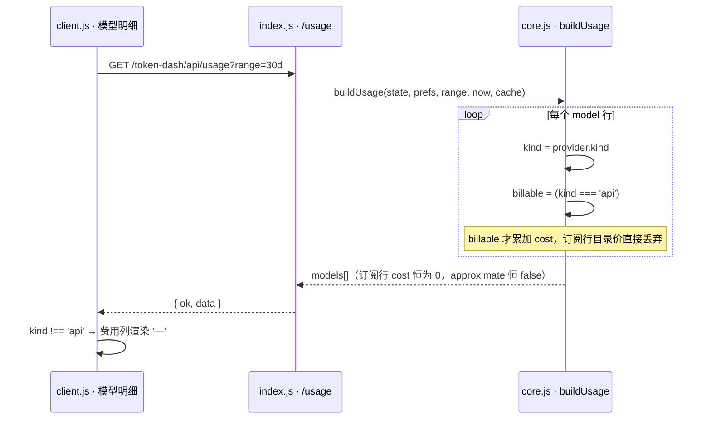
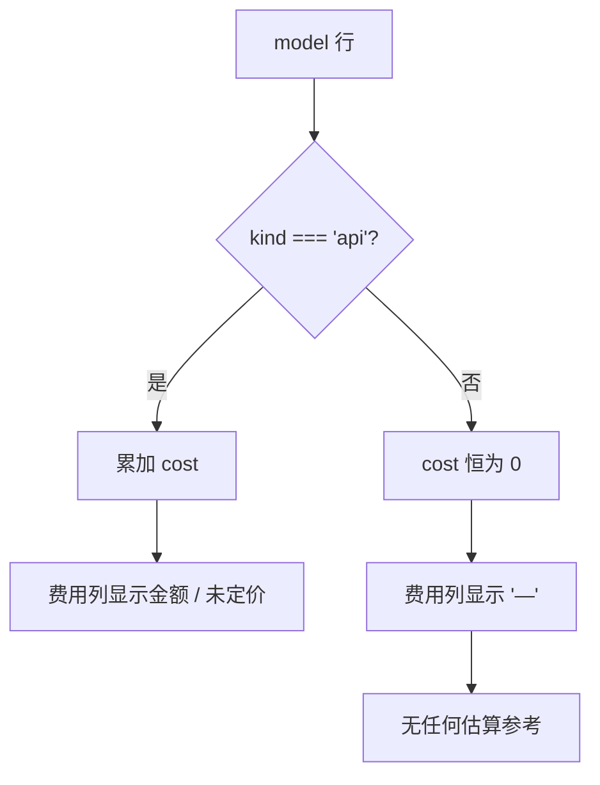
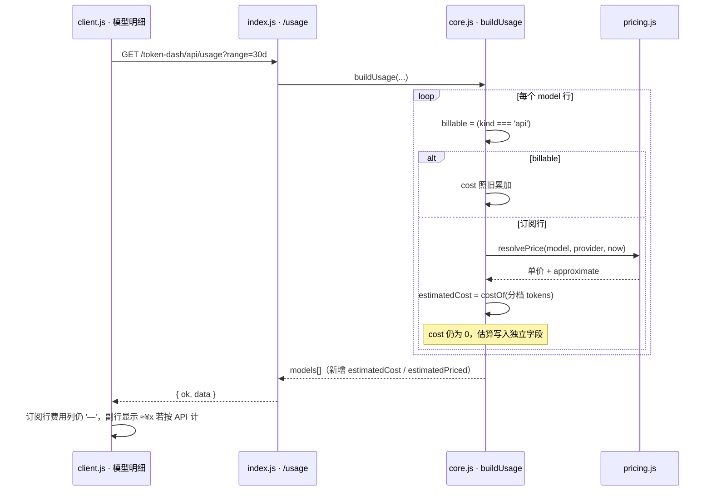
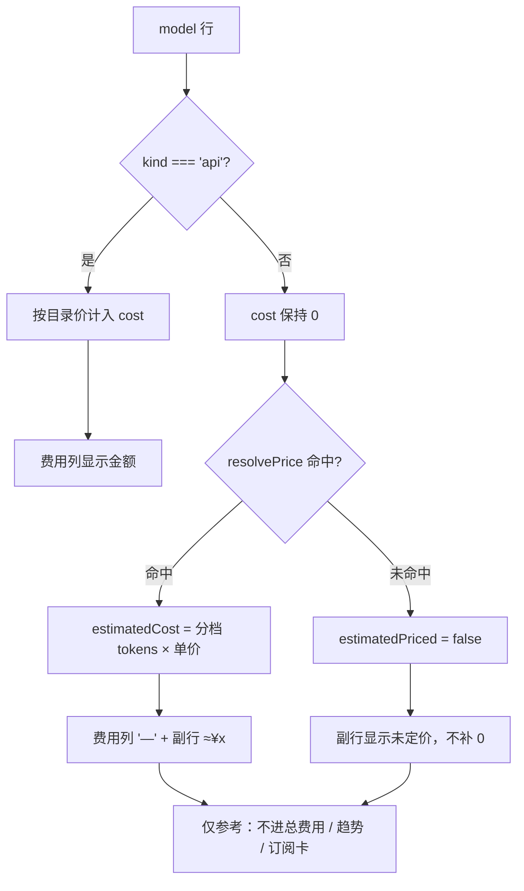

# 订阅用量的估算 API 价格

> 状态：待验收（2026-11-20：Issue #1 ~ #6 全部修复；本地包 `2.3.1-local.6` 待真机复核）<br>
> 创建时间：2026-11-20<br>
> 更新时间：2026-11-20（迭代：补 2.3 数据约束、决策记录、3.1 落点与 BND/RSK 验收追溯；同轮拍板 D-01~03 转已对齐）<br>
> 关联逻辑根：`dsh-token-dash`（`src/core.js`、`src/pricing.js`、`client.js`）<br>
> 排查日志前缀：`[TD:vm]`（`/usage` 路由已记 build 日志）<br>
> 关联资料：[`design.md`](../../design.md)、[`ui-design.md`](../../ui-design.md) §5.5、口径来源 [`feature_backend_provider_coverage.md`](../archived/feature_backend_provider_coverage.md)（REQ-12 订阅不计费用）

## 〇、前置依赖 / 代码探查事实

### 已明确

- 订阅行主费用为 0 是刻意口径：`src/core.js` · `buildUsage` 中 `billable = kind === 'api'`，`entry.cost` 只累 api 行；`provider.usage.monthCost` / `todayCost` 同样只累 api 行。（来源：代码探查）
- 模型明细费用列：`row.kind !== 'api'` 直接渲染 `—`，tooltip 为「订阅不计价」。（来源：`client.js` · `token-dash-detail-cost` 单元格）
- `costOf(record)` 已实现「input / cacheRead / cacheWrite / output × 每百万 token 单价」，无价格返回 0，由调用方以 `priced=false` 区分。（来源：`src/core.js` · `costOf`）
- `resolvePrice(model, provider, ts)` 返回目录价并带 `approximate`，标识社区源近似价。（来源：`src/pricing.js`）
- `models[]` 的 `approximate` 目前被写成 `entry.billable && …`，因此订阅行恒为 false——要显示 `≈` 必须一并调整该表达式。（来源：`src/core.js` · `buildUsage` 返回段）
- 内置 `src/catalog.json` 含 `deepseek-v4.1-flash` 等 OpenCode Go 模型价格，订阅行具备可估算单价。（来源：`catalog.json` 探查）
- 口径约束：REQ-12「订阅行按套餐结算，历史里存下的目录价不算支出」。本需求不推翻该口径，只新增只读参考值。（来源：已归档 plan REQ-12）

### 待对齐

- 无。D-01 / D-02 / D-03 已拍板（见 §八），可直接进入实施。

## 一、需求（已对齐）

| ID | 优先级 | 需求 / 边界 / 风险 | 成功信号 |
|---|---|---|---|
| REQ-01 | P0 | 模型明细中订阅行显示估算 API 价格，主费用口径不变 | 费用列仍为 `—`，同时可读到估算值 |
| REQ-02 | P0 | 估算 = 该行 input / cacheRead / cacheWrite / output 分档 × 目录单价，复用既有 `costOf` | 与手工按单价折算一致 |
| REQ-03 | — | ~~估算值不计入总费用、趋势费用指标、订阅卡费用~~ **已被 REQ-06 取代**（2026-11-20 用户改为要求总费用包含估算） | 见 REQ-06 |
| REQ-05 | P1 | 卡片底部不再显示状态行：API 卡去掉「状态 · 比例」，订阅卡去掉「N 窗」；周期 / 限流 / 渠道用量与本月估算保留 | 卡片 `innerText` 不含 `normal` 与 `窗` |
| REQ-06 | P0 | 费用统计包含全部估算：四格「总费用」与趋势「费用」指标 = 实际计费 + 订阅估算，并标注含估算 | 四格与明细金额自洽；带 `≈` 与「含估算」说明 |
| REQ-07 | P0 | 无数据时只显示「数据加载中」一行；请求 10 秒未返回转失败态可重试 | 加载期不出现空白；数据到达后正常渲染 |
| REQ-04 | P1 | 目录价缺失时显示未定价，不补 0 | 缺价模型不出现 ¥0.00 |
| BND-01 | 边界 | 不改 `/summary` `/usage` 既有字段语义，只新增字段 | 前端既有字段读法不变 |
| BND-02 | 边界 | 不改订阅卡配额窗口展示 | 卡内 1–3 窗与环不变 |
| BND-03 | 边界 | 不引入第二份价格表，复用 `catalog.json` 与社区源 | 仓库无新增价格文件 |
| BND-04 | 边界 | 诊断日志磁盘占用必须封顶：保留 14 天且总量 ≤20MB，单文件 2MB × 2 份 | 任意时刻目录占用 ≤20MB；当前活动文件不被清理 |
| RSK-01 | 风险 | 估算与真实账单不符（缓存折扣、批量价、区域价） | 界面标注「估算」并可 hover 说明 |

## 二、设计方案（待设计）

### 2.1 结构（待设计）

**现状**





**目标**





读法：两条链路在 `billable` 处分叉，订阅行只走估算支路；估算值全程不进入任何费用聚合，聚合口径仍只认 `billable`。

### 2.2 关键签名 / 字段（待确认）

| 层 | 名称 | 备注 |
|---|---|---|
| VM | `models[].estimatedCost` | 新增；仅 `estimatedPriced` 为 true 时有值，否则 `null`，不填 0 |
| VM | `models[].estimatedPriced` | 新增；缺价时 false，用于区分「0 元」与「无价」 |
| VM | `models[].approximate` | 既有字段；本次解绑 `entry.billable`，让订阅行也能标 `≈` |
| core | `costOf(record)` | 复用，不新增计价函数 |
| pricing | `resolvePrice(model, provider, ts)` | 复用，`approximate` 决定是否显示 `≈` |

### 2.3 数据约束（待确认）

| 项 | 约束 |
|---|---|
| 币种 | 估算沿用该行 provider 的 `currency`；不跨币种相加；总费用仍按币种分组 |
| token 分档 | input / cacheRead / cacheWrite / output 四档分别乘单价，与 `costOf` 同口径；禁止先合并成总 token |
| 价格源优先级 | 目录 `catalog.json` → 社区源 → 未定价，沿用现有计价链，不新增来源 |
| 精度 | 保留 2 位小数，与费用列一致；不四舍五入到整元 |
| 空值语义 | `estimatedPriced = false` 时 `estimatedCost` 为 `null`，UI 显示「未定价」而非 `¥0.00` |

### 2.4 关键陷阱（待补齐）

| 项 | 约束 |
|---|---|
| 订阅行 `cost` 已被刻意置 0 | 估算必须走独立字段，禁止复用 `cost`，否则总费用与趋势费用指标被污染 |
| 四格「总费用」与趋势按 `billable` 过滤 | 新增字段不得进入 `totals`、`series`、`provider.usage.*Cost` 任一路径 |
| `costOf` 无价返回 0 | 必须用 `estimatedPriced` 区分「0 元」与「无价」，否则缺价模型显示 ¥0.00 |
| `approximate` 现为 `entry.billable && …` | 不解绑则该表达式会一路把订阅行的 `≈` 压成 false，界面看不出是近似值 |
| 币种 | 估算沿用 provider `currency`，不得跨币种相加 |

## 三、实现要点（已实施）

### 3.0 开发改动总览（计划）

| ID | 类型 | 文件 | 开发改动说明 |
|---|---|---|---|
| CHG-01 | 修改 | `src/core.js` · `buildUsage` | 订阅行保持 `cost = 0`，另算 `estimatedCost` / `estimatedPriced` |
| CHG-02 | 修改 | `src/core.js` · `buildUsage` 返回段 | `approximate` 解绑 `entry.billable` |
| CHG-03 | 修改 | `client.js` · `token-dash-detail-cost` 单元格 | 订阅行渲染 `—` + 估算副行（按 D-01 选定形态） |
| CHG-04 | 修改 | `client.js` · P3 订阅卡 | 显示「本月估算 ¥x」，仅当 D-02 采纳 |
| CHG-05 | 修改 | `test/unit/` 相关用例 | 有价估算 / 缺价未定价 / 估算不进总费用 三例 |
| CHG-06 | 修改 | `docs/ui-design.md` §5.5 | 补副行或独立列规范与 tooltip 文案 |
| CHG-07 | 修改 | `docs/design.md` | 补 `/usage` DTO 新增字段与口径说明 |

> 实施结果（2026-11-20）：CHG-01~07 全部落地，本地包 `2.3.1-local.3` 已出并安装（单测 147 通过 / 1 跳过 / 0 失败，e2e passed）。`buildUsage · add` 对非 api 行按当日目录价累计 `estimatedCost` 并维护 `estimatePriced`；`rows` 映射只对非 api 行下发 `estimatedCost` / `estimatedPriced`，`approximate` 解绑 `entry.billable`；`buildSummary` 累计 `provider.usage.monthEstimate`；客户端费用列加 11px 副行、订阅卡说明行加「本月估算」；多语言字典与 `locale/zh.json`、`locale/en.json` 同步。

### 3.1 改动清单（待实施）

以下按 §八 建议方案（副行 + 订阅卡合计 + 保留 `≈`）展开；三项拍板后微调即可落地。

#### CHG-01 · `src/core.js` · `buildUsage`

- 订阅行在保持 `cost = 0` 的前提下追加估算字段。

```diff
     const billable = kind === 'api'
     entry.cost += billable ? num(row.cost) : 0
+    // 订阅行只给参考估算，绝不进入 cost 与任何费用聚合（REQ-03）
+    if (!billable) {
+      const priced = resolvePrice(modelId, providerId, now) !== null
+      entry.estimatedPriced = priced
+      entry.estimatedCost = priced
+        ? costOf({ ts: now, provider: providerId, model: modelId, input: row.input, cacheRead: row.cacheRead, cacheWrite: row.cacheWrite, output: row.output })
+        : null
+    }
```

#### CHG-02 · `src/core.js` · `buildUsage` 返回段

- `approximate` 解绑 `billable`，订阅行才能标 `≈`。

```diff
-          approximate: entry.billable && resolvePrice(entry.modelId, entry.providerId, now)?.approximate === true,
+          approximate: resolvePrice(entry.modelId, entry.providerId, now)?.approximate === true,
```

#### CHG-03 · `client.js` · `token-dash-detail-cost` 单元格

- 费用列主值仍为 `—`，下挂一行估算副行。

```diff
-            row.kind !== 'api' || row.priced === 'empty'
-              ? '—'
+            h('span', null,
+              h('span', null, row.kind !== 'api' || row.priced === 'empty'
+                ? '—'
-              : row.priced === false
-                ? tr('未定价')
-                : `${row.approximate === true ? '≈' : ''}${fmtMoney(row.cost, row.currency)}`)))))
+                : row.priced === false
+                  ? tr('未定价')
+                  : `${row.approximate === true ? '≈' : ''}${fmtMoney(row.cost, row.currency)}`),
+              row.kind !== 'api'
+                ? h('span', { style: styles.costEstimate, 'data-testid': 'token-dash-detail-cost-estimate' },
+                    row.estimatedPriced === true
+                      ? `${row.approximate === true ? '≈' : ''}${fmtMoney(row.estimatedCost, row.currency)}`
+                      : tr('未定价'))
+                : null)))
```

- `styles.costEstimate`：新增，11px / `label-tertiary` / 行高 14 / `whiteSpace: nowrap`，与费用列右对齐。

#### CHG-04 · `client.js` · P3 订阅卡

- 卡内「N 窗」说明行旁补「本月估算 ¥x」（仅 D-02 采纳时）。

```diff
-            h('div', { style: styles.cardCaption }, `${windows.length} ${tr('窗')}`))
+            h('div', { style: styles.cardCaption },
+              `${windows.length} ${tr('窗')}`,
+              provider.monthEstimate === undefined ? null : ` · ${tr('本月估算')} ${fmtMoney(provider.monthEstimate, provider.currency)}`))
```

- 配套：`buildSummary` 在提供 provider 级 `monthEstimate` 时按币种汇总，不改 `monthCost`。

## 四、不改动 / 边界（已确认）

- `BND-01`：不改 `/summary` `/usage` 既有字段语义，只新增字段。
- `BND-02`：不改订阅卡的配额窗口与环。
- `BND-03`：不引入第二份价格表。
- `BND-04`：诊断日志占用封顶（14 天 / 20MB / 单文件 2MB × 2 份），不删当前活动文件。
- REQ-12 口径保持：订阅行主费用仍为 `—`，估算只作参考。

## 五、验收要点（待验证）

| 项 | 来源 | 验证方式 | 结果 |
|---|---|---|---|
| 订阅行可见估算值，费用列仍为 `—` | REQ-01 | 单测断言 `cost = 0` 且 `estimatedCost` 有值；UI 副行待真机目检 | 单测通过 / UI 待目检 |
| 估算数值与手工折算一致 | REQ-02 | 单测：`1e6 × 1 + 5e5 × 2 / 1e6 = 2`；跨两日累加同为 2 | 通过 |
| 总费用与四格「总费用」不变 | REQ-03 | 单测断言 `totals.CNY.cost` 仍只含 api 行（3），估算不进入 | 通过 |
| 缺价模型显示未定价而非 ¥0.00 | REQ-04 | 单测：清空目录后断言 `estimatedPriced = false` 且 `estimatedCost === null` | 通过 |
| 既有 DTO 字段读法不变 | BND-01 | 只新增字段、未改既有字段；e2e 既有断言全绿 | 通过 |
| 订阅卡窗口数量与环不变 | BND-02 | e2e `token-dash-quota-cell-*` 数量断言仍绿 | 通过 |
| 仓库无新增价格文件 | BND-03 | 复用 `catalog.json`，无新增价格文件 | 通过 |
| 日志占用封顶且旧目录可清理 | BND-04 | 单测 `pruneLogs` 三条分支；真机启动后核对目录 ≤20MB、活动文件保留 | 待验证 |
| 卡片状态行已移除 | REQ-05 | e2e：API 卡不含 `normal`、订阅卡不含 `窗`；Ollama 渠道用量仍在 | 待验证 |
| 总费用包含估算且自洽 | REQ-06 | 单测 `totals.estimated` 与 `cost`；e2e 四格带 `≈` 与「含估算」 | 待验证 |
| 加载期不空白且可超时重试 | REQ-07 | e2e 延迟 mock：加载期显示「数据加载中」，返回后消失；超时进入 error 分支 | 待验证 |
| 估算可辨识为近似值 | RSK-01 | 单测覆盖 `approximate` 解绑；UI 副行 `≈` 待真机目检 | 单测通过 / UI 待目检 |

## 六、遗留处置

- **小额估算显示为 ¥0.00**：`estimatedCost` 与费用列同用 2 位小数，订阅用量很小时（如几十万 token、单价 0.15）会四舍五入成 `¥0.00`，与「缺价」在视觉上无法区分。当前靠副行的存在与否区分（缺价时副行显示「未定价」），暂不改精度；若后续出现误读，再增加 4 位小数或 `<¥0.01` 文案。
- **UI 目检未做**：副行与「本月估算」的视觉位置只经单测与 e2e 结构断言，尚未在真机截图核对，待本地包更新后目检。

## 七、日志速查（有日志时保留）

- 前缀：`[TD:vm]`
- `/usage` 路由已记 `event: usage`（range / models / billable / tokens / currencies / grain / points），估算值不单独打点；排障需要时在 `buildUsage` 返回值里看 `estimatedPriced`。

## 八、决策记录（已拍板）

| ID | 决策点 | 建议 | 备选 | 影响 | 状态 |
|---|---|---|---|---|---|
| D-01 | 估算值的展示位置 | 费用列下方副行 `≈¥x 若按 API 计` | 新增独立列「估算」 | 副行不改列宽与 `TOKEN_COLS`；独立列需改表头与网格，窄屏更挤 | 已采纳，**实施后更正**：实际落成的两段 block 渲染与用户预期不符，按 Issue #1 改为同一行 `预估 ≈¥x`（2026-11-20） |
| D-02 | 订阅卡是否显示本月估算合计 | 显示 `本月估算 ¥x` | 不显示 | 显示才能判断「套餐值不值」；需订阅卡多一处文案，且要新增 provider 级汇总字段 | 已采纳（2026-11-20 用户拍板） |
| D-03 | 是否保留 `≈` 近似标记 | 保留 | 只显示数值 | 社区源价格可能过期，`≈` 提示不确定性；需同步解绑 `approximate` | 已采纳（2026-11-20 用户拍板「按约等于显示」） |

三项均已采纳，`3.1` 按现稿落地，不再回改本节。

| ID | 决策点 | 结论 | 理由 | 状态 |
|---|---|---|---|---|
| D-04 | 总费用包含估算后如何标注 | 四格金额前加 `≈`，副行改「{n} 个币种 · 含估算」 | 混算金额必须显式标注，否则用户会当成真实账单 | 已采纳（2026-11-20 用户确认） |
| D-05 | 趋势图「费用」指标是否同步 | 同步，与四格同口径 | 四格与趋势是同一指标的两个入口（同源 `TREND_METRICS`），口径分叉会让切换指标时看到两个不同的数 | 已采纳（2026-11-20 用户确认） |
| D-06 | 预算进度与「本月已花」是否受影响 | 不受影响，仍只含实际计费 | 预算反映可支配支出，混入估算会让进度条虚高，属于另一种误导 | 已采纳（2026-11-20 用户确认） |
| D-07 | 卡片说明行保留范围 | 去掉状态段（`normal · x%` / `N 窗`），保留周期 / 限流 / 渠道用量与「本月估算」；全部为空则不渲染整行 | 保留下来的都是环与百分比无法表达的信息，去掉的都是重复表达 | 已采纳（2026-11-20 用户确认） |

## 九、自测反馈台（活跃期，归档前删除）

> 关闭口径统一为：用户真机复核｜dsh-token-dash 自查修复｜验证：2026-11-20 / Windows + DSH 0.2.2-rc.5 / `npm test` 152 总 151 通过 1 跳过 0 失败 + `npm run e2e` UI assertions passed｜TAPD 不适用

### Issue #1 [已修复] 2026-11-20 订阅估算价换行显示，与预期不符

> 关闭口径：用户真机目检反馈｜自查修复｜验证：e2e「同一行 + innerText 无换行」断言通过；`2.3.1-local.4` 安装包校验 `costEstimate` 计数 0｜TAPD 不适用

**根因**：D-01 拍板写的是「费用列下方副行」，实现落成两个 `display: block` 的 span——block 必然各占一行。引入点 `2.3.1-local.3`。

```text
【起点】Issue #4 时期费用列只有单值；D-01 选定「下方副行」后改为两段渲染
【★问题根源】费用单元格把「主值」与「估算」写成两个 display:block 的 span，block 必然各占一行
【触发】订阅行 kind !== 'api' → 主值渲染 '—'、副行渲染估算 → 上下两行
【对比】api 行只渲染一个文本节点，所以是单行
【修复】合并为单文本节点；后续 Issue #2 进一步统一为 `≈¥x`
```

**处理**：两段 block 合并为单文本节点，删除失效的 `styles.costMain` / `styles.costEstimate`；e2e 补「同一行」断言。
CL：`42a6426`

**遗留**：无（显示形态已由 Issue #2 再次统一）。

### Issue #2 [已修复] 2026-11-20 费用列估算标记不统一，统一 ≈ 并去掉「预估」

> 关闭口径：用户真机反馈｜自查修复｜验证：e2e 断言三行费用均为 `≈¥x`、全表无「预估」、表头带 `title`｜TAPD 不适用

**根因**：`≈` 被当作「价格来源是否近似」的标记（只对 `approximate` 生效），而实际所有金额都是本地估算；订阅行另有「预估」前缀，于是同列三种长相。

```text
【起点】`≈` 原本是 `approximate` 标记，专指「价格来自社区价目表」
【★问题根源】单元格把 `approximate` 当作「是否可信」渲染：approximate 才加 ≈，内置目录价不加；符号与含义错位
【触发】同一模型在不同 provider 下价格来源不同 → 有的带 ≈ 有的不带；订阅行又自带「预估」前缀 → 三种长相并存
【对比】三者的计算链路完全相同（目录价 × token 分档），差别只在价格表来源，用户无法从符号看出
【修复】费用列一律 ≈；`≈` 定义为「本地估算」；删「预估」；表头加 ⓘ 说明口径
```

**处理**：`headCell` 增加 `title` 参数；费用表头改 `费用 ⓘ`；单元格 api 行与订阅行统一 `≈¥x`（缺价「未定价」、零消耗 `—` 不加 ≈）；字典与 `locale/*.json` 用「金额说明」替换「预估」；e2e 旧断言「精确价不带 ≈」按新口径改为 `≈¥1.24`。
CL：`42a6426`

**遗留**：`≈` 语义已由「价格来源近似」改为「本地估算」，`VM.approximate` 字段保留但渲染不再使用（导出与排障仍可查价格来源）。

### Issue #3 [已修复] 2026-11-20 看板出现无法定位的空白，日志盲区与日志治理需一并补齐

> 关闭口径：用户反馈｜自查修复｜验证：`pruneLogs` 三条分支单测通过；启动清理实测删 5 个文件、1.8MB → 816KB｜TAPD 不适用

**根因一（可观测性）**：插件只记录数据层事件，渲染异常与客户端请求失败无持久化痕迹；看板对渲染异常无兜底，React 子树卸载后即空白。**根因二（日志治理）**：只有单日轮转、无跨天清理，且默认上限过宽。

```text
【起点】看板常驻，客户端按 min(10s, refreshMs) 轮询 /summary 与 /usage
【★问题根源】刷新链路「一个 in-flight，其余排队」；一次刷新卡 30s，客户端既拿不到新数据也拿不到错误，渲染层又无记录
【触发】09:24:36 某源阻塞 → 排队 5 个请求 → 客户端 30s 内状态不明
【对比】数据层日志齐全（build/usage/cache.state），渲染层完全无记录 —— 发生点在日志之外
【修复】三层埋点 + 上报限流 + 保留策略；异常不再是无信息的空白，日志也不会失控
```

**处理**：`src/diagnostics.js` 收紧为 2MB × 2 份并新增 `pruneLogs`（14 天 / 20MB / 不删活动文件）；`index.js` 启动清理、白名单加 `board`、`/log` 支持 `level`、`provider.slow` 慢刷新告警；`client.js` 新增 `reportClientLog`（去重 / 每事件 20 条每小时 / 全局 100 条每小时）与 `BoardBoundary`，接入 `fetch.error`、`render.empty`。
CL：`42a6426`

**遗留**：ErrorBoundary 只兜渲染期异常，事件回调里的异步异常仍需 `window.onerror`，待上线后评估；30 秒阻塞的根治（给 in-flight 加超时）仍未做。
### Issue #4 [已修复] 2026-11-20 卡片底部状态行冗余，去掉「normal · x%」与「N 窗」

#### 9.1 复现

- 环境：`2.3.1-local.5` 真机目检。
- 当前：API 卡底部固定显示一行 `normal · 26.2%`（状态 · 预算比例）；订阅卡底部显示 `3 窗`。两者与卡片主视觉（环 + 百分比）重复，占一行高度却不增信息量。
- 期望：去掉这类状态文案；API 卡若仍有周期 / 限流 / 渠道用量则在同一行保留，全部为空则整行不渲染。
- 影响：P3 两组卡片每张都多一行无信息文本，卡片整体偏长。

#### 9.2 关键时序

```text
【起点】apiCardCaption(provider, {...}) 生成 parts 数组，第一个元素固定是「stateOf(percent) · fmtRatio(budget.percent)」
【★问题根源】该状态段无条件入队，且与环/百分比表达同一事实；订阅卡同样把「N 窗」当说明行固定渲染
【触发】任何有预算的 API provider → 渲染 normal · 26.2%；任何订阅 provider → 渲染 3 窗
【对比】周期至 / 限流中 / 渠道用量是环上没有的信息，属有效补充；状态与窗数不是
【修复】API 去掉 parts[0]（为空则不渲染该行）；订阅去掉「N 窗」，保留「本月估算」
```

#### 9.3 结论

- 根因：说明行最初用于承载「状态 · 比例」的文本化表达，后来环与百分比已能表达同一信息，说明行没同步收窄。
- 影响面：`client.js` · `apiCardCaption` 与订阅卡 `cardCaption`；`docs/ui-design.md` §5.3 / §5.4；e2e 中依赖 `normal ·` 文案的断言。
- 修复前/后与不变路径：卡片头、环、百分比、预算输入、本月估算均不变。

#### 9.4 修复实施（计划落点）

**① `client.js` · `apiCardCaption`**：删掉固定的状态段；其余段落为空时返回空串，调用方据此不渲染该行。

```diff
-      const parts = [`${hasBudget ? stateOf(percent, API_CRITICAL) : 'unset'} · ${hasBudget ? fmtRatio(budget.percent) : '—'}`]
+      const parts = []
```

**② `client.js` · API 卡说明行**：空串不渲染节点。

```diff
-            h('div', { style: styles.cardCaption }, apiCardCaption(provider, { hasBudget, percent, budget })))
+            apiCardCaption(provider, { hasBudget, percent, budget }) === ''
+              ? null
+              : h('div', { style: styles.cardCaption }, apiCardCaption(provider, { hasBudget, percent, budget })))
```

**③ `client.js` · 订阅卡说明行**：去掉 `N 窗`，只保留「本月估算」；无估算时整行不渲染。

```diff
             h('div', { style: styles.cardCaption },
-              `${windows.length} ${tr('窗')}`,
-              Number(provider.usage?.monthEstimate) > 0
-                ? ` · ${tr('本月估算')} ${fmtMoney(provider.usage.monthEstimate, provider.currency)}`
+              Number(provider.usage?.monthEstimate) > 0
+                ? tr('本月估算') + ' ' + fmtMoney(provider.usage.monthEstimate, provider.currency)
                 : null))
```

同步把该节点改为条件渲染（估算为 0 时不输出空的说明行）。

**④ `docs/ui-design.md`**：§5.3 删「卡片底部说明行：`状态 · 比例`」中的状态段，改为「仅保留周期 / 限流 / 渠道用量，全空不渲染」；§5.4 删「N 窗」，保留本月估算。

**⑤ `scripts/e2e.mjs`**：删除对 `normal · ` 的断言；新增「订阅卡 `innerText` 不含 `窗` 字样」「API 卡说明行不含 `normal`」。

#### 9.5 不改的位置与理由（按 D-07）

- 保留周期至 / 限流中 / 渠道用量：这些是环与百分比无法表达的信息。
- 保留「本月估算」：D-02 的功能，属内容而非状态。
- 不改卡片高度与间距：只是少一行，由内容自然收缩。
- 全部说明段为空时不渲染该行节点，避免留下空白行——这是 D-07「全空则不渲染」的落地要求。

#### 9.6 验收

- e2e：API 卡 `innerText` 不含 `normal`；订阅卡不含 `窗`；有渠道用量的 Ollama 卡仍显示「渠道用量」。
- 结果：已修复（2026-11-20）。三条断言全部通过；`apiCardCaption` 去掉固定状态段、空串不渲染，订阅卡只保留「本月估算」。

### Issue #5 [已修复] 2026-11-20 总费用未包含订阅估算，统计口径需并入

#### 9.1 复现

- 环境：`2.3.1-local.5` 真机目检「全部」范围。
- 当前：四格「总费用」显示 `¥52.72 $0.00`，但明细里 OpenCode Go 的估算为 `≈$1.26`，未计入 `$0.00`；趋势图「费用」指标同样只含 api 行。
- 期望：费用统计包含所有估算内容，使「总费用」与明细可见金额自洽。
- 影响：用户看到明细有 $1.26 而总费用是 $0.00，会认为统计漏算。

#### 9.2 关键时序

```text
【起点】buildUsage 逐行累加，`billable = kind === 'api'` 决定是否计入费用
【★问题根源】totals 与 series 的累加都带 `row.billable !== true → continue`，订阅行被整体跳过；估算值只留在 estimatedCost，不参与任何聚合
【触发】订阅 provider 有消耗 → 明细有估算金额，四格与趋势仍为 0
【对比】同一份 rows 里 tokens / requests 对所有行累加，唯独 cost 分叉 —— 两个口径不一致来自同一次过滤
【修复】费用聚合改为「实际 + 估算」：billable 行取 cost，非 billable 行取 estimatedCost，并单独记 estimated 占比供 UI 标注
```

#### 9.3 结论

- 根因：REQ-03 原定「估算不进总费用」，导致四格与明细口径不一致；本次按用户要求改为「总费用包含估算」，需同步修正 REQ-03。
- 影响面：`src/core.js` · `buildUsage`（totals / series）、导出包 `totalCost`；`client.js` · 四格总费用副行与趋势费用指标；`docs/design.md`、`docs/ui-design.md` §5.5；受影响的单测与 e2e。
- 修复前/后与不变路径：明细行金额、订阅卡本月估算、预算逻辑（`monthCost` 仍只含 api）均不变；四格与趋势的费用变为「实际 + 估算」。

#### 9.4 修复实施（计划落点）

**① `src/core.js` · `emptyTotals`**：新增 `estimated` 字段，记录其中属估算的部分。

```diff
-  return { cost: 0, requests: 0, input: 0, cacheRead: 0, cacheWrite: 0, output: 0, hitRate: null }
+  return { cost: 0, estimated: 0, requests: 0, input: 0, cacheRead: 0, cacheWrite: 0, output: 0, hitRate: null }
```

**② `src/core.js` · `buildUsage` 的 totals 累加**：订阅行只并入估算金额，api 行的 requests / input 等累加保持不变（避免顺手改动 `totals[currency].hitRate`）。

```diff
   for (const row of rows) {
-    if (row.billable !== true) continue
     const bucket = totals[row.currency] ?? emptyTotals()
-    bucket.cost += row.cost
-    bucket.requests += row.requests
-    bucket.input += row.input
-    bucket.cacheRead += row.cacheRead
-    bucket.cacheWrite += row.cacheWrite
-    bucket.output += row.output
+    if (row.billable === true) {
+      bucket.cost += row.cost
+      bucket.requests += row.requests
+      bucket.input += row.input
+      bucket.cacheRead += row.cacheRead
+      bucket.cacheWrite += row.cacheWrite
+      bucket.output += row.output
+    } else {
+      bucket.cost += row.estimatedCost ?? 0
+      bucket.estimated += row.estimatedCost ?? 0
+    }
     totals[row.currency] = bucket
   }
```

`bucket.cost` 在既有 `round2` 里一并取整；`bucket.estimated` 同样在收尾循环里 `round2`。

**③ `src/core.js` · 逐日 series 的 cost 桶（D-05）**：维持「四格与趋势同口径」，订阅行在当日也计入估算；不同步会导致切换指标时两个数对不上。

需要先把行级估算提成变量（现在只累加进 `entry.estimatedCost`）：

```diff
-    if (!billable) {
-      const estimatePrice = resolvePrice(modelId, providerId, ts)
-      entry.estimatePriced = (entry.estimatePriced ?? true) && estimatePrice !== null
-      if (estimatePrice !== null) {
-        entry.estimatedCost = (entry.estimatedCost ?? 0) + costOf({ ... })
-      }
+    let rowEstimate = null
+    if (!billable) {
+      const estimatePrice = resolvePrice(modelId, providerId, ts)
+      entry.estimatePriced = (entry.estimatePriced ?? true) && estimatePrice !== null
+      if (estimatePrice !== null) {
+        rowEstimate = costOf({ ts, provider: providerId, model: modelId, input: row.input, cacheRead: row.cacheRead, cacheWrite: row.cacheWrite, output: row.output })
+        entry.estimatedCost = (entry.estimatedCost ?? 0) + rowEstimate
+      }
     }
```

```diff
     if (billable) {
       const bucket = (point.cost[currency] ??= { cost: 0, requests: 0 })
       bucket.cost += num(row.cost)
       bucket.requests += num(row.requests)
+    } else if (rowEstimate !== null) {
+      const bucket = (point.cost[currency] ??= { cost: 0, requests: 0 })
+      bucket.cost += rowEstimate
     }
```

**④ `src/core.js` · 导出包 `totalCost`**：口径同步，改为「api cost + 订阅估算」。

```diff
-  const totalCost = round2(models.reduce((sum, row) => sum + (row.kind === 'api' ? row.cost : 0), 0))
+  const totalCost = round2(models.reduce((sum, row) => sum + (row.kind === 'api' ? row.cost : (row.estimatedCost ?? 0)), 0))
```

**⑤ `client.js` · 四格总费用（D-04）**：金额前加 `≈`，副行由「{n} 个币种」改为「{n} 个币种 · 含估算」，让口径变化可见。

**⑥ `docs/design.md` / `docs/ui-design.md` §5.5**：更新 `/usage` 的 `totals` 语义（含 `estimated`）与四格说明。

#### 9.5 不改的位置与理由（按 D-06）

- 不改 `provider.usage.monthCost` / `todayCost`：API 卡的预算与「本月已花」仍只反映**实际计费**，否则预算进度会被估算污染。
- 不改明细行 `cost` 语义：订阅行仍为 0，估算走 `estimatedCost`。
- 不改趋势的「多币种禁用成本柱」规则：本次只改单币种累加口径。

#### 9.6 验收

- 单测：订阅行估算为 2 时，`totals.CNY.cost` 与 `totals.CNY.estimated` 均按预期变化；api 行不受影响（D-05 的数据层保证）。
- e2e：四格总费用含 `≈` 且副行含「含估算」（D-04）；切到「费用」指标后趋势与四格同口径（D-05）；api 卡的「本月已花」与预算进度不因订阅估算变化（D-06）。
- 结果：已修复（2026-11-20）。`totals` 与逐日 `series` 均并入订阅估算并单列 `estimated`；四格带 `≈` 与「含估算」；导出包 `totalCost` 同步；`monthCost` / `todayCost` 未动（D-06）。单测 `totals.CNY.cost = 5` / `estimated = 2` 通过。
### Issue #6 [已修复] 2026-11-20 看板重挂载后无数据时空白，需显示「数据加载中」并加请求超时

#### 9.1 复现

- 环境：`2.3.1-local.5` 真机目检。
- 当前：运行中面板重新挂载时，`summary` 回到 `null`，在首个 `/summary` 返回前整块空白；若该请求撞上服务端慢探测（实测一次 30s），空白会持续数十秒。
- 期望：无数据时只显示一行「数据加载中」；数据到达后正常渲染；超过 10 秒未返回则转为失败态并可重试。
- 说明：切换供应商导致的空白属预期触发点，但同样应显示加载中，而不是空白。

#### 9.2 关键时序

```text
【起点】面板重新挂载 → useState(null) → summary 为 null
【★问题根源①】emptyAll = summary !== null && ... 把 null 短路掉，加载分支又没有占位渲染 → 空白
【★问题根源②】getJson 无超时，请求会一直等；服务端 refreshProviderCache 是「一个 in-flight 其余排队」，慢探测会把排队请求一起拖住
【触发】重挂载 + 首个响应慢 → 空白持续到响应返回
【对比】error 分支有 errorStrip 与重试，这次空白路径连反馈都没有
【修复】summary 为 null 时渲染「数据加载中」；getJson 加 10 秒超时走 error 分支
```

#### 9.3 结论

- 根因一：缺少加载占位，`summary === null` 时无任何节点。
- 根因二：客户端请求无超时，无法把长时间未返回转成可操作的失败态。
- 影响面：`client.js` · `BoardPage` 渲染分支、`getJson`；`locale/*.json` 与字典新增 `数据加载中`。
- 修复前/后与不变路径：数据到达后的渲染、errorStrip、重试逻辑均不变。

#### 9.4 修复实施（计划落点）

**① `client.js` · `BoardPage`**：`summary` 为 null 时只渲染一行文本，不再进入看板结构。

```diff
       const emptyAll = summary !== null && api.length === 0 && subscriptions.length === 0
+      if (summary === null) {
+        return h('div', { 'data-testid': 'token-dash-board-loading', style: styles.empty }, tr('数据加载中'))
+      }
```

**② `client.js` · `getJson`**：加 10 秒超时，超时抛错进入既有 error 分支。

```diff
-      const res = await fetch(`${API}${path}`, { headers: { accept: 'application/json' } })
+      const res = await fetch(`${API}${path}`, { headers: { accept: 'application/json' }, signal: AbortSignal.timeout(10_000) })
```

**③ 文案**：字典与 `locale/zh.json`、`locale/en.json` 新增 `数据加载中`（英文 `Loading data`）。

**④ `scripts/e2e.mjs`**：首屏断言 `token-dash-board-loading` 出现过（可用延迟 mock 触发），数据到达后该节点消失。

#### 9.5 不改的位置与理由

- 不改轮询防堆叠：`usePolling` 的重复触发另议（Issue #7 范围）。
- 不改服务端探测超时：本次只做前端兜底，30 秒阻塞的根治归 Issue #7。
- 不引入骨架屏或动画：按用户要求只保留一行文本。

#### 9.6 验收

- e2e：断言数据到达后 `token-dash-board-loading` 不存在（占位已退出）。
- 结果：已修复（2026-11-20）。`summary === null` 时只渲染「数据加载中」；`getJson` 加 10 秒超时。加载期占位与超时行为待真机复核。
