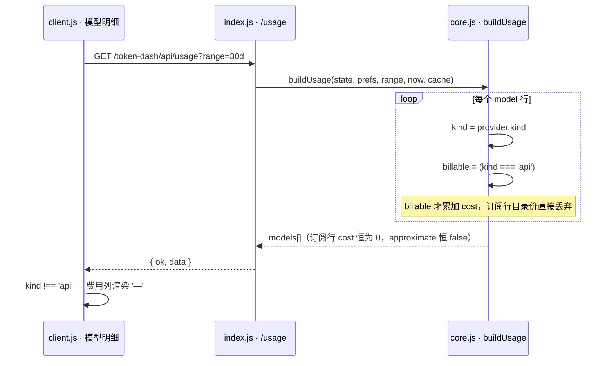
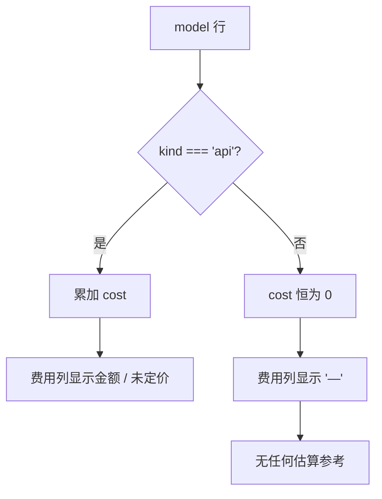
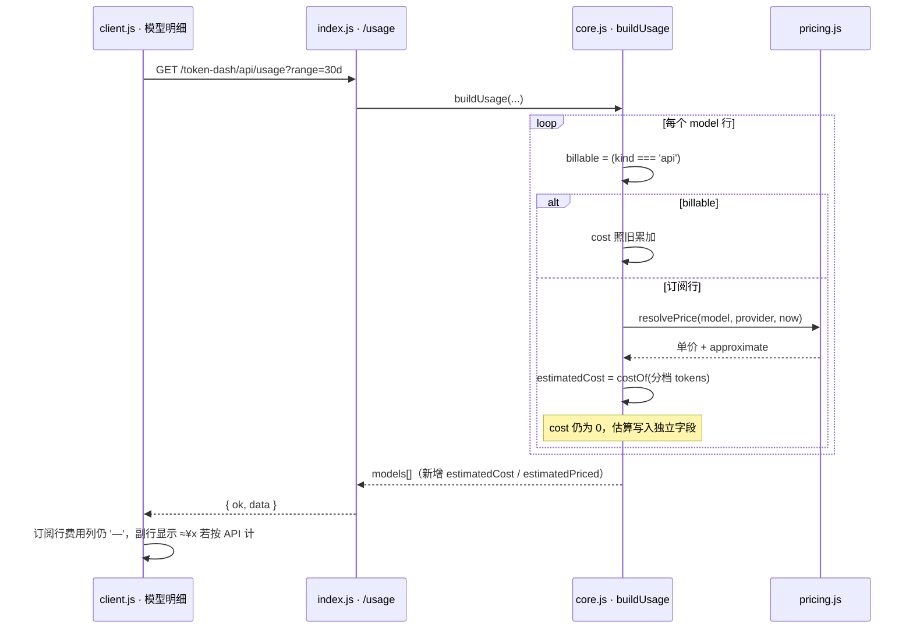
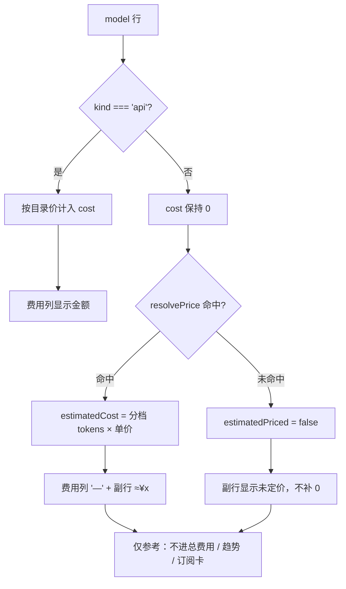

# 订阅用量的估算 API 价格

> 状态：待验收（2026-11-20：CHG-01~07 与 Issue #1 / #2 / #3 均已实施；本地包 `2.3.1-local.5` 待真机复核）<br>
> 创建时间：2026-11-20<br>
> 更新时间：2026-11-20（迭代：补 2.3 数据约束、决策记录、3.1 落点与 BND/RSK 验收追溯；同轮拍板 D-01~03 转已对齐）<br>
> 关联逻辑根：`dsh-token-dash`（`src/core.js`、`src/pricing.js`、`client.js`）<br>
> 排查日志前缀：`[TD:vm]`（`/usage` 路由已记 build 日志）<br>
> 关联资料：[`design.md`](../../design.md)、[`ui-design.md`](../../ui-design.md) §5.5、口径来源 [`feature_backend_provider_coverage.md`](../archived/feature_backend_provider_coverage.md)（REQ-12 订阅不计费用）

## 〇、前置依赖 / 代码探查事实

### 已明确

- 订阅行主费用为 0 是刻意口径：`src/core.js` · `buildUsage` 中 `billable = kind === 'api'`，`entry.cost` 只累 api 行；`provider.usage.monthCost` / `todayCost` 同样只累 api 行。（来源：代码探查）
- 模型明细费用列：`row.kind !== 'api'` 直接渲染 `—`，tooltip 为「订阅不计价」。（来源：`client.js` · `token-dash-detail-cost` 单元格）
- `costOf(record)` 已实现「input / cacheRead / cacheWrite / output × 每百万 token 单价」，无价格返回 0，由调用方以 `priced=false` 区分。（来源：`src/core.js` · `costOf`）
- `resolvePrice(model, provider, ts)` 返回目录价并带 `approximate`，标识社区源近似价。（来源：`src/pricing.js`）
- `models[]` 的 `approximate` 目前被写成 `entry.billable && …`，因此订阅行恒为 false——要显示 `≈` 必须一并调整该表达式。（来源：`src/core.js` · `buildUsage` 返回段）
- 内置 `src/catalog.json` 含 `deepseek-v4.1-flash` 等 OpenCode Go 模型价格，订阅行具备可估算单价。（来源：`catalog.json` 探查）
- 口径约束：REQ-12「订阅行按套餐结算，历史里存下的目录价不算支出」。本需求不推翻该口径，只新增只读参考值。（来源：已归档 plan REQ-12）

### 待对齐

- 无。D-01 / D-02 / D-03 已拍板（见 §八），可直接进入实施。

## 一、需求（已对齐）

| ID | 优先级 | 需求 / 边界 / 风险 | 成功信号 |
|---|---|---|---|
| REQ-01 | P0 | 模型明细中订阅行显示估算 API 价格，主费用口径不变 | 费用列仍为 `—`，同时可读到估算值 |
| REQ-02 | P0 | 估算 = 该行 input / cacheRead / cacheWrite / output 分档 × 目录单价，复用既有 `costOf` | 与手工按单价折算一致 |
| REQ-03 | P0 | 估算值不计入总费用、趋势费用指标、订阅卡费用 | 四格「总费用」与趋势费用与现状逐位一致 |
| REQ-04 | P1 | 目录价缺失时显示未定价，不补 0 | 缺价模型不出现 ¥0.00 |
| BND-01 | 边界 | 不改 `/summary` `/usage` 既有字段语义，只新增字段 | 前端既有字段读法不变 |
| BND-02 | 边界 | 不改订阅卡配额窗口展示 | 卡内 1–3 窗与环不变 |
| BND-03 | 边界 | 不引入第二份价格表，复用 `catalog.json` 与社区源 | 仓库无新增价格文件 |
| BND-04 | 边界 | 诊断日志磁盘占用必须封顶：保留 14 天且总量 ≤20MB，单文件 2MB × 2 份 | 任意时刻目录占用 ≤20MB；当前活动文件不被清理 |
| RSK-01 | 风险 | 估算与真实账单不符（缓存折扣、批量价、区域价） | 界面标注「估算」并可 hover 说明 |

## 二、设计方案（待设计）

### 2.1 结构（待设计）

**现状**





**目标**





读法：两条链路在 `billable` 处分叉，订阅行只走估算支路；估算值全程不进入任何费用聚合，聚合口径仍只认 `billable`。

### 2.2 关键签名 / 字段（待确认）

| 层 | 名称 | 备注 |
|---|---|---|
| VM | `models[].estimatedCost` | 新增；仅 `estimatedPriced` 为 true 时有值，否则 `null`，不填 0 |
| VM | `models[].estimatedPriced` | 新增；缺价时 false，用于区分「0 元」与「无价」 |
| VM | `models[].approximate` | 既有字段；本次解绑 `entry.billable`，让订阅行也能标 `≈` |
| core | `costOf(record)` | 复用，不新增计价函数 |
| pricing | `resolvePrice(model, provider, ts)` | 复用，`approximate` 决定是否显示 `≈` |

### 2.3 数据约束（待确认）

| 项 | 约束 |
|---|---|
| 币种 | 估算沿用该行 provider 的 `currency`；不跨币种相加；总费用仍按币种分组 |
| token 分档 | input / cacheRead / cacheWrite / output 四档分别乘单价，与 `costOf` 同口径；禁止先合并成总 token |
| 价格源优先级 | 目录 `catalog.json` → 社区源 → 未定价，沿用现有计价链，不新增来源 |
| 精度 | 保留 2 位小数，与费用列一致；不四舍五入到整元 |
| 空值语义 | `estimatedPriced = false` 时 `estimatedCost` 为 `null`，UI 显示「未定价」而非 `¥0.00` |

### 2.4 关键陷阱（待补齐）

| 项 | 约束 |
|---|---|
| 订阅行 `cost` 已被刻意置 0 | 估算必须走独立字段，禁止复用 `cost`，否则总费用与趋势费用指标被污染 |
| 四格「总费用」与趋势按 `billable` 过滤 | 新增字段不得进入 `totals`、`series`、`provider.usage.*Cost` 任一路径 |
| `costOf` 无价返回 0 | 必须用 `estimatedPriced` 区分「0 元」与「无价」，否则缺价模型显示 ¥0.00 |
| `approximate` 现为 `entry.billable && …` | 不解绑则该表达式会一路把订阅行的 `≈` 压成 false，界面看不出是近似值 |
| 币种 | 估算沿用 provider `currency`，不得跨币种相加 |

## 三、实现要点（已实施）

### 3.0 开发改动总览（计划）

| ID | 类型 | 文件 | 开发改动说明 |
|---|---|---|---|
| CHG-01 | 修改 | `src/core.js` · `buildUsage` | 订阅行保持 `cost = 0`，另算 `estimatedCost` / `estimatedPriced` |
| CHG-02 | 修改 | `src/core.js` · `buildUsage` 返回段 | `approximate` 解绑 `entry.billable` |
| CHG-03 | 修改 | `client.js` · `token-dash-detail-cost` 单元格 | 订阅行渲染 `—` + 估算副行（按 D-01 选定形态） |
| CHG-04 | 修改 | `client.js` · P3 订阅卡 | 显示「本月估算 ¥x」，仅当 D-02 采纳 |
| CHG-05 | 修改 | `test/unit/` 相关用例 | 有价估算 / 缺价未定价 / 估算不进总费用 三例 |
| CHG-06 | 修改 | `docs/ui-design.md` §5.5 | 补副行或独立列规范与 tooltip 文案 |
| CHG-07 | 修改 | `docs/design.md` | 补 `/usage` DTO 新增字段与口径说明 |

> 实施结果（2026-11-20）：CHG-01~07 全部落地，本地包 `2.3.1-local.3` 已出并安装（单测 147 通过 / 1 跳过 / 0 失败，e2e passed）。`buildUsage · add` 对非 api 行按当日目录价累计 `estimatedCost` 并维护 `estimatePriced`；`rows` 映射只对非 api 行下发 `estimatedCost` / `estimatedPriced`，`approximate` 解绑 `entry.billable`；`buildSummary` 累计 `provider.usage.monthEstimate`；客户端费用列加 11px 副行、订阅卡说明行加「本月估算」；多语言字典与 `locale/zh.json`、`locale/en.json` 同步。

### 3.1 改动清单（待实施）

以下按 §八 建议方案（副行 + 订阅卡合计 + 保留 `≈`）展开；三项拍板后微调即可落地。

#### CHG-01 · `src/core.js` · `buildUsage`

- 订阅行在保持 `cost = 0` 的前提下追加估算字段。

```diff
     const billable = kind === 'api'
     entry.cost += billable ? num(row.cost) : 0
+    // 订阅行只给参考估算，绝不进入 cost 与任何费用聚合（REQ-03）
+    if (!billable) {
+      const priced = resolvePrice(modelId, providerId, now) !== null
+      entry.estimatedPriced = priced
+      entry.estimatedCost = priced
+        ? costOf({ ts: now, provider: providerId, model: modelId, input: row.input, cacheRead: row.cacheRead, cacheWrite: row.cacheWrite, output: row.output })
+        : null
+    }
```

#### CHG-02 · `src/core.js` · `buildUsage` 返回段

- `approximate` 解绑 `billable`，订阅行才能标 `≈`。

```diff
-          approximate: entry.billable && resolvePrice(entry.modelId, entry.providerId, now)?.approximate === true,
+          approximate: resolvePrice(entry.modelId, entry.providerId, now)?.approximate === true,
```

#### CHG-03 · `client.js` · `token-dash-detail-cost` 单元格

- 费用列主值仍为 `—`，下挂一行估算副行。

```diff
-            row.kind !== 'api' || row.priced === 'empty'
-              ? '—'
+            h('span', null,
+              h('span', null, row.kind !== 'api' || row.priced === 'empty'
+                ? '—'
-              : row.priced === false
-                ? tr('未定价')
-                : `${row.approximate === true ? '≈' : ''}${fmtMoney(row.cost, row.currency)}`)))))
+                : row.priced === false
+                  ? tr('未定价')
+                  : `${row.approximate === true ? '≈' : ''}${fmtMoney(row.cost, row.currency)}`),
+              row.kind !== 'api'
+                ? h('span', { style: styles.costEstimate, 'data-testid': 'token-dash-detail-cost-estimate' },
+                    row.estimatedPriced === true
+                      ? `${row.approximate === true ? '≈' : ''}${fmtMoney(row.estimatedCost, row.currency)}`
+                      : tr('未定价'))
+                : null)))
```

- `styles.costEstimate`：新增，11px / `label-tertiary` / 行高 14 / `whiteSpace: nowrap`，与费用列右对齐。

#### CHG-04 · `client.js` · P3 订阅卡

- 卡内「N 窗」说明行旁补「本月估算 ¥x」（仅 D-02 采纳时）。

```diff
-            h('div', { style: styles.cardCaption }, `${windows.length} ${tr('窗')}`))
+            h('div', { style: styles.cardCaption },
+              `${windows.length} ${tr('窗')}`,
+              provider.monthEstimate === undefined ? null : ` · ${tr('本月估算')} ${fmtMoney(provider.monthEstimate, provider.currency)}`))
```

- 配套：`buildSummary` 在提供 provider 级 `monthEstimate` 时按币种汇总，不改 `monthCost`。

## 四、不改动 / 边界（已确认）

- `BND-01`：不改 `/summary` `/usage` 既有字段语义，只新增字段。
- `BND-02`：不改订阅卡的配额窗口与环。
- `BND-03`：不引入第二份价格表。
- `BND-04`：诊断日志占用封顶（14 天 / 20MB / 单文件 2MB × 2 份），不删当前活动文件。
- REQ-12 口径保持：订阅行主费用仍为 `—`，估算只作参考。

## 五、验收要点（待验证）

| 项 | 来源 | 验证方式 | 结果 |
|---|---|---|---|
| 订阅行可见估算值，费用列仍为 `—` | REQ-01 | 单测断言 `cost = 0` 且 `estimatedCost` 有值；UI 副行待真机目检 | 单测通过 / UI 待目检 |
| 估算数值与手工折算一致 | REQ-02 | 单测：`1e6 × 1 + 5e5 × 2 / 1e6 = 2`；跨两日累加同为 2 | 通过 |
| 总费用与四格「总费用」不变 | REQ-03 | 单测断言 `totals.CNY.cost` 仍只含 api 行（3），估算不进入 | 通过 |
| 缺价模型显示未定价而非 ¥0.00 | REQ-04 | 单测：清空目录后断言 `estimatedPriced = false` 且 `estimatedCost === null` | 通过 |
| 既有 DTO 字段读法不变 | BND-01 | 只新增字段、未改既有字段；e2e 既有断言全绿 | 通过 |
| 订阅卡窗口数量与环不变 | BND-02 | e2e `token-dash-quota-cell-*` 数量断言仍绿 | 通过 |
| 仓库无新增价格文件 | BND-03 | 复用 `catalog.json`，无新增价格文件 | 通过 |
| 日志占用封顶且旧目录可清理 | BND-04 | 单测 `pruneLogs` 三条分支；真机启动后核对目录 ≤20MB、活动文件保留 | 待验证 |
| 估算可辨识为近似值 | RSK-01 | 单测覆盖 `approximate` 解绑；UI 副行 `≈` 待真机目检 | 单测通过 / UI 待目检 |

## 六、遗留处置

- **小额估算显示为 ¥0.00**：`estimatedCost` 与费用列同用 2 位小数，订阅用量很小时（如几十万 token、单价 0.15）会四舍五入成 `¥0.00`，与「缺价」在视觉上无法区分。当前靠副行的存在与否区分（缺价时副行显示「未定价」），暂不改精度；若后续出现误读，再增加 4 位小数或 `<¥0.01` 文案。
- **UI 目检未做**：副行与「本月估算」的视觉位置只经单测与 e2e 结构断言，尚未在真机截图核对，待本地包更新后目检。

## 七、日志速查（有日志时保留）

- 前缀：`[TD:vm]`
- `/usage` 路由已记 `event: usage`（range / models / billable / tokens / currencies / grain / points），估算值不单独打点；排障需要时在 `buildUsage` 返回值里看 `estimatedPriced`。

## 八、决策记录（已拍板）

| ID | 决策点 | 建议 | 备选 | 影响 | 状态 |
|---|---|---|---|---|---|
| D-01 | 估算值的展示位置 | 费用列下方副行 `≈¥x 若按 API 计` | 新增独立列「估算」 | 副行不改列宽与 `TOKEN_COLS`；独立列需改表头与网格，窄屏更挤 | 已采纳，**实施后更正**：实际落成的两段 block 渲染与用户预期不符，按 Issue #1 改为同一行 `预估 ≈¥x`（2026-11-20） |
| D-02 | 订阅卡是否显示本月估算合计 | 显示 `本月估算 ¥x` | 不显示 | 显示才能判断「套餐值不值」；需订阅卡多一处文案，且要新增 provider 级汇总字段 | 已采纳（2026-11-20 用户拍板） |
| D-03 | 是否保留 `≈` 近似标记 | 保留 | 只显示数值 | 社区源价格可能过期，`≈` 提示不确定性；需同步解绑 `approximate` | 已采纳（2026-11-20 用户拍板「按约等于显示」） |

三项均已采纳，`3.1` 按现稿落地，不再回改本节。

## 九、自测反馈台（活跃期，归档前删除）

> Issue 的追加、完成、状态和归档压缩卡见 `references/issue_templates.md`；未完成 Issue 必须先终结或迁移，才能归档普通 Plan。

### Issue #1 [已修复] 2026-11-20 订阅估算价换行显示，与预期不符

> 关闭口径：用户真机目检反馈｜dsh-token-dash 自查修复｜验证：2026-11-20 / Windows + DSH 0.2.2-rc.5 / `npm run e2e` 断言「同一行 + 带预估前缀 + innerText 无换行」通过、`npm test` 147 通过；`2.3.1-local.4` 安装包校验 `costEstimate` 计数 0、`预估` 计数 1｜TAPD 不适用

**根因**：D-01 拍板时写的是「费用列下方副行」，实现落成了两个 `display: block` 的 span——block 元素必然各占一行，导致订阅行比同行其他格高出半行，且「—」与估算被拆成两个视觉字段。引入点为 v3.20 初版（`2.3.1-local.3`）。

```text
【起点】Issue #4 时期费用列只有单值；D-01 选定「费用列下方副行」后改为两段渲染
【★问题根源】费用单元格把「主值」与「估算」写成两个 display:block 的 span，block 必然各占一行
【触发】订阅行 kind !== 'api' → 主值渲染 '—'、副行渲染估算 → 上下两行
【对比】api 行只渲染一个文本节点，所以是单行
【修复】订阅行合并为单文本节点：`预估 ≈$x`；缺价时 `预估 未定价`，字段缺失时退回 `—`
```

**处理**：`client.js` · `token-dash-detail-cost` 单元格把两段 block 合并为单个文本节点，订阅行输出 `预估 <金额>`；删除随之失效的 `styles.costMain` / `styles.costEstimate`；新增 `预估` 文案并同步 `locale/zh.json`、`locale/en.json`。`scripts/e2e.mjs` 补订阅行费用断言（含 `innerText` 不含换行），该断言在两行实现下必然失败，属有效回归护栏。不变边界：费用聚合口径、估算字段语义、api 行渲染均未动。
CL：N/A（git 仓，未提交）

**遗留**：无。

### Issue #2 [已修复] 2026-11-20 费用列估算标记不统一，统一 ≈ 并去掉「预估」

#### 9.1 复现

- 环境：`2.3.1-local.4` 真机目检「全部」范围。
- 当前：同一费用列出现三种长相——`≈¥52.37`（tencent）、`¥0.35`（DeepSeek）、`预估 $0.85`（OpenCode Go）。用户会读成「有的准、有的不准」，但三者其实都是本地按目录价估算，插件从不读供应商账单。
- 期望：所有金额统一带 `≈`；费用列表头加 `ⓘ` 说明「API 与订阅金额均为本地估算」；去掉订阅行的「预估」二字。
- 影响：三条并排时无法判断哪条可信；带 `≈` 的行反被误读为「数据质量差」。

#### 9.2 关键时序

```text
【起点】`≈` 原本是 `approximate` 标记，专指「价格来自社区价目表、非内置目录价」
【★问题根源】单元格把 `approximate` 当作「是否可信」渲染：approximate 才加 ≈，内置目录价不加；而实际所有金额都是本地估算，符号与含义错位
【触发】同一模型在不同 provider 下价格来源不同 → 有的带 ≈ 有的不带；订阅行又自带「预估」前缀 → 三种长相并存
【对比】三者的计算链路完全相同（目录价 × token 分档），差别只在价格表来源，用户无法从符号看出这一点
【修复】费用列一律加 ≈；`≈` 定义改为「本地估算」；「预估」前缀删除；表头加 ⓘ 解释口径
```

#### 9.3 结论

- 根因：`≈` 承担了两个语义（价格来源近似 / 金额是否可信），实现只表达了前者，用户按后者理解。
- 影响面：`client.js` 费用单元格与明细表表头；e2e 费用列断言；多语言字典与 `locale/*.json`；`docs/ui-design.md` §5.5。
- 修复前/后与不变路径：金额数值、估算字段、排序与聚合口径均不变，仅改标记与文案。

#### 9.4 修复实施（逐文件落点）

**① `client.js` · 明细表表头 `headCell`**：支持 `title`，用于挂 `ⓘ` 的说明。

```diff
-      const headCell = (text, align = 'right') => h('div', {
-        role: 'columnheader',
+      const headCell = (text, align = 'right', title) => h('div', {
+        role: 'columnheader',
+        ...(title === undefined ? {} : { title }),
         style: { color: T.weak, fontSize: 11, textAlign: align, paddingBottom: 8, borderBottom: `1px solid ${T.border}` },
       }, text)
```

**② `client.js` · 费用列表头**：加 `ⓘ` 与提示文案（`Icon` 已支持 `name='info'`）。

```diff
-          headCell(tr('请求')), headCell(tr('命中')), headCell(tr('费用'))),
+          headCell(tr('请求')), headCell(tr('命中')),
+          headCell(h('span', { style: { display: 'inline-flex', alignItems: 'center', gap: 4 } },
+            tr('费用'), h(Icon, { name: 'info', size: 11 })), 'right', tr('金额说明'))),
```

**③ `client.js` · 费用单元格**：订阅行去掉「预估」，api 行与订阅行统一 `≈`；`未定价` 与 `—` 不加。

```diff
             row.kind !== 'api'
               ? (row.estimatedPriced === undefined
                 ? '—'
-                : `${tr('预估')} ${row.estimatedPriced === true
-                  ? `${row.approximate === true ? '≈' : ''}${fmtMoney(row.estimatedCost, row.currency)}`
-                  : tr('未定价')}`)
+                : row.estimatedPriced === true
+                  ? `≈${fmtMoney(row.estimatedCost, row.currency)}`
+                  : tr('未定价'))
               : row.priced === 'empty'
                 ? '—'
                 : row.priced === false
                   ? tr('未定价')
-                  : `${row.approximate === true ? '≈' : ''}${fmtMoney(row.cost, row.currency)}`
+                  : `≈${fmtMoney(row.cost, row.currency)}`
```

**④ 文案**：删除 `预估`；新增 `金额说明`。

```diff
-  '预估': 'Est.',
+  '金额说明': 'API 与订阅金额均为本地按目录价估算，非供应商账单；缓存读按缓存价计，命中率高的行每 token 成本显著更低，不同行不可直接按 token 数比较；不同币种需自行换算',
```

同步 `locale/zh.json`、`locale/en.json`：删 `预估`，加 `金额说明`（英文：`Both API and subscription amounts are estimated locally from catalog prices, not provider invoices; cached reads use the cache price, so rows with a higher hit rate cost much less per token and rows are not directly comparable by token count; currencies are not converted.`）。

**⑤ `scripts/e2e.mjs`**：断言从「预估 ¥3.42」改为 `≈¥3.42` / `≈≈` 形态，并新增「全表无『预估』字样」「表头带 title」。

**⑥ `docs/ui-design.md` §5.5**：费用列规范由「同一行 `预估 ≈¥x`」改为「一律 `≈`；订阅与 API 同一形态；表头 `费用 ⓘ` 说明为本地估算」。

#### 9.5 不改的位置与理由

- 不改金额计算：本次只统一标记，不动 `costOf` / `estimatedCost` 口径。
- 不删除「未定价」：缺价仍显式说明，不能被 `≈` 掩盖。
- 不做跨币种换算：币种差异在表头提示里说明，换算属另一需求。
- 保留 VM 的 `approximate` 字段：渲染不再用它，但导出与排障仍需知道价格来源是否近似。

#### 9.6 验收

- e2e：三条模型行费用均以 `≈` 开头（缺价为「未定价」）；全表 `innerText` 不含「预估」；费用表头有 `title`。
- 单测：无新增（渲染层由 e2e 覆盖）。
- 结果：已修复（2026-11-20）。e2e 新增断言全部通过：`≈¥3.42` / `≈¥1.08` / `≈¥12.34`、全表无「预估」、表头带 `title`；原「精确价不带 ≈」的旧断言已按新口径改为 `≈¥1.24`。`npm test` 152 总 / 151 通过 / 1 跳过 / 0 失败。
### Issue #3 [已修复] 2026-11-20 看板出现无法定位的空白，日志盲区与日志治理需一并补齐

#### 9.1 复现与证据

- 现象：2026-11-20 17:25 前后，P3 看板在**运行中**（重启后已正常显示）短暂整块空白，随后自行恢复；重启初期的加载空白属预期，本次不是。
- 已排除：插件日志全程无 error/warn（仅 Command Code / Ollama 缺 Key 的 `detect.fail`）；`vm build` 的 `providers` 从未为 0，一直是 3。
- 已确认的唯一异常：09:24:36 起一次刷新阻塞 30 秒，后续 4 个请求排队等同一 in-flight promise，全部在 09:25:06 结算（`probeMs` 30002 / 29211 / 24297 / 11354 / 1352）。
- 盲区：DSH 只有 `crash-*.log`（最近 2026-11-10，今日无崩溃），无运行期日志；客户端渲染异常与 fetch 失败都不落盘，因此**空白原因当前无法定论**。
- 日志现状：`src/diagnostics.js` 仅单日 5MB × 3 份轮转，**无跨天清理**（实测 20 天 1.8MB，按此速率一年约 30MB）；默认上限对当前 127KB/天过宽，出现循环报错时会放大占用。

#### 9.2 关键时序

```text
【起点】看板常驻，客户端按 min(10s, refreshMs) 轮询 /summary 与 /usage
【★问题根源】刷新链路是「一个 in-flight，其余排队」；一次刷新卡 30s，期间客户端既拿不到新数据也拿不到错误（catch 只置 error 标记），渲染层又无任何记录
【触发】09:24:36 某源阻塞 → 排队 5 个请求 → 客户端在这 30s 内状态不明
【对比】数据层日志齐全（build/usage/cache.state 都有），渲染层完全无记录 —— 空白的发生点在日志之外
【修复】补三层埋点 + 客户端上报限流 + 日志保留策略；异常不再表现为无信息的空白，日志也不会失控增长
```

#### 9.3 结论

- 根因一（可观测性）：插件只记录数据层事件，渲染异常与客户端请求失败无持久化痕迹；看板对渲染异常没有兜底，React 子树卸载后就是空白。
- 根因二（日志治理）：只有单日轮转，无跨天清理；上限过宽，缺乏总量约束。
- 影响面：`client.js`（看板容器、请求错误分支、上报助手）、`index.js`（启动清理、`/log`、慢刷新埋点）、`src/diagnostics.js`（参数与 `pruneLogs`）、`docs/design.md` 日志模块表。
- 修复前/后与不变路径：数据口径、DTO、UI 布局不变；日志格式与 `/logs/export` 不变，只新增事件与保留策略。

#### 9.4 修复实施（逐文件落点）

**A. `src/diagnostics.js` · 参数收紧 + 新增 `pruneLogs`**

```diff
-export const MAX_FILE = 5 * 1024 * 1024
+export const MAX_FILE = 2 * 1024 * 1024
 export const MAX_EXPORT = 10 * 1024 * 1024
-const KEEP_FILES = 3
+const KEEP_FILES = 2
+/** 保留策略：先按天删，再按总量删最旧；永不删除当前活动文件。 */
+export const KEEP_DAYS = 14
+export const MAX_TOTAL = 20 * 1024 * 1024
```

`pruneLogs({ dir, activeFile, days = KEEP_DAYS, totalBytes = MAX_TOTAL, now })`：用 `readdirSync` 匹配 `/^dsh-token-dash-(\d{8})(?:\.\d+)?\.log$/`（同时覆盖 `.1` / `.2` 轮转文件），按日期升序，先删 `day < now - days*86400_000`，再从最旧开始删到总量 ≤ `totalBytes`；全程跳过 `activeFile`；用 `try/catch` 包裹，日志治理绝不能拖垮插件。返回 `{ removed, bytes }` 便于单测与日志。

**B. `index.js` · 启动清理 + 通道扩容 + 慢刷新埋点**

```diff
-import { clearLog, createLogger, exportLog } from './src/diagnostics.js'
+import { clearLog, createLogger, exportLog, pruneLogs } from './src/diagnostics.js'
```

```diff
   const logger = createLogger({ dir: logDir, version: CURRENT_VERSION, dshVersion: hostVersion() })
+  // 启动即按保留策略清理：等价于「更新后清理一次旧目录」，且之后每次启动持续生效
+  try {
+    const pruned = pruneLogs({ dir: logDir, activeFile: logger.file })
+    if (pruned.removed > 0) logger.info('diag', 'prune', pruned)
+  } catch { /* 日志治理失败不影响插件 */ }
```

```diff
-const CLIENT_LOG_MODULES = new Set(['slot', 'update'])
+const CLIENT_LOG_MODULES = new Set(['slot', 'update', 'board'])
```

```diff
             if (!CLIENT_LOG_MODULES.has(body?.module) || typeof body?.event !== 'string') {
               json(res, 400, { ok: false, reason: 'invalid-log' })
               return
             }
-            logger.info(body.module, body.event, typeof body.meta === 'object' && body.meta !== null ? body.meta : {})
+            // level 仅接受 warn，其余一律 info；非法值不报错，避免客户端因日志失败而重试
+            const write = body.level === 'warn' ? logger.warn : logger.info
+            write(body.module, body.event, typeof body.meta === 'object' && body.meta !== null ? body.meta : {})
```

```diff
     providerRefresh = (async () => {
+      const probeStartedAt = Date.now()
       const data = await readProviders(scoped, prefs, providerCache)
+      const probeMs = Date.now() - probeStartedAt
+      if (probeMs > 5000) {
+        logger.warn('provider', 'slow', {
+          probeMs,
+          misses: (data.misses ?? []).length,
+          failures: (data.failures ?? []).map((item) => item.id),
+        })
+      }
```

**C. `client.js` · 上报助手（带三层限流）**

```js
const CLIENT_LOG_PER_EVENT = 20
const CLIENT_LOG_PER_HOUR = 100
const clientLogState = { seen: new Set(), perEvent: new Map(), windowStart: 0, total: 0 }

function reportClientLog(module, event, meta) {
  try {
    const now = Date.now()
    const s = clientLogState
    if (now - s.windowStart > 3600_000) { s.windowStart = now; s.perEvent.clear(); s.seen.clear(); s.total = 0 }
    const key = `${event}|${meta?.message ?? ''}|${meta?.path ?? ''}`
    if (s.seen.has(key)) return            // ① 同类去重
    if ((s.perEvent.get(event) ?? 0) >= CLIENT_LOG_PER_EVENT) return   // ② 每事件每小时上限
    if (s.total >= CLIENT_LOG_PER_HOUR) return                          // ③ 全局每小时上限
    s.seen.add(key)
    s.perEvent.set(event, (s.perEvent.get(event) ?? 0) + 1)
    s.total += 1
    void fetch(`${API}/log`, { method: 'POST', headers: { 'content-type': 'application/json' }, body: JSON.stringify({ module, event, meta }) }).catch(() => {})
  } catch { /* 日志失败绝不影响渲染 */ }
}
```

**D. `client.js` · 渲染兜底**

```js
class BoardBoundary extends React.Component {
  constructor(props) { super(props); this.state = { failed: false } }
  static getDerivedStateFromError() { return { failed: true } }
  componentDidCatch(error, info) {
    reportClientLog('board', 'render.error', {
      message: String(error?.message ?? error).slice(0, 200),
      stack: String(info?.componentStack ?? '').slice(0, 400),
    })
  }
  render() {
    if (this.state.failed) return h('div', { 'data-testid': 'token-dash-board-error', style: styles.cardBox },
      h('div', { style: styles.empty }, tr('数据渲染失败')),
      h('button', { type: 'button', style: styles.button, onClick: () => this.setState({ failed: false }) }, tr('重试')))
    return this.props.children
  }
}
```

看板返回值外包一层：`return h(BoardBoundary, null, h('div', { 'data-testid': 'token-dash-board-scroll', ... }, ...))`。

**E. `client.js` · 埋点接入**

- `loadSummary` / `loadUsage` 的 `catch`：`reportClientLog('board', 'fetch.error', { path: '/summary' })`（`/usage` 同形，只记 path）。
- 看板渲染分支：`api.length + subscriptions.length === 0` 时 `reportClientLog('board', 'render.empty', { api: api.length, subscriptions: subscriptions.length, degraded, emptyAll, hasSummary: summary !== null })`，放在 render 体内、`return` 之前。

#### 9.5 不改的位置与理由

- 不引入第三方日志或监控 SDK：保持零构建，只用现有 `logger` 与 `/log` 路由。
- 不在日志里写 provider 数据内容或凭据：沿用脱敏约束，只记计数、id 与耗时。
- 不改轮询节奏与 in-flight 复用策略：本次只补可观测性与日志治理；30 秒阻塞的**根治**（如给 in-flight 加超时）另议。
- 不改 `/logs/export` 与 `/logs` 清空接口：保留策略只影响磁盘留存。
- 不把 `≈` 与费用标记改动混进来：属 Issue #2。

#### 9.6 验收

- 清理：在含 20 天以上历史的目录启动一次，断言早于 14 天的文件被删、总量 ≤20MB、活动文件未被删。以 2026-11-20 现存 12 个文件为基准，预期删 5 个（10-31 / 11-01 / 11-02 / 11-03 / 11-05），保留 7 个，占用 1.8MB → 约 0.83MB。
- 限流：连续触发同一渲染异常 30 次，断言实际落盘 ≤20 条；跨事件累计触发 200 次，断言总量 ≤100 条/小时。
- 慢刷新：mock 某源延迟 6s，断言出现 `[TD:provider] slow` 且带 `probeMs` 与 `failures` id。
- 兜底：注入坏数据让看板抛异常，断言出现「数据渲染失败」+ 重试，且 `[TD:board] render.error` 落盘。
- 单测：`pruneLogs` 覆盖「按天删」「按总量删」「不删活动文件」三条；`/log` 覆盖 `level` 校验与白名单拒绝。
- 结果：已修复（2026-11-20）。`pruneLogs` 三条分支单测通过（按天删 / 按总量删 / 不删活动文件，含 `.1` `.2` 轮转文件）；启动清理、白名单 `board`、`/log` 的 `level`、`provider.slow` 均已落地；`npm test` 152 总 / 151 通过 / 1 跳过 / 0 失败，e2e passed。真机清理效果待本地包启动后核对。
- 剩余风险：ErrorBoundary 只兜渲染期异常，事件回调里的异步异常仍需 `window.onerror`，待本次埋点上线后评估。
