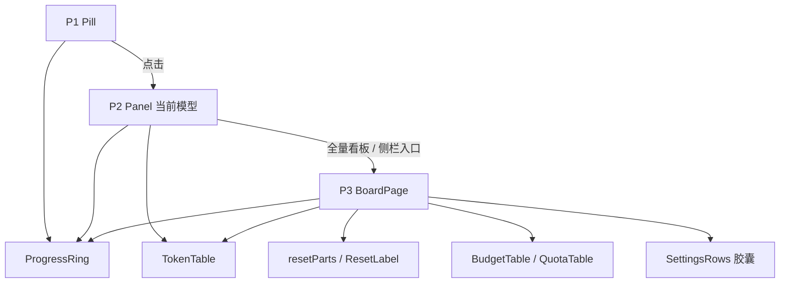

# Token 看板整页化与浮层收敛（前端）

> 状态：已实施 
> 完成时间：2026-11-04（`1.2.0-local.2`） 
> 关联逻辑根：`dsh-token-dash`（`client.js`） 
> 关联资料：[`ui-design.md`](../../ui-design.md)（v3.1）、施工稿（已归档）[`fullpage-board-build-checklist.md`](../../checklist/archived/fullpage-board-build-checklist.md)、后续设计（已归档）[`feature_board_cards_redesign.md`](feature_board_cards_redesign.md)

## 一、最终需求与范围

| ID | 最终处置 | 需求 / 边界 / 风险 | 最终结论或迁移去向 |
|---|---|---|---|
| REQ-01 | 完成 | `ProgressRing` 三处共用 | P1/P2/P3 环几何一致；后续由 v3.2 拆为 `ProgressRing` + 组合层 |
| REQ-02 | 完成 | `resetParts` 相对 + 绝对时间 | P2/P3 同源同值 |
| REQ-03 | 完成 | `TokenTable` 自适应 + `[` 交界对齐 | 单网格 + `display:contents`，跨行列宽一致 |
| REQ-04 | 完成 | P3 整页注册 | `main` + `sidebar.panellist` 同 key，入口可切 |
| REQ-05 | 完成 | P1 环 + 数字 | 空环 / 满环 / `--` 三态可用 |
| REQ-06 | 完成 | P2 收敛为当前模型四列 | 无进度条、无双 tab、无开关 |
| REQ-07 | 完成 | P3 按量表四列 | 无「计费」「今日」列 |
| REQ-08 | 完成 | P3 订阅表每窗两行 | 缺窗占位 `—` |
| REQ-09 | 完成 | 两格卡与明细分行 | 两卡 gap 12、与表 16 |
| REQ-10 | 完成 | 设置三行 + sticky | 96px 留白，滚到底不遮挡 |
| REQ-11 | 完成 | 预算就地编辑 | 保存后环 / 已用% / 计划余额即时更新 |
| REQ-12 | 完成 | 三路关闭 | `×` / 点外部 / `Esc`，焦点回 P1 |
| REQ-13 | 完成 | P3 头部 GitHub 入口 | 只做跳转，不请求 `/repo` |
| REQ-14 | 完成（投影未联调） | P1 三级取值兜底 | 投影 → 默认模型 → 账本；测试环境走账本 |
| REQ-15 | 完成 | 可见性暂停轮询 | 恢复可见立即刷新 |
| REQ-16 | 完成 | 容纳七家 | 两表分流，不重叠 |
| REQ-17 | 完成 | P3 自取数 | `/summary` + `/usage` + `/prefs`，失败保留旧数据 |
| REQ-18 | 完成 | 脚本与文档同批 | `shots` 可跑，英文无中文漏出 |
| BND-01 | 保持 | 不改 `src/` 与 `/summary` 契约 | 前端只消费 VM |
| BND-02 | 保持 | 计费模式自动侦测 | 无下拉、无写接口 |
| BND-03 | 保持 | P2 无设置开关 | 设置只在 P3 胶囊 |
| BND-04 | 保持 | `MiniBar` 仅停止调用 | 组件保留 |
| BND-05 | 保持 | B14 未上线降级账本值 | 不造数 |
| RSK-01 | 已验证 | `fit-content` 在 flex 内退化 | 触顶 480 截断模型名，实测正常 |
| RSK-02 | 已验证 | 浮层 / 整页 `Esc` 冲突 | 浮层打开时只关浮层 |
| RSK-03 | 已验证 | `selectPanel` 未注册抛错 | 入口先 `hasMainPanel` 判空 |

## 二、最终实现

### 3.0 最终改动总览

| ID | 类型 | 文件 | 开发改动说明 |
|---|---|---|---|
| CHG-01 | 新增 | `client.js` · `ProgressRing` | 14/20 两档，`state` 驱动弧色，零 hex |
| CHG-02 | 新增 | `client.js` · `resetParts` / `ResetLabel` | 相对与绝对时间拆分；`suffix` 控制「重置」 |
| CHG-03 | 修改 | `client.js` · `TokenTable` / `DetailTable` | 单网格 + `display:contents` 行；明细 8 列含费用 |
| CHG-04 | 修改 | `client.js` · `Pill` | `[API]` / `[订阅]` + 环 + 数字；订阅三窗 |
| CHG-05 | 修改 | `client.js` · `rawActiveProvider` / `summaryPath` | 投影 → 默认模型 → 账本；`?active=` 透传 |
| CHG-06 | 修改 | `client.js` · `Panel` / `PanelHeader` | 删双 tab；四列主区 + 胶囊 + 用量表 + 全量看板；document 级 Esc |
| CHG-07 | 新增 | `client.js` · `P2Summary` / `P2Windows` / `WindowRow` | P2 四列与订阅四段行 |
| CHG-08 | 新增 | `client.js` · `BoardPage` | `/summary` + `/usage` + `/prefs` 自取数；轮询 / 可见性 / 刷新 / 错误 strip |
| CHG-09 | 新增 | `client.js` · `BudgetTable` | 四列 + 行内编辑；计划余额可负 |
| CHG-10 | 新增 | `client.js` · `QuotaTable` / `QuotaCell` | 每窗两行；缺窗三段 `—` |
| CHG-11 | 新增 | `client.js` · `RangeCards` | 两格卡（gap 12）+ 多币种同行 |
| CHG-12 | 新增 | `client.js` · `SettingsRows` | 三行：刷新与开关 / 日志与数据 / 价格与版本 |
| CHG-13 | 新增 | `client.js` · `BoardEntry` / `openBoardPage` | 侧栏入口与 `hasMainPanel` 守卫 |
| CHG-14 | 修改 | `client.js` · `EN` 词典 | 补新文案；停用双 tab 与旧标题词条 |
| CHG-15 | 修改 | `scripts/e2e.mjs` | P1/P2/P3、编辑、空态、窄屏、暗色；输入走原生 setter |
| CHG-16 | 修改 | `tools/mock/fixtures.mjs` | 七家（OpenCode Go 三窗 / Command Code 两窗 + credits） |
| CHG-17 | 修改 | `tools/mock/shots.mjs` | P2 按量 / 订阅两窗 / 三窗、P3 整页；胶囊静态化 + 缩放 |
| CHG-18 | 修改 | `README.md` / `README.en.md` / `docs/design.md` / `docs/ui-design.md` | 页面形态与截图说明同步 |

### 2.1 最终结构

| 节点 | 职责 |
|---|---|
| P1 Pill | 当前 provider 概览；三级取值兜底；环 + 数字 |
| P2 Panel | 四列主区 + 范围胶囊 + 四列用量表 + 全量看板入口 |
| P3 BoardPage | 自取数；两张表 + 两格卡 + 八列明细 + 设置胶囊 |
| 共用件 | `ProgressRing` / `resetParts` / `TokenTable` / `usePolling` |

### 2.3 关键陷阱

| 项 | 约束 |
|---|---|
| `main` / `sidebar` 同 key | 不一致时宿主 `hasMainPanel` 校验失败 |
| `selectPanel` | 未注册 key 抛错；入口先判 `hasMainPanel` |
| `fit-content` 定位 | `measurePanel` 用面板实测宽度，不用常量 360 |
| `Esc` 分层 | tooltip → 预算编辑 → 浮层，逐层消费；整页不接管 |
| 预算保存 | 读 `event.currentTarget.value`，不读可能滞后的 state |
| 表格对齐 | 单网格 + `display:contents`，避免逐行 grid 列宽漂移 |

## 三、不改动 / 边界

- 不改 `src/`、`/summary` 契约与计费侦测；后端七家扩展由后端清单承担。
- 不改 `MiniBar` 组件本体；不改 `test/unit/*`（现有单测均为 host 侧）。
- 冲突先改文档再改代码。

## 四、最终验收

**自动测试（2026-11-04）**

- `npm test`：76 项，75 通过 / 1 跳过（local 版跳过 Release notes）/ 0 失败。
- `npm run e2e`：通过。覆盖 P1 环与百分比、P2 自适应 280–480 与四列、P3 两表分流与四列数值、两卡 12/16 间距、预算编辑四场景、star chip 跳转、Esc 关闭、360 窄屏、暗色胶囊。
- `npm run shots`：三张截图可重新生成。

**人工走查**

| # | 场景 | 期望 |
|---|---|---|
| W1 | 首页无会话 | P1 用账本兜底，不闪 `--` |
| W2 | 切模型不发消息 | P1 立即跟随投影 |
| W3 | 三窗订阅 | P1 三窗全显；≤520 只留首窗 |
| W4 | 预算 99% | 环留缺口，红环红字不粘连 |
| W5 | 整页 760px | 按量表退化，订阅表横向滚动 |
| W6 | 整页滚到底 | 胶囊贴底，最后一行留 ≥24 |
| W7 | 只有订阅 | 按量计价整块不渲染 |
| W8 | 超支 | 计划余额负数并转红，环满圈 |
| W9 | star chip | 点击新标签打开 GitHub |

## 五、计划—实际重大偏差

- 计划 `/repo` 数据接口（后端 B15）→ 实际只做 GitHub 跳转（原因：计数对用户无价值，B15 不再需要）。
- 计划 P2 保留双 tab → 实际取消 tab（原因：P2 只讲当前模型，v3.0 结构重构）。

## 六、诊断锚点

- LogCategory：`token-dash`
- 前缀：`[TD:<module>]`
- 高价值日志：`[TD:board] refresh ok/fail`、`[TD:prefs] budget saved`
