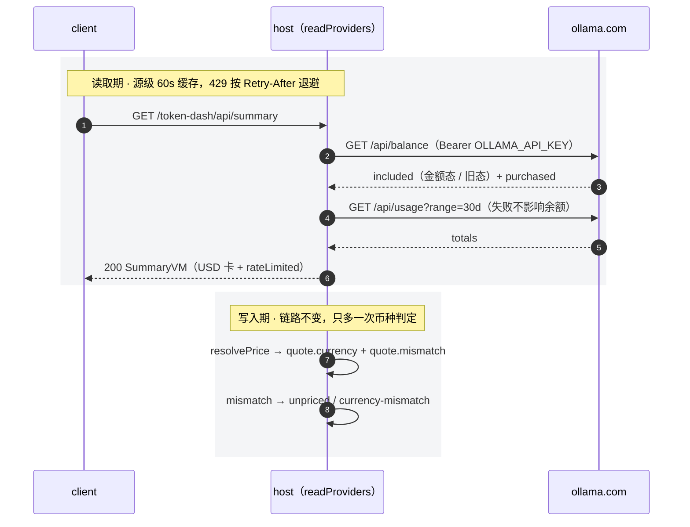
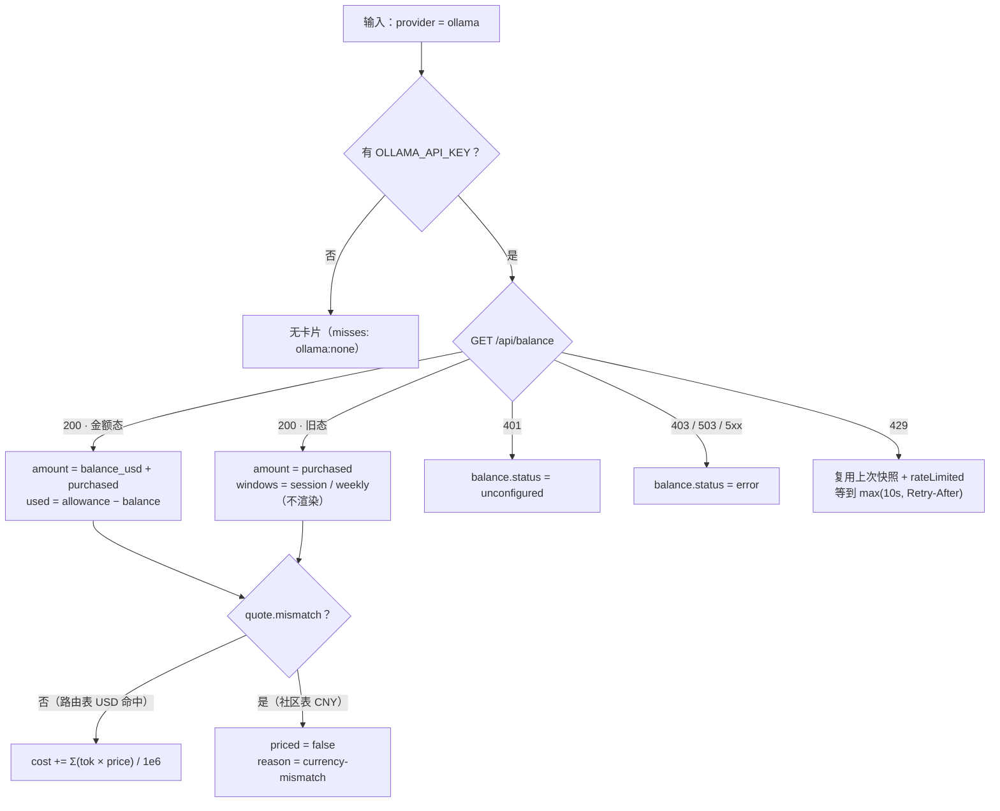

# Ollama Cloud 余额与用量接入

> 状态：已实施<br>
> 完成时间：2026-11-10（随 `2.1.0` 正式发布）<br>
> 关联逻辑根：`dsh-token-dash`<br>
> 关联资料：[`design.md`](../../design.md) §Provider 源表 / §第三方接入与扩展边界、[`ui-design.md`](../../ui-design.md) §5.3、[`README.md`](../../../README.md)「支持的 API 范围」、[`feature_third_party_provider_pricing.md`](feature_third_party_provider_pricing.md)

## 一、最终需求与范围

| ID | 最终处置 | 需求 / 边界 / 风险 | 最终结论 |
|---|---|---|---|
| REQ-01 | 完成 | 解析 `included` 二态 + `purchased` + `period` | 真实余额 = 套餐剩余 + 购买余额；P3 另列「套餐已用」「购买余额」与周期 |
| REQ-02 | 完成 | 形态 `api`、币种 USD；声明式源 `mode` 由 `kind` 派生 | `kind=api`；`providerKinds.ollama` 只会落 `api`，不会被固化成订阅 |
| REQ-03 | 完成 | 币种不匹配即未定价，三处计价入口一致（含 override） | `quote.mismatch === true` → `priced=false`、`reason=currency-mismatch` |
| REQ-04 | 完成 | `/api/usage?range=30d` 只读展示 | 进 P3 卡片 caption，不回写 `daily.json` |
| REQ-05 | 完成 | 失败降级 `401` / `403` / `429` / `503` | `401 → unconfigured`；`429` 复用旧快照并按 `Retry-After` 退避；其余 → `error` |
| REQ-06 | 完成 | 计价语义变化后历史一致 | `costVersion 4` 重算一次；订阅行与零消耗行保持原状态 |
| BND-01 | 保持 | Ollama 不做订阅隔离 | `kind` 恒为 `api`，本地按 token × 单价 |
| BND-02 | 保持 | 不读 Cookie、不抓控制台 | 仅官方 Bearer 接口 |
| BND-03 | 保持 | 计价链只加「币种不匹配」一条 | `catalog` / `match` / `selectTable` 未改，`resolvePrice` 只多只读 `mismatch` |
| BND-04 | 保持 | 不新增设置项、不新增 prefs 键 | 设置区仍三行 |
| BND-05 | 保持 | 其余 7 家 adapter 声明与解析零改动 | 回归通过 |
| RSK-01 | 已缓解 | 10 rpm 跨 key / 设备共享 | 源级 60s 缓存 + `max(10s, Retry-After)` 退避 |
| RSK-02 | 接受 | 未定价看起来像能力倒退 | 未定价 tooltip 说明原因；文档已同步 |
| RSK-03 | 已验证 | 误以为 Ollama 模型全部未定价 | 路由表命中按 USD 计价，仅回退社区表时未定价 |
| RSK-04 | 接受 | 升 `costVersion` 会重算历史金额 | CHANGELOG 与 Release 已明示「历史金额按新规则重算一次」 |

## 二、最终实现

### 3.0 最终改动总览

| ID | 类型 | 文件 | 开发改动说明 |
|---|---|---|---|
| CHG-01 | 修改 | `src/quota-sources.js` | 新增 `parseOllamaBalance`（金额态 / 旧态 / `purchased` / `periodEnd`）与 `parseOllamaUsage`（只取 `totals` → `channel`）；`PROVIDER_SOURCES` 增 `ollama`（`kind:'api'`、`currency:'USD'`、`credential.type='bearer'`、`quota` + 可选 `usage` 钩子） |
| CHG-02 | 修改 | `src/adapters.js` | `requestJson` 读 `Retry-After`（兼容裸 mock）；`readDeclarativeSource` 的 `mode` 由 `kind` 派生、`quota` 与 `usage` 分开取、429 复用上一份快照并标 `_rateLimited`；`readCachedSource` 支持 `until` 绝对到期；`toSnapshot` 透出 `channel` / `rateLimited`；`logAdapterEvents` 增 `adapter.ollama` 分支；新增导出 `missSignature` |
| CHG-03 | 修改 | `src/providers.js` | 增 `ollama` descriptor（`label:'Ollama'`、`USD`、`subscription:false`、价格页，无默认模型 / 前缀）；`PROVIDER_ORDER` 末位追加；`ALIASES` 增 `ollama` / `ollama-cloud` |
| CHG-04 | 修改 | `src/pricing.js` | `resolvePrice` 的 override 出口与选表出口各写 `mismatch = quote.currency !== currencyOf(providerId)`；选表与匹配逻辑未改 |
| CHG-05 | 修改 | `src/core.js` | `addRecord` / `repriceUnpriced` 用 `price.mismatch` 判未定价并写 `reason`；`repriceState(state, kindOf)` 先按形态跳过非 `api`、保留 `'empty'`、再按 mismatch 判定；`emptyState().costVersion` 与 `repriceState` 收口值改 `4` |
| CHG-06 | 修改 | `src/store.js` | `COST_MODEL_VERSION` 3 → 4，启动触发一次历史重算 |
| CHG-07 | 修改 | `index.js` | 启动 `repriceState(state, kindOf)` 传入形态闭包；`provider.cache.state` 由每轮 debug 改为「探测清单变化才记」的 info，带 `configured` / `misses` |
| CHG-08 | 修改 | `client.js` | P3 API 卡按字段追加「套餐已用」（`used / allowance`）与「购买余额」；`apiCardCaption` 追加「周期至 / 限流中 / 渠道用量」；`REASON_TEXT` 增 `currency-mismatch`；`balanceText` 单值位语义不变（`amount` 已是合计） |
| CHG-09 | 修改 | `locale/zh.json` / `locale/en.json` | 随包词典副本同步新增词条（套餐已用 / 购买余额 / 周期至 / 限流中 / 渠道用量 / 币种不匹配说明） |
| CHG-10 | 修改 | `tools/preview/templates/cards-api.html` | 原型补额度行、购买余额行与说明行，作为卡片形态参照 |
| CHG-11 | 测试 | `test/unit/{quota-sources,adapters,pricing,core,providers,providers-vm}.test.mjs` + `scripts/e2e.mjs` | 二态解析 / 429 保旧值 / 401·403·503 / mismatch（含 override 与路由表命中）/ `costVersion=4` 重算不变量 / 8 家契约 / `misses` 顺序；e2e 注入 Ollama VM 断言额度、周期、限流与渠道用量 |
| CHG-12 | 文档 | `docs/design.md` / `docs/ui-design.md` / `README.md` / `README.en.md` / `CHANGELOG.md` | 源表 7 → 8 家与可选 `usage` 钩子、`session` 窗口、429 退避、币种不匹配规则；P3 卡片新行与说明行；README「支持的 API 范围」表与「自定义 route 必须为 `ollama`」；`2.1.0` 正式变更说明 |

### 2.1 最终结构

```text
quota-sources.js  ollama: { kind:'api', currency:'USD',
                            credential:{ type:'bearer', refs:['OLLAMA_API_KEY'] },
                            quota:{ url:'https://ollama.com/api/balance', parse },
                            usage:{ url:'https://ollama.com/api/usage', range:'30d', parse } }
adapters.js       readDeclarativeSource：mode 由 kind 派生 → quota 请求（429 复用 previous）
                  → usage 请求（失败只记日志）→ toSnapshot（channel / rateLimited）
pricing.js        quote.mismatch = quote.currency !== currencyOf(provider)
core.js           形态 → mismatch → 计价 / 未定价；costVersion 4 重算同序
client.js         P3 卡：真实余额（合计）/ 套餐已用 / 购买余额 / 周期 / 限流 / 渠道用量
```

| 源字段 | 映射 | 消费方 |
|---|---|---|
| `included.balance_usd` | `balance.packageLeft`、合计分子 | 真实余额合计；P3 套餐已用分子推导 |
| `included.allowance_usd` | `balance.allowance`、`balance.used = allowance − balance_usd` | P3「套餐已用 `used / allowance`」 |
| `purchased.balance_usd` | `balance.purchased`（并入 `balance.amount`） | 真实余额合计 + P3「购买余额」行 |
| `included.period.until` | `balance.periodEnd` | P3 caption「周期至 MM-DD HH:mm」 |
| `included.session/weekly` | `windows[]`（`key: session / week`，`usedPercent = 100 − remaining_percent`） | 旧套餐分支：仅解析，API 形态卡不渲染 |
| `/api/usage` `totals` | `channel{ range, usageUsd, requests, tokens }` | P3 caption「渠道用量」，只读 |





### 2.2 关键代码骨架

```text
addRecord / repriceState / repriceUnpriced
  if kindOf(provider) !== 'api'  → 订阅：priced='subscription'，cost 不动
  quote = resolvePrice(model, provider, ts)
  if quote == null               → priced=false, reason=explainPriceMiss
  else if quote.mismatch         → priced=false, reason='currency-mismatch'
  else                           → cost=Σ(tok×price)/1e6, priced=true
  四桶为 0                       → priced='empty'
```

### 2.3 关键陷阱

| 项 | 约束 |
|---|---|
| 声明式源 `mode` | 必须由 `kind` 派生；硬编码 `subscription` 会让 `stampProviderKinds` 把 provider 固化成订阅，token 全部 `cost=0` |
| `credential.type` | 必须写 `bearer`；缺失等于无凭据，源被静默跳过（表现为「没有卡片」） |
| `included` 二态 | 先判 `session !== undefined`，否则按金额态；两态都缺 → `status=error`，不伪造 0 |
| `amount` 语义 | `amount` 是「套餐剩余 + 购买余额」合计，不是套餐剩余；进度只能用 `allowance` / `used` |
| 429 保旧值 | 必须复用上一份快照并写 `until` 缓存；否则卡片在限流时闪成「查询失败」 |
| override 币种 | `normalizeOverride` 未写 `currency` 时默认 CNY，USD provider 会因此判未定价；补 USD 单价必须显式 `currency:'USD'` |
| 重算边界 | `repriceState` 不判形态会给订阅行写金额并压掉 `'subscription'` / `'empty'` 两态，必须传 `kindOf` |
| 渠道用量 | `/api/usage` 与 `/api/balance` 共用 10 rpm，只按 30d 低频取一次，且不得回写 `cost` |
| 宿主接入 | DSH 无内置 Ollama，需自定义 OpenAI 兼容路由且 route id 必须是 `ollama`（Key 引用按 `<ROUTE>_API_KEY` 派生） |

## 三、不改动 / 边界

- `BND-01`～`BND-05`：不做订阅隔离、不读 Cookie/控制台、不改匹配与选表、不新增 prefs 键、其余 7 家零改动。
- 已否决：给 `addRecord` / `repriceUnpriced` / `repriceState` 增加 `currencyOf` 参数（要改 5 处签名与全部单测，收益仅为少一个只读字段）。
- 已否决：Mistral 接入（Admin API 仅 Enterprise、消费级无公开接口；若后续开放 personal usage API 再单开 feature）。
- 旧套餐 `session/weekly` 官方未给窗口时长，不映射成 `5h`，也不在 API 形态卡渲染。

## 四、最终验收

| 项 | 来源 | 环境与方式 | 结果 |
|---|---|---|---|
| 金额态 `72.5 / 100 / 25` → 真实余额 `$97.50`、套餐已用 `$27.50 / $100.00`、购买余额 `$25.00` | REQ-01 | 本地 L1 单测 + L2 e2e（注入 SummaryVM） | 通过 |
| 旧态 `session/weekly` → 两个 `usedPercent`，`amount` 取 `purchased` | REQ-01 | L1 单测 | 通过（UI 不渲染，见 §2.3） |
| `period.until` → caption「周期至 …」 | REQ-01 | L2 e2e 文案断言 | 通过 |
| `kind=api`、USD、`providerKinds.ollama` 不被固化为订阅 | REQ-02 / BND-01 | L1 `stampProviderKinds` | 通过 |
| CNY 报价 + USD provider → `priced=false` / `currency-mismatch`；路由表命中仍按 USD 计价 | REQ-03 / RSK-03 | L1（两种命中分别断言） | 通过 |
| `openrouter` / `qwen` 国际站同步转未定价；override 缺 `currency` 判未定价、显式 USD 正常 | REQ-03 / BND-05 | L1 回归 | 通过 |
| `costVersion` 升 4，重算后订阅行 `cost=0` / `priced='subscription'`，零消耗行 `'empty'` | REQ-06 | L1（混合账本） | 通过 |
| `/api/usage` 只读，失败不影响余额与 `cost` | REQ-04 | L1 | 通过 |
| `429` 保旧值 + `rateLimited` + 缓存等到 `Retry-After`；`401`→未配置；`403 / 503`→错误 | REQ-05 / RSK-01 | L1 mock（含 `Retry-After` 头） | 通过 |
| 8 家契约（`pricingLinks` / `misses` 顺序）与现有 7 家零回归 | 质量门槛 | `npm test` 117 项 + `npm run e2e` | 通过 |
| 真实 `OLLAMA_API_KEY` 手测（真实套餐金额、周期文案、限流表现） | REQ-01 / REQ-05 | 需真实凭据 | **未执行**：由用户自行验证，未伪造通过结论 |

## 五、计划—实际重大偏差

- 计划给 `addRecord` / `repriceUnpriced` / `repriceState` 加 `currencyOf` 参数 → 实际改为 `quote.mismatch` 只读字段（原因：避免改 5 处签名与全部单测，判定仍留在 core）。
- 计划把旧套餐 `windows` 接入 UI → 实际只解析与记录日志（原因：API 形态卡不渲染 `windows`，线上套餐以金额态为主）。
- 计划未涵盖宿主接入前提 → 实际新增「自定义 route 必须填 `ollama`」约束与说明（原因：本机核查 DSH 无内置 Ollama，Key 引用由 route 派生）。

## 六、诊断锚点

- LogCategory：`adapter.ollama`、`provider`、`boot`
- 前缀：`[TD:adapter.ollama]`、`[TD:provider]`
- 高价值日志：`adapter.ollama.quota.ok/fail`（`amount` / `purchased` / `legacy` / `httpStatus` / `retryAfter`）、`adapter.ollama.usage`、`provider.cache.state`（清单变化才记，含 `configured` / `misses`）、`probe.miss` 的 `ollama:none`
