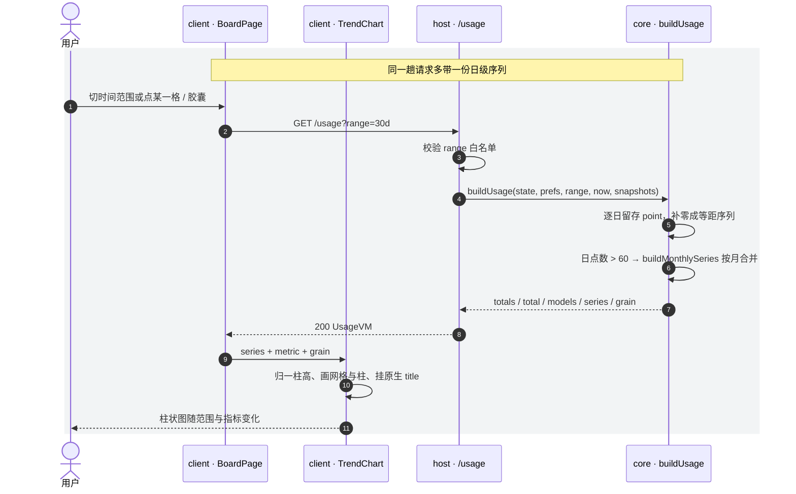
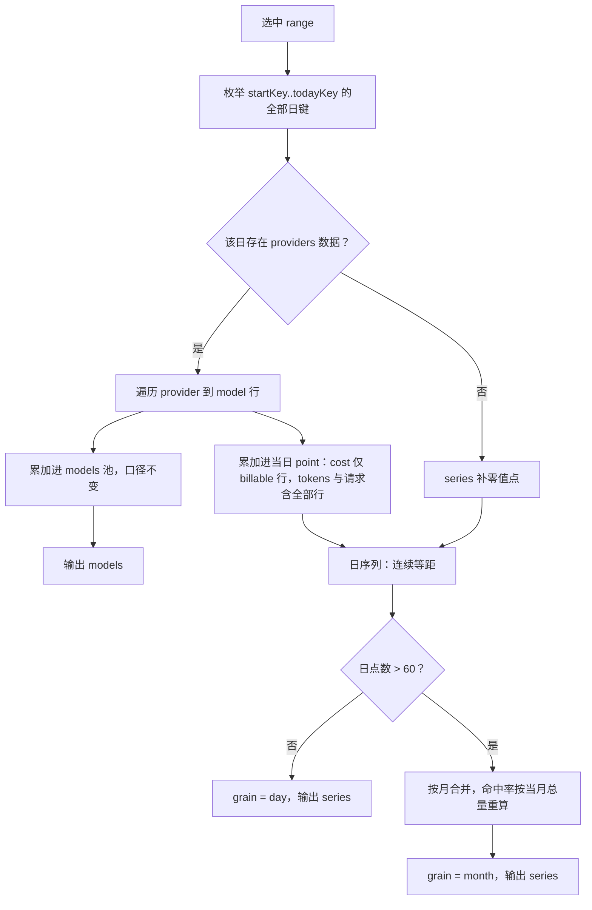

# P3 四格摘要带与用量趋势柱

> 状态：已实施<br>
> 完成时间：2026-11-16（`2.2.0`）<br>
> 关联逻辑根：`dsh-token-dash`（`src/core.js` · `index.js` · `client.js`）<br>
> 关联资料：[`ui-design.md`](../../ui-design.md) v3.13 §5.5、[`design.md`](../../design.md)「路由与鉴权」的 `/usage` DTO、Issue 记录已压缩进 §四

## 一、最终需求与范围

| ID | 最终处置 | 需求 / 边界 / 风险 | 最终结论或迁移去向 |
|---|---|---|---|
| REQ-01 | 完成 | `/usage` 返回连续日级序列 `series[]` | 窗口内每个日键都有点，长度等于 `eachDayKey(startKey, endKey)` |
| REQ-02 | 完成 | P3 范围区新增柱状图，位于摘要带与明细表之间；摘要带同步扩四格 | 位置与四格同源口径；E2E 断言 `trend.y > band.bottom` 且 `detail.y > trend.bottom` |
| REQ-03 | 完成 | 无消耗日补零值点，柱距等距不塌 | 零值日不画柱但保留槽位；单测 + E2E 覆盖 |
| REQ-04 | 完成 | 摘要带四格兼作指标选择器，图表随选中格切换 | 四格与标题行胶囊双向同步（`aria-pressed` / `data-td-trend`） |
| REQ-05 | 完成 | 刻度随语言分流：中文「万 / 亿」、英文 K / M / B | 中文分支单测覆盖；英文分支由 E2E 实测（`locale: en-US`，断言轴内不含「万 / 亿」） |
| REQ-06 | 完成 | 加载 / 空数据 / 单点都不塌版 | 柱区高度恒 132px；单点范围只画 1 根柱 |
| REQ-07 | 完成 | 原型、UI 文档、单测、E2E 同步 | `npm run preview` / `npm test` / `npm run e2e` 全绿 |
| REQ-08 | 完成 | 新增文案全走 `tr()`，三处同键同占位符 | 新增 14 键，`locale.test.mjs` 通过（134 键一致） |
| BND-01 | 保持 | 不改 `daily.json` 与 `costVersion` | 旧账本直接可读，无迁移 |
| BND-02 | 保持 | 不改 `/summary`、P1、P2、设置胶囊 | 仅动 P3 与 `/usage` |
| BND-03 | 保持 | 不引入图表库 | `dependencies` 仍为空 |
| BND-04 | 保持 | 不做小时级粒度 | 采集层无逐请求时间戳，未改采集 |
| BND-05 | 保持 | 导出包不含 `series` | `buildExport` 仍输出 `{ totals, total, models }`，`backup.test.mjs` 原断言未改 |
| RSK-01 | 已验证 | 多币种成本柱语义歧义 | 禁用成本指标并给出口文案，E2E 覆盖 |
| RSK-02 | 已验证 | `all` 范围柱数数百、柱退化为线 | 日点数 > 60 切按月桶，桶数稳定在 12 上下 |
| RSK-03 | 已验证 | 订阅行进 tokens 但不进 cost，被误读为算错 | 单测锁定「Σ 与 total / totals 闭合」 |
| RSK-04 | 已验证 | 侧栏开合时量宽错帧 | flex 自适应，不做 JS 量宽 |

## 二、最终实现

### 3.0 最终改动总览

| ID | 类型 | 文件 | 开发改动说明 |
|---|---|---|---|
| CHG-01 | 新增 | `src/core.js` · `eachDayKey` | 枚举 `[startKey, endKey]` 内全部本地日键；用 `setDate` 逐日推进避开夏令时，带 36600 次上限兜底 |
| CHG-02 | 修改 | `src/core.js` · `buildUsage` | 新增 `points` Map 与 `pointOf(dayKey)`；`add()` 多接 `point` 参数，逐日累 requests/input/cacheRead/cacheWrite/output/tokens，cost 只累 billable 行；返回体追加 `series` / `grain` |
| CHG-03 | 新增 | `client.js` · `TrendChart` | 柱区组件：标题行（标题 + 粒度 + 指标胶囊）、132px 柱区、三条网格线、原生 `title`；每根柱外包等分槽 `trendSlot` 再居中 |
| CHG-04 | 新增 | `client.js` · 图表辅助函数 | `TREND_METRICS` / `METRIC_LABELS` / `isChinese` / `fmtTrendTokens` / `fmtHitTick` / `trendValue` / `costTotalOf` / `fmtMetric` / `fmtAxisMetric` / `hitRateFloor` / `monthNameOf` |
| CHG-05 | 修改 | `client.js` · `BoardPage` | 新增 `metric` 状态；`RangeCards` 与 `TrendChart` 共用 setter，图表挂在摘要带与明细表之间 |
| CHG-06 | 修改 | `client.js` · `styles` | `summaryBand` 改 4 列、`summaryHalf` 改按钮形态 + `summaryHalfOn` 选中态、`summaryV` 26 → 22px；新增 trendBox/Head/Title/Hint/Spacer/Plot/Grid/Axis/Bars/Slot/Bar/Ticks/Tick/Msg |
| CHG-07 | 修改 | `client.js` · `EN` 词典 | 新增 14 键（含「万」作为语言探针，英文值 `K`）；`ZH` 由键镜像生成 |
| CHG-08 | 修改 | `locale/zh.json` / `locale/en.json` | 与 `EN` 同键同占位符，各 134 键 |
| CHG-09 | 修改 | `index.js` · `/usage` 日志 | 追加 `grain` / `points` / `seriesCurrencies` |
| CHG-10 | 修改 | `test/unit/usage.test.mjs` | 新增 8 例：`eachDayKey` 边界、补零、闭合、口径分叉、hide、单点、命中率 null、按月合并 |
| CHG-11 | 修改 | `scripts/e2e.mjs` | 补 `seriesFor()` fixture；L2 断言 series 契约；L3 新增 9 项断言（柱数 / 零值 / 位置 / 切指标 / 双向同步 / 多币种 / 单点 / 英文刻度）；fixture 适配 DSH 0.2.2 |
| CHG-12 | 修改 | `tools/preview/templates/page-p3.html` | 摘要带改四格按钮 + 趋势区块 + 指标切换脚本 + 响应式 2×2 |
| CHG-13 | 修改 | `docs/ui-design.md` §2.6 / §5.5 / §6 / §8 / §9 | 版本 v3.13；四格 8 条 + 趋势柱 13 条规格；字号例外 22px；radiogroup / roving tabindex / 柱区 `aria-hidden` |
| CHG-14 | 修改 | `client.js` · `RangeCards` | 两格 → 四格；每格 `button[role=radio]` + `aria-pressed`；保留既有 testid（range-cards / card-cost / card-tokens / cost-values） |
| CHG-15 | 修改 | `tools/preview/spec.mjs` / `render.mjs` | 新增 `SPEC.summary`（4 列 / 22 / 11）与 `SPEC.trend`（132 / 34 / 18 / 36 / 3 / 2 / 11），注入 9 个 CSS 变量 |
| CHG-16 | 新增 | `src/core.js` · `buildMonthlySeries` | 日点数 > 60 时按月合并；命中率按当月总量重算，不取日均 |
| CHG-17 | 修改 | `client.js` · `TrendChart` 支持 `grain` | `grain='month'` 时刻度写 `MM月` / `Jan`，title 用 `YYYY-MM` |
| CHG-18 | 修改 | `tools/mock/fixtures.mjs` · `usageFor` | 按范围生成 1 / 7 / 30 / 84 个点，`grain` 按实际点数判定；四范围 Σseries 与 total / totals 精确闭合 |
| CHG-19 | 修改 | `README.md` / `README.en.md` / `docs/design.md` | P3 描述补四格 + 趋势柱；design.md 头部 v3.13 + `/usage` DTO 补 `series` / `grain` |
| CHG-20 | 修改 | `tools/mock/shots.mjs` | 适配 DSH 0.2.2（seed `workspace.json` + 真实指针事件）；P3 截图先切「近 30 天」 |
| CHG-21 | 修改 | `docs/pic/` · `docs/pic/en/` | 12 张截图重出（中英各 6 张），P3 含四格摘要带与趋势柱 |

> `3.1` 逐文件 diff 已按归档规范删除；代码变化以本表为唯一留存形式。

### 2.1 最终结构

```text
section.boardSection「范围与明细」
└─ div.rangeBox
   ├─ rangeHead（范围胶囊 + 共 N 个模型 · 更新于）
   ├─ RangeCards（四格：总费用 / 真实 Tokens / 总请求数 / 缓存命中率）
   │   └─ 每格 button[role=radio] + aria-pressed，外层 role=radiogroup
   ├─ TrendChart（标题行[标题 + 粒度 + 指标胶囊] + 132px 柱区）
   │   └─ 柱区：3 条网格线 + 2 档 Y 轴 + N 个等分槽（槽内柱宽 ≤36）+ 日期刻度
   └─ detailWrap（八列明细，内部横向滚动）
```

**数据链路（时序）**



**分桶与补零（分支）**



读法：目标分支在「进池」之外多一条「按日留存」的腿，因此 `models` 结果不变，风险被限制在新增字段上；末端两条出口都产出 `series`，只改 `grain` 与桶宽，不改任何累加口径。

### 2.2 关键代码骨架

```js
/** 逐日点与两格卡同口径：cost 只累 billable，其余字段含订阅行。 */
const point = { dayKey, cost: {}, requests: 0, input: 0, cacheRead: 0, cacheWrite: 0, output: 0, tokens: 0, hitRate: null }

/** 等距连续：窗口内无数据的日补零，hitRate 留 null 表示「无数据」而不是 0%。 */
const daySeries = eachDayKey(startKey, todayKey).map((dayKey) => { /* 取点 + round2(cost) + 算 hitRate */ })
const { grain, series } = buildMonthlySeries(daySeries)   // >60 点转按月

/** 柱高：命中率从命中率下限起画，其余从 0 起。 */
const ratio = value === null || value <= floor ? 0 : ((value - floor) / span) * 100
```

### 2.3 关键陷阱

| 项 | 约束 |
|---|---|
| 补零位置 | 必须按 `eachDayKey` 枚举，不能遍历 `state.days` 的 key 再补，否则窗口首尾缺柱 |
| 口径分叉 | 费用柱与 Tokens 柱的行集合不同（前者仅 billable），改动时两处必须同改 |
| 多币种成本 | 一根柱只能表达一个标量；多币种必须禁用并给出口文案，禁止取首个币种静默画 |
| 柱子均分 | **只对柱体设 `maxWidth` 会让所有柱挤到左侧**；必须「等分槽 + 槽内居中」两层结构 |
| 单点与空序列 | `today` 只有 1 点、无记录时全零；两种态都不能出现 0 高度容器塌版 |
| 零值 vs 缺数据 | 补零点的 `hitRate` 为 `null` 而非 0，否则命中率柱会把「无数据」画成「0%」 |
| 语言判定 | `localeService` 只暴露 register/subscribe/bind，拿不到语言码；用 `tr('万') !== '万'` 作探针，故「万」必须建键且英文值为 `K` |
| 导出包 | 不给 `buildExport` 加 `series`，否则备份包体积翻倍且导入时被忽略 |

## 三、不改动 / 边界

- `BND-01`：不改 `daily.json` / `months/*.json` 结构与 `costVersion`，旧账本直接可读。
- `BND-02`：不改 `/summary`、`SummaryVM`、P1 Pill、P2 浮层、设置胶囊与导出 / 导入。
- `BND-03`：不加 dependencies，`client.js` 保持零构建手写 `h()`。
- `BND-04`：不做小时级 / 分钟级粒度；采集层无逐请求时间戳，本轮不改采集。
- `BND-05`：导出包 `usage[range]` 维持 `{ totals, total, models }`。

## 四、最终验收

| 项 | 来源 | 环境与方式 | 结果 |
|---|---|---|---|
| `series` 连续等距且长度等于窗口天数 | REQ-01 | `npm test` · usage.test.mjs | 通过 |
| 无消耗日柱高为 0 且柱数不减 | REQ-03 | `npm test` + `npm run e2e` | 通过 |
| 图表位于摘要带与明细表之间 | REQ-02 | `npm run e2e` 取 boundingBox 比较 | 通过 |
| 切指标后柱高 / 轴刻度 / 标题同步 | REQ-04 | `npm run e2e` | 通过 |
| 四格与胶囊选中态双向同步 | REQ-04 | `npm run e2e` | 通过 |
| 跨范围求和等于四格卡数字 | RSK-03 | `npm test`（Σseries 对 total / totals） | 通过 |
| hide 的 provider 不进柱 | 2.3 | `npm test` | 通过 |
| 多币种时成本指标禁用并提示 | RSK-01 | `npm run e2e` | 通过 |
| 单点 / 空序列不塌版（高度恒 132） | REQ-06 | `npm run e2e` | 通过 |
| 命中率缺数据不画成 0% | 2.3 | `npm test` | 通过 |
| 三处词条同键同占位符 | REQ-08 | `npm test` · locale.test.mjs（134 键） | 通过 |
| 中文「万 / 亿」、英文 K / M / B | REQ-05 / REQ-08 | `npm test` + `npm run e2e`（英文 page 断言轴内不含「万 / 亿」） | 通过 |
| 无新增依赖 | BND-03 | 人工核对 `package.json` | 通过（dependencies 仍为空） |
| 导出包结构不变 | BND-05 | `npm test` · backup.test.mjs 原断言 | 通过 |
| README / 设计文档已同步 | CHG-19 | `npm run shots` 产物与新文案核对 | 通过（12 张图重出） |

**执行环境**：Windows + DSH `0.2.2-rc.3`；L1 `node --test` **125 通过 / 0 失败**；L3 `npm run e2e`（临时 `DSH_HOME` + web profile + Playwright）通过；L4 真实 Key 采样未启用（需单独授权，与本 feature 无关）。

**Issue 记录（已压缩）**

| # | 状态 | 根因 / 处理 | CL |
|---|---|---|---|
| 1 | 已修复 | e2e 在 DSH 0.2.2 下 P1 不挂载：宿主改为按工作区分组会话，fixture 的 `cwd` 不存在且未写 `storages/workspace.json` → 侧栏列表为空；侧栏条目只监听真实指针事件，`evaluate(node.click)` 不触发 `onPointerDown`。处理：fixture 落到 `${DSH_HOME}/e2e-workspace` 并 seed workspace，点击改派发 pointerdown → mousedown → mouseup → click | `9907212` |
| 2 | 已修复 | 英文刻度分支未进 e2e：`fmtTrendTokens` 的 K / M / B 路径只被单测间接覆盖。处理：e2e 新增英文 page（`locale: 'en-US'`），断言标题为 `Trend · …`、四格为 `Total requests`、轴内不含「万 / 亿」 | 本归档提交 |

## 五、计划—实际重大偏差

- 计划把「指标胶囊」放在趋势区块外单独一行 → 实际并入 TrendChart 标题行右侧（原因：单行更紧凑，且与四格形成双入口不占额外高度）。
- 计划 CHG-01~19 → 实际落地 21 项，新增 CHG-20（`shots.mjs` 适配 0.2.2）与 CHG-21（截图重出）（原因：宿主升级导致截图脚本失效，属交付物必要修复）。
- 计划「英文刻度待补 e2e」作为遗留 → 实际在归档前补齐并跑绿（原因：归档硬门槛要求 Issue 全部终结）。

## 六、关联资料

- UI 规格：[ui-design.md](../../ui-design.md) v3.13 §2.6 / §5.5 / §6 / §8 / §9
- 架构与 DTO：[design.md](../../design.md)「路由与鉴权」的 `/usage` DTO
- 原型：[page-p3.html](../../../tools/preview/templates/page-p3.html) · `npm run preview page-p3`
- 用户文档：[README.md](../../../README.md) / [README.en.md](../../../README.en.md)
- 发布记录：`2.2.0`（[Release](https://github.com/spartawhy117/dsh-token-dash/releases/tag/v2.2.0)）

## 七、诊断锚点

- LogCategory：`vm`
- 前缀：`[TD:vm]`
- 高价值日志：`/usage` 每次范围查询输出 `range / grain / models / billable / tokens / currencies / points / seriesCurrencies / probeMs / durationMs`；`grain` 与 `points` 可区分「无数据」与「补零过多」。
