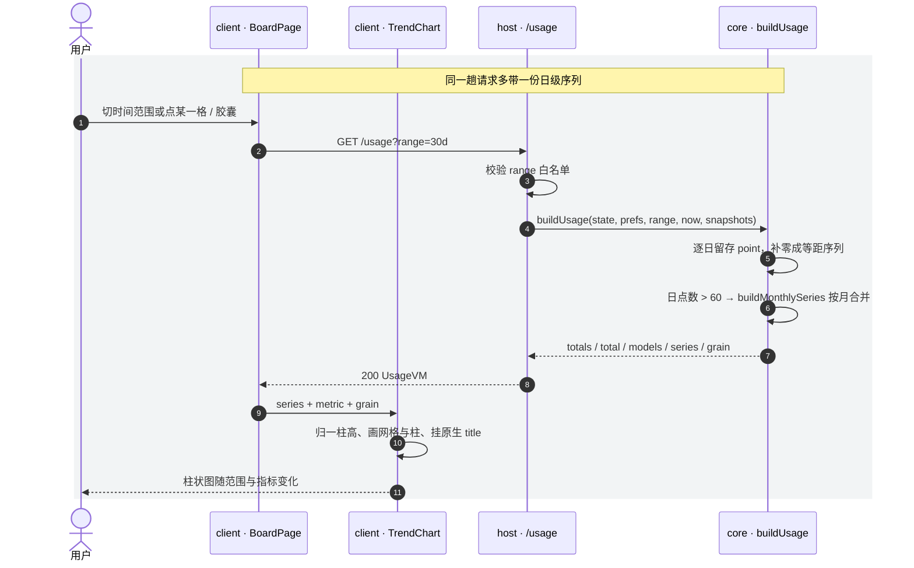
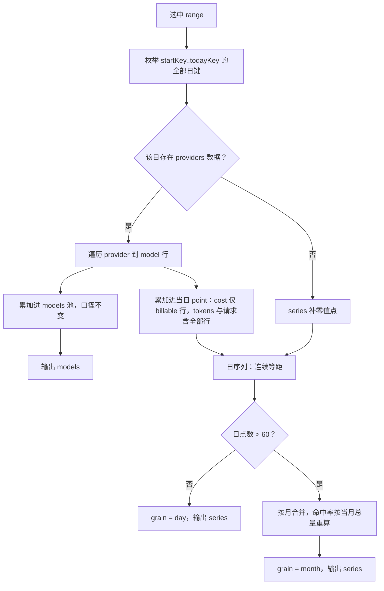

# P3 四格摘要带与用量趋势柱

> 状态：已实施（`2.3.0`）<br>
> 完成时间：2026-11-16（`2.2.0`）；2026-11-16 重开后随 `2.3.0` 发布<br>
> 关联逻辑根：`dsh-token-dash`（`src/core.js` · `index.js` · `client.js`）<br>
> 关联资料：[`ui-design.md`](../../ui-design.md) v3.17 §5.5 / §5.7.1、[`design.md`](../../design.md)「路由与鉴权」的 `/usage` DTO、Issue 记录见 §八（#1 / #2 已压缩进 §四）

## 一、最终需求与范围

| ID | 最终处置 | 需求 / 边界 / 风险 | 最终结论或迁移去向 |
|---|---|---|---|
| REQ-01 | 完成 | `/usage` 返回连续日级序列 `series[]` | 窗口内每个日键都有点，长度等于 `eachDayKey(startKey, endKey)` |
| REQ-02 | 完成 | P3 范围区新增柱状图，位于摘要带与明细表之间；摘要带同步扩四格 | 位置与四格同源口径；E2E 断言 `trend.y > band.bottom` 且 `detail.y > trend.bottom` |
| REQ-03 | 完成 | 无消耗日补零值点，柱距等距不塌 | 零值日不画柱但保留槽位；单测 + E2E 覆盖 |
| REQ-04 | 完成 | 摘要带四格兼作指标选择器，图表随选中格切换 | 四格与标题行胶囊双向同步（`aria-pressed` / `data-td-trend`） |
| REQ-05 | 完成 | 刻度随语言分流：中文「万 / 亿」、英文 K / M / B | 中文分支单测覆盖；英文分支由 E2E 实测（`locale: en-US`，断言轴内不含「万 / 亿」） |
| REQ-06 | 完成 | 加载 / 空数据 / 单点都不塌版 | 柱区高度恒 132px；单点范围只画 1 根柱 |
| REQ-07 | 完成 | 原型、UI 文档、单测、E2E 同步 | `npm run preview` / `npm test` / `npm run e2e` 全绿 |
| REQ-08 | 完成 | 新增文案全走 `tr()`，三处同键同占位符 | 新增 14 键，`locale.test.mjs` 通过（134 键一致） |
| BND-01 | 保持 | 不改 `daily.json` 与 `costVersion` | 旧账本直接可读，无迁移 |
| BND-02 | 保持 | 不改 `/summary`、P1、P2、设置胶囊 | 仅动 P3 与 `/usage` |
| BND-03 | 保持 | 不引入图表库 | `dependencies` 仍为空 |
| BND-04 | 保持 | 不做小时级粒度 | 采集层无逐请求时间戳，未改采集 |
| BND-05 | 保持 | 导出包不含 `series` | `buildExport` 仍输出 `{ totals, total, models }`，`backup.test.mjs` 原断言未改 |
| RSK-01 | 已验证 | 多币种成本柱语义歧义 | 禁用成本指标并给出口文案，E2E 覆盖 |
| RSK-02 | 已验证 | `all` 范围柱数数百、柱退化为线 | 日点数 > 60 切按月桶，桶数稳定在 12 上下 |
| RSK-03 | 已验证 | 订阅行进 tokens 但不进 cost，被误读为算错 | 单测锁定「Σ 与 total / totals 闭合」 |
| RSK-04 | 已验证 | 侧栏开合时量宽错帧 | flex 自适应，不做 JS 量宽 |

### 1.1 重开阶段新增需求

| ID | 最终处置 | 需求 | 最终结论 |
|---|---|---|---|
| REQ-09 | 完成 | 四格与右侧指标胶囊顺序一致 | 统一为 Tokens → 费用 → 命中率 → 请求数，同源于 `TREND_METRICS`（Issue #3） |
| REQ-10 | 完成 | 趋势柱悬停要指示线且提示即时 | 虚线 + 柱顶圆点 + 自绘浮层，移除原生 `title`（Issue #5） |
| REQ-11 | 完成 | README 截图柱高要有起伏 | 权重改确定性曲线，去等权分摊（Issue #6） |
| REQ-12 | 完成 | 更新检测要有周期且状态可感知 | 启动无条件 + 4h 周期；UpdateButton 组件化（Issue #7） |
| REQ-13 | 完成 | 点击更新不要确认，直接装 | 移除 confirm 态，8 态降 7 态（Issue #11） |
| REQ-14 | 完成 | 装的就是看到的版本 | 安装接口接受 `{ version }`（Issue #9） |
| REQ-15 | 完成 | 更新状态可被读屏播报 | `role=status` + `aria-live=polite`，失败用 `alert`（Issue #11） |

## 二、最终实现

### 3.0 最终改动总览

| ID | 类型 | 文件 | 开发改动说明 |
|---|---|---|---|
| CHG-01 | 新增 | `src/core.js` · `eachDayKey` | 枚举 `[startKey, endKey]` 内全部本地日键；用 `setDate` 逐日推进避开夏令时，带 36600 次上限兜底 |
| CHG-02 | 修改 | `src/core.js` · `buildUsage` | 新增 `points` Map 与 `pointOf(dayKey)`；`add()` 多接 `point` 参数，逐日累 requests/input/cacheRead/cacheWrite/output/tokens，cost 只累 billable 行；返回体追加 `series` / `grain` |
| CHG-03 | 新增 | `client.js` · `TrendChart` | 柱区组件：标题行（标题 + 粒度 + 指标胶囊）、132px 柱区、三条网格线、原生 `title`；每根柱外包等分槽 `trendSlot` 再居中 |
| CHG-04 | 新增 | `client.js` · 图表辅助函数 | `TREND_METRICS` / `METRIC_LABELS` / `isChinese` / `fmtTrendTokens` / `fmtHitTick` / `trendValue` / `costTotalOf` / `fmtMetric` / `fmtAxisMetric` / `hitRateFloor` / `monthNameOf` |
| CHG-05 | 修改 | `client.js` · `BoardPage` | 新增 `metric` 状态；`RangeCards` 与 `TrendChart` 共用 setter，图表挂在摘要带与明细表之间 |
| CHG-06 | 修改 | `client.js` · `styles` | `summaryBand` 改 4 列、`summaryHalf` 改按钮形态 + `summaryHalfOn` 选中态、`summaryV` 26 → 22px；新增 trendBox/Head/Title/Hint/Spacer/Plot/Grid/Axis/Bars/Slot/Bar/Ticks/Tick/Msg |
| CHG-07 | 修改 | `client.js` · `EN` 词典 | 新增 14 键（含「万」作为语言探针，英文值 `K`）；`ZH` 由键镜像生成 |
| CHG-08 | 修改 | `locale/zh.json` / `locale/en.json` | 与 `EN` 同键同占位符，各 134 键 |
| CHG-09 | 修改 | `index.js` · `/usage` 日志 | 追加 `grain` / `points` / `seriesCurrencies` |
| CHG-10 | 修改 | `test/unit/usage.test.mjs` | 新增 8 例：`eachDayKey` 边界、补零、闭合、口径分叉、hide、单点、命中率 null、按月合并 |
| CHG-11 | 修改 | `scripts/e2e.mjs` | 补 `seriesFor()` fixture；L2 断言 series 契约；L3 新增 9 项断言（柱数 / 零值 / 位置 / 切指标 / 双向同步 / 多币种 / 单点 / 英文刻度）；fixture 适配 DSH 0.2.2 |
| CHG-12 | 修改 | `tools/preview/templates/page-p3.html` | 摘要带改四格按钮 + 趋势区块 + 指标切换脚本 + 响应式 2×2 |
| CHG-13 | 修改 | `docs/ui-design.md` §2.6 / §5.5 / §6 / §8 / §9 | 版本 v3.13；四格 8 条 + 趋势柱 13 条规格；字号例外 22px；radiogroup / roving tabindex / 柱区 `aria-hidden` |
| CHG-14 | 修改 | `client.js` · `RangeCards` | 两格 → 四格；每格 `button[role=radio]` + `aria-pressed`；保留既有 testid（range-cards / card-cost / card-tokens / cost-values） |
| CHG-15 | 修改 | `tools/preview/spec.mjs` / `render.mjs` | 新增 `SPEC.summary`（4 列 / 22 / 11）与 `SPEC.trend`（132 / 34 / 18 / 36 / 3 / 2 / 11），注入 9 个 CSS 变量 |
| CHG-16 | 新增 | `src/core.js` · `buildMonthlySeries` | 日点数 > 60 时按月合并；命中率按当月总量重算，不取日均 |
| CHG-17 | 修改 | `client.js` · `TrendChart` 支持 `grain` | `grain='month'` 时刻度写 `MM月` / `Jan`，title 用 `YYYY-MM` |
| CHG-18 | 修改 | `tools/mock/fixtures.mjs` · `usageFor` | 按范围生成 1 / 7 / 30 / 84 个点，`grain` 按实际点数判定；四范围 Σseries 与 total / totals 精确闭合 |
| CHG-19 | 修改 | `README.md` / `README.en.md` / `docs/design.md` | P3 描述补四格 + 趋势柱；design.md 头部 v3.13 + `/usage` DTO 补 `series` / `grain` |
| CHG-20 | 修改 | `tools/mock/shots.mjs` | 适配 DSH 0.2.2（seed `workspace.json` + 真实指针事件）；P3 截图先切「近 30 天」 |
| CHG-21 | 修改 | `docs/pic/` · `docs/pic/en/` | 12 张截图重出（中英各 6 张），P3 含四格摘要带与趋势柱 |

> `3.1` 逐文件 diff 已按归档规范删除；代码变化以本表为唯一留存形式。

### 2.4 重开改动总览（Issue #3 / #4）

| ID | 类型 | 文件 | 开发改动说明 |
|---|---|---|---|
| CHG-22 | 修改 | `client.js` · `TREND_METRICS` | 顺序改为 `tokens → cost → hitRate → requests`，作为四格与胶囊的唯一顺序源 |
| CHG-23 | 修改 | `client.js` · `RangeCards` | 四个手写 `cell()` 调用改为遍历 `TREND_METRICS`；新增按 key 取「标签 / 主值 / 副值」的渲染映射，Tokens 格的 `InfoTip` 与既有 testid（`card-cost` / `card-tokens`）保持不变 |
| CHG-24 | 修改 | `tools/preview/templates/page-p3.html` | 四格与胶囊 DOM 顺序同步（先于代码完成，作为视觉依据） |
| CHG-25 | 修改 | `docs/ui-design.md` §5.5 | 四格顺序描述改为 Tokens → 费用 → 命中率 → 请求数；补「两处顺序同源」约束 |
| CHG-26 | 修改 | `scripts/e2e.mjs` | 新增断言：四格 `data-testid` 序列与趋势胶囊按钮序列一致且为 `tokens/cost/hitRate/requests` |
| CHG-27 | 修改 | `docs/pic/` · `docs/pic/en/` | P3 截图重出（`panel-api` / `panel-sub-2` / `panel-sub-3` / `settings` 及英文同名 4 张） |
| CHG-28 | 修改 | `docs/ui-design.md` | 升 v3.14，变更记录加一行；§5.5 补四格顺序与「同源」约束 |
| CHG-29 | 配置 | `package.json` / `CHANGELOG.md` | 版本 `2.2.1-local.1`，CHANGELOG 顶部 local 块（中英各两条） |
| CHG-30 | 修改 | `client.js` · `TrendChart` | 新增 `hover` 状态与 `onMouseEnter` / `onMouseLeave`；删除柱上原生 `title`；新增虚线指示线 + 柱顶圆点 + 自绘浮层 |
| CHG-31 | 修改 | `client.js` · `styles` | 新增 `trendHoverLine` / `trendHoverDot` / `trendTip`；`trendBars` 补 `zIndex: 1` 让虚线压到柱上 |
| CHG-32 | 修改 | `docs/ui-design.md` §5.5 | 悬停规格由「原生 title」改为「虚线 + 圆点 + 自绘浮层」 |
| CHG-33 | 修改 | `scripts/e2e.mjs` / `tools/mock/shots.mjs` | 新增 5 项悬停断言；截图脚本补悬停态取图 |
| CHG-34 | 修改 | `tools/mock/fixtures.mjs` · `dailyWeights` | 新增确定性权重曲线（周末低 / 工作日高 + 两个尖峰 + 逐日波动），替换等权分摊；末点份额预留在归一化目标内，避免末柱塌成 0 |
| CHG-35 | 修改 | `tools/mock/fixtures.mjs` · `seriesFor` | `hitRate: null` 的索引由固定 5 改为 `days.length - 3`，四档范围都能演示「无数据」 |
| CHG-36 | 修改 | `tools/mock/AGENTS.md` | §3 数值与边界补「逐日权重必须确定性且带起伏」约束 |
| CHG-37 | 修改 | `docs/pic/` · `docs/pic/en/` | 6 张截图重出，趋势柱呈现真实起伏 |
| CHG-38 | 新增→**已删除** | `index.js` · `readLocalLatest` | 曾新增本地假更新源，因测量对象是自造规则而整体移除（见 §7.6 前置说明） |
| CHG-39 | 修改 | `index.js` · `/update` | 支持 `?refresh=1`（仅本地源生效）绕过 5min 缓存；成功写 `check.ok` 日志，失败写 `check.fail` 带 `errorKind` / `httpStatus` 并返回 502 |
| CHG-40 | 新增→**已删除** | `index.js` · `updateSpec` | 曾支持 tarball 安装 spec，随假源一并移除；现固定按 npm 版本号安装 |
| CHG-41 | 新增 | `client.js` · `UpdateButton` | 8 态更新控件组件；有更新转 accent + 常显版本号；移除小圆点；手动失败可重试 |
| CHG-42 | 修改 | `client.js` · `checkForUpdate` | 失败分级：manual → `error`（强提示 + 可重试），auto → `autoError`（低强度文字，5s 消失） |
| CHG-43 | 修改 | `client.js` · 插件 `apply` | 启动 30s **无条件**检测 + 4h 周期检测 + `visibilitychange` 补偿；时间戳存 localStorage（仅服务周期判定，不参与启动决策） |
| CHG-44 | 修改 | `client.js` · `styles` / `EN` / `locale` | 新增 `updateButton*` 样式与 5 个词条（138 键中英一致） |
| CHG-45 | 新增 | `test/unit/update-schedule.test.mjs` | 5 例单测；版本判定改为 import 生产 `isNewer`，不再复刻逻辑 |

> 已落地内容一律回填本表；不保留逐文件 diff。


### 2.1 最终结构

```text
section.boardSection「范围与明细」
└─ div.rangeBox
   ├─ rangeHead（范围胶囊 + 共 N 个模型 · 更新于）
   ├─ RangeCards（四格：真实 Tokens / 总费用 / 缓存命中率 / 总请求数 —— 顺序同右侧胶囊）
   │   └─ 每格 button[role=radio] + aria-pressed，外层 role=radiogroup
   ├─ TrendChart（标题行[标题 + 粒度 + 指标胶囊] + 132px 柱区）
   │   └─ 柱区：3 条网格线 + 2 档 Y 轴 + N 个等分槽（槽内柱宽 ≤36）+ 日期刻度
   └─ detailWrap（八列明细，内部横向滚动）
```

**数据链路（时序）**



**分桶与补零（分支）**



读法：目标分支在「进池」之外多一条「按日留存」的腿，因此 `models` 结果不变，风险被限制在新增字段上；末端两条出口都产出 `series`，只改 `grain` 与桶宽，不改任何累加口径。

### 2.2 关键代码骨架

```js
/** 逐日点与两格卡同口径：cost 只累 billable，其余字段含订阅行。 */
const point = { dayKey, cost: {}, requests: 0, input: 0, cacheRead: 0, cacheWrite: 0, output: 0, tokens: 0, hitRate: null }

/** 等距连续：窗口内无数据的日补零，hitRate 留 null 表示「无数据」而不是 0%。 */
const daySeries = eachDayKey(startKey, todayKey).map((dayKey) => { /* 取点 + round2(cost) + 算 hitRate */ })
const { grain, series } = buildMonthlySeries(daySeries)   // >60 点转按月

/** 柱高：命中率从命中率下限起画，其余从 0 起。 */
const ratio = value === null || value <= floor ? 0 : ((value - floor) / span) * 100
```

### 2.3 关键陷阱

| 项 | 约束 |
|---|---|
| 补零位置 | 必须按 `eachDayKey` 枚举，不能遍历 `state.days` 的 key 再补，否则窗口首尾缺柱 |
| 口径分叉 | 费用柱与 Tokens 柱的行集合不同（前者仅 billable），改动时两处必须同改 |
| 多币种成本 | 一根柱只能表达一个标量；多币种必须禁用并给出口文案，禁止取首个币种静默画 |
| 柱子均分 | **只对柱体设 `maxWidth` 会让所有柱挤到左侧**；必须「等分槽 + 槽内居中」两层结构 |
| 单点与空序列 | `today` 只有 1 点、无记录时全零；两种态都不能出现 0 高度容器塌版 |
| 零值 vs 缺数据 | 补零点的 `hitRate` 为 `null` 而非 0，否则命中率柱会把「无数据」画成「0%」 |
| 语言判定 | `localeService` 只暴露 register/subscribe/bind，拿不到语言码；用 `tr('万') !== '万'` 作探针，故「万」必须建键且英文值为 `K` |
| 导出包 | 不给 `buildExport` 加 `series`，否则备份包体积翻倍且导入时被忽略 |

## 三、不改动 / 边界

- `BND-01`：不改 `daily.json` / `months/*.json` 结构与 `costVersion`，旧账本直接可读。
- `BND-02`：不改 `/summary`、`SummaryVM`、P1 Pill、P2 浮层、设置胶囊与导出 / 导入。
- `BND-03`：不加 dependencies，`client.js` 保持零构建手写 `h()`。
- `BND-04`：不做小时级 / 分钟级粒度；采集层无逐请求时间戳，本轮不改采集。
- `BND-05`：导出包 `usage[range]` 维持 `{ totals, total, models }`。

## 四、最终验收

| 项 | 来源 | 环境与方式 | 结果 |
|---|---|---|---|
| `series` 连续等距且长度等于窗口天数 | REQ-01 | `npm test` · usage.test.mjs | 通过 |
| 无消耗日柱高为 0 且柱数不减 | REQ-03 | `npm test` + `npm run e2e` | 通过 |
| 图表位于摘要带与明细表之间 | REQ-02 | `npm run e2e` 取 boundingBox 比较 | 通过 |
| 切指标后柱高 / 轴刻度 / 标题同步 | REQ-04 | `npm run e2e` | 通过 |
| 四格与胶囊选中态双向同步 | REQ-04 | `npm run e2e` | 通过 |
| 跨范围求和等于四格卡数字 | RSK-03 | `npm test`（Σseries 对 total / totals） | 通过 |
| hide 的 provider 不进柱 | 2.3 | `npm test` | 通过 |
| 多币种时成本指标禁用并提示 | RSK-01 | `npm run e2e` | 通过 |
| 单点 / 空序列不塌版（高度恒 132） | REQ-06 | `npm run e2e` | 通过 |
| 命中率缺数据不画成 0% | 2.3 | `npm test` | 通过 |
| 三处词条同键同占位符 | REQ-08 | `npm test` · locale.test.mjs（139 键） | 通过 |
| 中文「万 / 亿」、英文 K / M / B | REQ-05 / REQ-08 | `npm test` + `npm run e2e`（英文 page 断言轴内不含「万 / 亿」） | 通过 |
| 无新增依赖 | BND-03 | 人工核对 `package.json` | 通过（dependencies 仍为空） |
| 导出包结构不变 | BND-05 | `npm test` · backup.test.mjs 原断言 | 通过 |
| README / 设计文档已同步 | CHG-19 | `npm run shots` 产物与新文案核对 | 通过（12 张图重出） |

**执行环境**：Windows + DSH `0.2.2`；L1 `node --test` **130 通过 / 0 失败**；L3 `npm run e2e`（临时 `DSH_HOME` + web profile + Playwright，走真实 npm registry）通过；L4 真实 Key 采样未启用（需单独授权，与本 feature 无关）。

**重开阶段补充验收**

| 项 | 来源 | 方式 | 结果 |
|---|---|---|---|
| 四格与胶囊顺序一致 | REQ-09 | e2e 断言 `data-testid` 序列与胶囊文本序列 | 通过 |
| 悬停虚线 400ms 内出现 | REQ-10 | e2e 断言 `trend-hover-line` 可见且为 dashed | 通过 |
| 截图柱高有起伏 | REQ-11 | `npm run shots` 目检，30 天视图跨度比 4.55 | 通过 |
| 启动无条件检测 | REQ-12 | e2e 预置「刚检测过」时间戳仍发请求；日志 `startup.run` | 通过 |
| 点击直接安装、无 confirm | REQ-13 | e2e 断言 `update-confirm` 数量为 0 | 通过 |
| 安装使用展示版本 | REQ-14 | e2e POST 非法版本 → 400；日志 `install.ok target:2.2.0` | 通过 |
| 读屏可播报 | REQ-15 | e2e 断言失败态 `role=alert` + `aria-live=assertive` | 通过 |

**Issue 记录（已压缩）**

| # | 状态 | 根因 / 处理 | CL |
|---|---|---|---|
| 1 | 已修复 | e2e 在 DSH 0.2.2 下 P1 不挂载：宿主改为按工作区分组会话，fixture 的 `cwd` 不存在且未写 `storages/workspace.json` → 侧栏列表为空；侧栏条目只监听真实指针事件，`evaluate(node.click)` 不触发 `onPointerDown`。处理：fixture 落到 `${DSH_HOME}/e2e-workspace` 并 seed workspace，点击改派发 pointerdown → mousedown → mouseup → click | `9907212` |
| 2 | 已修复 | 英文刻度分支未进 e2e：`fmtTrendTokens` 的 K / M / B 路径只被单测间接覆盖。处理：e2e 新增英文 page（`locale: 'en-US'`），断言标题为 `Trend · …`、四格为 `Total requests`、轴内不含「万 / 亿」 | 本归档提交 |

## 五、计划—实际重大偏差

- 计划把「指标胶囊」放在趋势区块外单独一行 → 实际并入 TrendChart 标题行右侧（原因：单行更紧凑，且与四格形成双入口不占额外高度）。
- 计划 CHG-01~19 → 实际落地 21 项，新增 CHG-20（`shots.mjs` 适配 0.2.2）与 CHG-21（截图重出）（原因：宿主升级导致截图脚本失效，属交付物必要修复）。
- 计划「英文刻度待补 e2e」作为遗留 → 实际在归档前补齐并跑绿（原因：归档硬门槛要求 Issue 全部终结）。

## 六、关联资料

- UI 规格：[ui-design.md](../../ui-design.md) v3.17 §2.6 / §5.5 / §5.7.1 / §6 / §8 / §9
- 架构与 DTO：[design.md](../../design.md)「路由与鉴权」的 `/usage` DTO
- 原型：[page-p3.html](../../../tools/preview/templates/page-p3.html) · `npm run preview page-p3`
- 用户文档：[README.md](../../../README.md) / [README.en.md](../../../README.en.md)
- 发布记录：`2.2.0`（[Release](https://github.com/spartawhy117/dsh-token-dash/releases/tag/v2.2.0)）；`2.3.0` 为本次重开后的发布

## 七、诊断锚点

- LogCategory：`vm`
- 前缀：`[TD:vm]`
- 高价值日志：`/usage` 每次范围查询输出 `range / grain / models / billable / tokens / currencies / points / seriesCurrencies / probeMs / durationMs`；`grain` 与 `points` 可区分「无数据」与「补零过多」。

## 八、Issue 记录（压缩）

### Issue #3 [已修复] 2026-11-16 四格摘要带与右侧指标胶囊顺序不一致

> 关闭口径：用户反馈（截图）｜dsh-token-dash 自查修复｜验证：2026-11-16 / Windows + DSH 0.2.2 本地候选包 / `npm test` 125 通过、`npm run e2e` UI assertions passed｜TAPD 不适用

**根因**：`client.js` · `RangeCards` 早期四格是按「费用 / Tokens / 请求 / 命中率」的阅读优先级**手写的四个 `cell()` 调用**，而趋势区块胶囊由 `TREND_METRICS.map` 生成——同一组指标在两处各写一份顺序，天然漂移。两处又是同一选择器的双入口（`aria-pressed` / `data-td-trend` 双向同步），顺序不一致时用户要在同一行视线内重新找位置。引入点为 2.2.0 引入四格时未收敛单一顺序源。

```text
【起点】RangeCards 四格（手写顺序）+ TrendChart 胶囊（TREND_METRICS.map）——同一 metric 状态两个入口
【★问题根源】四格四个 cell() 调用各自写死位置，未消费 TREND_METRICS → 与胶囊顺序无关
【触发】四格 cost/tokens/requests/hitRate；胶囊 tokens/requests/cost/hitRate
【对比】选中态同步正确（aria-pressed 双向），说明状态层没问题，差异只在渲染顺序
【修复】TREND_METRICS 提为唯一顺序源（tokens → cost → hitRate → requests），RangeCards 改为遍历它渲染
```

**处理**：`client.js` · `TREND_METRICS` 重排为 `tokens / cost / hitRate / requests`；`RangeCards` 由「四个手写 `cell()`」改为遍历 `TREND_METRICS`、按 key 从 `CARDS` 取长标签 / 主值 / 副值，两处同源、结构上不可能再分叉。落地明细见 §三 CHG-22~27。

不变边界：`summaryHalf` / `summaryBand` 尺寸间距不动；默认 `metric = 'tokens'` 仍在第一格；四格长标签与胶囊短标签的差异保留（窄胶囊放不下长标签），只要求顺序一致——这是 #4 的结论，已并入本项。

顺序取舍：命中率排第 3 而非第 4，因为它是四格中唯一的非累加型（百分比）指标，夹在两个计数指标之间会被误读为可加总项。

CL：git 仓 commit `9e935eb`（`feat(p3): 四格摘要带与指标胶囊顺序对齐（2.2.1-local.1）`）

**遗留**：无。新增指标时必须同时定义四格长标签与胶囊短标签，两者顺序永久同源 `TREND_METRICS`，该约束已写入 ui-design.md §5.5。

### Issue #5 [已修复] 2026-11-16 柱状图悬停无虚线指示线，数值提示出现慢

> 关闭口径：用户反馈｜dsh-token-dash 自查修复｜验证：2026-11-16 / Windows + DSH 0.2.2 本地候选包 / `npm test` 通过、`npm run e2e` UI assertions passed｜TAPD 不适用

**根因**：`TrendChart` 的柱子只挂了原生 `title` 属性，没有任何悬停状态。两个后果同源：原生 tooltip 由操作系统绘制，组件拿不到「当前悬停哪根柱」→ 无从画线；其显示延迟由宿主决定（Chromium 约 1s）→ 组件侧无法调优。引入点为 2.2.0 首版趋势柱，当时按「无交互状态」的最小实现落地。

```text
【起点】柱容器内每根柱 = span（高度按比例），仅带 title 属性
【★问题根源】悬停信息交给浏览器原生 title：无 hover state → 画不出指示线；延迟不可控 → 反应慢
【触发】鼠标移到柱上 → 等约 1s 系统 tooltip → 才知道是哪天，且无任何位置指示
【对比】同为双入口的指标胶囊走 React 状态、切换即时生效——证明组件层有能力做即时反馈
【修复】每个等分槽挂 onMouseEnter 写 hover 状态；虚线 + 圆点 + 自绘浮层替换原生 title，容器 onMouseLeave 清空
```

**处理**：`client.js` · `TrendChart` 新增 `hover` 状态（`{ center, ratio, text }`）；`trendSlot` 挂 `onMouseEnter`、柱容器挂 `onMouseLeave`；新增 `trendHoverLine`（1px dashed，`zIndex 4`，压在柱体 `zIndex 1` 之上）、`trendHoverDot`（柱顶圆点）、`trendTip`（`zIndex 6` 自绘浮层，复用 `T.tooltip`）；删除柱上原生 `title`；`metric` / `series` 变化时 `useEffect` 清空悬停态。零值日同样可悬停——悬停单位是等分槽，不看柱高。落地明细见 §三 CHG-30~33。

不变边界：柱区 132px 高、18px 刻度行、34px 轴宽、柱宽上限 36px 均不动；不加十字准线、不引入图表库；键盘用户仍通过四格 / 胶囊取数，趋势柱保持 `aria-hidden`，不新增第二套导航。

CL：git 仓 commit `c41b9eb`（`feat(p3): 趋势柱悬停虚线指示线与即时浮层`）

**遗留**：无。悬停位置按「等分槽中心」计算，与柱体居中绘制共用同一槽宽；若后续把 `trendBars` 的 `paddingLeft: 34` 改成动态轴宽，`calc()` 里的 34px 需同步替换为变量。

### Issue #6 [已修复] 2026-11-16 README 截图里的趋势柱高度几乎一致，看不出走势

> 关闭口径：用户反馈｜dsh-token-dash 自查修复｜验证：2026-11-16 / Windows / `npm run shots` 目检 + `npm test` 无失败 + `npm run e2e` UI assertions passed｜TAPD 不适用

**根因**：`tools/mock/fixtures.mjs` · `seriesFor` 的逐日分摊权重被写死成「等权 + 第 5 天零值」，除零值日外每个日点拿到相同份额，柱高自然齐平。等权是为闭合算法（末点承接余量）服务的最小实现，未考虑截图要表达「趋势」。注意 mock 侧失真不影响线上——真实采集数据本就逐日不同。

```text
【起点】seriesFor 需保证 Σseries 与 total / totals 精确闭合（单测与 E2E 都锁这条）
【★问题根源】闭合靠「前 n-1 天等权分摊、末点吃余量」实现；等权 → 柱高全等 → 图像退化成矩形块
【触发】shots.mjs 直接消费 fixtures 的 usageFor，等权序列原样进截图
【对比】真实采集数据逐日不同，线上不会这样；只在 mock 侧失真
【修复】权重改为确定性起伏曲线，闭合仍由末点承接余量
```

**处理**：新增 `dailyWeights(days)`——周末 0.55 / 工作日 1.0，叠加按比例定位的两个尖峰（×1.9 / ×1.35）与逐日波动；**不用随机数**，否则每次 `npm run shots` 产物都在变。关键陷阱：归一化目标不能是 100%，必须留出末点份额（`1 - 1/count`），否则末柱承接负余量被压成 0（第一版即踩此坑）。`hitRate: null` 的索引由固定 5 改为 `days.length - 3`，四档范围都能演示「无数据」。落地明细见 §三 CHG-34~37。

不变边界：闭合算法（末点承接余量）不动；`scripts/e2e.mjs` 内联 fixture 本就等权以外的曲线，未改——两条 fixture 约定各自独立；`client.js` · `TrendChart` 渲染逻辑无缺陷，未动。

CL：git 仓 commit `682ad0c`（`fix(mock): 趋势序列权重改为确定性起伏曲线，修正 README 柱高齐平`）

**遗留**：长跨度里周末权重相同会让部分柱高巧合相等（30 天视图 29 根非零柱中 22 根互不相同），属可接受的视觉巧合；若将来调大尖峰倍数需复核末点余量不为负。约束已写入 `tools/mock/AGENTS.md` §3。

### Issue #7 [已修复] 2026-11-16 更新检测无周期轮询，且「可更新」信号过弱

> 关闭口径：用户反馈｜dsh-token-dash 自查修复｜验证：2026-11-16 / Windows / `npm test` 通过、`npm run e2e` UI assertions passed、日志核对 + 真实低版本包人工验证｜TAPD 不适用

**根因**：检测只在插件 `apply` 触发一次，无周期轮询；柱子…（略）。三处叠加：① 无周期检测，进程不重启就永不重检；② 失败分支只回 `idle`，无日志无提示；③ 「可更新」唯一信号是 4px 小圆点，版本号藏在 `title` 里。

```text
【起点】apply → autoUpdateChecked=false → setTimeout 4s → checkForUpdate({manual:false})
【★问题根源】仅 apply 触发一次，无周期；失败只 emitUpdate({idle})，无 errorKind 无日志
【触发】启动 4s 网络抖动 / registry 超 5s → 静默失败，此后不再重试
【对比】manual=true 会显示「检查失败」；auto 把该信号吞掉了
【修复】4h 周期 + 启动无条件检测 + 失败分级 + UpdateButton 组件化
```

**处理**：`client.js` 新增 `UpdateButton`（8 态，移除小圆点，有更新转 accent 并常显版本号）；`checkForUpdate` 失败分级（manual → `error` 可重试 / auto → `autoError` 低强度 5s 消失）；插件 `apply` 启动 30s **无条件**检测 + `setInterval` 4h + `visibilitychange` 补偿；`index.js` `/update` 支持 `?refresh=1` 绕过 5min 缓存、失败写 `check.fail` 带 `errorKind`/`httpStatus`、`/log` 白名单扩为 `slot`/`update`。落地明细见 §三 CHG-38~45。

**测试策略**：弃用本地假更新源（测的是自造规则），改为 `TOKEN_DASH_CURRENT_VERSION=2.1.0` 对 npm 上真实 `2.2.0` 判定——检测源、版本比较、安装 spec 全走生产路径。人工验证见 [update-testing.md](../../update-testing.md)。

**实施中修的额外缺陷**：① 调度块暂时性死区（`lastAt` 先于声明被引用 → `ReferenceError` 被 effect 吞掉，表现为「重启后从不检测」）；② `/log` 白名单只允许 `slot` → 调度日志写不进去；③ 启动检测被 1h 去重挡住，与「每次启动都检查」冲突。**前两项在所有测试绿灯时依然存在**，说明当时的断言只验证「请求发了没有」，没验证「调度逻辑跑没跑」。

CL：git 仓 commit `3b0d071`（`test(update): 更新检测测试改走真实 registry`，含本轮全部实现）

**遗留**：见 Issue #9（更新侧代码与测试复查）。

### Issue #9 [已修复] 2026-11-16 安装链路版本错配与错误不可读

> 关闭口径：自查｜dsh-token-dash 修复｜验证：2026-11-16 / `npm test` 130 通过、`npm run e2e` passed、插件日志 `install.ok target:2.2.0`｜TAPD 不适用

**根因**：`/update/install` 内重新调 `fetchLatest()`，与客户端展示值脱钩——两次查询间若发版会「提示 A 装成 B」；客户端只判 `body.ok`，不读 `res.ok` / `reason`，宿主对非法版本 throw 后用户只看到「更新失败（unknown）」。

```text
【现状】客户端展示 latest=2.2.0 → POST /install（无 body）→ 宿主重查 registry → 可能装 2.3.0
【★根源】展示值与安装值之间没有任何绑定
【目标】客户端带上 { version } → 宿主校验并按该版本装 → 非法版本返回 400 + reason
```

**处理**：宿主 `/update/install` 接受 `{ version }` 并按它安装，非法版本返回 400（原 throw 变 500），空 body 回退 `fetchLatest()`；客户端把 `update.latest` 放进请求体，读 `res.ok` 与 `body.reason`，映射为「版本号不合法 / 该版本未发布 / 版本未变化 / 未找到 dsh 命令」四种可读文案。落地见 §三 CHG 表。

CL：git 仓 commit `dbbb50f`（`feat(update): 去确认条直装 + 安装版本绑定 + 调度去重 + 无障碍播报（2.2.1-local.6）`）

**遗留**：无。安装后仍读磁盘 `installedVersion` 校验，与请求版本不符报 `version-unchanged`。

### Issue #10 [已修复] 2026-11-16 更新检测调度重复触发

> 关闭口径：自查｜dsh-token-dash 修复｜验证：2026-11-16 / `npm test` 通过、`npm run e2e` 连续 visibility 事件不扇出｜TAPD 不适用

**根因**：`setInterval` 每 4h 无条件 `runAuto()`，`visibilitychange` 也判 `elapsed >= 4h` 后 `runAuto()`。两个判定源互不知情，切回标签页时可能与定时器叠加；`updateRequest` 守卫只能挡并发，串行仍连发两次。

```text
【起点】启动 30s → runAuto → lastAt = T
【★根源】setInterval 不看 lastAt；onVisible 判 elapsed。两个判定源各自为政
【触发】第 4h 用户切回页面 → onVisible 放行；同刻 setInterval 到点 → 再次放行
【对比】onVisible 的判定正确，setInterval 缺少同一判定
【修复】抽出 isDue() 供两处共用
```

**处理**：`client.js` · `apply` 抽出 `isDue = () => Date.now() - lastAt() >= UPDATE_INTERVAL_MS`，`setInterval` 与 `onVisible` 共用；顺带删除「距上次检测不足 1h 则跳过」的过时注释。启动检测保持无条件，不受 `isDue` 影响。

CL：git 仓 commit `dbbb50f`

**遗留**：无。

### Issue #11 [已修复] 2026-11-16 点击更新仍弹确认条，且状态无读屏播报

> 关闭口径：用户反馈 + 四项交互决策确认｜dsh-token-dash 修复｜验证：2026-11-16 / `npm run e2e` 断言 confirm 节点为 0、失败态 `role=alert`｜TAPD 不适用

**根因**：两条路径都以 `confirm` 为终点——① 手动检测命中 `hasUpdate` 后置 `phase='confirm'`；② `available` 态点击经 `onConfirm` 又置 `confirm`。`confirm` 是 v3.16 规格显式定义的中间态，不是实现偏差，因此本项属**需求变更**。无障碍问题则是组件抽取时 `aria-live` 未随文案一起迁移。

```text
路径 A：点按钮 → checkForUpdate({manual}) → hasUpdate → phase='confirm' → 再点「立即更新」才装
路径 B：available 态 → 点按钮 → onConfirm() → 又置 confirm
【★根源】confirm 作为中间态被显式设计，用户要求去掉
【修复】移除 confirm：手动命中即 install；available 点击直接 install
```

**处理**（四项决策：无确认 / 重试即装 / keep 按钮形态 / 不加撤销窗口）：`UpdateButton` 删除 `confirm` 分支与 `onConfirm` 参数，8 态降 7 态；`available` 与 `error` 态点击均直接 `onInstall()`；提示节点补 `role="status"` + `aria-live="polite"`，失败态 `role="alert"` + `assertive`；移除「立即更新」「发现」「取消」三键（139 键中英一致）。

CL：git 仓 commit `dbbb50f`

**遗留**：无。误触风险已与用户确认，不加撤销窗口；安装无进度百分比（`dsh plugin add` 无回调）。

### Issue #12 [已修复] 2026-11-16 更新侧测试盲区

> 关闭口径：自查｜dsh-token-dash 修复｜验证：2026-11-16 / `npm test` 130 通过、`npm run e2e` passed｜TAPD 不适用

**根因**：原 `update-schedule.test.mjs` 在测试内**复刻**判定逻辑而非 import 生产实现，改坏代码测试仍绿；安装链路零 e2e 覆盖；`check.fail` 日志字段无断言。

**处理**：单测改为直接 `import { isNewer } from '../../src/version.js'`，并新增「到期去重」用例；e2e 新增安装契约断言（非法版本 400 + reason）、连续 visibility 事件不扇出、`confirm` 节点不存在、失败态 `role=alert`；删除 `td:updateStartupDelay` 生产后门。

CL：git 仓 commit `dbbb50f`

**遗留**：`shouldCheckOnVisible` 仍在测试内复刻（与 `isNewer` 不同），若后续改 `isDue` 实现需同步测试；4h 定时器真实触发未用 `page.clock` 验证。