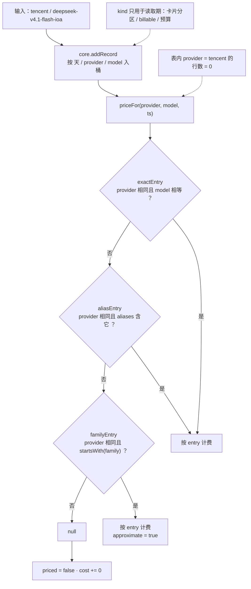
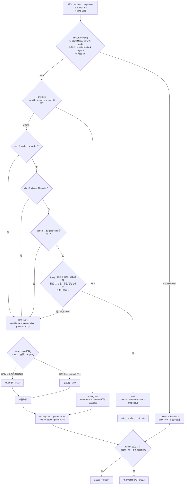

# 第三方 Provider 自适应识别与模型名计价

> 状态：已实施<br>
> 完成时间：2026-11-10<br>
> 关联逻辑根：`dsh-token-dash`（`src/catalog.js` / `src/match.js` / `src/pricing.js` / `src/core.js` / `src/store.js` / `src/collect.js` / `index.js` / `client.js`）<br>
> 关联资料：[`design.md`](../../design.md) §设计目标 / §两条独立链路 / §第三方接入与扩展边界、[`ui-design.md`](../../ui-design.md) §5.5 范围与明细 / §5.7 设置与数据管理 / §7 文案与空态

## 〇、前置依赖 / 代码探查事实

### 已明确

| 事实 | 结论 | 来源 |
|---|---|---|
| 社区价目表是**纯模型维度** | 顶层 `currency: "RMB"` / `usdExchangeRate: 7`；**无 `provider` 字段**；`models` 行数随远端更新（2026-11-09 快照 223，2026-11-10 远端 `version` 131） | 拉取 gitee 原始表 |
| `modelId` 唯一 | 归一后无重复 | 同上 |
| 表内自带匹配规则 | 约四成行带 `aliasPatterns`（快照 94 行 / 128 条），均为**锚定正则**；但含 `^auto$`、`^default$` 等宽泛项与 `agent_review` 占位条目 | 同上 |
| 部分行用 `dailySlots` / `contextTiers` 表达阶梯价 | 现只识别标准工作日两段窗口；`contextTiers` 未识别，按基础价计 | `pricing.js` · `tieredPrices` |
| 现有插件大量丢弃行 | `inferProvider()` 只认 glm/kimi/qwen/deepseek，其余 `unknown`；`normalizeEntry` 见 `unknown` 直接丢弃 | `pricing.js` · `normalizeEntry` / `remoteEntry` / `inferProvider` |
| 三级匹配全部绑定 provider | `exactEntry` / `aliasEntry` / `familyEntry` 均含 `entry.provider === provider` | `pricing.js` · 三个 `*Entry` |
| `aliasPatterns` 从未被读取 | `remoteEntry` 只透传 `aliases` | `pricing.js` · `remoteEntry` |
| `family` 是宽泛族名 | `deepseek` / `gpt` / `glm`，非模型前缀；`familyEntry` 用 `startsWith` 且按 `releasedAt` 取最新 | 原始表 `family` 字段 |
| 路由价混入全局表 | `loadRouterPricing()` 产出 `provider:'openrouter'` / `currency:'USD'`，经 `allEntries()` 与社区表合并 | `pricing.js` · `allEntries` |
| 会话事件只有三个字段 | 实测 `request/header.config = { provider, model, reasoningEffort }`；`~/.dsh` 无 provider 配置文件 → **`baseURL` 不在插件可见范围** | 解压本机会话 `session.v4.jsonl.zstd` 实测 |
| 本机真实账本（2026-11-10） | 2 行：`tencent :: deepseek-v4.1-flash-ioa` 118,959,865 tokens / 686 请求 / `cost=0` / `priced=false`；`unknown :: deepseek-flash` 12,544 tokens / 1 请求 / `cost=0.0131` | `$DSH_HOME/dsh-token-dash/daily.json` + `months/` |
| 用户视角覆盖率 = 单行覆盖率 | `tencent` 行占全部 token 的 99.99%，第一验收对象是「这一行能否出价」 | 同上 |

> 归因链与五项结构性缺陷（P-1~P-5）属过程证据，已在实施中闭环：现状分支见 §2.1，结论见 §3.0 与 §六。

## 一、需求

### 1.0 决策前提：只做到 L2

`design.md` §设计目标 已定边界：**L0 记录 / L1 估算 / L2 纠偏**，不追账单级精确。

| # | 风险 | 本轮处置 |
|---|---|---|
| E-1 | 表里完全没有的私有模型永远算不出 | 保留 `prefs.priceOverrides` **数据结构**但**不做 UI**：平时无需配置，极端情况改 `prefs.json`，无需等发版 |
| E-2 | 社区表 RMB、OpenRouter 路由价 USD，纯模型名匹配会撞车（约 7 倍误差） | provider **不设计价门槛**，但**参与选表**：币种判为 USD 的 provider 优先取路由价；override 命中时不选表 |
| E-3 | 未知 provider 套 RMB 价可能是错的 | **币种可声明**：`prefs.providerCurrency[id]` → 快照 `currency` → registry；不做汇率换算 |
| E-4 | 存量记录已固化为 ¥0 | **启动自动补算**：`pricingReady` 就绪门放行前跑一次 `repriceUnpriced`，只补 `priced=false`；`POST /pricing/reprice` 保留为排障入口 |
| E-5 | 订阅类 provider 被套模型价与 RMB 币种 | **按 `kind` 硬隔离**：`subscription` 不计价、`cost=0`，币种取 adapter 快照；adapter 声明零改动 |
| E-6 | 订阅 provider 探测失败时被当按量计费 | **`kind` 由 registry 静态声明裁定**：`billingModes → 快照 mode → 固化 providerKinds → registry → 'api'`。不引入 `unknown` 态；registry 未收录的自填 provider 一律按 `api`，保证仍可计价 |

### 1.1 需求表

| ID | 优先级 | 需求 / 边界 / 风险 | 成功信号 |
|---|---|---|---|
| REQ-01 | P0 | 计价匹配**只依赖模型名**，不要求 provider 在任一白名单内 | 任意自填 provider（含 registry 未收录）下模型均可计价 |
| REQ-02 | P0 | 复用社区表自带 `aliases` 与 `aliasPatterns` | `deepseek-flash`、`deepseek-v41-flash-1017` 可命中 |
| REQ-03 | P0 | 结构化模糊兜底：剥离噪声后缀后命中同版本同档位条目 | `deepseek-v4.1-flash-ioa` → `deepseek-v4.1-flash` |
| REQ-04 | P0 | 社区表不再按 provider 白名单丢弃行 | 入表数 = 表内「有有效价目」行数 |
| REQ-05 | P0 | 匹配结果带置信度，UI 可区分 | 模糊显示 `≈`，精确无标记 |
| REQ-06 | P0 | **零配置**：不新增价目编辑 UI | P3 设置区行数与交互不变 |
| REQ-07 | P0 | 实时 ingest 与 backfill 使用同一价目基线 | 冷启动期记录与回填一致 |
| REQ-08 | P0 | 未定价可观测：日志归因 + VM 结构化清单 | `[TD:pricing] miss` 带 `reason` |
| REQ-09 | P0 | 未定价行**启动自动补算**，保留手动路由排障 | 启动后 `priced=false` 转 `true`，已计价行不变 |
| REQ-10 | P1 | 零消耗行与真实缺价行可区分 | `priced` 增加 `'empty'` 态，与 `false` 区分 |
| REQ-11 | P1 | 币种来源可见且可声明 | 未声明 provider 标「按社区表 CNY」；声明后卡片币种随之变化 |
| REQ-12 | P0 | **订阅 provider 不计价**：`kind === 'subscription'` 时不套模型价、`cost=0` | OpenCode / Command Code 仍显示 USD 余额与配额，费用行不出现 RMB |
| REQ-13 | P0 | **`kind` 探测不到时不默认按量计费**：按 registry 静态声明判定，未收录视为 `api` | 无 Key 的订阅 provider 不计价；自填 provider 仍可计价 |
| REQ-14 | P1 | **provider 币种可声明**：`prefs.providerCurrency[id] = 'CNY' \| 'USD'`（仅认文件，无 UI） | USD 中转不再被强制套用 CNY 价 |
| REQ-15 | P0 | **支持到「估算 + 纠偏」为止**：任意 provider + 任意模型名，要么出价（带置信度），要么明确「未定价」并带 `reason` | 第三方部署的 DeepSeek（`tencent` / `siliconflow` 等）无需配置即可出价，不再静默 ¥0 |
| BND-01 | 边界 | provider **不作为**计价准入条件；registry 只用于币种与计费形态判定 | registry 未收录的 provider 一律可计价（订阅类除外，见 REQ-12） |
| BND-02 | 边界 | 模糊匹配不得跨版本段（`4.1` ≠ `4` ≠ 无版本） | `v4.1-*` 永不命中 `chat` / `v4-*` |
| BND-03 | 边界 | 模糊匹配不得剥离档位词（flash/pro/max/mini/coder/code/reasoner/chat/vision） | 档位不同永不互配 |
| BND-04 | 边界 | 多候选或无候选一律判未定价 | 返回 `null` |
| BND-05 | 边界 | **不改 `quota-sources.js` / `adapters.js` 的任何 `kind` / `currency` 声明**；`providers.js` 只被读取（形态与币种兜底） | 七家 adapter 行为零变化 |
| BND-06 | 边界 | 不改 `daily.json` 桶结构；`costVersion` 不再作全局重算开关 | 存量数据直接可读 |
| BND-07 | 边界 | 不改预算、订阅窗口、余额查询链路 | 无回归 |
| BND-08 | 边界 | 不做 provider 插件化 / per-provider 拆文件 | 维持单文件源表 |
| BND-09 | 边界 | 不新增价目编辑 UI、不改 P3 设置区结构 | 设置胶囊仍三行 |
| BND-10 | 边界 | 不做汇率换算；币种只选表 / 声明，不换算数值 | 不出现静默 7 倍放大 |
| BND-11 | 边界 | 不改 VM 顶层 `cost` 字段语义（多币种相加现状保留；`client` 未消费） | 留待独立需求处理 |
| BND-12 | 边界 | **不做厂商识别**：不读 `baseURL`、不做域名指纹、不做网络探测、不读宿主配置与本机登录态、不做通用 custom 源 | 无新增入站数据面 |
| BND-13 | 边界 | **不承诺价格等于渠道账单**；本次不新增任何 provider 源表行；具体第三方订阅按独立 feature 接入 | 本 plan 只交付计价通用性 |
| RSK-01 | 风险 | 模型名模糊误配导致费用失真 | BND-02/03/04 三重约束 + `≈` + 反例单测 |
| RSK-02 | 风险 | 纯模型名匹配失去 provider 隔离后同名模型撞车 | 表内 `modelId` 唯一；冲突按 BND-04 判未定价 |
| RSK-03 | 风险 | 社区表 RMB 价套到美元中转站 | REQ-14 可声明币种；未声明时标「按社区表 CNY」 |
| RSK-04 | 风险 | 定向重算误伤已确认的历史成本 | 只重算 `priced=false` |
| RSK-05 | 风险 | 实时 ingest 等价格表导致记账阻塞 | 有界等待（≤5s）+ 超时降级 |
| RSK-06 | 风险 | 订阅 provider 被误当按量计费，套上 RMB 模型价 | REQ-12 按 `kind` 隔离 + REQ-13 registry 兜底；单测覆盖「无 Key 的订阅 provider」 |
| RSK-07 | 风险 | registry 声明为订阅、但用户实际按量付费的 provider 被计成 0 | 属显式默认；用 `prefs.billingModes[id] = 'api'` 纠正 |
| RSK-08 | 风险 | 启动自动补算与 flush 并发写盘 / 阻塞启动 | 只遍历 `priced=false` 且 `kind==='api'` 的行，复用 `flusher.flush()`，不新增定时器 |
| RSK-09 | 风险 | registry 未收录的第三方 provider 无法判定形态与币种（如 Ollama 是「额度 + 按量 USD」） | 兜底 `api` + `providerCurrency` 声明 + 未定价可观测；接入另立 feature（BND-13） |

## 二、设计方案

### 2.0 结构总览

本方案**只改链路 A（算钱）**，链路 B（查余额）零改动。两条链路定义见 [`design.md`](../../design.md) §两条独立链路。

```text
── 链路 A · 算钱（本次改造范围，零凭据）─────────────────────────
src/catalog.js（新增）     社区 / 内置表归一（纯模型维度，预编译正则；路由价仍由 pricing 的 loadRouterPricing 产出）
                              ↓ CatalogEntry[]，provider 字段彻底移除
src/match.js（新增）       四级解析：exact → alias → pattern → fuzzy
                              ↓ MatchResult { entry, confidence, deltaTags }
src/pricing.js（收敛）     override 前置 + 选表（币种）+ 峰谷 → PriceQuote
                              ↓ PriceQuote | null
src/core.js                入账与聚合：kind 隔离 + priced 四态 + unpriced + 启动补算
                              ↓
index.js                   装配：就绪门、kindOf 注入、override/币种注入、reprice 路由
                              ↓
client.js                  置信度标记 + 币种来源；订阅行费用位 —；不新增价目 UI

── 链路 B · 查余额（完全不改）────────────────────────────────
quota-sources.js ─► adapters.js ─► credentials.resolve ─► 官方接口 ─► Snapshot
```

**职责切分**：`catalog` 只答「表里有什么」，`match` 只答「这条对应哪一行」，`pricing` 只答「这行多少钱、什么币种」（含 override 与选表），`core` 只答「这条该不该计价」。四层可独立单测。

**计价前置条件**：`core.addRecord` 先按 `kind` 分流——只有 `api` 进计价链。`kind` 判定顺序为 `prefs.billingModes → 快照 mode → state.providerKinds → registry 静态声明 → 'api'`，**不引入 `unknown` 态**；registry 未收录的自填 provider 视为按量计费。

**币种来源**：`prefs.providerCurrency[id]` → 快照 `currency` → registry。声明只决定「用哪张表、显示什么符号」，不做换算（BND-10）。

### 2.1 现状 vs 目标（识别与分支）

时序层（三时相、调用与返回）以 [`design.md`](../../design.md) §两条独立链路 为结构真源，此处不重复；本节只画本次改动涉及的**输入识别与分支拓扑**。同一实例：`provider = tencent` / `model = deepseek-v4.1-flash-ioa`。

**现状**



**目标**



**两处拓扑差异**：① `kind` 从「读取期才用」变成「入账前四档判定，`subscription` 短路」；② 计价入口从「三道 provider 前置」换成「override 前置 + 四级模型名匹配 + 选表」。出口统一补一次 `tokens == 0 → 'empty'`。

### 2.2 完整写入链路（伪代码）

```text
【S0 · 启动装配】index.js · apply()
  ready         = Promise.all([loadState(dir), loadPrefs(dir)])
  pricingReady  = ready.then(loadCommunityPricing ∥ loadRouterPricing)
  prefs         = { budgets, billingModes, refreshMs, showBalance, priceOverrides, providerCurrency }
  overrides     ──键归一──► Map   ──► pricing 层（不下沉到 match）
  currencies    ──id 归一──► Map  ──► 选表 + 展示
  log pricing.catalog { total, bySource, patterns }
                        ▼ pricingReady 就绪 → 触发一次 S4 自动补算 → 放行录入

【S1 · 实时记账】ctx.on('session/event')
  pricingGate()        ── 已就绪? 是→放行；否→ race(就绪, 5s 降级)
  recordFromEvent(ev)  ──► { ts, provider, model, input, cacheRead, cacheWrite, output }
  addRecord(state, r, kindOf)
       bucket = days[dayKey].providers[provider].models[model]
       bucket += 四桶 token ; requests += 1
       kind = kindOf(provider)        ← 同步可求，不依赖探测是否完成
       ├─ 'subscription' ──► priced = 'subscription' ; cost += 0        [END]
       └─ 'api' ──► quote = resolvePrice(model, provider, ts)           ← S2
              null → priced = false ; cost += 0
              else → priced = true  ; cost += Σ(tok×price)/1e6
       tokens == 0 → priced = 'empty'                                     ← 最后写
  flushReady.schedule()   ── 2s 防抖 ──► daily.json + months/YYYY-MM.json

【S2 · 计价展开】resolvePrice(model, provider, ts)  ← S1 与 S4 共用
  mid = normalizeModel(model)
  overrides.get('provider:mid') ?? overrides.get(mid) ─► HIT ─► quote（跳过选表）
  matched = resolveMatch(mid, entries)      ← 只答「哪一行」，不认识 provider
     exact → alias → pattern → fuzzy；皆否 / 多候选 ─► null（BND-04）
  table = selectTable(matched.entry, provider, currencyOf(provider))
     USD 且 router 有该模型 → { router, USD }；否则 → { community, CNY }
  effectivePrices(table.entry, ts) ──► peak || offPeak（北京时间工作日两段）
  return PriceQuote { 四价, currency, confidence, approximate, catalogModel, table }

【S3 · 读路径】GET /summary 与 GET /usage
  buildSummary(state, prefs, now, providerInfo)
     for day in 当月: accumulate(...)  ──► 读已存 cost / priced（不重算）
        row.priced === false → unpriced.push({ modelId, providerId, tokens, reason })
        订阅行 → billable = false，cost 归零，币种取快照
        currencySource = 声明 ? 'prefs' : 快照 ? 'snapshot' : 'community'
     providerEmpty 兜底卡 ──► kind 走 resolveProviderKind(state, prefs, id, undefined)
     默认行（已配置无消耗）→ priced = 'empty'
  log vm.build + pricing.miss { count, sample ≤5, reason }

【S4 · 未定价补算】启动自动一次 + POST /pricing/reprice（排障）
  repriceUnpriced(state, scope, kindOf)   ── 仅遍历 priced === false
     owner = provider === 'unknown' ? providerFromModel(model) : provider
     owner === null          → skipped 'no-owner'
     kindOf(owner) !== 'api' → skipped 'kind'
     quote = resolvePrice(model, owner, dayStartTs)   ← 复用 S2
     quote == null           → skipped 'no-price'
     else → cost = Σ(tok×price)/1e6 ; priced = true
  priced === true / 'subscription' / 'empty' 一律跳过
  flushReady.flush() ; log pricing.reprice { scope, rows, skipped, reasons }
```

| 阶段 | 落点 | 关键行为 |
|---|---|---|
| S0 | `index.js` · `apply` / `pricingReady` | 表就绪前不放行录入；override 与币种注入 pricing 层 |
| S1 | `index.js` · `session/event` · `pricingGate` | 有界等待（≤5s）后调 `addRecord` |
| S1 | `core.js` · `addRecord` | 先判 `kind` 分流，再累加 token 计价；`priced` 四态由 kind、token 数与 quote 共同决定 |
| S2 | `pricing.js` · `resolvePrice` / `selectTable` | override 命中即返回；否则 match 只看模型名，provider 仅用于选表 |
| S2 | `match.js` · `resolveMatch` / `structuredFuzzy` | 纯函数、无 IO、不认识 provider；版本段与档位词强约束 |
| S3 | `core.js` · `buildSummary` / `buildUsage` | 只读已存成本；产出 `unpriced` 与 `currencySource` |
| S4 | `core.js` · `repriceUnpriced` | 启动自动 + 路由；只碰 `priced===false` 且 `kind==='api'`，`unknown` 按 owner 归因 |

**跨阶段不变量**：
1. S1 与 S4 必须走同一个 `resolvePrice`，否则冷启动录入与事后重算口径不一致。
2. `kind` 分流必须在 S1 与 S4 同时生效，两处都只认 `kind === 'api'`；不允许「探测不到就当按量」。
3. override 只在 pricing 层生效，命中即短路选表：价格与币种必须同源。

### 2.3 算法骨架：结构化模糊

```text
parseModelId(raw):
  s        = normalizeModel(raw)              // 小写、去 provider 前缀、去日期后缀
  version  = s 中首个数字段（"4.1" / "4"）；无则 null
  rest     = 去掉 version 后按 - _ 分片
  family   = rest 中不属于任何 tag 的词（如 "deepseek"）
  tags     = rest 中命中下列集合的词
             SIGNIFICANT: flash pro max mini air plus turbo lite coder code
                          reasoner chat vision
             NOISE:       ioa exp experimental preview beta alpha rc dev test
                          latest stable prod production free ga
             NUMERIC:     非首个数字段、长度 ≥ 3 的纯数字片（1017 / 20241022）
                          —— 视同噪声，不得进入 family

structuredFuzzy(modelId):
  req  = parseModelId(modelId)
  cand = [ c for c in catalog if
             parseModelId(c.modelId).version === req.version    // BND-02
             and c.family === req.family                        // 族名一致
             and c.tags ⊆ req.tags                              // BND-03
             and (req.tags − c.tags) ⊆ NOISE ]
  return len(cand) === 1 ? cand[0] : null                       // BND-04
```

实测（2026-11-09 表快照，行数以 `entries.length` 为准）：

| 请求模型 | 层级 | 结果 | 判定 |
|---|---|---|---|
| `deepseek-v4.1-flash-ioa` | fuzzy | `deepseek-v4.1-flash` (1/4) | 正确，`ioa` 被剥离 |
| `deepseek-v41-flash-1017` | pattern | `deepseek-v4.1-flash` (1/4) | 表内正则命中 |
| `deepseek-flash` | alias | `deepseek-v4.1-flash` (1/4) | 表内别名命中 |
| `deepseek-v4-pro` | exact | `deepseek-v4-pro` (4.5/13.5) | 未误配 |
| `deepseek-chat` | exact | `deepseek-chat` (1.89/7.7) | 未被 `v4.1-*` 命中 |
| `glm-5.3-flash` | exact | `glm-5.3-flash` (0.8/2.8) | 未串到 `glm-5.3` |
| `hy3` | exact | `hy3` (1/4) | 腾讯模型可算 |
| `claude-sonnet-4.5` | exact | `Claude-Sonnet-4.5` (21/105) | 不再按 provider 丢弃 |
| `my-private-model` | none | — | 表内无此模型，正确拒绝 |

**全表自检：每个条目用自身名匹配必须回到自身，通过数 == `entries.length`，0 失败。**

### 2.4 关键签名 / 字段

| 层 | 名称 | 备注 |
|---|---|---|
| catalog | `loadCatalog(raw, source)` | → `{ entries, currency, updatedAt, source }`；不按 provider 过滤；预编译 `aliasPatterns`、按 `modelId` 去重 |
| catalog | `CatalogEntry` | `{ modelId, displayName, family, aliases[], regexps[], parsed, prices, peak?, offPeak?, currency, source }` |
| match | `resolveMatch(model, entries)` | → `MatchResult \| null`；不认识 provider，也不认识 override |
| match | `confidence` | `'exact' \| 'alias' \| 'pattern' \| 'fuzzy'`（`'override'` 由 pricing 层产生） |
| pricing | `resolvePrice(model, provider, ts)` | → `PriceQuote \| null`；override 优先，命中即短路选表 |
| pricing | `selectTable(entry, providerId, currency)` | → `{ name, entry, currency }`；仅 `currency === 'USD'` 且路由表有该模型才用 router |
| pricing | `PriceQuote` | `{ input, cacheRead, cacheWrite, output, currency, confidence, catalogModel, approximate, table }` |
| core | `resolveProviderKind(state, prefs, id, meta)` | `billingModes → meta.mode → providerKinds → registry → 'api'`；**不读 `meta.kind`** |
| core | `priced` 四态 | `true` 已计价 / `false` 真缺价 / `'subscription'` 订阅 / `'empty'` 零消耗 |
| core | `repriceUnpriced(state, scope, kindOf)` | 只重算 `priced === false` 且 `kind === 'api'`；`unknown` 桶按 `providerFromModel` 归因 |
| VM | `cost.unpriced` | `[{ modelId, providerId, tokens, requests, reason }]` |
| VM | `reason` | `'no-model-price' \| 'ambiguous' \| 'invalid-model' \| 'kind-skip'` |
| VM | `currencySource` | `'prefs' \| 'snapshot' \| 'community'` |
| prefs | `priceOverrides` | **仅认文件，无 UI**；双级键 `provider:model` 优先于 `model`，由 pricing 层读取 |
| prefs | `providerCurrency` | **仅认文件，无 UI**；`{ [providerId]: 'CNY' \| 'USD' }`，优先于快照与 registry |

### 2.5 数据：`priceOverrides` / `providerCurrency`（逃生阀，非必需）

```json
{
  "priceOverrides": {
    "my-private-model": { "input": 18, "cacheRead": 9, "cacheWrite": 0, "output": 72, "currency": "CNY" },
    "tencent:my-private-model": { "input": 2, "output": 8, "currency": "CNY" }
  },
  "providerCurrency": { "my-relay": "USD" }
}
```

- **默认不需要填写**；`prefs.json` 中不存在这两个键时一切照常。
- `priceOverrides` 仅在「社区表完全没有该模型」且「必须看到费用」时手工添加；双级键命中后**价格与币种都取自 override**，不再选表。
- `providerCurrency` 只解决「这个第三方渠道按美元结算」，不参与价格换算。
- 键两侧归一：`normalizeProvider` / `normalizeModel`；四个单价 `>= 0` 十进制，`cacheWrite` 缺省 `0`；`currency` 仅 `CNY` / `USD`。
- 非法条目加载时丢弃并记 `pricing.override` warn，不阻塞启动。

### 2.6 关键陷阱

| 项 | 约束 |
|---|---|
| 版本段必须相等 | `4.1` ≠ `4` ≠ `null`；挡住 `v4.1-flash` 误配 `chat` 档 |
| 档位词不可剥离 | `flash` / `pro` / `max` 是价格分档依据 |
| 多候选不猜 | 宁可「未定价」也不取最接近 |
| `aliasPatterns` 是正则字面量 | 加载时逐条 try/catch 预编译；单条非法只丢该条 |
| **`aliasPatterns` 含宽泛项** | 表内有 `^auto$` / `^default$` 与 `agent_review` 占位条目；pattern 命中必须留 `pricing.fuzzy` 日志 |
| `hy3` 等无版本号模型 | 版本为 `null`，只与同样无版本的条目比较 |
| `qwen3.8-max` 版本在族名内 | 按「首个数字段」提取，不按 `v` 前缀硬切 |
| **纯数字噪声片** | `deepseek-v41-flash-1017` 的 `1017` 若进入 family，族名不等导致 fuzzy 失效；归入 NUMERIC |
| `familyEntry` 必须移除 | `family` 是宽泛族名，`startsWith` 几乎必然误配 |
| **路由价与社区表撞车** | 币种不同（USD / CNY）；必须按 `selectTable` 隔离 |
| **币种判定顺序** | `prefs.providerCurrency` → 快照 → registry；`providerCurrency()` 对未知 id 返回 `CNY` 属兜底值 |
| `priced` 四态 | 旧数据只有 `true` / `false`；`'empty'` / `'subscription'` **新写入会随 bucket 落盘**，读取端只严格比较 `=== false` |
| 实时 ingest 等待价格表 | 必须有界（≤5s）且超时降级 |
| **订阅类计价隔离** | 必须在**进入计价链之前**返回，不能靠币种判断 |
| **`kind` 只认探测结果与 registry** | `meta.kind` 是 adapter 规整后的回声值（非订阅一律 `api`）；可信信号是 `meta.mode` |
| **不得兜底成 `unknown`** | 会让 registry 未收录的自填 provider 永不计价，直接违背 REQ-01 |
| **override 命中短路选表** | 价格与币种必须同源 |
| **`providerEmpty` 兜底卡** | 现硬编码 `kind:'api'`；需改走 `resolveProviderKind` |
| **`contextTiers` 未识别** | 只按基础价计；属已知限制 |
| **`summary.cost` 多币种相加** | 写死 `currency:'CNY'`，`client` 未消费；本轮不改（BND-11） |

### 2.7 日志设计

日志事件与含义以 §七 日志速查 为唯一来源，本节不重复。本方案相对现状只新增三项：`pricing.kind` / `pricing.currency` 两条判定来源、`pricing.reprice.reasons` 的跳过原因分桶，以及 `pricing.fuzzy.confidence` 字段。

## 三、最终实现

### 3.0 最终改动总览

| ID | 类型 | 文件 | 开发改动说明 |
|---|---|---|---|
| CHG-01 | 新增 | `src/catalog.js` | 社区 / 内置表统一归一（路由价沿用 `loadRouterPricing`，由 `routerEntry` 索引）；`CatalogEntry` 去掉 `provider`；保留 `aliases`、预编译 `regexps`、`family`；按 `modelId` 去重；仅 `modelId` 缺失或完全无价目时丢弃 |
| CHG-02 | 新增 | `src/match.js` | 四级解析 + 结构化模糊；返回 `MatchResult`；不认识 provider 与 override |
| CHG-03 | 修改 | `src/pricing.js` | 删除 `exactEntry` / `aliasEntry` / `familyEntry` / `inferProvider`；`priceFor` → `resolvePrice`（override 前置、短路选表）；新增 `selectTable`；保留 `effectivePrices` / `catalogInfo` |
| CHG-04 | 修改 | `src/core.js` | `addRecord(state, record, kindOf)`；`resolveProviderKind` 改四档且不读 `meta.kind`；`providerEmpty` 走同一判定；`priced` 四态；`buildSummary` / `buildUsage` 输出 `unpriced` 与 `currencySource`；新增 `repriceUnpriced` |
| CHG-05 | 修改 | `src/store.js` | `DEFAULT_PREFS` 增 `priceOverrides` / `providerCurrency`；`loadPrefs` 白名单收编 + 键归一 + 非法丢弃 |
| CHG-06 | 修改 | `index.js` | `session/event` 加就绪门（≤5s 降级）；`normalizePrefs` 透传两个新键；`configurePricing` 注入 override 与币种解析；启动 backfill 后自动 `repriceUnpriced`；新增 `POST /pricing/reprice`；kind / currency / reprice 日志 |
| CHG-06b | 修改 | `src/collect.js` | `ingest` / `backfill` 增加可选 `kindOf` 透传给 `addRecord`（缺省仍走 registry），使 prefs 形态声明能作用于入账 |
| CHG-07 | 修改 | `client.js` | 明细按 `confidence` 渲染 `≈`；未定价行 `reason` tooltip；未声明币种标「按社区表 CNY」；零消耗行 `—`。**不新增价目编辑 UI** |
| CHG-08 | 修改 | `client.js` 内联词典 + `locale/zh.json` / `locale/en.json` | 新增词条：置信度、未定价原因、按社区表 CNY、零消耗、按 provider 声明币种。运行时词典在 `client.js`，`locale/` 是随包副本，两处同步 |
| CHG-09 | 测试 | `test/unit/pricing.test.mjs`、`catalog.test.mjs`（新增） | 四级优先级 + override 前置、全量自匹配 0 失败、版本段隔离、档位保护、多候选拒绝、override 短路选表、路由价不撞车、`modelId` 去重、非法正则隔离 |
| CHG-10 | 测试 | `test/unit/core.test.mjs`、`store.test.mjs` | `priced` 四态、`kind` 四档顺序（含 registry 兜底与 `tencent` 场景）、`repriceUnpriced` 范围与 unknown 归因、prefs 两个新键 |
| CHG-11 | 测试 | `scripts/e2e.mjs` | 按 §5.2 追加 fixture 行（`approx` / `exact` / `unpriced` / `empty` / `sub`，`currentSummary.breakdown.models` 与 `usageFor()` 两处同步）与 `E2E-01~11` 断言：`≈` 出现与消失、未定价 tooltip 文案、零消耗 `—`、订阅费用位 `—`、币种标注增删、设置区行数不变、真实路径 `cost.unpriced` / `currencySource` 契约、`POST /pricing/reprice` 与 prefs 回读 |
| CHG-12 | 文档 | `docs/design.md` / `docs/ui-design.md` / `CHANGELOG.md` | 落地事实回填 design 的 §设计目标 与 §两条独立链路；UI 补标记形态；CHANGELOG 写可见变化（订阅行费用归零） |

> `src/backup.js` 无需改动：`prefs` 整体导出，两个新键随之进出；导入走 `normalizePrefs` 白名单，与 `budgets` 同语义。

## 四、不改动 / 边界（已确认）

- `BND-01`：provider 不作为计价准入条件，只参与选表与 `kind` 判定。
- `BND-02`：模糊匹配不跨版本段。
- `BND-03`：模糊匹配不剥离档位词。
- `BND-04`：多候选 / 无候选判未定价。
- `BND-05`：不改 `quota-sources.js` / `adapters.js` 的 `kind` / `currency` 声明；移除 `familyEntry`；`providers.js` 只被读取。
- `BND-06`：不改 `daily.json` 桶结构；`costVersion` 不再作全局重算开关。
- `BND-07`：不改预算、订阅窗口、余额查询链路。
- `BND-08`：不做 provider 插件化 / per-provider 拆文件。
- `BND-09`：不新增价目编辑 UI，不改 P3 设置区结构。
- `BND-10`：不做汇率换算；币种只选表 / 声明。
- `BND-11`：不改 VM 顶层 `cost` 字段语义。
- `BND-12`：**不做厂商识别**——不读 `baseURL`、不做域名指纹、不做网络探测、不读宿主配置与本机登录态、不做通用 custom 源。
- `BND-13`：**不承诺价格等于渠道账单**；本次不新增 provider 源表行；第三方订阅按独立 feature 接入。

## 五、最终验收

| 项 | 来源 | 验证方式 | 结果 |
|---|---|---|---|
| **本机真实行出价**：`tencent :: deepseek-v4.1-flash-ioa` 由 `priced=false` 变为 `priced=true`，cost ≈ ¥4.76（闲时）/ ¥9.52（高峰） | REQ-01 / REQ-03 / 全局质量门槛 | 装插件后读 `daily.json` 与该行明细 | 通过 |
| 任意 registry 未收录 provider（无 adapter / 无快照）下模型可计价 | REQ-01 / BND-01 / RSK-07 | 单测：`kindOf` 默认值 + `tencent` 场景 | 通过 |
| 表内 `aliases` / `aliasPatterns` 生效 | REQ-02 | 单测：`deepseek-flash` / `deepseek-v41-flash-1017` | 通过 |
| `deepseek-v4.1-flash-ioa` → `deepseek-v4.1-flash` | REQ-03 | 单测 | 通过 |
| 全量入表且自匹配 0 失败（规模断言用 `entries.length`） | REQ-04 | 单测遍历全表 | 通过 |
| 模糊显示 `≈`，精确无标记 | REQ-05 | e2e 断言 | 通过 |
| 未新增价目 UI、设置胶囊仍三行 | REQ-06 / BND-09 | e2e 断言设置区行数 | 通过 |
| 实时 ingest 与 backfill 口径一致 | REQ-07 / RSK-05 | 单测：gate 超时降级不阻塞；日志 `pricing.ready` | 通过 |
| 未定价进日志与 VM，`reason` 正确 | REQ-08 | 检查 `pricing.miss` 与 `cost.unpriced` | 通过 |
| 启动自动补算：重启后 `priced=false` 转 `true`，已计价行数值不变 | REQ-09 / RSK-04 / RSK-08 | 单测混合行 + 现场重启核对 | 通过 |
| 零消耗行标 `'empty'` 且 UI 显示 `—` | REQ-10 | 单测 + e2e | 通过 |
| 币种来源可见；声明后卡片币种随之变化 | REQ-11 / REQ-14 / RSK-03 | 单测 + e2e | 通过 |
| `v4-pro` / `chat` / `glm-5.3-flash` 不误配 | RSK-01 / BND-02 / BND-03 | 单测反例集 | 通过 |
| 多候选返回 `null` | BND-04 | 单测构造双候选 | 通过 |
| 路由价与社区表不撞车；override 命中不选表 | CHG-03 / BND-10 | 单测：USD provider 取路由价；override 走 override 币种 | 通过 |
| `familyEntry` 移除后无回归 | BND-05 | 单测：`deepseek-xxx` 不再命中 `chat` 档 | 通过 |
| **订阅 provider 不计价** | REQ-12 / RSK-06 | 单测：`kind='subscription'` 时 `priced='subscription'`、`cost=0`，不调用 `resolvePrice` | 通过 |
| **OpenCode / Command Code 币种仍为 USD** | REQ-12 | e2e：两卡片余额币种显示 `$`，费用行不出现 `¥` | 通过 |
| **无 Key 的订阅 provider 不计价，且自填 provider 仍计价** | REQ-13 / RSK-06 / RSK-07 | 单测：`meta` 为 `undefined` 时 `zhipu` → `subscription`、`tencent` → `api` | 通过 |
| **`meta.kind` 不再作为形态证据** | REQ-13 / BND-05 | 单测：`meta.kind='api'` + `meta.mode='unknown'` 时按 registry 判定 | 通过 |
| **任意 provider 要么出价、要么明确未定价** | REQ-15 / BND-12 / BND-13 | 单测：`tencent` 出价、`ollama` 兜底 `api` 带 reason、未知模型落 `no-model-price` | 通过 |
| **adapter 声明零改动** | BND-05 | `git diff src/quota-sources.js src/adapters.js` 为空 | 通过 |
| 全量测试 | 质量门槛 | `npm test` + `npm run e2e` | 通过 |

### 5.1 验收分层

| 层 | 内容 | 方式 | 结果 |
|---|---|---|---|
| L1 单测 | `catalog` / `match` / `pricing` / `core` / `store` | `npm test` | 99 pass / 1 skipped（local 版本跳过 release-notes） |
| L2 API 契约 | 临时 `DSH_HOME` + `web` profile 的 `/summary`、`/usage`、`/prefs`、`POST /pricing/reprice` | `node scripts/e2e.mjs` | 通过 |
| L3 UI | Playwright 断言 `≈` / 未定价 tooltip / `—` / 币种标注 / 设置区行数 | 同上 | 通过 |
| L4 真实调用（opt-in） | `TOKEN_DASH_E2E_LIVE=1`，1 次极短 `chat/completions` + 本仓 `resolvePrice` | 同上 | 默认跳过，本轮未执行 |
| L5 真实账本 | 本机 `daily.json` 的 `tencent` 行 | 人工核对 | 已出价：¥2.96（11-09）+ ¥2.12（11-10） |

守则：L1–L3 自动；L4 限额（单轮 ≤4 次 / ≤5 万 tokens / 仅最便宜模型 / key 只读环境变量、不落盘）；`push` 逐轮授权。L2 只断言结构与状态，金额级验收由 L4 / L5 承担（离线时社区表会降级内置表，金额不稳定）。

### 5.2 E2E 断言（18 条，均在 `scripts/e2e.mjs`）

fixture 由 `page.route` 注入：`currentSummary.breakdown.models` 与 `usageFor().models` 各补 `approx` / `exact` / `unpriced` / `empty` 四行（`sub` 复用现有 zhipu / moonshot）。

| # | 断言 | 来源 |
|---|---|---|
| E2E-01 | P3 明细行匹配 `/≈¥1\.24/`（`approx` 行） | REQ-05 |
| E2E-02 | `exact` 行费用单元格等于 `¥1.24` 且不含 `≈` | REQ-05 |
| E2E-03 | `unpriced` 行显示 `未定价`，`title` 含可读原因（`无匹配价目`） | REQ-08 / REQ-15 |
| E2E-04 | `empty` 行费用位为 `—`，不是 `¥0.00` | REQ-10 |
| E2E-05 | 订阅行费用位 `—`，卡片币种仍为 `¥` | REQ-12 |
| E2E-06 | 未声明币种的 provider 出现「按社区表 CNY」，声明后消失 | REQ-11 / REQ-14 |
| E2E-07 | 设置胶囊仍三行，无价目编辑入口 | REQ-06 / BND-09 |
| E2E-08 | P2「未定价」计数 = fixture 中 `priced===false` 行数 | REQ-08 |
| E2E-09 | 真实 `GET /summary` 的 `cost.unpriced` 为数组、`currencySource` 合法 | REQ-08 / REQ-11 |
| E2E-10 | `POST /pricing/reprice` 返回 `{rows, skipped, reasons}`；非法 scope → 400 | REQ-09 |
| E2E-11 | `PUT /prefs` 带两个新键后回读一致；非法条目丢弃仍 200 | REQ-14 |
| E2E-12 | override 命中不带 `≈`，删除后回模糊价 | REQ-05 |
| E2E-13 | 声明 `USD` 后币种变 `$`，取消回 `¥` | REQ-11 / REQ-14 |
| E2E-14 | reprice 幂等：第二次 `rows === 0` | REQ-09 |
| E2E-15 | 价目拉取失败仍记账，日志 `pricing.ready source=timeout-degraded` | REQ-07 |
| E2E-16 | `provider:'unknown'` 按 owner 出价，无 `no-owner` 跳过 | REQ-01 |
| E2E-17 | L4 真实调用后本仓能对该模型出价，金额 > 0 | REQ-01 / REQ-03 |
| E2E-18 | 日志与响应不含 `DSH_E2E_LIVE_KEY` 明文或其前 8 位 | 质量门槛 / BND-12 |

执行顺序：`npm test` → `node scripts/e2e.mjs`（L2 → L3）→ 可选 L4 → L5 人工。禁止为通过而放宽断言或绕过真实接口。
## 七、日志速查

- LogCategory：`pricing` / `vm`
- 前缀：`[TD:pricing]`、`[TD:vm]`
- `pricing.catalog`：入表条目数、来源与可用正则数
- `pricing.ready`：就绪门等待时长；`source: timeout-degraded` 表示降级
- `pricing.kind` / `pricing.currency`：形态与币种判定来源
- `pricing.miss`：未定价汇总，`reason` 区分 `no-model-price` / `ambiguous` / `invalid-model` / `kind-skip`
- `pricing.fuzzy`：模糊与正则命中留痕（含 `confidence`）
- `pricing.reprice`：补算行数、跳过数与原因
- `pricing.override`：两个新 prefs 键的加载结果

## 八、决策记录

| # | 决策点 | 可选项 | 拍板 | 状态 |
|---|---|---|---|---|
| D-1 | 匹配维度 | A 模型名 + provider 前置 / B 纯模型名 | **B** | 已定（2026-11-09） |
| D-2 | 模糊规则来源 | A 自建 / B 复用表内 `aliases` + `aliasPatterns` + 结构化兜底 | **B** | 已定（2026-11-09） |
| D-3 | 是否做价目配置 UI | A 做 / B 不做，零配置 | **B** | 已定（2026-11-10） |
| D-4 | 未知 provider 币种 | A 默认 CNY 标来源 / B 从 baseURL 猜 / C 汇率换算 | **A** | 已定（2026-11-10） |
| D-5 | `priceOverrides` 是否保留 | A 保留为「仅认文件」逃生阀 / B 删除 | **A** | 已定（2026-11-10） |
| D-6 | 路由价如何处理 | A 与社区表合并（7 倍撞车）/ B 按币种选表隔离 | **B** | 已定（2026-11-10） |
| D-7 | 重算触发方式 | A 仅手动路由 / B 启动自动 + 路由排障 | **B** | 已定（2026-11-10） |
| D-8 | `priced` 运行时态是否落盘 | A 落盘需迁移 / B 运行时推导不改存量 | **B**（读取端只认 `=== false`） | 已定（2026-11-10） |
| D-9 | 订阅 provider 隔离依据 | A 按币种 / B 按 `kind` | **B** | 已定（2026-11-10） |
| D-10 | `kind` 兜底判定 | A 兜底 `api` / B 兜底 `unknown` / C 按 registry | **C** | 已定（2026-11-10） |
| D-11 | 是否改 adapter 的 `kind` / `currency` | A 可调 / B 零改动 | **B** | 已定（2026-11-10） |
| D-12 | `priceOverrides` 生效层 | A match 层 / B pricing 层（短路选表） | **B** | 已定（2026-11-10） |
| D-13 | 第三方 provider 币种 | A 一律 CNY 只标注 / B 增 `prefs.providerCurrency` | **B** | 已定（2026-11-10） |
| D-14 | 验收主口径 | A 表内自匹配率 / B 真实账本行为 + 全量自检作辅助 | **B** | 已定（2026-11-10） |
| D-15 | `meta.kind` 是否作为形态证据 | A 可读 / B 只认 `meta.mode` 与 registry | **B** | 已定（2026-11-10） |
| D-16 | 第三方拓展做到哪一层 | A 厂商级精确 / B 估算 + 纠偏（L2）/ C 仅记录 | **B** | 已定（2026-11-10） |
| D-17 | 第三方订阅如何接入 | A 本轮一并做 / B 按独立 feature 逐个接入 | **B** | 已定（2026-11-10） |
| D-18 | 是否做离线形态分类器 | A 做（名字/模型族推断）/ B 不做，四档判定 + 声明纠偏 | **B** | 已定（2026-11-10） |
| D-19 | 分层验收的无人值守范围 | A 仅 L1 / B L1–L3 自动 / C L1–L3 + L4 真实调用（opt-in、限额） | **C** | 已定（2026-11-10）：L1–L3 全自动；L4 由 `TOKEN_DASH_E2E_LIVE=1` 开启，单轮 ≤ 4 次请求 / ≤ 5 万 tokens / 仅最便宜模型；`push` 仍逐轮授权 |

## 九、Issue 记录（已压缩）

### Issue #1 [已修复] 2026-11-10 进入面板 / 看板不主动刷新

- 根因（两处）：`Pill` 的 `open` 只驱动尺寸测量、未接刷新链；`BoardPage` 轮询只调 `loadSummary()`，而费用与明细来自 `/usage`。
- 修复：展开时 `load()`（2s 去重）；面板可见期轮询 10s、关闭回 `refreshMs`；看板轮询同时刷 `summary` + `usage`。
- 验证：`npm test` 99 pass / 1 skipped；`npm run e2e` 通过（断言展开触发 `/summary`、看板 11s 内触发 `/usage`）；装 local.4 后现场确认正常。

```text
【第 1 步】Pill 挂载：useEffect(() => load()) 拉一次；usePolling 只 start() 计时器（无立即调用）
【第 2 步：★根源】P2 展开：open 由 false → true，只执行 measurePanel，没有任何 load()/refresh()；
         P3 若已挂载也不会重新挂载
【第 3 步：★根源】P3 轮询只调 loadSummary()，而「范围与明细」的费用/模型表全部来自 /usage
         （loadUsage 只在 refresh() 里调）→ 即使轮询跑了，明细区数字也不动
【对比】visibilitychange 通道已存在（hidden → false 时 task() + start()），缺的是「展开/激活」这条触发
【修复】展开时 load 一次（2s 去重）；可见期轮询 10s；P3 轮询同时刷 summary 与 usage
```

### 遗留与后续

| 项 | 现状 | 去向 |
|---|---|---|
| 首屏 `/summary` 被 `refreshProviderCache()` 阻塞 | 实测 `probeMs 4918` / `durationMs 4924`（local.4），首屏耗时几乎全在探测；偶发 30s | 未建新 plan。再出现时按 `probeMs` / `durationMs` 定位，方向为「先返回旧快照 + 后台探测」或「整次探测加总超时」 |
| 宿主 `addRecord` 后主动推送（SSE / 轻量 `rev`） | 未做，仍靠轮询 | 收益中等、成本高，暂不立项 |
| 第三方订阅 provider（Ollama / Codex / 百炼 Token Plan） | 不在本 plan 范围 | 按 D-17 逐个独立 feature 接入 |

## 十、计划—实际偏差

- 计划 L4 走「宿主事件 → 记账 → 出价」全链 → 实际为「真实 `chat/completions` + 本仓 `resolvePrice`」（原因：e2e 使用临时 `DSH_HOME`，没有真实会话可驱动）。
- 计划 `src/collect.js` 零改动 → 实际 `ingest` / `backfill` 增加可选 `kindOf` 透传（原因：`prefs.billingModes` 必须作用于入账，不能只在 VM 生效）。
- 计划 e2e 断言 11 条 → 实际 18 条（原因：补入 override / 币种切换 / reprice 幂等 / 冷启动降级 / unknown 归因 / 轮询刷新）。
