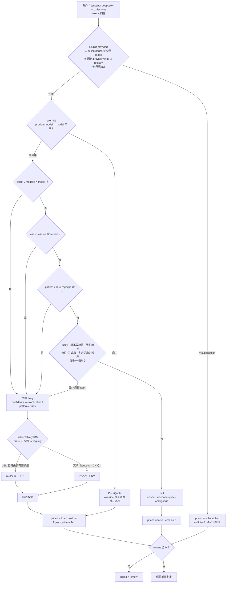

# 第三方 Provider 自适应识别与模型名计价

> 状态：已实施<br>
> 完成时间：2026-11-10（随 `2.1.0` 发布）<br>
> 关联逻辑根：`dsh-token-dash`（`src/catalog.js` / `src/match.js` / `src/pricing.js` / `src/core.js` / `src/store.js` / `src/collect.js` / `index.js` / `client.js`）<br>
> 关联资料：[`design.md`](../../design.md)（§设计目标 / §两条独立链路 / §第三方接入与扩展边界）、[`ui-design.md`](../../ui-design.md)（§5.5 / §5.7）、[`feature_ollama_subscription.md`](feature_ollama_subscription.md)（后续 provider 接入）

## 一、最终需求与范围

| ID | 最终处置 | 需求 / 边界 / 风险 | 最终结论或迁移去向 |
|---|---|---|---|
| REQ-01 | 完成 | 计价只依赖模型名，不要求 provider 在白名单内 | 任意 provider（含 registry 未收录）下模型均可出价 |
| REQ-02 | 完成 | 复用表内 `aliases` / `aliasPatterns` | `deepseek-flash`、`deepseek-v41-flash-1017` 命中 |
| REQ-03 | 完成 | 结构化模糊兜底 | `deepseek-v4.1-flash-ioa` → `deepseek-v4.1-flash` |
| REQ-04 | 完成 | 社区表不再按 provider 白名单丢行 | 入表数 = 表内有有效价目行数 |
| REQ-05 | 完成 | 匹配带置信度，UI 可区分 | fuzzy 显示 `≈`，exact 无标记 |
| REQ-06 | 完成 | 零配置，不新增价目编辑 UI | P3 设置区仍三行 |
| REQ-07 | 完成 | 实时 ingest 与 backfill 同一价目基线 | 就绪门有界等待（≤5s），超时降级 |
| REQ-08 | 完成 | 未定价可观测 | `pricing.miss` 日志 + VM `cost.unpriced` |
| REQ-09 | 完成 | 未定价启动自动补算，保留手动路由排障 | `priced=false` 转 `true`，已计价行不变 |
| REQ-10 | 完成 | 零消耗与真实缺价可区分 | `priced='empty'`，UI 显示 `—` |
| REQ-11 | 完成 | 币种来源可见且可声明 | 未声明标「按社区表 CNY」，声明后卡片跟随 |
| REQ-12 | 完成 | 订阅 provider 不计价 | `priced='subscription'`、`cost=0`，不进计价链 |
| REQ-13 | 完成 | 探测不到形态时不默认按量 | 四档判定 + registry 兜底，不引入 `unknown` |
| REQ-14 | 完成 | provider 币种可声明 | USD 中转不再被强制套 CNY 价 |
| REQ-15 | 完成 | 只做到「估算 + 纠偏」为止 | 要么出价（带置信度），要么明确未定价并带 `reason` |
| BND-01 | 保持 | provider 不作为计价准入条件 | registry 只用于币种与形态判定 |
| BND-02 | 保持 | 模糊不跨版本段 | `4.1` ≠ `4` ≠ 无版本 |
| BND-03 | 保持 | 模糊不剥离档位词 | flash / pro / max 等不互配 |
| BND-04 | 保持 | 多候选或无候选判未定价 | 返回 `null`，不取最近似 |
| BND-05 | 保持 | 不改 `quota-sources.js` / `adapters.js` 的 `kind` / `currency` | adapter 零改动，`providers.js` 只被读取 |
| BND-06 | 保持 | 不改 `daily.json` 桶结构 | 存量直接可读 |
| BND-07 | 保持 | 不改预算、订阅窗口、余额链路 | 无回归 |
| BND-08 | 保持 | 不做 provider 插件化 | 单文件源表 |
| BND-09 | 保持 | 不新增价目编辑 UI | 设置胶囊仍三行 |
| BND-10 | 保持 | 不做汇率换算 | 币种只选表 / 声明 |
| BND-11 | 保持 | 不改 VM 顶层 `cost` 字段语义 | 多币种相加现状保留，`client` 未消费 |
| BND-12 | 保持 | 不做厂商识别 | 不读 `baseURL` / 域名指纹 / 本机登录态 |
| BND-13 | 保持 | 不承诺价格等于账单；本 plan 不新增 provider 源表行 | 第三方订阅按独立 feature 接入 |
| RSK-01 | 已验证 | 模糊误配导致费用失真 | 版本段 / 档位 / 多候选三重约束 + `≈` + 反例单测 |
| RSK-02 | 已验证 | 同名模型跨 provider 撞车 | 表内 `modelId` 唯一，冲突按 BND-04 判未定价 |
| RSK-03 | 已缓解 | RMB 价套到美元中转站 | 可声明币种；未声明标来源 |
| RSK-04 | 已验证 | 重算误伤已确认历史成本 | 只重算 `priced=false` 且 `kind='api'` |
| RSK-05 | 已验证 | 等价格表阻塞记账 | 有界等待 ≤5s + 超时降级 |
| RSK-06 | 已验证 | 订阅 provider 被当按量计费 | 按 `kind` 隔离 + registry 兜底，单测覆盖无 Key 场景 |
| RSK-07 | 接受 | registry 声明订阅但实际按量 | 属显式默认，用 `prefs.billingModes[id]='api'` 纠正 |
| RSK-08 | 已验证 | 补算与 flush 并发写盘 | 复用 `flusher.flush()`，不新增定时器 |
| RSK-09 | 已缓解 | 未收录 provider 无法判断形态与币种 | 兜底 `api` + 未定价可观测；接入另立 feature（已由 Ollama 计划落地） |

## 二、最终实现

### 3.0 最终改动总览

| ID | 类型 | 文件 | 开发改动说明 |
|---|---|---|---|
| CHG-01 | 新增 | `src/catalog.js` | 社区 / 内置表统一归一为纯模型维度 `CatalogEntry`（去 `provider`、保留 `aliases`、预编译 `regexps`、按 `modelId` 去重）；路由价仍由 `pricing.loadRouterPricing` 产出 |
| CHG-02 | 新增 | `src/match.js` | 四级解析 exact → alias → pattern → fuzzy；返回 `MatchResult`；不认识 provider 与 override |
| CHG-03 | 修改 | `src/pricing.js` · `resolvePrice` / `selectTable` | 删除 `exactEntry` / `aliasEntry` / `familyEntry` / `inferProvider`；`priceFor` → `resolvePrice`（override 前置、命中即短路选表）；新增按币种选表 |
| CHG-04 | 修改 | `src/core.js` · `addRecord` / `resolveProviderKind` / `buildSummary` / `buildUsage` / `repriceUnpriced` | `addRecord(state, record, kindOf)`；`kind` 四档判定不读 `meta.kind`；`providerEmpty` 走同一判定；`priced` 四态；VM 输出 `unpriced` / `currencySource`；新增补算入口 |
| CHG-05 | 修改 | `src/store.js` · `DEFAULT_PREFS` / `loadPrefs` | 增 `priceOverrides` / `providerCurrency`，白名单收编、键归一、非法丢弃 |
| CHG-06 | 修改 | `index.js` | `session/event` 就绪门（≤5s 降级）；`normalizePrefs` 透传新键；`configurePricing` 注入 override 与币种解析；backfill 后自动补算；新增 `POST /pricing/reprice` |
| CHG-06b | 修改 | `src/collect.js` · `ingest` / `backfill` | 增加可选 `kindOf` 透传，使 prefs 形态声明作用于入账 |
| CHG-07 | 修改 | `client.js` | 明细按 `confidence` 渲染 `≈`；未定价行 `reason` tooltip；未声明币种标「按社区表 CNY」；零消耗 `—`；不新增价目 UI |
| CHG-08 | 修改 | `client.js` 内联词典 + `locale/zh.json` / `locale/en.json` | 新增置信度、未定价原因、按社区表 CNY、零消耗等词条，两处同步 |
| CHG-09 | 测试 | `test/unit/pricing.test.mjs`、`test/unit/catalog.test.mjs`（新增） | 四级优先级、override 前置、全表自匹配 0 失败、版本段隔离、档位保护、多候选拒绝、路由价不撞车、非法正则隔离 |
| CHG-10 | 测试 | `test/unit/core.test.mjs`、`test/unit/store.test.mjs` | `priced` 四态、`kind` 四档顺序（含 `tencent` 与 registry 兜底）、补算范围与 unknown 归因、两个新 prefs 键 |
| CHG-11 | 测试 | `scripts/e2e.mjs` | fixture 补 `approx` / `exact` / `unpriced` / `empty` 行；18 条断言覆盖 `≈`、未定价 tooltip、零消耗、订阅费用位、币种标注、设置行数、`cost.unpriced` / `currencySource`、reprice 幂等与 400、prefs 回读 |
| CHG-12 | 文档 | `docs/design.md` / `docs/ui-design.md` / `CHANGELOG.md` | 回填设计目标与两条独立链路；UI 补标记形态；CHANGELOG 写可见变化 |

> `src/backup.js` 未改：`prefs` 整体导出，两个新键随之进出，导入走 `normalizePrefs` 白名单。

### 2.1 最终结构

```text
catalog.js   表归一（纯模型维度）→ CatalogEntry[]（无 provider，预编译正则，modelId 去重）
match.js     exact → alias → pattern → fuzzy → MatchResult{ entry, confidence }
pricing.js   override 前置 + selectTable(币种) + 峰谷 → PriceQuote | null
core.js      kind 分流 + priced 四态 + unpriced + 补算
index.js     就绪门 / kindOf 注入 / override 与币种注入 / reprice 路由
client.js    置信度标记、币种来源、订阅行费用位 —；不新增价目 UI
```

职责切分：`catalog` 只答「表里有什么」，`match` 只答「对应哪一行」，`pricing` 只答「多少钱、什么币种」，`core` 只答「该不该计价」；四层可独立单测。链路 B（查余额）零改动。



| 层 / 名称 | 契约 |
|---|---|
| `loadCatalog(raw, source)` | → `{ entries, currency, updatedAt, source }`；不按 provider 过滤，按 `modelId` 去重 |
| `resolveMatch(model, entries)` | → `MatchResult \| null`；不认识 provider / override |
| `resolvePrice(model, provider, ts)` | → `PriceQuote \| null`；override 优先且短路选表 |
| `selectTable(entry, providerId, currency)` | 仅 `USD` 且路由表有该模型才用 router，其余走社区表 |
| `resolveProviderKind(state, prefs, id, meta)` | `billingModes → meta.mode → providerKinds → registry → 'api'`；不读 `meta.kind` |
| `priced` | `true` / `false` / `'subscription'` / `'empty'`；读取端只严格比较 `=== false` |
| `repriceUnpriced(state, scope, kindOf)` | 只重算 `priced === false` 且 `kind === 'api'`；`unknown` 按 `providerFromModel` 归因 |
| VM | `cost.unpriced[{ modelId, providerId, tokens, requests, reason }]`、`currencySource` |

结构化模糊骨架：

```text
parseModelId(raw):  version = 首个数字段；rest 分片 → family + tags
  SIGNIFICANT: flash pro max mini air plus turbo lite coder code reasoner chat vision
  NOISE:       ioa exp experimental preview beta alpha rc dev test latest stable prod free ga
  NUMERIC:     非首个数字段且长度 ≥ 3 的纯数字片（1017 / 20241022），不得进入 family
structuredFuzzy(modelId): 候选需 version 相等 + family 相等 + tags ⊆ req.tags +
  (req.tags − c.tags) ⊆ NOISE；唯一候选才返回，否则 null
```

实测（2026-11-09 快照）：`deepseek-v4.1-flash-ioa` → fuzzy 命中 `deepseek-v4.1-flash`；`deepseek-v41-flash-1017` 正则命中；`deepseek-flash` 别名命中；`v4-pro` / `chat` / `glm-5.3-flash` 不误配；全表「用自身名匹配回到自身」0 失败。

### 2.2 关键决策与陷阱

| 项 | 最终结论 |
|---|---|
| 匹配维度（决策） | 纯模型名，provider 只用于选表与形态判定 |
| 规则来源（决策） | 复用表内 `aliases` + `aliasPatterns` + 结构化模糊兜底，不自建词表 |
| 币种（决策） | 默认 CNY 标来源；`prefs.providerCurrency` 可声明；不做汇率换算、不猜 `baseURL` |
| 路由价（决策） | 按币种选表隔离，不与社区表合并（避免约 7 倍撞车） |
| 订阅隔离（决策） | 按 `kind` 在进入计价链前短路，不靠币种判断 |
| 逃生阀（决策） | 保留 `priceOverrides`（仅认文件、无 UI），命中即短路选表，价格与币种同源 |
| 补算（决策） | 启动自动一次 + `POST /pricing/reprice` 排障；`priced` 运行时态落盘，读取端只认 `=== false` |
| 模糊边界 | 版本段必须相等；档位词不可剥离；多候选不猜 |
| `aliasPatterns` | 正则字面量，逐条 try/catch 预编译；表内含 `^auto$` / `^default$` 宽泛项，命中必须留 `pricing.fuzzy` 日志 |
| 无版本模型 | `hy3` 等 version 为 `null`，只与同样无版本条目比较；`qwen3.8-max` 按「首个数字段」提取 |
| 纯数字噪声 | `1017` 若进入 family 会导致 fuzzy 失效，必须归入 NUMERIC |
| `familyEntry` | 必须移除：`family` 是宽泛族名，`startsWith` 几乎必然误配 |
| `meta.kind` | 是 adapter 回声值，不可信；只认 `meta.mode` 与 registry |
| 兜底形态 | 不得兜底 `unknown`，否则自填 provider 永不计价（违背 REQ-01） |
| 已知限制 | `contextTiers` 未识别（按基础价计）；VM 顶层 `cost` 多币种相加未改（BND-11） |

### 2.3 反馈收口与遗留

| 项 | 结论 / 去向 |
|---|---|
| Issue #1 进入面板 / 看板不主动刷新 | 已修复：展开时 `load()`（2s 去重）、可见期轮询 10s、看板同时刷 `/summary` + `/usage`；L1 + L2 验证，随 `2.1.0` 发布 |
| 首屏 `/summary` 被 `refreshProviderCache()` 阻塞 | 未建新 plan；实测 `probeMs ≈ 4.9s`，再出现时按 `probeMs` / `durationMs` 定位，方向为「先返回旧快照 + 后台探测」 |
| 宿主主动推送（SSE / 轻量 `rev`） | 未做，仍靠轮询；收益中等、成本高，暂不立项 |
| 第三方订阅 provider 接入 | 已由 [`feature_ollama_subscription.md`](feature_ollama_subscription.md) 落地（Ollama）；其余按 D-17 逐个独立 feature |

## 三、不改动 / 边界

- 链路 B（`quota-sources.js` → `adapters.js` → 官方接口）零改动；不读 `baseURL`、不做厂商识别、不读宿主配置或本机登录态。
- 不新增价目编辑 UI、不改 P3 设置区结构、不改 `daily.json` 桶结构。
- 已否决：按 `baseURL` / 域名猜 provider；汇率换算；`familyEntry` 的 `startsWith` 匹配；给 `unknown` 兜底形态。
- `costVersion` 不再作全局重算开关（该机制在后续 provider 接入时才重新启用）。

## 四、最终验收

| 项 | 来源 | 环境与方式 | 结果 |
|---|---|---|---|
| 本机真实行 `tencent :: deepseek-v4.1-flash-ioa` 由 `priced=false` 转 `true` | REQ-01 / REQ-03 | 装插件后读 `daily.json` 与明细 | 通过（¥2.96 / 11-09，¥2.12 / 11-10） |
| registry 未收录 provider 也可出价 | REQ-01 / BND-01 | L1 单测（`kindOf` 默认 + `tencent`） | 通过 |
| `aliases` / `aliasPatterns` / 结构化模糊命中 | REQ-02 / REQ-03 | L1 单测 | 通过 |
| 全表自匹配 0 失败 | REQ-04 | L1 遍历全表 | 通过 |
| `≈` / 精确 / 未定价 tooltip / 零消耗 `—` / 订阅费用位 `—` | REQ-05 / REQ-08 / REQ-10 / REQ-12 | L3 e2e 断言 | 通过 |
| 未新增价目 UI，设置胶囊仍三行 | REQ-06 / BND-09 | L3 e2e | 通过 |
| 就绪门超时降级不阻塞记账 | REQ-07 / RSK-05 | L1 + 日志 `pricing.ready` | 通过 |
| 启动补算：`priced=false` 转 `true`，已计价行不变；reprice 幂等 | REQ-09 / RSK-04 / RSK-08 | L1 混合行 + L2 路由 | 通过 |
| 币种来源可见、声明后切换；路由价与社区表不撞车；override 不选表 | REQ-11 / REQ-14 / BND-10 | L1 + L3 | 通过 |
| 形态四档：无 Key 订阅不计价、自填 provider 仍计价、`meta.kind` 不作证据 | REQ-12 / REQ-13 / RSK-06 / RSK-07 | L1 单测 | 通过 |
| adapter 声明零改动 | BND-05 | `git diff` 为空 | 通过 |
| 全量测试 | 质量门槛 | `npm test` + `npm run e2e` | 通过（L1 99 pass / 1 skipped；L2/L3 通过；L4 真实调用 opt-in 未执行） |

## 五、计划—实际重大偏差

```text
计划 L4 走「宿主事件 → 记账 → 出价」全链 → 实际为「真实 chat/completions + 本仓 resolvePrice」（原因：e2e 用临时 DSH_HOME，无真实会话可驱动）
计划 src/collect.js 零改动 → 实际 ingest / backfill 增加可选 kindOf 透传（原因：prefs.billingModes 必须作用于入账，不能只在 VM 生效）
计划 e2e 断言 11 条 → 实际 18 条（原因：补 override / 币种切换 / reprice 幂等 / 冷启动降级 / unknown 归因 / 轮询刷新）
```

## 六、诊断锚点

- LogCategory：`pricing` / `vm`；前缀 `[TD:pricing]`、`[TD:vm]`
- `pricing.catalog`（入表条目与来源）、`pricing.ready`（等待时长，`timeout-degraded` 表示降级）、`pricing.kind` / `pricing.currency`（判定来源）
- `pricing.miss`（`reason`：`no-model-price` / `ambiguous` / `invalid-model` / `kind-skip`）、`pricing.fuzzy`（命中层级与置信度）、`pricing.reprice`（行数 / 跳过原因）、`pricing.override`（两个 prefs 键加载结果）
